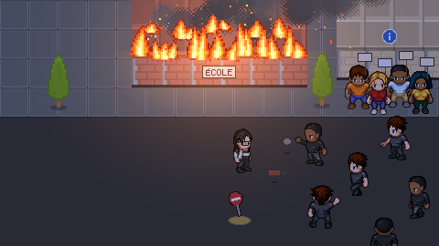

<p align="center">
  
</p>

<h1 align="center">BreakBreaker</h1>

<p align="center"><b>The neighbourhood is on fire. Paul has a rock, a lot of nerve and no day off.</b></p>

<p align="center">
  <a href="https://thlaure.github.io/BreakBreaker/"><b>▶ Play now</b></a> ·
  <a href="CHANGELOG.en.md">Changelog</a> ·
  <a href="ROADMAP.md">Roadmap</a> ·
  <a href="docs/SPECS%20-%20Index.md">Specs</a>
</p>

<p align="center">
  <a href="https://www.buymeacoffee.com/thomaslaure"></a>
</p>

<p align="center">
  <a href="https://github.com/thlaure/BreakBreaker/actions/workflows/ci.yml"></a>
  <a href="LICENSE"></a>
  
  
</p>

---

BreakBreaker is a free, top-down pixel-art arcade game that runs in your browser (phone included, no install). You play **Paul**: rioters are smashing up the district, fires are spreading, and it is your job to hold the line for as many rounds as you can. The game is available in **French** (default) and **American English**: two pixel flags at the top left of the landing page, and in the pause menu, switch the language, and the choice is remembered. The jokes are adapted for each language, not translated word for word. The code and docs are in English.

## Why it is fun

- **Chaos with rules.** Rounds get denser, buildings catch fire, and two emergencies at once will test you from round 5.
- **Smash, send rocks back, charge up.** Strike, return projectiles, fill the energy gauge, then unleash the energy wave or go full *furie*.
- **A district to protect.** Rebuild ruins with a toolbox, extinguish fires, rescue victims, defend the nursery, the town hall, the library and the kiosk.
- **Call for backup.** Phone booths summon the fire truck or the police, but they can be attacked too.
- **Seasonal events.** `src/events/` holds themes laid over the base game by date; Halloween (24 October to 2 November) turns some rioters into goofy zombies and decorates the map (`?event=halloween` or `?event=none` to force it).
- **A stage with a skeleton band.** A rock stage on the north-east of the map, an original riff that rises as you get close, and a singer fed up like everyone else.
- **A prison with a grudge.** Knocked-out Caïds get locked up. If the prison falls, they all walk out.
- **Slapstick KOs.** Every knock-out falls its own way, with the odd wildly over-the-top one.
- **Fiction only.** Everything is satire, Paul and everyone else are made up, and no real person is depicted.

## Play

Open **https://thlaure.github.io/BreakBreaker/** (or the English page at `/en/`) and hit *Jouer* / *Play*. Works with keyboard and mouse or touch.

## Controls

| Action | Keyboard / mouse | Touch |
| --- | --- | --- |
| Move | ZQSD, WASD or arrows | Joystick (left half of the screen) |
| Strike | Space or left click | Frapper button |
| Throw a rock back | E or right click (aim with the mouse) | Renvoyer button (tap = last aim, drag = aim) |
| Run | Shift | Push the joystick all the way |
| Onde d’énergie (gauge ≥ 50) | C (one press) | Onde button (one press) |
| Mode furie (full gauge) | R | Furie button |
| Pause | Esc | Pause button |

## Under the hood

Vite, TypeScript (strict), Phaser 4.2.1, Vitest. The game logic is a **deterministic 60 Hz fixed-step simulation** in `src/sim/` (no Phaser, no `Math.random`), so it is fully testable (900+ tests, including a seeded bot that plays whole sessions). Rendering and UI live in `src/game/` and only read snapshots of the simulation. The landing page ships no JavaScript at all.

## Scripts

```bash
npm install
npm run dev        # Vite dev server
npm run build      # production build into dist/
npm run preview    # preview the build
npm test           # vitest run (includes a production build check, in a temp folder)
npm run typecheck  # tsc --noEmit
npm run lint       # ESLint (a warning above 400 lines per file)
npm run format     # Prettier (CI checks with `npm run format:check`)
npm run assets     # download and assemble assets (LPC sprites, tiles, sounds) and regenerate public/CREDITS.md
npm run hero       # regenerate the landing hero src/site/hero.png from the game tiles and sprites (deterministic, offline)
npm run bench      # cost of one simulation step under load (40 rioters, 24 rocks in flight)
```

To test on a phone on the same Wi-Fi: `npm run dev -- --host`, then open the "Network" address.

## Contributing

Bug reports and ideas are welcome: see [CONTRIBUTING.md](CONTRIBUTING.md). The full game specification lives in [`docs/`](docs/SPECS%20-%20Index.md).

## Releases

Versions follow MAJOR.MEDIUM.MINOR: major = a big update that changes the game a lot, medium = new content, minor = fixes and polish. Each release updates `package.json`, `CONFIG.appVersion`, `CHANGELOG.md` and the specs.

## Credits and license

Sprites, tiles and sounds are free assets (notably LPC, CC-BY-SA 3.0 / GPL 3.0 / OGA-BY 3.0, and Kenney, CC0). Every author and license is listed in [`public/CREDITS.md`](public/CREDITS.md), generated by `npm run assets` from `scripts/credits-template.md`, and linked from the landing page footer and the in-game pause menu.

The code is released under the [MIT license](LICENSE). The assets are not covered by it: each keeps its own license (see credits above).
