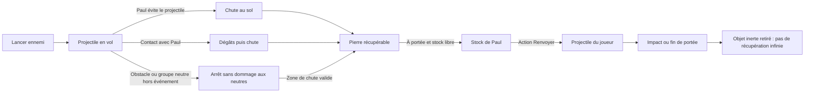
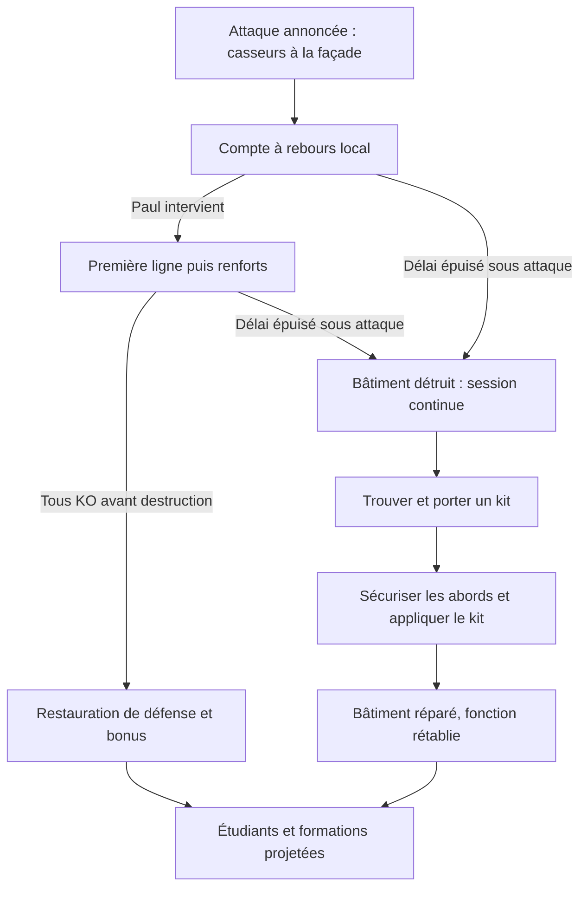

# BreakBreaker — Cahier des charges fonctionnel et technique

**Version :** 1.6 — 20 octobre 2026  
**Périmètre :** jeu web 2D en pixel art, vue du dessus non isométrique, mode arcade par manches sans limite de durée, Paris, Paul (commerçant fictif) comme héros unique, ordinateur et téléphone  
**Statut :** spécification de référence ; les décisions confirmées par le porteur du projet et les recommandations de conception sont identifiées. Une première tranche jouable existe (section 24) ; ce document ne constitue pas une validation de production ni une attestation que toutes les exigences sont déjà implémentées.  
**Langue de lancement :** français  
**Projet :** BreakBreaker

## Sommaire

1. [Vision et positionnement](#1-vision-et-positionnement)
2. [Exigences validées et décisions proposées](#2-exigences-validées-et-décisions-proposées)
3. [Périmètre et priorités](#3-périmètre-et-priorités)
4. [Parcours du joueur](#4-parcours-du-joueur)
5. [Carte, exploration et objectifs](#5-carte-exploration-et-objectifs)
6. [Paul, déplacement et caméra](#6-paul-déplacement-et-caméra)
7. [Commandes](#7-commandes)
8. [Combat, projectiles et groupes protégés](#8-combat-projectiles-et-groupes-protégés)
   - [8.7 Armes ramassables](#87-armes-ramassables)
9. [Personnages, hordes et intelligence artificielle](#9-personnages-hordes-et-intelligence-artificielle)
10. [Bâtiments menacés, défense et réparation](#10-bâtiments-menacés-défense-et-réparation)
11. [Objectif monument](#11-objectif-monument)
12. [Mode arcade, manches, événements, progression et soins](#12-mode-arcade-manches-événements-progression-et-soins)
13. [Score, compteur de casseurs neutralisés et bilan](#13-score-compteur-de-casseurs-neutralisés-et-bilan)
14. [Interface et accessibilité](#14-interface-et-accessibilité)
15. [Direction artistique et ressources pixel art](#15-direction-artistique-et-ressources-pixel-art)
16. [Son](#16-son)
17. [Choix techniques](#17-choix-techniques)
18. [Architecture logicielle et données](#18-architecture-logicielle-et-données)
19. [Performances et compatibilité](#19-performances-et-compatibilité)
20. [Stockage, chargement et diffusion](#20-stockage-chargement-et-diffusion)
21. [Validation et critères de recette](#21-validation-et-critères-de-recette)
22. [Production et livrables](#22-production-et-livrables)
23. [Extensions prévues](#23-extensions-prévues)
24. [Écart avec le prototype actuel](#24-écart-avec-le-prototype-actuel)
25. [Décisions restantes et sources](#25-décisions-restantes-et-sources)
26. [Landing page et accès au jeu](#26-landing-page-et-accès-au-jeu)

## 1. Vision et positionnement

### 1.1 Concept

Jeu web d’action arcade en **2D pixel art, vu du dessus, sans isométrie**, proche d’un hack-and-slash rétro. Le joueur incarne Paul, un commerçant de quartier fictif, représenté avec des cheveux longs, une tenue noire et une écharpe blanche qui le distingue des casseurs.

Il se déplace librement dans une carte parisienne fictive : places, école, monument et commerces. Des hordes de casseurs arrivent par plusieurs accès. Le joueur les combat au contact, à mains nues ou avec des armes ramassées dans les rues, évite leurs projectiles, peut récupérer certaines pierres tombées puis les renvoyer, défend l’école et reprend des drapeaux.

Des groupes de manifestants pacifiques occupent des parties de la carte. Ils ne sont pas des cibles pour Paul et doivent être contournés. Certains peuvent être menacés par des casseurs lors d’événements de secours. D’autres rencontres mettent en scène une personne ou un couple âgé victime de vol ou d’intimidation, à aider rapidement.

La session est découpée en manches : chaque manche fixe un nombre de casseurs à neutraliser et un à trois objectifs. La santé, les petits soins et la survie jusqu’au KO restent conservés. Aucun compte à rebours global et aucune victoire terminant automatiquement la session. Des comptes à rebours locaux indiquent en revanche le délai pour sauver un bâtiment ou intervenir auprès de personnes menacées. Un bâtiment détruit peut être restauré avec un kit trouvé sur la carte.

### 1.2 Promesse

« Se déplacer, repousser les hordes, ramasser des armes, renvoyer leurs pavés et tenir le quartier manche après manche, aussi longtemps que possible. »

Le plaisir repose sur le mouvement, la lecture des groupes, les coups, l’esquive par déplacement, le renvoi de projectiles, la défense des lieux et la gestion de la santé. La récupération d’objets est limitée et compréhensible ; aucun inventaire complexe.

### 1.3 Direction visuelle

Vue orthogonale du dessus, carte à axes horizontaux/verticaux, sprites et décors dessinés en pixels. De petits volumes dessinés et des faces de bâtiment peuvent améliorer la lisibilité, sans projection isométrique ni grille en losanges.

La référence GTA / The Division n’est plus une cible de rendu. La crédibilité vient désormais des détails reconnaissables, des animations, des réactions et du son, dans une représentation rétro cohérente.

### 1.4 Public et accès

Navigateur sur ordinateur et téléphone, sans compte ni installation obligatoire. Caméra automatique, commandes simples et version tactile. Le pixel art réduit certains besoins graphiques, mais ne dispense pas de limiter les hordes, les collisions et les effets ni de tester sur téléphone réel.

### 1.5 Paul, protagoniste unique

**Confirmé (révision 1.5) :** le héros est Paul, un commerçant de quartier entièrement fictif. Repères visuels : cheveux longs, vêtements noirs et un accent clair (écharpe ou bavoir blanc) qui le distingue des casseurs vêtus de sombre ; silhouette identifiable à la taille réelle du sprite. Aucun choix de sexe, de teint ou d’un autre héros.

Paul ne représente aucune personne réelle. Les missions parisiennes, les dialogues et les positions exprimées dans le jeu relèvent de la fiction. Aucun nom de famille, élément biographique ou référence de presse n’est associé au personnage.

## 2. Exigences validées et décisions proposées

### 2.1 Statut

- **Confirmé** : demandé explicitement par le porteur du projet.
- **Proposé** : solution concrète de conception à essayer.
- **Paramètre initial** : valeur d’équilibrage modifiable sans changer la vision.
- **Extension** : hors première version de diffusion.

La présente révision remplace la cible 3D. Les dernières demandes annulent la vue derrière l’épaule, la personnalisation et le chronomètre global. L’idée de murs ou de ruelles imposés a été retirée par l’utilisateur ; elle ne doit pas devenir une fonctionnalité à développer.

La révision 1.5 intègre des décisions **confirmées** : héros fictif Paul, barème égal pour tous les casseurs, compteur neutre « Casseurs neutralisés », frappe circulaire, soins appliqués au contact, armes ramassables, manches à effectif fixe et lancement direct depuis la landing. Les valeurs chiffrées associées restent des paramètres initiaux sauf mention contraire.

### 2.2 Exigences confirmées

| ID | Exigence |
| --- | --- |
| EX-01 | Jeu web, un joueur, ordinateur et téléphone, sans compte. |
| EX-02 | 2D pixel art, vue du dessus, non isométrique, action de type hack-and-slash rétro. |
| EX-03 | Déplacement libre sur la carte ; Paris pour la première version. |
| EX-04 | Paul, commerçant fictif, héros unique ; aucun écran de sélection d’apparence ; aucune référence à une personne réelle. |
| EX-05 | Trois variantes de casseurs : classique, drapeau palestinien, drapeau Antifa. Le drapeau est purement cosmétique : même barème (+1 au KO), mêmes rôles possibles. |
| EX-06 | Arrivée de hordes ; casseurs hostiles jusqu’au KO, sans reddition ni interpellation. |
| EX-07 | Combat au contact, à mains nues ou avec des armes ramassées ; aucune arme à feu, aucun tir d’arme à feu, aucun gore. |
| EX-08 | Projectiles ennemis de type caillou, pavé ou brique. |
| EX-09 | Possibilité de récupérer des projectiles et de les renvoyer contre les casseurs. |
| EX-10 | Groupes de manifestants pacifiques à éviter et non ciblables par Paul ; certains peuvent subir une menace ennemie et être secourus. |
| EX-11 | Étudiants, professeurs, policiers, pompiers, soignants et commerçants restent non ennemis. |
| EX-12 | Santé et petits soins conservés. |
| EX-13 | Session arcade sans durée limite, découpée en manches, poursuivie jusqu’au KO du joueur. |
| EX-14 | École à défendre : première ligne, vague, réparation, retour des étudiants et formations projetées. |
| EX-15 | Captures de drapeau sur des monuments, avec zone contestée et changement de drapeau. |
| EX-16 | Flèche et zone au sol pour les objectifs. |
| EX-17 | Chaque casseur KO ajoute une unité au compteur neutre « Casseurs neutralisés », sans doublon. |
| EX-18 | Score, record local, pause, arrêt volontaire et son après geste utilisateur. |
| EX-19 | Assez de contenu et de renouvellement pour plusieurs manches. |
| EX-20 | Délai local avant destruction d’un bâtiment attaqué, pour créer une urgence de défense. |
| EX-21 | Kits de réparation récupérables sur la carte et utilisables sur un bâtiment détruit. |
| EX-22 | Événements dynamiques de secours : manifestants agressés, personne ou couple âgé menacé ou dépouillé ; délai local d’intervention. |
| EX-23 | Déplacement libre, mais impossibilité de traverser les bâtiments, les troncs d’arbre et les obstacles solides. |
| EX-24 | Landing page publique simple donnant accès au jeu ; contenu et fonctionnement définis ici, direction visuelle traitée séparément avec Claude. |
| EX-25 | Armes ramassables apparaissant aléatoirement dans les rues ; chacune met un casseur KO en un coup, avec portée et nombre de coups propres ; aucune arme à feu (section 8.7). |
| EX-26 | Manches à effectif fixe : un nombre de casseurs à neutraliser et un à trois objectifs par manche, écran « Manche N terminée » et courte respiration entre deux manches (section 12.2). |
| EX-27 | Landing sobre (titre, accroche, boutons Jouer et Commandes, pied de page) avec visuel original ; règles et instructions affichées au lancement du jeu ; bouton « Commandes » (modale) sur la landing et dans le jeu (section 26). |

### 2.3 Propositions de départ

| Sujet | Proposition |
| --- | --- |
| Carte | Quartier unique, 48 × 48 tuiles de 32 pixels (1 536 × 1 536 pixels logiques) |
| Vue | Caméra qui suit Paul, orientation fixe et zoom entier |
| Déplacement | Huit directions, diagonales normalisées ; quatre orientations dessinées au minimum |
| Contact | **Confirmé :** frappe circulaire à 360° autour de Paul, les plus proches d’abord, jusqu’à trois casseurs, chacun touché une seule fois ; Paul se tourne vers le plus proche |
| Armes | **Confirmé :** armes ramassées en passant dessus, une tenue à la fois, KO en un coup, usure par coup utile (section 8.7) |
| Pierres | Ramassage automatique des pierres ennemies déjà tombées, stock maximal de trois |
| Renvoi | Action distincte, direction choisie ; pas de capture parfaite de projectile en vol en V1 |
| Manifestants | Non ciblables par Paul ; menace ennemie représentée par un état de détresse pendant un événement de secours |
| Objectifs | École, monument, boutique proposée pour varier les manches |
| Manches | **Confirmé :** manches à effectif fixe et un à trois objectifs ; progression des effectifs proposée en section 12.2, avec plafond de simulation |
| Soins | **Confirmé :** stations limitées appliquées au contact (+25) ; petits soins de terrain, sans régénération passive |
| Réparation après perte | Kit distinct des soins, un porté au maximum, interaction interrompable |
| Urgences | Un compte à rebours par incident, pas de fin de partie à son expiration |
| Technique | Retenu : Phaser 4.2.1, TypeScript, Vite et Vitest ; simulation pure séparée du rendu ; validation sur appareils réels |

Les seuils précis sont proposés, pas déjà validés par l’utilisateur, sauf mention « Confirmé ». La récupération au sol est une première interprétation de « récupérer pour renvoyer », plus accessible que l’interception en vol.

## 3. Périmètre et priorités

| Priorité | Contenu |
| --- | --- |
| P0 | Vue du dessus non isométrique, Paul unique, déplacement libre, hordes et trois variantes, frappe circulaire, armes ramassables, projectiles récupérables et renvoi, groupes pacifiques protégés, santé, soins, kits de réparation, urgences locales et secours, arcade par manches sans limite, école et capture, score, compteur de casseurs neutralisés, pause. |
| P1 | Pixel art abouti, boutique, nouvelles armes débloquées par manche (section 8.7), diversité d’assauts, repérage, accessibilité, optimisation et longue session sur téléphone réel. |
| P2 | Autres cartes/villes, dialogues complets, récupération de projectile en vol si utile, PWA. |

La cible de diffusion inclut P0 et P1. Contenu minimal proposé : un quartier, trois objectifs récurrents, trois variantes visuelles hostiles et deux comportements de combat (contact/lanceur), trois groupes pacifiques, deux points de soin, trois armes de contact et au moins quatre compositions d’assaut.

La carte doit pouvoir être parcourue librement, y compris entre deux objectifs. Les objectifs peuvent être activés progressivement pour l’apprentissage ; le joueur n’est pas enfermé dans une succession d’arènes fermées. La caméra ne doit pas tirer le joueur de force vers une mission.

Hors périmètre : 3D, isométrie, monde ouvert de grande taille, construction de murs, couloirs obligatoires, conduite, armes à feu, gore, multijoueur, compte et inventaire complexe.

Cible de variété : plusieurs situations différentes dans les dix premières minutes si le joueur survit, sans durée minimale ou maximale imposée.

## 4. Parcours du joueur

### 4.1 Accueil

Le site s’ouvre sur une landing page légère, distincte du jeu, volontairement sobre : titre, accroche, bouton « Jouer » (qui lance directement la partie) et bouton « Commandes » (modale des touches). **Confirmé (1.6) :** les règles et instructions de jeu ne sont pas sur la landing ; elles s’affichent au lancement du jeu (§26.4). Son contenu détaillé est défini en section 26. Aucun choix de sexe ou teint ; aucune limite globale de durée annoncée.

### 4.2 Entrée

**Confirmé :** « Jouer » ouvre `/jouer/?go`. La page du jeu affiche sa progression de chargement (moteur, sprites, tuiles, collisions, sons utiles et premiers adversaires), puis la partie démarre dès que les ressources indispensables sont prêtes, sans écran de départ. Le son se déverrouille à la première touche, au premier clic ou au premier toucher. Une visite directe sur `/jouer/` (sans `?go`) affiche l’écran des règles avec l’action « Commencer ». Caméra du dessus dès la prise de contrôle, pas de cinématique derrière l’épaule ni de modèle 3D.

La première école est indiquée, ainsi qu’un groupe pacifique et un soin proche. Les premières secondes permettent de se déplacer avant d’être pressé par une horde. Le premier compte à rebours de destruction est annoncé et tient compte du temps de trajet depuis le point de départ ; il n’attend pas obligatoirement que Paul entre dans le cercle. Le premier lanceur est introduit seul ou en petit nombre pour enseigner la récupération.

### 4.3 Boucle

Explorer → repérer un objectif / un soin / une arme → combattre ou contourner → esquiver et récupérer des pierres → les renvoyer → résoudre les objectifs et neutraliser l’effectif de la manche → écran « Manche N terminée » et respiration → nouvelle manche.

La réussite des objectifs n’arrête pas la session. Santé, score, KO, soins utilisés, stock porté et arme tenue persistent entre objectifs et manches, sous les règles de réapprovisionnement.

### 4.4 Fin

Santé à zéro : KO, bilan et Rejouer. Un arrêt volontaire reste accessible depuis Pause. Rejouer réinitialise tout l’état de la session, pas les préférences et records compatibles.

## 5. Carte, exploration et objectifs

### 5.1 Carte

Paris fictif en tuiles orthogonales : sol, places, rues ouvertes, bâtiments, école, monument, boutique, soins et emplacements de groupes pacifiques. Gabarit retenu pour la première tranche : 48 × 48 tuiles de 32 pixels, soit 1 536 × 1 536 pixels logiques, à ajuster aux essais.

La taille doit produire de vrais choix de trajet sans longues traversées vides. Deux objectifs proches peuvent être visibles dans des directions différentes. La première destination reste atteignable rapidement depuis le départ.

### 5.2 Déplacement libre

Pas de murs ajoutés comme mécanique, pas de labyrinthes de ruelles imposés. Les empreintes de bâtiments, les troncs d’arbre et les objets solides restent des obstacles cohérents. Paul ne peut pas les traverser ; le feuillage dessiné peut être au-dessus du personnage sans agrandir artificiellement la collision du tronc. Les limites de carte sont lisibles et les accès ne forment pas de pièges involontaires.

Aucun objectif ne doit avoir un seul passage pouvant être entièrement condamné par un groupe pacifique. Les points de soin, kits et zones de secours ont des accès praticables. La distance de parcours réelle est utilisée pour planifier un événement urgent, pas seulement la distance à vol d’oiseau. Les groupes laissent plusieurs possibilités de contournement ; ils ne constituent pas des refuges fermés invulnérables.

### 5.3 Couches

Sol ; détails de sol ; empreintes solides ; objets ; personnages ; parties hautes des bâtiments ; effets ; marqueurs d’objectifs ; HUD. Ordre de profondeur lié à la position des pieds pour les éléments qui se chevauchent.

Les toits ou parties hautes qui masquent Paul deviennent transparents ou disparaissent localement. La collision d’un bâtiment suit son empreinte, pas toute la hauteur dessinée du sprite.

### 5.4 États

École dégradée/en feu, reconstruction, ouverte, perdue puis éventuellement reconquise. Monument occupé, contesté, capturé, réoccupé. Boutique bloquée, dégagée, ouverte. Soins chargés/épuisés ; armes au sol ; groupes pacifiques toujours reconnaissables.

Chaque nouvel assaut est annoncé et identifié ; les bonus ne sont pas rejoués par un changement purement graphique. Un bâtiment détruit reste en ruine tant qu’aucun kit n’a été appliqué ; une transition de manche ne le répare pas gratuitement.

## 6. Paul, déplacement et caméra

### 6.1 Héros

Sprite de Paul aux cheveux longs et vêtements noirs, avec un accent clair (écharpe ou bavoir blanc), lisible dans quatre orientations au minimum. Accent clair, silhouette, animation et contour doivent permettre de le distinguer des casseurs classiques également vêtus de couleurs sombres.

Sprite retenu : personnage composé à partir des spritesheets Universal LPC, cellules de 64 × 64 pixels pour une silhouette visible d’environ 32 × 48, avec variantes d’animation et accessoires séparés. Les pieds définissent l’ancrage et la petite zone de collision au sol.

### 6.2 Déplacement

Huit directions libres. Gauche déplace à gauche de la carte, haut vers le haut, indépendamment de l’orientation précédente. Le schéma 3D « gauche fait tourner le nez » est remplacé. Les diagonales sont normalisées pour ne pas accélérer.

Valeurs initiales proposées, adaptées aux tuiles de 32 pixels : 180 pixels logiques/seconde en déplacement, 250 en course. La vitesse exacte reste à équilibrer. Arrêt rapide et léger lissage, sans inertie qui empêche d’esquiver un caillou.

Pas de saut, de roulade ou de barre d’endurance indispensable en V1. L’esquive demandée repose d’abord sur le déplacement. Une roulade éventuelle est une extension, pas une condition implicite de la jouabilité.

### 6.3 Caméra

Caméra du dessus à orientation fixe, centrée avec une petite zone morte. Aucun contrôle de rotation et aucune perspective isométrique. Le suivi est fluide mais arrondi au pixel au rendu pour préserver la netteté ; le zoom de caméra est toujours entier.

La visibilité autour du héros doit laisser le temps de lire une préparation de lancer. Un indicateur de menace peut annoncer un lanceur hors écran ; un projectile ne doit pas atteindre Paul sans signal ou délai suffisant.

Adaptation paysage/portrait par cadrage et zones de HUD, sans étirer les sprites. Le changement d’orientation ne fait pas apparaître d’ennemis à portée immédiate et ne modifie pas leur vitesse.

## 7. Commandes

| Action | Ordinateur | Téléphone | Manette, si retenue |
| --- | --- | --- | --- |
| Déplacer | ZQSD, WASD ou flèches | Joystick gauche | Stick gauche |
| Viser / orienter | Souris ; repli vers dernière direction de mouvement | Direction du mouvement, ou glisser depuis Renvoyer pour viser | Stick droit, repli vers déplacement |
| Frapper (frappe circulaire autour de Paul) | Espace ou clic principal, remappable | Bouton Frapper | Bouton principal |
| Renvoyer une pierre portée | E ou clic secondaire, remappable | Bouton Renvoyer ; relâcher après visée si mode glisser | Bouton secondaire |
| Ramasser une pierre au sol | Automatique à portée si stock disponible | Automatique | Automatique |
| Ramasser une arme | Automatique en passant dessus ; remplace l’arme tenue | Automatique | Automatique |
| Se soigner à une station | Automatique en passant sur une station chargée | Automatique | Automatique |
| Agir : aider une victime / réparer / rideau | F | Bouton contextuel nommé | Bouton d’action |
| Courir | Maj, maintien ou bascule | Bouton ou seuil du joystick selon essai | Bouton ou pression stick |
| Pause / arrêter | Échap / menu | Bouton Pause | Menu |

Le clic secondaire n’est pas obligatoire : une touche doit permettre de renvoyer sans dépendre d’un menu contextuel. Sur téléphone, une pression simple renvoie vers la dernière direction de visée ; le glissement permet une direction plus précise. La visée ne concerne que le renvoi : la frappe est circulaire. Aucune frappe sur un groupe pacifique ne peut être déclenchée par une aide au ciblage. Agir ne sert plus à se soigner (section 12.6).

Options : remappage, sensibilité de visée, maintien/bascule pour frapper, courir et Agir, désactivation du glissement de visée si gênant. L’option d’assistance de renvoi ne sélectionne que des casseurs actifs visibles et ne traverse pas un groupe ou un obstacle.

Les pointeurs tactiles du joystick et des actions sont indépendants. Une annulation, un menu ou une perte de focus relâche tous les boutons. Les commandes ne déclenchent ni zoom de page, ni défilement, ni sélection de texte.

## 8. Combat, projectiles et groupes protégés

### 8.1 Contact

Hack-and-slash de proximité. **Confirmé : frappe circulaire.** Chaque coup touche tout autour de Paul (360°) les casseurs actifs à portée, les plus proches d’abord, au plus trois par attaque ; Paul se tourne vers le plus proche des casseurs touchés. Portée à mains nues : 56 pixels logiques (tuiles de 32 pixels). Cadence proposée : un coup toutes les 0,45 seconde. Chaque cible ne reçoit qu’un contact par identifiant de coup. Une arme tenue remplace la portée et met KO en un coup (section 8.7).

À mains nues, la résistance commence à deux coups, puis certains ennemis renforcés clairement signalés peuvent demander jusqu’à quatre points de dégâts. Le premier coup ne provoque jamais de reddition.

Les contacts sont synchronisés aux images utiles de l’animation. Recul court, réaction et flash d’impact lisible sans sang. Les corps KO ne sont plus ciblables, ne bloquent pas le passage et ne rapportent plus de points.

### 8.2 Lanceurs ennemis

Le rôle « lanceur » est indépendant de la variante visuelle : un casseur classique ou à drapeau peut lancer une pierre. Aucun drapeau n’attribue automatiquement une statistique supérieure.

Objets : caillou, pavé, brique. En V1, ils peuvent partager les mêmes valeurs de dégâts avec des sprites différents. Pas de bouteille incendiaire, explosif ou arme à feu ajouté implicitement.

Chaque lancer possède une préparation, une direction/zone annoncée et un délai de trajet. Paramètres de départ : préparation d’au moins 0,6 seconde ; portée 280 à 360 pixels ; trajet d’au moins 0,5 seconde sur une cible éloignée ; 5 PV perdus par impact au départ. Un intervalle individuel empêche le tir continu.

Un petit arc visuel et une ombre peuvent représenter la trajectoire, mais la collision est calculée dans le plan 2D. Le point d’impact ou la trajectoire est visible avant les dégâts. Les lancers hors écran nécessitent un avertissement et ne sont pas autorisés à très courte distance sans préparation.

### 8.3 Cycle de récupération et renvoi



Proposition V1 : récupération des **projectiles ennemis au sol**, pas interception en vol. Ramassage automatique dans un rayon d’environ 28 pixels, seulement s’il reste une place. Un projectile en vol ne peut pas être ramassé.

Stock maximal : trois objets. Stock plein : l’objet reste au sol. Le nombre porté est visible. Aucun achat, fabrication ou inventaire à ouvrir.

Renvoyer consomme un objet porté, crée un projectile appartenant au joueur et suit la direction choisie au lancement. Aucun guidage automatique une fois en vol. Paramètres initiaux : un point de dégât, portée d’environ 360 pixels et intervalle de 0,5 seconde. Un seul casseur touché, pas de ricochet en chaîne en V1.

Après un renvoi, l’objet devient inerte à son prochain contact ou en fin de course et est retiré ; il n’alimente pas une boucle de ramassage infinie. Seules les nouvelles pierres ennemies produisent des objets récupérables. La collision avec Paul du projectile qu’il vient de renvoyer est désactivée.

### 8.4 Règles d’impact

| Source | Cible | Effet |
| --- | --- | --- |
| Contact du joueur | Casseur actif | Dégâts et éventuellement KO ; KO immédiat avec une arme |
| Pierre ennemie en vol | Paul | Dégâts, puis chute récupérable en zone valide |
| Pierre renvoyée | Casseur actif | Dégâts ; score seulement si KO |
| Coup / pierre de Paul | Groupe pacifique ou victime à secourir | Aucun dégât, aucun KO, aucune unité au compteur de casseurs neutralisés |
| Attaque d’un agresseur affecté à un secours | Victime de cet événement | Réduit le délai / la jauge de détresse de cet événement, sans gore |
| Attaque ennemie ordinaire hors secours | Groupe pacifique | Pas de dégâts de foule non scénarisés ni d’événement silencieux |
| Pierre en vol | Obstacle solide | Arrêt ; chute ou retrait selon espace disponible |
| Pierre renvoyée | Corps KO | Pas de nouveau score ; ne sert pas de cible active |

Le KO a le même barème quelle que soit l’origine des dégâts de Paul : mains nues, arme ou renvoi. Aucun bonus supplémentaire pour un projectile ou une arme.

### 8.5 Groupes pacifiques protégés

Les manifestants sont regroupés, avec pancartes et animation calme. Le ciblage, la frappe circulaire et le renvoi de Paul les excluent : un manifestant dans le rayon de frappe n’est ni touché ni compté parmi les trois cibles. Ils ne possèdent pas de transition de KO infligée par le joueur. Pendant un secours identifié, un sous-ensemble du groupe ou une victime désignée peut passer en détresse sous la menace des agresseurs affectés à cet événement.

Les groupes occupent un espace identifiable à contourner. Leurs positions ne peuvent pas bloquer entièrement un objectif, une sortie ou un soin. Le joueur ne peut pas les déplacer ou les disperser à coups. Les ennemis doivent également pouvoir les contourner.

Un projectile de Paul qui rencontre le volume protégé du groupe est arrêté sans blessure. Un projectile ennemi ordinaire suit aussi cette protection ; seule une attaque explicitement affectée à un secours peut faire avancer sa menace. Une chute récupérable exige une position libre hors du groupe ; sinon l’objet est retiré. Les pierres renvoyées arrêtées deviennent inertes. Les sprites neutres ne servent pas à masquer un casseur intouchable : ordre d’affichage, navigation et trajectoires doivent être vérifiés.

L’intérêt d’éviter les groupes vient du déplacement et des lignes de renvoi, pas de dégâts infligés par Paul aux manifestants. Il faut distinguer cette protection permanente contre le joueur de la détresse provoquée par des ennemis dans un secours annoncé. Aucun score positif ou négatif de « frappe sur manifestant » n’est déclenché, puisque ces contacts sont exclus. Les pénalités héritées restent applicables aux autres personnes protégées si elles sont touchables ; une extension d’invulnérabilité à tous les neutres reste possible, à décider explicitement.

### 8.6 Santé

100 PV au départ, pas de régénération passive en normal. Contacts et projectiles peuvent réduire la santé. Brève invulnérabilité après impact, proposée à 0,6 seconde, pour éviter des dégâts simultanés illisibles. Un projectile ne produit qu’un événement de dommage par trajectoire.

La progression des dégâts est plafonnée comme celle des assauts. Les soins décrits en section 12 sont conservés. Le KO du héros reste la seule défaite globale.

### 8.7 Armes ramassables

**Confirmé (EX-25) :** des armes apparaissent au hasard dans les rues. Elles remplacent l’ancienne extension « accessoires de contact ». Aucune arme à feu, y compris humoristique, et aucun gore.

| Règle | Valeur |
| --- | --- |
| Emplacement d’apparition | Point libre et praticable, à 160–480 pixels logiques de Paul, hors groupe pacifique et hors obstacle |
| Rythme | Première arme après environ 10 secondes, puis une toutes les 15 à 25 secondes |
| Plafond au sol | Deux armes au maximum ; au-delà, aucune apparition ni réserve invisible |
| Ramassage | Automatique en passant dessus ; la nouvelle arme remplace l’arme tenue, qui disparaît |
| Effet | Toute arme met un casseur KO en un coup, y compris un casseur renforcé ; portée propre à chaque arme ; frappe toujours circulaire, trois cibles au maximum |
| Usure | Seul un coup touchant au moins un casseur consomme une charge ; à zéro, l’arme se brise et Paul revient à mains nues (56 pixels) |
| Manches | L’arme tenue et ses coups restants sont conservés d’une manche à la suivante |

Armes de contact actuelles (**Confirmé**, valeurs en paramètre initial) :

| Arme | Portée | Coups |
| --- | ---: | ---: |
| Bâton | 72 pixels | 15 |
| Marteau | 64 pixels | 8 |
| Panneau de signalisation | 96 pixels | 10 |

Présentation : une arme au sol flotte, oscille et brille pour être repérée ; l’arme tenue tourne sur elle-même à chaque coup. Le HUD affiche « Arme : <nom> (<coups>) » ou « Arme : mains nues ». Le score d’un KO à l’arme est identique à celui d’un KO à mains nues ou par renvoi.

**Nouvelles armes débloquées par manche — Proposé, tranche 2 :**

| Arme | Comportement proposé | Disponibilité |
| --- | --- | --- |
| Gant de boxe à ressort | Coup de poing à distance en ligne droite ; KO et repoussement du premier casseur touché ; environ 6 tirs | Débloqué par la progression des manches |
| Kamehame | Vague d’énergie de dessin animé : maintenir environ 1 seconde pour charger, Paul immobile pendant la charge ; le rayon met KO tous les casseurs sur la ligne ; 2 utilisations | Rare |
| Bouclier | Bloque les pierres venant de face (elles tombent et deviennent récupérables) et frappe en poussant lors d’un coup ; dure environ 20 secondes | Débloqué par la progression des manches |

Ton cartoon, aucune arme à feu, aucun gore. Équilibrage : les armes puissantes restent rares et sont associées à l’arrivée de casseurs plus résistants. Les rayons et coups à distance respectent la protection des groupes pacifiques et des victimes (section 8.5) : ils s’arrêtent sur leur volume sans les blesser.

## 9. Personnages, hordes et intelligence artificielle

### 9.1 Catégories visuelles

| Catégorie | Fonction | Score et compteur « Casseurs neutralisés » |
| --- | --- | --- |
| Casseur classique | Contact, dégradation ou lancer selon rôle | +1 point et +1 au compteur au KO |
| Casseur avec drapeau palestinien | Même familles de rôles, drapeau distinct | +1 point et +1 au compteur au KO |
| Casseur avec drapeau Antifa | Même familles de rôles, drapeau distinct | +1 point et +1 au compteur au KO |
| Groupe de manifestants pacifiques | Groupe neutre à contourner et protéger ; secours possible si menacé | Jamais |
| Victime individuelle ou couple âgé | Vol/intimidation pendant un événement de secours, jamais adversaire | Jamais |
| Étudiants / professeurs | Présence pacifique et retour à l’école | Jamais |
| Police / pompiers / soignants / commerçants | Présence et fonctions protégées | Jamais |

Les teints des PNJ varient dans toutes les catégories. La tenue, la pancarte ou le drapeau ne remplace pas la logique d’entité et son comportement hostile ou neutre. **Confirmé :** le drapeau est purement cosmétique ; il ne modifie ni le score, ni le compteur, ni les statistiques.

### 9.2 Rôles d’ennemis

- Contact : rejoint Paul, prépare puis frappe à portée.
- Dégradeur : rejoint une façade tant que l’objectif est actif, puis change de cible si elle est perdue.
- Lanceur : cherche une distance de lancer et une ligne lisible, prépare puis projette ; revient au contact si nécessaire.

La première manche enseigne le contact seul ; les lanceurs apparaissent à partir de la manche 2 (section 12.2). Une horde mélange ensuite les rôles. Aucun état de reddition, de fuite comptée comme victoire ou de disparition donnant gratuitement un KO.

### 9.3 Hordes et pression

Les hordes sont plus nombreuses que dans la version 3D prévue. Dans une manche, les casseurs entrent un par un (1,5 seconde d’écart) avec au plus douze casseurs de manche sur la carte à la fois ; les suivants attendent dans une file d’entrée. Le plafond technique reste de quarante hostiles actifs, agresseurs d’événements compris, à valider par les budgets mobile. Ce plafond reste une règle commune aux qualités graphiques, pas un nombre réduit automatiquement sur les appareils lents.

Le directeur limite les préparations d’attaques simultanées : au départ deux frappes de contact et deux lancers ; augmentation progressive plafonnée à quatre contacts et quatre lancers en préparation. Les autres ennemis approchent, se repositionnent ou dégradent. Le total de projectiles en vol est plafonné séparément.

### 9.4 Navigation

Grille orthogonale, empreintes de bâtiments et volumes de groupes pacifiques. Évitement local et partage des chemins ou champs de direction pour ne pas recalculer une recherche complète pour chaque ennemi à chaque image.

Partition spatiale pour voisinage, contacts et projectiles. Aucun parcours quadratique de toute la foule à chaque image comme solution de production. Les apparitions sont hors du champ proche, dans un emplacement libre, jamais au milieu d’un groupe pacifique.

Une horde ne doit pas bloquer définitivement son propre trajet. Un agent coincé recalcule ou rejoint une autre cible valide ; pas de téléportation visible près de Paul.

### 9.5 Groupes pacifiques

Trois groupes proposés sur la carte, de six à huit sprites chacun, sur des emplacements non obligatoires. Déplacements lents de groupe possibles après validation, sans couper brutalement la seule voie d’esquive.

Leurs pancartes et leur densité les distinguent des hordes. Ils restent neutres même quand Paul passe près ou se fait poursuivre. Un événement peut les faire appeler à l’aide ou se replier ; ils ne deviennent pas hostiles et ne sont pas exposés à des dégâts libres de Paul. Ils ne nourrissent pas les systèmes de butin, de soins ou de score de KO.

## 10. Bâtiments menacés, défense et réparation

### 10.1 Boucle de l’école



### 10.2 Alerte et délai local

L’école est dégradée et en feu. La première occurrence présente trois casseurs, un de chaque variante, puis huit renforts après leur défaite ; ces casseurs comptent dans l’effectif de la manche (section 12.2). Flèche, cercle rouge, icône sur la carte et compte à rebours rendent l’urgence visible même avant l’arrivée de Paul.

Le délai commence quand au moins un casseur affecté à cet incident dégrade réellement un point valide de la façade. Il ne commence pas pendant son trajet ni au simple chargement de la carte. Il ne dépend plus de l’entrée initiale du joueur dans le cercle.

Proposition de départ : **30 secondes d’attaque effective avant destruction**, à ajuster après essai. Le directeur peut choisir un délai plus long si le trajet et la difficulté le nécessitent. Le premier incident a un délai calculé pour permettre l’apprentissage, pas une période invulnérable qui ne commencerait qu’au contact du héros.

### 10.3 Source de vérité du compte à rebours

Pour éviter une jauge de vie et un timer contradictoires, la V1 proposée utilise une seule réserve de temps de résistance :

`tempsRestant = max(0, tempsRestant - tempsActifDeDégradation)`

Elle décroît à une seconde par seconde lorsqu’au moins un casseur de cet incident est en dégradation valide. Elle se suspend si personne ne peut dégrader : casseurs interrompus, éloignés ou neutralisés. Elle ne se réinitialise pas quand Paul quitte la zone. Augmenter le nombre de casseurs ne multiplie pas silencieusement la vitesse du timer ; la pression se règle par composition ou délai initial annoncé.

La dégradation valide est un état continu à portée de façade, couvrant le cycle d’animation des coups ; elle ne se limite pas à l’image où la main touche le mur.

La jauge d’intégrité éventuelle est dérivée de cette réserve : `100 × tempsRestant / duréeInitiale`. Le HUD affiche donc un délai exact dans ces conditions, pas une seconde horloge indépendante. Les anciens dégâts continus de façade de 0,25 / 0,45 point par seconde ne sont plus la règle cible.

À zéro sous attaque valide : bâtiment détruit. Résoudre une seule fois la perte, attribuer −3 pour l’école et retirer le bonus de sauvetage. Paul peut poursuivre la session. Les casseurs survivants changent de cible au lieu de frapper une ruine sans fin.

### 10.4 Première ligne et renforts

L’entrée du cercle déclenche la confrontation, pas le début du danger. Les KO obtenus avant l’entrée sont conservés. Aucun agent ne réapparaît à cause d’une sortie/rentrée.

Après la première ligne entièrement KO, une courte cinématique peut annoncer les huit renforts. Pendant cette présentation suspendue, le compte à rebours et tous les autres incidents sont également suspendus. Passer la séquence ne double pas la vague.

Si le bâtiment a déjà été détruit, cette occurrence ne crée pas sa vague de défense en retard. Les survivants restent à traiter, mais la voie de résolution devient la réparation par kit.

### 10.5 Sauvetage avant destruction

Tous les adversaires requis KO et réserve strictement positive : restauration de défense, extinction du feu, retrait des dégradations et retour du drapeau français. Bonus d’école +8 une seule fois pour cette occurrence ; aucun kit consommé.

Séquence de présentation proposée : trois secondes, passée possible. Aucun dégât ni autre compte à rebours local ne progresse pendant elle. C’est une récompense pour l’intervention à temps.

### 10.6 Kits après destruction

Un bâtiment détruit peut être réparé grâce à un **kit de réparation** trouvé sur la carte. Il est distinct des soins médicaux : icône de caisse à outils, couleur et compteur séparés. Il ne rend pas de santé à Paul.

Proposition de stock : un kit porté maximum, deux kits placés sur des emplacements libres au début de chaque manche. Un kit déjà porté peut être conservé entre manches ; la carte ne dépasse pas deux kits présents. Aucun stock supplémentaire invisible. Le premier incident détruit doit laisser un kit accessible si les réserves de cette manche n’ont pas toutes été utilisées.

Un kit plein ne disparaît pas si Paul marche dessus alors qu’il en porte déjà un. Les emplacements sont accessibles sans traverser bâtiment, tronc ou groupe ; pas de kit bloqué dans la ruine à réparer.

Pour appliquer : proximité d’un point de façade, abords immédiats sécurisés, Agir pendant environ trois secondes. Le déplacement, une attaque reçue ou le retour d’un casseur actif à proximité interrompt la pose. Durée et rayon de sécurité sont des paramètres ; proposition de rayon 64 pixels logiques.

Le kit n’est consommé qu’à la validation complète. Interruption : aucun gain, aucun kit consommé, progression d’application remise à zéro. Bâtiment déjà intact : aucune consommation.

### 10.7 Résultat d’une réparation

Le bâtiment revient à l’état restauré et sa fonction reprend. L’école peut de nouveau recevoir des étudiants. Proposition : +5 pour la réparation tardive, sans effacer la pénalité −3 déjà subie. Ne pas attribuer en plus le bonus de sauvetage +8 : sauver avant destruction reste mieux récompensé.

Une réparation ne recrée ni la vague déjà perdue ni une nouvelle occurrence d’assaut. Chaque bâtiment conserve la référence de son dernier incident détruit et de sa réparation validée pour empêcher le double bonus. Une nouvelle attaque ultérieure est annoncée et identifiée séparément.

Les ruines persistent entre manches jusqu’à réparation, au lieu de se reconstruire gratuitement au changement de numéro. Leur empreinte reste solide pour la navigation. Un objectif déjà détruit peut être proposé comme mission de réparation ; on ne dégrade pas une ruine avec un nouveau timer.

### 10.8 Étudiants et formations

Après sauvetage ou réparation, quatre étudiants puis de petits groupes peuvent rejoindre la porte. Chaque entrée produit une seule formation projetée, ingénieur ou scientifique. Pas de points de classement par attente. Au plus cinq étudiants en déplacement.

Les arrivées se suspendent si l’école est attaquée ou détruite. Les compteurs déjà obtenus ne sont pas effacés. Une réparation les fait reprendre sans remettre à zéro l’historique de session.

## 11. Objectif monument

### 11.1 Présentation

Monument en pixel art inspiré de Victor Hugo, avec silhouette reconnaissable, socle, plaque et mât. Quartier et implantation fictifs. Le premier état porte un drapeau palestinien.

Le monument entre dans la progression à la manche 4 proposée (section 12.2). Lors de sa première apparition, l’épisode école de la manche doit être résolu avant son activation, qu’il soit réussi ou perdu. Une perte de l’école ne bloque donc pas la session à vie. Lors des manches suivantes, le directeur peut varier l’ordre des objectifs.

### 11.2 Déclenchement

La première entrée dans une zone activée déclenche six défenseurs lors de la première occurrence : deux de chaque variante. Une nouvelle entrée ne recrée pas de défenseur. Les apparitions sont hors du cercle, hors obstacles et hors distance de frappe immédiate du joueur.

### 11.3 Capture locale

La capture conserve une durée locale de référence de 12 secondes. Ce n’est pas une limite de partie : aucun temps global n’est en train de s’épuiser.

| Situation | Progression |
| --- | --- |
| Objectif non actif | Verrouillée |
| Joueur hors cercle | Suspendue, valeur conservée |
| Joueur dans le cercle avec un défenseur actif à l’intérieur | Suspendue : « Zone contestée » |
| Joueur dans le cercle sans défenseur actif à l’intérieur | Avance |
| 12 secondes atteintes, défenseur encore actif hors cercle | Attente de sa mise au sol |
| 12 secondes atteintes, tous les défenseurs KO et joueur présent | Capture réussie |

Les personnes protégées et les corps KO ne contestent pas. La règle utilise les états et positions de gameplay, pas la visibilité d’un modèle.

### 11.4 Résolution et réoccupation

Remplacement visible du drapeau palestinien par le français, son de confirmation, +10 proposé une seule fois par occurrence. La session continue immédiatement après une courte célébration facultative.

Le monument reste acquis jusqu’à une nouvelle réoccupation annoncée dans une manche ultérieure. Cette nouvelle occurrence a son propre identifiant, ses défenseurs et sa jauge. Pas de changement de drapeau arbitraire hors événement de gameplay. Un retrait du joueur avant la fin ne crée ni défaite globale ni réapparition gratuite des défenseurs.

## 12. Mode arcade, manches, événements, progression et soins

### 12.1 Règle centrale

**Aucune durée limite de session. Aucun compte à rebours global. La session se poursuit jusqu’au KO du héros.** La session est découpée en manches (section 12.2). Réussir l’école, le monument ou une manche augmente le score et renouvelle le contenu, sans réinitialiser la santé et sans afficher une victoire finale. Un objectif échoué ne termine jamais la session : seul le KO de Paul y met fin.

Les délais de frappe, la destruction d’un bâtiment attaqué, la détresse d’un secours, les cinématiques, la capture et les interactions ont des durées locales. Une mesure de durée de survie peut apparaître au bilan, en temps écoulé, sans pression de compte à rebours.

### 12.2 Structure des manches

**Confirmé :** les manches remplacent les vagues sans fin comme structure cible. Une manche fixe un nombre de casseurs à mettre KO et un à trois objectifs. Elle se termine quand tout son effectif a été neutralisé et que ses objectifs sont résolus, réussis ou perdus. Un objectif échoué ne termine jamais la session ; seul le KO de Paul y met fin.

Entre deux manches : écran de bilan « Manche N terminée » (KO, objectifs réussis ou perdus, points gagnés), recharge des stations de soin, courte respiration sans nouvel assaut, puis annonce de la manche suivante. Le joueur conserve sa santé, son score, ses KO, ses formations, son stock de pierres, son kit porté, son arme tenue avec ses coups restants et son historique de soins.

Les casseurs affectés aux objectifs (première ligne, renforts, défenseurs, agresseurs de secours) font partie de l’effectif de la manche. Une réparation optionnelle d’un bâtiment déjà perdu n’empêche pas la transition. Les secours déjà déclenchés doivent être résolus ou reportés explicitement avec leur état ; ils ne disparaissent pas gratuitement au changement de manche. La boutique, détaillée en section 23, fait partie de la cible de diffusion et s’insère dans le mélange des manches suivantes.

Progression proposée (valeurs **Proposé**, à équilibrer) :

| Manche | Casseurs à neutraliser | Objectifs et nouveautés |
| --- | ---: | --- |
| 1 | 10 | École ; casseurs au contact uniquement |
| 2 | 14 | École et secours ; apparition des lanceurs |
| 3 | 18 | Deux urgences simultanées ; nouvelle arme |
| 4 | 22 | Ajout du monument ; casseurs renforcés |
| 5 et suivantes | +4 par manche, plafonné vers 40 grâce à la file d’entrée | Mélange aléatoire pondéré des objectifs ; une nouvelle arme ou un nouveau type d’ennemi toutes les deux manches |

Déroulement interne proposé : les casseurs entrent un par un, à 1,5 seconde d’intervalle, avec au plus douze casseurs sur la carte à la fois ; les suivants attendent dans une file d’entrée. Une vague regroupe des entrées consécutives et six secondes de repos séparent deux vagues. La première vague ne comporte aucun lanceur.

Préparer au moins quatre compositions d’assaut et plusieurs points d’apparition. Aucun nouvel objectif ne doit se déclencher pendant une cinématique suspendue. Les respirations entre vagues et entre manches sont des délais locaux ; elles n’imposent pas un chronomètre de partie.

### 12.3 Directeur de pression

Le directeur suit la manche, les vagues, les objectifs résolus, les KO, la file d’entrée et les agents actifs. La difficulté augmente avec la progression, pas uniquement avec le temps passé à attendre dans un coin.

Proposition de niveau de pression : `P = min(12, 1 + floor(vague / 2) + floor(KO / 30))`, où `vague` est le nombre de vagues lancées depuis le début de la session. Elle remplace la formule de la révision 1.4 et reste un point de départ à tester. Elle rend le combat d’adversaires additionnels progressivement plus dangereux, même si le joueur retarde un objectif.

Les paramètres augmentent par paliers avec plafonds : nombre total de renforts par épisode, variantes de comportement, rapidité de décision, résistance de certains casseurs et dégâts. La vitesse d’animation ne doit jamais supprimer la lisibilité de la préparation d’attaque.

| Paramètre | Départ normal proposé | Plafond proposé |
| --- | --- | --- |
| Santé joueur | 100 | 100, sans hausse automatique par manche |
| Coups nécessaires par casseur | 2 à mains nues ; 1 avec une arme | 4 à mains nues pour les adversaires renforcés clairement signalés ; toujours 1 avec une arme |
| Préparations simultanées contre le héros | 2 contacts + 2 lancers | 4 contacts + 4 lancers, avec fenêtres lisibles |
| Dégâts par attaque ennemie | 5 | 12 |
| Intervalle individuel d’attaque | 1,8 s | Pas moins de 1,2 s ; préparation toujours visible |
| Casseurs de manche sur la carte | Entrée un par un toutes les 1,5 s | 12 à la fois ; plafond technique de 40 hostiles actifs, agresseurs compris |
| Étudiants en déplacement | Jusqu’à 5 | 5 |

Les augmentations de dégâts ou de résistance sont annoncées par l’apparence, le statut ou la jauge, sans bonus aléatoire incompréhensible. Les statistiques des rôles renforcés sont une variation de difficulté séparée. Les rôles de lanceur ou de dégradeur sont indépendants de la variante visuelle.

Un plafond d’agents est un plafond de calcul, pas une fin d’assaut : le directeur garde des renforts en file d’entrée et les fait entrer après libération d’une place. Les agents survivants d’un objectif perdu occupent ces places. Aucun adversaire actif ne doit être supprimé silencieusement pour résoudre le problème.

### 12.4 Anti-stagnation

Le joueur peut quitter un objectif, mais pas attendre indéfiniment dans un refuge invulnérable en gagnant des points ou des soins. Les ennemis actifs poursuivent le héros selon leur rôle. En cas d’inaction prolongée sans ennemi actif, le directeur peut annoncer une petite patrouille après un délai local de 20 à 30 secondes, sous le même plafond d’agents.

La patrouille n’entraîne ni gain de points gratuit ni soin automatique. Les KO augmentent la pression. Les bonus d’objectifs restent liés à des occurrences uniques, pas au fait d’entrer et sortir d’un cercle.

### 12.5 Santé et petits soins

Santé maximale : 100. Aucune régénération passive automatique en normal. Le joueur doit repérer et atteindre des soins. Chaque ressource est un état de gameplay persistant pour la session, pas un effet qui réapparaît à chaque visite.

Deux points de soin sont proposés dans le quartier : trousse près d’un poste de secours et armoire ou trousse dans une arrière-boutique. Ils sont signalés par un pictogramme médical accompagné d’un texte. Leur implantation laisse une voie de retrait sans garantir l’absence d’ennemis.

| Ressource proposée | Effet | Stock / obtention |
| --- | --- | --- |
| Point de soin | +25 PV appliqués au contact, sans dépasser 100 | Une charge par point et par manche, deux points au départ |
| Petit soin de terrain | +10 PV | Un soin après chaque tranche de 8 KO éligibles ; au plus deux au sol |
| Réapprovisionnement de manche | Restaure les charges des deux points de soin | Une fois à la fin de la manche, pas au simple retour au point |

Les quantités sont à équilibrer. Les deux points ne donnent pas un soin complet ; la santé n’est pas remise à 100 après un objectif ou une manche.

### 12.6 Soin au contact

**Confirmé :** marcher sur un point de soin chargé applique immédiatement +25 PV, plafonnés à 100, et consomme sa charge de la manche. Aucune touche, aucun maintien, aucune interruption possible. La charge et le gain de santé sont appliqués ensemble, une seule fois, par identifiant de charge.

À pleine santé, aucune charge n’est consommée et l’interface indique « Santé au maximum ». Station utilisée : « Épuisé » jusqu’à la manche suivante. Une station ne remet pas les ennemis à zéro et ne suspend pas le combat.

Une trousse chargée flotte et pulse doucement (petite animation) pour être repérée de loin ; une station épuisée reste immobile.

Le petit soin de terrain se ramasse en passant à portée courte. Il ne disparaît pas à pleine santé ; il reste jusqu’à consommation, nettoyage entre manches ou expiration de ressource documentée. Proposition simple : pas d’expiration temporelle, retrait à la transition de manche après annonce.

Quand deux petits soins sont déjà au sol, les tranches de KO suivantes ne créent pas de réserve invisible. Elles sont considérées comme traitées ; libérer ensuite une place ne fait pas apparaître une pile différée. Un objet porte un identifiant unique empêchant la double consommation.

### 12.7 Équilibrage des soins

Les soins récompensent le déplacement et la progression, sans garantir une survie illimitée sur place. Chaque nouveau stock est lié à la manche ou aux KO éligibles. Aucun réapprovisionnement continu uniquement parce qu’un temps s’est écoulé ou qu’un menu a été ouvert.

Le mode découverte peut augmenter les soins ou réduire les dégâts, avec record séparé. L’ajustement automatique de la qualité graphique ne modifie jamais la santé, les soins, la pression ou le nombre d’adversaires à vaincre.

### 12.8 Horloges et suspension

- **Simulation active** : mouvements, contacts, IA, soins, capture et délais de renforts.
- **Présentation suspendue** : menus, aide, cinématiques et préparation obligatoire de ressources ; aucune santé perdue.
- **Durée de survie** : mesure monotone facultative du temps actif, affichée au bilan si retenue.

Une baisse de fréquence de rendu ne doit pas modifier les trajectoires et contacts de projectiles, ni faire progresser une capture ou une pose de kit différemment à durée active égale. Le passage en arrière-plan suspend la simulation et relâche les commandes ; la reprise est explicite.

### 12.9 Fins de session

| Cause | Résultat |
| --- | --- |
| Santé du héros à zéro | Défaite arcade et bilan définitif |
| Objectif perdu | Pénalité ou bonus manqué ; session poursuivie |
| Manche terminée | Écran « Manche N terminée », stations rechargées, respiration, nouvelle manche ; santé, score et arme conservés |
| Pause | Session suspendue, aucun résultat validé |
| Arrêt volontaire | Bilan marqué « Session interrompue volontairement » |
| Problème technique irrécupérable | Sortie technique signalée, pas de fausse défaite enregistrée |

Un KO ne doit pas être annulé par un soin traité plus tard dans le même pas. Ordonner les contacts, les dégâts, la vérification du KO, puis les interactions encore valides. Un événement terminal empêche les nouveaux gains après ce point.


### 12.10 Événements dynamiques de secours

Le terme de conception est **événement dynamique** ou **rencontre aléatoire**. Il s’agit d’un incident court qui apparaît pendant l’exploration et invite à changer temporairement de priorité.

Trois variantes proposées :

| Rencontre | Mise en scène | Intervention |
| --- | --- | --- |
| Groupe pacifique harcelé | Deux à quatre casseurs menacent une personne du groupe | Neutraliser les agresseurs puis rassurer / aider |
| Manifestante agressée | Victime en détresse, animation d’intimidation ou de recul | Intervenir avant l’expiration puis prise en charge |
| Personne ou couple âgé victime de vol | Un ou deux civils menacés, objets personnels au sol, casseurs à proximité | Neutraliser les agresseurs et restituer / aider via Agir |

Ces rencontres sont fictives. Les anecdotes citées par l’utilisateur servent d’inspiration narrative ; le cahier ne les présente pas comme des faits historiques vérifiés. Le gameplay ne nécessite ni reproduction d’une blessure au visage, ni nudité, ni recette ou simulation détaillée d’un dispositif incendiaire. La violence est rendue par détresse, recul, appel à l’aide et menace lisible.

### 12.11 Déclenchement et équité

Le directeur choisit un emplacement atteignable, hors obstacle et hors groupe encombrant un passage obligatoire. L’événement n’apparaît pas sous les pieds de Paul. Alerte visuelle, direction, distance et délai sont disponibles dès le début, y compris hors écran.

Délais proposés : de vingt à trente secondes de menace effective pour un secours. Le délai minimal doit couvrir le trajet praticable, une confrontation raisonnable et une marge de réaction. Calculer ce trajet sur la navigation, pas à travers les bâtiments.

Plafond proposé : un incident urgent à la fois pendant l’apprentissage, puis au plus deux au total en normal, bâtiments et secours confondus. Ne pas déclencher deux incidents impossibles à atteindre successivement. Les objectifs ordinaires sans échéance peuvent rester actifs en parallèle.

Le directeur varie les types, lieux et groupes ; il évite de répéter immédiatement le même scénario. Les agresseurs utilisent le même plafond de quarante hostiles que les hordes. Les victimes sont prises dans un groupe existant si possible ; le nombre de personnages supplémentaires reste borné.

Une fenêtre de repos entre rencontres et une sélection pondérée suffisent en V1. L’apparition aléatoire est contrôlée : aucun besoin d’une génération procédurale complète ou d’un scénario tiré sans tenir compte de la position du joueur.

### 12.12 Détresse, secours et échec local

La protection contre Paul est permanente : ses coups et ses pierres ne blessent jamais ces victimes. En revanche, les agresseurs désignés peuvent faire avancer une **jauge de détresse / un compte à rebours de secours**, uniquement dans l’événement concerné. Les autres passants ne deviennent pas subitement vulnérables à toute la foule.

La menace à portée est un état continu pendant l’intimidation ou le cycle d’agression, pas seulement l’image d’impact. La jauge et le délai affiché représentent une seule réserve autoritaire, sans seconde santé cachée pour la victime.

Le délai décroît tant qu’au moins un agresseur de cet événement exécute une menace valide à portée de la victime ; il se suspend si cette menace est interrompue. Ne pas retirer une seconde barre de vie indépendante au même rythme : une source de vérité par incident.

Tous les agresseurs affectés KO avant zéro : menace arrêtée et délai figé. Paul peut ensuite utiliser Agir, environ une seconde, pour aider ou rassurer. Le geste final ne doit pas échouer parce que le timer continuerait alors que tous les agresseurs sont neutralisés. Un seul bonus de secours, proposé à +6 par événement, indépendamment du nombre de victimes.

À zéro avant sécurisation : secours manqué, bonus perdu, session continuée. La victime passe dans un état de repli ou de prise en charge par les secours ; pas de mort graphique ni de nudité. Les agresseurs restants redeviennent des hostiles ordinaires. L’échec n’incrémente pas le compteur de casseurs neutralisés et ne remet pas la santé de Paul à zéro.

Un secours ne réapparaît pas par entrée/sortie de zone. Une personne déjà secourue n’est pas choisie de nouveau immédiatement. Les KO des agresseurs sont comptés une seule fois, avec le barème ordinaire ; le bonus d’événement est distinct.

### 12.13 Délais locaux et mode arcade

Les délais de bâtiment, détresse, capture et interaction n’imposent aucune durée totale de partie. Leur expiration affecte seulement l’incident concerné. Pause, aide, cinématique et perte de focus suspendent tous les délais et toutes les actions hostiles.

La réduction de qualité graphique ne modifie pas ces délais. Un mode découverte peut les allonger explicitement avec record séparé. Le HUD réserve les nombres d’urgence aux incidents actifs, sans remettre une case globale « Temps restant ».

## 13. Score, compteur de casseurs neutralisés et bilan

### 13.1 Barème de référence

| Événement | Points | Statut |
| --- | ---: | --- |
| KO de casseur, quelle que soit sa variante ou son drapeau | +1 | Confirmé (révision 1.5) |
| Coup valide sur policier | −3 | Demande initiale |
| Coup valide sur autre personne protégée hors groupe pacifique | −2 | Héritage conservé si ces PNJ sont touchables |
| Tentative de coup ou renvoi vers groupe pacifique | 0 ; aucun contact de dégâts accepté | Protection confirmée dans la révision 1.2 |
| École restaurée | +8 par occurrence réussie | Brief initial |
| École perdue | −3 une fois par occurrence, sans fin de session | Brief initial adapté au mode arcade |
| Réparation tardive par kit | +5, sans cumul avec le +8 de sauvetage de la même occurrence | Proposition |
| Secours réussi | +6 par événement, une seule fois | Proposition |
| Secours manqué | Aucun bonus ; pas de défaite globale | Proposition |
| Monument capturé | +10 par occurrence | Proposition |
| Boutique dégagée puis rouverte | +4 puis +5 par occurrence | Brief initial |
| Manche entièrement réussie sans personne protégée frappée | +5 une fois à sa clôture | Proposition arcade |
| Soin ou formation projetée | 0 | Proposition pour éviter l’attente rentable |
| Coup non terminal sur casseur | 0 | Gain au KO seulement |

Aucun bonus ne dépend d’un temps restant. Il n’existe pas de score maximal fini pour toute la session arcade. La référence précédente de 51 points et le compteur limité à 17 casseurs sont supprimés.

L’effectif de chaque manche suit la progression proposée en section 12.2 (10, 14, 18, 22, puis +4 par manche), hors patrouilles additionnelles. Le bonus de manche exige de réussir ses objectifs ; il ne se déclenche pas au seul passage de numéro après un objectif perdu. L’enchaînement sans fin des manches empêche de déduire une limite de score ou de KO.

### 13.2 Compteur « Casseurs neutralisés »

`Casseurs neutralisés = nombre d’identifiants uniques de casseurs passés de actif à KO depuis le lancement de la session.`

Chaque variante ajoute 1, comme au score. Un corps déjà KO, un groupe pacifique, une victime, un soin, un kit, une réparation, un secours, une capture, un ramassage ou une formation ne l’incrémente jamais. Mains nues, arme et renvoi partagent le même événement de KO, donc jamais deux unités pour un même casseur. Le compteur ne se réinitialise pas à chaque manche.

**Confirmé (révision 1.5) :** le compteur est neutre ; il ne mentionne ni nationalité, ni situation administrative, ni sanction.

### 13.3 Bilan

Score, record compatible, cause de fin, manche atteinte, casseurs neutralisés, armes ramassées et brisées, bâtiments sauvés/détruits/réparés, secours réussis/manqués, objectifs réussis/perdus, KO, erreurs de ciblage, formations, soins et kits utilisés. Durée de survie écoulée facultative, sans compte à rebours en mission.

Le bilan affiche une ligne neutre :

> X casseurs neutralisés

X est égal au compteur de la section 13.2. Les anciennes lignes satiriques du bilan sont supprimées (révision 1.5).

Un arrêt volontaire produit un bilan partiel identifié. Une proposition de record définitif de survie n’est validée qu’au KO ; un meilleur score provisoire d’une session arrêtée peut être conservé séparément, sans se confondre avec une session terminée par défaite.

### 13.4 Records

Records par version de règles et difficulté ; score comme classement principal, puis manche atteinte et éventuellement durée active en départage. Une durée plus longue n’apporte aucun point direct et ne doit pas encourager l’attente immobile. Les statistiques de projectiles récupérés, renvoyés et ayant touché peuvent figurer au bilan, sans gain de points par simple ramassage.

Le mode découverte et les réglages modifiant les soins ou la pression utilisent une catégorie distincte. Le record est local et modifiable dans le stockage du navigateur ; aucun classement mondial sécurisé n’est promis.

Dédupliquer le score par identifiants d’événements et d’occurrences d’objectif. Un recyclage de modèle ou de pool d’agent attribue un nouvel identifiant de vie, sans réutiliser à tort l’identité du casseur précédent.

## 14. Interface et accessibilité

### 14.1 Interface

Santé de Paul, score, manche, compteur « Casseurs neutralisés » et casseurs restant à neutraliser dans la manche, arme tenue (« Arme : <nom> (<coups>) » ou « Arme : mains nues »), stock de pierres sur trois emplacements, kit porté et action de renvoi disponible. Objectifs et soins indiqués dans la carte et éventuellement sur une mini-carte. Délais locaux des incidents urgents, jauges de capture et d’interaction, sans compte à rebours global. Chaque compte à rebours porte le nom de son événement, son emplacement et son état « en cours / interrompu / perdu ».

Les groupes pacifiques ont un signe lisible de neutralité et une alerte distincte si une victime est en détresse. Une icône neutre ne doit jamais être remplacée par un marqueur d’ennemi sur une victime. La cible de contact ou de renvoi assisté ne peut pas les désigner. Les projectiles doivent se distinguer du sol, des pierres ramassables, des armes au sol, des soins et des décors.

Afficher les états : préparation ennemie, pierre en vol, pierre récupérable, stock plein, arme au sol, arme brisée, soin chargé ou épuisé, santé au maximum, cercle contesté, objectif résolu, fin de manche. Les annonces ne doivent pas masquer une zone d’impact ou une échappatoire. Au plus deux alertes urgentes sont détaillées ; une sélection affiche le trajet ou la direction vers l’incident choisi.

### 14.2 Accessibilité

Remappage ; grosses actions tactiles ; maintien ou bascule ; options de visée ; contraste ; taille de HUD ; sons doublés par des repères visuels ; focus clavier ; pause automatique. Aucun contrôle de caméra à apprendre en V1.

Les alertes de secours ont texte/icône en plus d’un son et de leur couleur. Les sprites peuvent être dessinés à basse résolution, mais le texte de règles et le HUD doivent rester lisibles à taille CSS adaptée. Une police bitmap trop petite n’est pas imposée. Les couleurs rouge/vert sont complétées par formes, icônes ou textes.

Paysage recommandé, portrait pris en charge avec aire de jeu et boutons adaptés. Ne pas simplement réduire tout l’écran paysage en une miniature. Les zones système du téléphone restent dégagées.

Les [Game Accessibility Guidelines](https://gameaccessibilityguidelines.com/basic/) et la [liste complète](https://gameaccessibilityguidelines.com/full-list/) servent de référence, sans déclaration de certification intégrale.

### 14.3 Modes

Normal : santé, soins, hordes et trajectoires de référence. Découverte : dégâts réduits, préparation des lancers plus longue et visée assistée renforcée, avec record distinct. Aucun mode n’impose une limite globale de temps.

La qualité visuelle ne change jamais la taille des hitboxes, la vitesse des pierres, la pression, le stock ou le score. Une qualité basse garde toutes les alertes utiles.

## 15. Direction artistique et ressources pixel art

### 15.1 Style

Pixel art dessiné, palette cohérente et sprites de même échelle. Vue du dessus orthogonale, sans isométrie. Paul conserve cheveux longs et tenue noire ; l’écharpe ou le bavoir blanc et un contour contrasté le distinguent du sol et de la foule.

Paris est évoqué par les pavés, panneaux, façades, devantures, école et monument. Les silhouettes et panneaux doivent rester compréhensibles à la taille de jeu. Les drapeaux sont lisibles sans agrandir tous les adversaires.

### 15.2 Gabarits retenus

| Élément | Gabarit |
| --- | --- |
| Tuile de sol | 32 × 32 pixels logiques (tuiles Kenney / LPC CC0) |
| Paul et personnages courants | Cellules de 64 × 64 des spritesheets Universal LPC, silhouette visible d’environ 32 × 48, ancrage aux pieds |
| Grandes animations de contact | Cellule plus large si nécessaire, hitbox séparée |
| Drapeau | Accessoire séparé, lisible et non retourné avec du texte inversé |
| Caillou / pavé / brique | Environ 8 à 16 pixels, contour visible |
| Arme au sol | Sprite lisible avec halo, flottement et oscillation |
| Vue interne paysage | Base de 640 × 360 pixels logiques |
| Vue interne portrait | Base de 360 × 640 pixels logiques, sans étirement |

Mise à l’échelle retenue : mode RESIZE de Phaser (le canevas occupe la fenêtre) et zoom de caméra entier, calculé à partir de la base paysage ou portrait, minimum 1. Les pixels restent nets ; des marges ou un champ visible plus large sont acceptés plutôt qu’une déformation.

### 15.3 Ressources

Un jeu de sprites de Paul ; armes au sol et tenues (bâton, marteau, panneau de signalisation) ; victimes individuelles et couple âgé ; caisse à outils et kit porté ; objets personnels de secours ; trois variantes de casseurs avec rôles contact/lanceur ; manifestants en groupe avec pancartes ; étudiants et secours ; tuiles de sol et bâtiment ; école à plusieurs états ; monument et drapeaux ; boutique ; stations de soin ; pierres en vol et au sol ; icônes.

Les groupes pacifiques doivent se lire comme un ensemble calme. Éviter de donner aux sprites neutres les mêmes animations de charge ou de lancer que les hostiles.

Sources retenues pour la première tranche : personnages Universal LPC, tuiles Kenney et LPC sous CC0, sons Kenney sous CC0. Chaque auteur et licence est listé dans `public/CREDITS.md`, accessible depuis la landing et le menu Pause.

### 15.4 Animations

Au minimum : repos, déplacement, frappe circulaire, rotation de l’arme tenue à chaque coup, flottement et halo des armes au sol, flottement et pulsation des trousses chargées, réaction, KO, ramassage bref ou indication de ramassage, renvoi, soin, lancer ennemi, dégradation, port de drapeau, manifestation calme, appel à l’aide, recul de victime, aide/rassurance, pose de kit, marche des étudiants, feu, ruine, réparation et changement de drapeau. Aucune animation de nudité ou de brûlure graphique n’est nécessaire.

Quatre directions dessinées au minimum ; huit directions de déplacement logique. Le choix de huit directions dessinées est une amélioration, pas un prérequis au premier prototype. Les effets de contact ne remplacent pas une animation lisible du héros.

### 15.5 Préparation

Sources éditables de sprites et carte ; exports PNG avec transparence ; atlas de textures et données d’animation ; carte en JSON de tuiles et objets ; validation des ancrages, collisions et cadres. Pas de pipeline de modèles GLB ou de squelette 3D dans cette version.

Registre des auteurs, licences, attributions, sources et modifications (`public/CREDITS.md`). Les ressources du prototype ne doivent pas être de simples carrés colorés présentés comme une direction pixel art finale. Une création ou adaptation artistique reste nécessaire.

## 16. Son

Le premier clic, toucher ou geste clavier pertinent autorise l’initialisation audio. Le son reste désactivable depuis l’accueil et la pause. L’échec de l’audio ne bloque pas le jeu.

Prévoir des groupes de volume séparés : ambiance, effets, musique éventuelle, voix. La musique est facultative ; la lisibilité du combat prime. Les sons proches sont spatialisés avec mesure et le nombre de voix simultanées plafonné.

Les sons de la première tranche proviennent de Kenney (CC0). Les pas suivent le rythme de déplacement ; les impacts correspondent au contact ; les alarmes ou crépitements indiquent la présence du feu. Les répétitions de coups utilisent plusieurs variantes pour éviter un effet mécanique.

Une cinématique ne doit pas déclencher une seconde copie des sons de la scène à sa reprise. Retour d’onglet et reprise de contexte audio sont gérés explicitement.

## 17. Choix techniques

### 17.1 Stack retenue

| Domaine | Choix | Motif |
| --- | --- | --- |
| Langage | TypeScript compilé en JavaScript | États, objets, collisions et tests typés |
| Build | Vite, version verrouillée | Développement local et build statique |
| Moteur 2D | Phaser 4.2.1, version verrouillée | Rendu des sprites, animations, caméra, entrées, son et scènes |
| Simulation | Module TypeScript pur et déterministe à pas fixe (60 Hz), sans dépendance à Phaser, séparé du rendu | Règles testables et reproductibles |
| Rendu | WebGL, pixelArt activé, mode d’échelle RESIZE, zoom de caméra entier, base 640 × 360 / 360 × 640 | Netteté sans étirement |
| Collisions | Cercles et rectangles 2D calculés par la simulation ; grille de tuiles de 32 pixels | Contacts, projectiles et top-down sans dépendre du moteur de rendu |
| Projectiles | Trajectoires 2D et arc visuel séparé | Contrôle et coût prévisible |
| Carte | Tuiles orthogonales et objets JSON | Sol, collisions, objectifs, groupes et apparitions |
| Animation | Spritesheets/atlas | Pas de squelette 3D requis |
| IA | États, directeur de hordes, grille et voisinage spatial | Beaucoup d’agents simples, logique testable |
| Interface | HUD de jeu et menus HTML/CSS accessibles | Séparer commandes de jeu et navigation de menus |
| Son | Système audio Phaser / Web Audio | Mixage et reprise après interruption |
| Tests | Vitest pour la simulation et les règles ; parcours navigateur | Projeter, ramasser, renvoyer, protéger les groupes, frapper, armes |
| Ressources | Universal LPC, Kenney / LPC CC0, sons Kenney CC0 | Crédits dans `public/CREDITS.md` |
| Livraison | Fichiers statiques sur HTTPS | Sans compte, API payante ou serveur applicatif |

### 17.2 Changement par rapport à Three.js

La direction visuelle a changé : la conservation du moteur 3D n’est plus un objectif. Phaser a été retenu pour utiliser un cadre 2D de jeu plutôt que reconstituer sprites, scènes et collisions autour d’un moteur 3D.

Les règles pures de score, capture, santé et objectifs peuvent être réutilisées après adaptation. Le rendu, la caméra, les entrées directionnelles et les ressources doivent être refaits. Aucun portage automatique des modèles et animations procédurales du prototype ne donnera un résultat pixel art final.

Three.js, Rapier 3D, KTX2, GLB et le choix WebGPU ne font plus partie de la cible. Ils ne doivent pas être chargés dans le build 2D de production.

### 17.3 Références et limites

Le [téléchargement officiel](https://phaser.io/download) et les [archives de versions](https://phaser.io/download/archive) indiquent les versions disponibles. La documentation [Arcade Physics](https://docs.phaser.io/phaser/concepts/physics/arcade) reste une référence ; la première tranche calcule toutefois ses collisions dans la simulation pure.

Le [Scale Manager](https://docs.phaser.io/phaser/concepts/scale-manager) et les [caméras](https://docs.phaser.io/phaser/concepts/cameras) servent à adapter l’affichage. Les options [pixel art](https://docs.phaser.io/api-documentation/typedef/types-core) permettent de préserver des pixels nets.

Le Canvas de Phaser 4 est annoncé comme déprécié dans la [présentation officielle du moteur de rendu](https://phaser.io/news/2026/04/phaser-4-renderer-faster-cleaner-and-built-for-modern-games). Le cahier ne promet donc pas un mode Canvas de secours équivalent avant essai. La base de recette est WebGL ; l’absence de prise en charge produit un message clair.

### 17.4 Première validation technique

Avant de figer la version : faire fonctionner Paul, quarante adversaires, trois groupes pacifiques, les collisions et des projectiles sur les téléphones cibles. Vérifier le poids réel du moteur et des atlas, pas seulement la facilité du démarrage sur ordinateur.

Pas de backend, IA générative à l’exécution, dépendance réseau à chaque manche, physique de débris complète ou effet WebGPU obligatoire.

## 18. Architecture logicielle et données

### 18.1 Systèmes

```text
src/
  site/         landing HTML/CSS, contenu, aperçu et lien vers le jeu
  app/          démarrage, menus, chargement et erreurs
  scenes/       accueil, quartier, HUD, pause et bilan
  sim/          simulation pure et déterministe, sans Phaser : entités, règles, manches, armes
  core/         états, horloges, identifiants, événements
  input/        clavier, souris, tactile, manette
  player/       Paul, déplacement, visée, frappe circulaire, santé
  weapons/      armes au sol, apparition, ramassage, usure et bris
  projectiles/  lancers, trajectoires, impacts, ramassage, stock, renvoi
  crowds/       groupes pacifiques et volumes protégés
  ai/           hordes, rôles, pression, navigation et voisinage
  objectives/   école, monument, boutique, résistance locale et occurrences
  incidents/    directeur, urgences de bâtiment et secours de victimes
  repairs/      kits, stock, pose, interruption et restauration
  healing/      stations au contact, petits soins et charges
  rules/        dégâts, KO, score, casseurs neutralisés et bilan
  rendering/    atlas, animations, profondeur, effets et qualité
  audio/        groupes de sons et interruptions
  storage/      préférences et records versionnés
  data/         carte, atlas, manches, compositions et paramètres
public/assets/  sprites, tuiles, atlas, sons et cartes exportés
public/CREDITS.md  auteurs et licences des ressources
assets-source/  sources artistiques et fichiers de carte
tests/          règles, intégration, navigateur et endurance
```

Cette arborescence est une cible ; la première tranche regroupe la simulation dans `src/sim/` et le rendu, les entrées et l’interface dans `src/game/`. La logique de mission ne doit pas dépendre d’un sprite visible ou du nom d’une image. Une séparation entre entités de jeu et objets de rendu facilite les tests et le recyclage.

### 18.2 États de projectile

`EnemyWindup → EnemyFlying → LandedRecoverable → InInventory → PlayerFlying → Inert/Removed`.

Chaque projectile possède identifiant, propriétaire, type visuel, état, position, vitesse, durée de vie et identifiant d’impact. Un événement de transition est accepté une seule fois. Un pool réinitialise entièrement les champs avant réutilisation et attribue une nouvelle identité de vie.

Seul `LandedRecoverable` peut entrer dans le stock. `PlayerFlying` ne redevient pas récupérable. Le stock n’est jamais supérieur à trois ou inférieur à zéro. Un objet retiré ne peut pas être consommé de nouveau.

### 18.3 Événements

`SessionStarted`, `RoundStarted`, `ObjectiveActivated`, `AttackStarted`, `HitConfirmed`, `EnemyThrowStarted`, `ProjectileLanded`, `ProjectilePickedUp`, `ProjectileReturned`, `ProtectedGroupBlockedImpact`, `ActorKnockedOut`, `BuildingThreatStarted`, `BuildingThreatPaused`, `BuildingDestroyed`, `RepairKitPickedUp`, `RepairStarted`, `RepairCancelled`, `BuildingRepaired`, `RescueStarted`, `RescueSecured`, `RescueCompleted`, `RescueFailed`, `ObjectiveLost`, `SchoolRestored`, `StudentEnteredSchool`, `MonumentCaptured`, `HealCompleted`, `WeaponSpawned`, `WeaponPickedUp`, `WeaponBroken`, `WaveStarted`, `RoundCompleted`, `PlayerKnockedOut`, `SessionEnded`.

Le système de règles est seul auteur du score et du compteur de casseurs neutralisés. Les KO, consommations de soins, ramassages et bonus d’objectif sont dédupliqués. Les groupes pacifiques et victimes ne peuvent jamais émettre un KO valide. Les délais d’incident, consommation de kit, réparation et bonus de secours sont dédupliqués par identifiant propre. Une ancienne perte encore réparable garde seulement son état minimal ; elle n’oblige pas à conserver tout le journal historique.

### 18.4 Configuration cible

```json
{
  "rulesVersion": "1.5.0",
  "sessionMode": "arcade",
  "view": "top-down-orthogonal",
  "artStyle": "pixel-art",
  "districtId": "paris-sciences",
  "playerCharacterId": "paul",
  "characterCustomization": false,
  "tileSize": 32,
  "flagAffectsScore": false,
  "playerStrikeArcDegrees": 360,
  "playerStrikeRange": 56,
  "maxStrikeTargets": 3,
  "sessionTimeLimitSeconds": null,
  "endOnPlayerKnockout": true,
  "endOnObjectiveLoss": false,
  "playerMaxHealth": 100,
  "captureSeconds": 12,
  "maxCarriedProjectiles": 3,
  "recoverFlyingProjectiles": false,
  "recoverReturnedProjectiles": false,
  "pacifistGroupsTargetable": false,
  "pacifistGroupsDamageableByPlayer": false,
  "rescueVictimsThreatenedByHostiles": true,
  "rescueUsesDistressMeter": true,
  "buildingThreatSeconds": 30,
  "rescueThreatSeconds": 25,
  "maxUrgentIncidents": 2,
  "buildingThreatRequiresActiveDegrader": true,
  "destroyedBuildingsPersistAcrossRounds": true,
  "maxCarriedRepairKits": 1,
  "maxGroundRepairKits": 2,
  "repairApplicationSeconds": 3,
  "repairSafetyRadius": 64,
  "repairBonus": 5,
  "rescueBonus": 6,
  "maxActiveHostiles": 40,
  "maxFlyingProjectiles": 24,
  "maxRecoverableProjectiles": 16,
  "maxActiveStudents": 5,
  "maxGroundHeals": 2,
  "stationHealAmount": 25,
  "stationHealOnContact": true,
  "firstWeaponSpawnSeconds": 10,
  "weaponSpawnIntervalSeconds": [15, 25],
  "weaponSpawnDistance": [160, 480],
  "maxGroundWeapons": 2,
  "roundEnemyCounts": [10, 14, 18, 22],
  "roundEnemyIncrement": 4,
  "maxRoundEnemies": 40,
  "maxRoundEnemiesOnMap": 12,
  "enemyEntryIntervalSeconds": 1.5,
  "waveRestSeconds": 6,
  "smallHealAmount": 10
}
```

Les valeurs sont proposées. Les caps de simulation sont communs aux profils graphiques ; un réglage de difficulté distinct peut changer les effectifs, pas une baisse automatique de qualité.

### 18.5 Collisions et temps

Simulation fixe cible 60 Hz, rendu séparé. Coordonnées logiques flottantes ; arrondi seulement au rendu. Utiliser des volumes de pieds pour les agents, des empreintes de bâtiments et des volumes de groupe séparés.

Les projectiles rapides utilisent une vérification du segment parcouru ou des sous-pas bornés pour éviter de traverser une petite hitbox entre deux images. Les groupes protégés et obstacles doivent être considérés avant une cible derrière eux.

Pause : destruction de bâtiment, détresse, capture, pose de kit, apparition d’armes, entrée des casseurs, IA, projectiles, particules utiles et dégâts suspendus. Perte de focus : commandes relâchées et reprise explicite. Ne pas rejouer toute une trajectoire en accéléré au retour d’onglet.

### 18.6 Ressources bornées

Pool de sprites, corps, pierres, armes, soins, kits, victimes et effets. Le directeur de secours utilise les mêmes plafonds d’agents hostiles ; ses agresseurs ne sont pas une population supplémentaire hors budget. Plafonds distincts pour projectiles en vol et pierres au sol. Après le plafond au sol, remplacer la plus ancienne pierre récupérable par une nouvelle chute ou retirer la nouvelle selon une règle unique documentée ; proposition : recycler la plus ancienne hors de proximité immédiate du joueur.

Les projectiles en attente de lancement ne créent pas une réserve infinie : le directeur retarde la préparation quand le budget de vol est atteint. Les corps et pierres sont nettoyés entre manches ou hors vue selon les règles annoncées. Aucun retrait d’un projectile en vol dangereux sans résolution explicite.

Conserver les totaux historiques, pas tous les événements, corps ou identifiants depuis le lancement. Rejouer et enchaîner des manches ne doivent pas augmenter indéfiniment textures, écouteurs, minuteries ou sons.

## 19. Performances et compatibilité

### 19.1 Statut

Budgets proposés à mesurer sur un vrai prototype 2D. Le pixel art n’est pas une garantie automatique de performance : transparences, projectiles, chemins et collisions peuvent rester coûteux.

### 19.2 Budgets de départ

| Indicateur | Cible proposée |
| --- | --- |
| Premier chargement jouable | Au plus 8 Mo transférés |
| Quartier complet | Au plus 20 Mo de ressources, audio compris |
| Mobile modeste de référence | Cible nominale 30 images/s, 95 % des images actives ≤ 40 ms |
| Ordinateur de référence | Cible nominale 60 images/s, 95 % des images actives ≤ 20 ms |
| Hostiles actifs | 40 au maximum ; 12 casseurs de manche sur la carte à la fois |
| Groupes pacifiques | 3 groupes de 6 à 8 sprites dans la carte de référence |
| Étudiants actifs | 5 au maximum |
| Projectiles en vol | 24 au maximum |
| Pierres récupérables au sol | 16 au maximum |
| Petits soins au sol | 2 au maximum |
| Armes au sol | 2 au maximum |
| Kits de réparation au sol / portés | 2 au sol et 1 porté au maximum |
| Incidents urgents simultanés | 1 pendant l’introduction, puis 2 au maximum |
| Corps visibles / persistants | Budget borné, proposé à 16 avant recyclage hors vue |
| Chargement puis contrôle | Cible ≤ 8 secondes sur le profil rapide de recette |

Profil rapide : cache froid, 20 Mbit/s descendants, 80 ms de latence, appareil documenté. Profil contraint : 5 Mbit/s et 150 ms, progression explicite et reprise possible, sans promesse de huit secondes.

Percentiles sur scénario reproductible de dix minutes, hors chargement/pause, cinq essais par configuration. Endurance sur appareil réel pendant trente minutes ; cent manches en simulation.

### 19.3 Rendu pixel art

Atlas raisonnables, proposés à 2 048 × 2 048 pixels maximum par page pour la base de recette. Partager les atlas entre variantes, éviter les changements de texture et de mode de fusion permanents. Le texte et les dessins de foule ne sont pas recréés en bitmap à chaque image.

La définition interne n’est pas multipliée sans limite par le ratio de pixels du téléphone. Un agrandissement net est privilégié ; pas de flou, d’anticrénelage ou de zoom continu obligatoire. Les effets lumineux et les ombres sont simples et désactivables sans masquer la lecture du combat.

### 19.4 Qualité

Économie, Standard, Élevée : varier particules, détails décoratifs, ombres et effets. Ne pas réduire silencieusement les hordes, les alertes de lancer, les groupes protégés ou les hitboxes. Les projectiles restent visibles en Économie.

Les positions et collisions sont calculées avec le même système quel que soit le rendu. Les formats portrait/paysage peuvent modifier le champ visible mais pas la simulation ou la vitesse.

### 19.5 Compatibilité

WebGL comme base de production, détection au démarrage, pas de WebGPU ou WebAssembly de physique obligatoire. Aucun écran vide si le contexte n’est pas disponible. Un mode Canvas équivalent n’est pas promis sans validation spécifique.

Recette : Safari iPhone ancien compatible et récent ; Chrome Android modeste et récent ; Chrome/Edge/Firefox sur portable Windows intégré ; Safari/Chrome sur Mac. Modèles et versions exacts consignés avant validation. Navigateur intégré à une autre application non déclaré compatible sans essai.

Vérifier chauffe, mémoire, multi-touch, interruptions, rotation, reprise audio et vingt transitions de manche au minimum. Les textures doivent se stabiliser après le chargement de la carte ; la durée de session ne doit pas faire croître le nombre d’objets.

## 20. Stockage, chargement et diffusion

### 20.1 Local

Préférences de commandes, audio, accessibilité, qualité et records par version de règles/difficulté. Aucun choix d’apparence du héros, aucun compte. Une ancienne préférence de sexe/teint du prototype est ignorée à la migration.

Un stockage indisponible n’empêche pas de jouer. Le record d’une session interrompue est distingué selon la règle arcade. Le chargement d’une ancienne donnée invalide revient à des valeurs sûres.

### 20.2 Ressources

La landing et le jeu ont des points d’entrée séparés. La landing ne télécharge ni moteur ni atlas ni sons du jeu ; le chargement de ces ressources commence à l’ouverture de la page du jeu. Les exigences détaillées de navigation et de poids sont en section 26.

Moteur, atlas de Paul et ennemis, armes, carte, collisions, pierres, soins et alertes indispensables chargés avant le contrôle. Autres sons et détails possibles ensuite. Les hordes suivantes ne redescendent pas le même atlas à chaque manche.

Les sprites réutilisent des textures partagées mais conservent leur état d’animation indépendant. Aucun chargement synchrone au premier coup ou à la première pierre renvoyée.

### 20.3 Livraison

Build statique HTTPS, fichiers versionnés et compression adaptée. Sprites et sons hébergés avec le jeu, sans dépendance à une URL de démonstration externe. La session continue hors connexion après le chargement complet du quartier ; rechargement hors connexion réservé à une évolution PWA.

Aucun backend, publicité, analyse d’audience ou API générative nécessaire. Les diagnostics de développement sont locaux. La spécification n’autorise ni achat ni nouvelle publication externe.

## 21. Validation et critères de recette

### 21.1 Preuves

Tests de règles ; intégration avec horloge contrôlée ; navigateur avec rendu ; téléphone réel ; essais de prise en main. Aucun test de l’ancien moteur 3D ne valide le rendu ou les entrées du futur jeu 2D.

### 21.2 Cas de recette

| ID | Scénario | Résultat attendu |
| --- | --- | --- |
| RC-01 | Lancer | Accueil sans compte, héros Paul unique, aucune personnalisation. |
| RC-02 | Observer le jeu | Vue du dessus orthogonale, pixels nets, aucune isométrie. |
| RC-03 | Déplacer dans huit directions | Traduction directe sur la carte, diagonales sans vitesse supérieure. |
| RC-04 | Explorer hors objectif | Déplacement libre et retour possible, aucune caméra imposant une arène. |
| RC-05 | Passer derrière un bâtiment | Paul reste visible ; collision sur l’empreinte uniquement. |
| RC-06 | Frappe circulaire | Casseurs touchés à 360° dans un rayon de 56 px à mains nues, les plus proches d’abord, trois au maximum, un dégât par cible et attaque ; Paul se tourne vers le plus proche. |
| RC-07 | Premier coup | Réaction, aucune reddition. |
| RC-08 | KO et corps frappé ensuite | Un gain de score et une unité au compteur « Casseurs neutralisés », aucun doublon. |
| RC-09 | Voir une horde | Trois variantes lisibles, rôles contact/lanceur possibles indépendamment ; KO d’un casseur à drapeau : +1 comme un casseur classique. |
| RC-10 | Préparation de lancer | Animation et trajectoire/zone annoncées avant dégâts. |
| RC-11 | Éviter une pierre | Pierre au sol récupérable, dégâts évités. |
| RC-12 | Recevoir une pierre | Dégâts une seule fois, santé cohérente, pas de rafale multi-contact. |
| RC-13 | Passer sur une pierre en vol | Aucun ramassage. |
| RC-14 | Passer sur une pierre au sol | Stock +1 et objet retiré une seule fois si place disponible. |
| RC-15 | Stock déjà à trois | Pas de dépassement ; pierre au sol conservée. |
| RC-16 | Renvoyer | Stock −1, direction choisie au lancement, aucune arme à feu. |
| RC-17 | Renvoyer à stock vide | Aucun projectile ni stock négatif. |
| RC-18 | Toucher un casseur par renvoi | Dégâts puis éventuel KO avec le même barème que le contact. |
| RC-19 | Pierre renvoyée en fin de trajectoire | Inerte/retirée, pas de recyclage infini en stock. |
| RC-20 | Plusieurs tentatives simultanées de ramassage | Une seule acquisition par objet. |
| RC-21 | Groupe pacifique autour de Paul | Aucune sélection par la frappe circulaire, aucun dégât de contact. |
| RC-22 | Projectile de Paul vers un groupe pacifique | Arrêt sans blessure ni KO ; aucun point ni casseur neutralisé compté pour les manifestants. |
| RC-23 | Contourner un groupe | Plusieurs passages praticables, objectif et soin non bloqués définitivement. |
| RC-24 | Casseur derrière un groupe | Pas de frappe ou renvoi à travers le groupe ; contournement possible. |
| RC-25 | École attaquée avant arrivée du joueur | Alerte, trois casseurs, cercle, feu et délai local lisible ; urgence déjà active si dégradation valide. |
| RC-26 | Entrer/sortir/rentrer | Une occurrence, pas de résurrection ni bonus répété. |
| RC-27 | Vague d’école | Renforts après première ligne ; réserve de destruction consommée seulement pendant une dégradation valide. |
| RC-28 | Défendre l’école avec succès | Réparation visible, bonus unique et étudiants. |
| RC-29 | Délai d’école épuisé | Ruine persistante, pénalité unique, session continuée et réparation par kit possible. |
| RC-30 | Étudiant entrant | Une formation par entrée, aucune file ou population illimitée. |
| RC-31 | Capture avec contestation / sortie | Jauge suspendue, valeur conservée. |
| RC-32 | Capture réussie | Conditions de temps local et défenseurs réunies, drapeau français, session poursuivie. |
| RC-33 | Boutique rouverte | Gains uniques, pas de soin complet implicite. |
| RC-34 | Passer une manche | Effectif neutralisé et objectifs résolus : écran « Manche N terminée », stations rechargées, respiration ; score, santé, stock et arme conservés. |
| RC-35 | Reprendre un objectif | Nouvelle occurrence explicite et nouveaux gains possibles, pas un doublon. |
| RC-36 | Marcher sur un point de soin chargé | +25 immédiat plafonné à 100, sans touche ni maintien ; charge consommée une seule fois. |
| RC-37 | Repasser sur une station utilisée | « Épuisé », aucun gain jusqu’à la manche suivante. |
| RC-38 | Marcher sur une station à pleine santé | Pas de charge consommée ; « Santé au maximum ». |
| RC-39 | Stations épuisées | Pas de réapprovisionnement par attente ou menu ; recharge selon manche. |
| RC-40 | Perte de focus / pause | Paul, ennemis, trajectoires, captures et soins suspendus ; commandes relâchées. |
| RC-41 | Santé de Paul à zéro | Défaite et bilan, pas de soin tardif annulant le KO. |
| RC-42 | Session prolongée | Aucune fin à l’ancienne limite ; aucune victoire finale après une manche. |
| RC-43 | Stockage indisponible | Jeu possible, pas de plantage. |
| RC-44 | Rotation / redimensionnement | Carte et HUD adaptés, pixels non étirés, actions accessibles. |
| RC-45 | Profil Économie | Projectiles et alertes lisibles ; règles inchangées. |
| RC-46 | Plafonds d’agents et projectiles | Pas de réserve invisible infinie ni suppressions dangereuses incohérentes. |
| RC-47 | Réutiliser un pool | Nouveaux identifiants, propriétaire/stock/hitbox correctement remis à zéro. |
| RC-48 | Session de trente minutes | Ressources stables, commandes et soins toujours fonctionnels. |
| RC-49 | Bilan | Compteurs de session cohérents ; ligne « X casseurs neutralisés » égale au nombre de KO. |
| RC-50 | Cent manches en simulation | Progression bornée, aucune croissance sans limite, fin au KO toujours possible. |
| RC-51 | Marcher vers bâtiment ou tronc | Collision solide ; aucune traversée malgré liberté d’exploration. |
| RC-52 | Casseurs en trajet vers bâtiment | Délai de destruction pas encore consommé. |
| RC-53 | Dégradation valide puis interruption | Compte à rebours local avance puis se suspend ; jauge d’intégrité cohérente. |
| RC-54 | Quitter/rentrer dans la zone attaquée | Même réserve de temps et même identifiant d’incident. |
| RC-55 | Fin du délai puis changement de manche | Bâtiment toujours détruit jusqu’à application d’un kit. |
| RC-56 | Ramasser un kit | Un objet retiré et un kit porté ; stock jamais supérieur à un. |
| RC-57 | Stock de kit déjà plein | Objet au sol non consommé et aucun doublon. |
| RC-58 | Poser un kit en zone sûre | Application complète, kit consommé une fois, fonction du bâtiment rétablie. |
| RC-59 | Pose interrompue par déplacement ou attaque | Aucun kit consommé ni réparation partielle gratuite. |
| RC-60 | Kit utilisé sur bâtiment intact | Aucune consommation ou gain de points. |
| RC-61 | Réparer après une perte | Bonus tardif unique, pénalité conservée, pas de cumul avec bonus de sauvetage. |
| RC-62 | Déclencher un secours | Victime, agresseurs, délai, direction et accès valides ; pas plus de deux urgences. |
| RC-63 | Paul frappe ou renvoie vers la victime | Aucun dégât ; aucune sélection comme ennemi, aucun KO ni casseur neutralisé compté. |
| RC-64 | Agresseur affecté menace la victime | Détresse de cet événement seulement ; protection des autres groupes inchangée. |
| RC-65 | Neutraliser tous les agresseurs avant zéro | Délai figé, puis Agir valide une seule aide et un seul bonus. |
| RC-66 | Délai de secours épuisé | Secours manqué, repli/prise en charge, session continuée sans violence graphique. |
| RC-67 | Pause pendant destruction, détresse ou pose de kit | Tous les délais et interactions suspendus sans consommation de ressource. |
| RC-68 | Transition de manche avec incident ou ruine | Pas de disparition, guérison ou réparation gratuite ; état reporté ou résolu explicitement. |
| RC-69 | Ouvrir la racine du site | Visuel, titre, boutons Jouer et Commandes visibles ; ni règles ni tableau des touches affichés d’emblée ; aucune session démarrée. |
| RC-70 | Activer Jouer | Navigation dans le même onglet vers `/jouer/?go`, chargement lisible puis démarrage immédiat sans écran de départ bloquant, carte « Comment jouer » visible par-dessus la partie ; audio déverrouillé à la première touche, au premier clic ou au premier toucher. |
| RC-71 | Ouvrir directement `/jouer/` | Jeu accessible sans passage préalable par la landing, y compris après rechargement ; écran des règles avec Commencer. |
| RC-72 | Inspecter le réseau avant Jouer | Aucun moteur, atlas ou son du jeu téléchargé par la landing. |
| RC-73 | Naviguer au clavier et sur téléphone | Liens utilisables, focus visible, texte lisible, aucun débordement horizontal. |
| RC-74 | Consulter le visuel et les textes | Visuel original sans photographie réelle ; absence de promesse 3D, de durée globale ou de fonctionnalité absente. |
| RC-75 | Ouvrir le site puis le jeu avec son bloqué | Aucun son automatique ; activation par geste sur la page du jeu, mode muet toujours jouable. |
| RC-76 | Revenir au site depuis Pause ou Bilan | Navigation fonctionnelle ; abandon d’une session active explicitement confirmé dans le jeu. |
| RC-77 | Aperçu indisponible ou JavaScript désactivé sur la landing | Présentation et vrai lien vers le jeu restent accessibles ; aucun bloc vide bloquant. |
| RC-78 | Charger landing et jeu sur hébergement statique | Deux routes servies correctement, ressources versionnées, budgets mesurés séparément. |
| RC-86 | Landing : bouton Commandes | La modale s’ouvre sans JavaScript, liste toutes les commandes (clavier et tactile), se ferme par Fermer, Échap ou clic extérieur ; sans API popover, le tableau reste lisible sous le contenu. |
| RC-87 | Lancer le jeu via Jouer | Carte « Comment jouer » (objectif, touches principales) visible par-dessus la partie en cours, fermable par « Compris », absente après ~25 s ; touches tactiles affichées sur téléphone. |
| RC-88 | Bouton Commandes en jeu | Un clic met la partie en pause, ouvre la modale (touches et règles) avec le focus sur Fermer ; Fermer ou Échap reprend la partie sans perte d’état. |
| RC-89 | Visuel de la landing | Illustration originale, aucune image téléchargée, aucune photographie réelle ; texte lisible (contraste ≥ 4,5:1) sur ordinateur et téléphone, sans débordement horizontal. |
| RC-79 | Apparition d’armes | Emplacement libre praticable à 160–480 px de Paul, hors groupe pacifique ; première après environ 10 s, puis toutes les 15 à 25 s ; jamais plus de deux au sol. |
| RC-80 | Ramasser une arme en tenant déjà une | Nouvelle arme tenue, ancienne remplacée ; HUD « Arme : <nom> (<coups>) ». |
| RC-81 | Frapper avec une arme | KO en un coup à la portée de l’arme ; charge consommée seulement si au moins un casseur est touché. |
| RC-82 | Arme à zéro coup | Arme brisée, HUD « Arme : mains nues », portée de 56 px rétablie. |
| RC-83 | Changer de manche avec une arme | Arme et coups restants conservés. |
| RC-84 | Objectif échoué en cours de manche | Pénalité ou bonus manqué, manche poursuivie ; seule la santé de Paul à zéro termine la session. |
| RC-85 | Entrée des casseurs d’une manche | Un par un toutes les 1,5 s, au plus 12 sur la carte, 6 s de repos entre vagues, aucun lanceur dans la première vague. |

### 21.3 Recette visuelle

Évaluer la taille réelle à l’écran : Paul identifiable grâce à son accent clair, armes au sol repérables, groupes pacifiques distincts, drapeaux lisibles, pierres en vol/au sol différentes, soins et kits distincts, victime identifiable, alerte de délai local lisible, frappe et renvoi compréhensibles. Vérifier profondeur des pieds et bâtiments, pixel art net, aucune caméra isométrique.

### 21.4 Joueurs et performance

Scénario de dix minutes sur appareils cibles, puis trente minutes de session continue. Premier panel de cinq à huit personnes : compréhension des groupes protégés, du stock de pierres, de l’esquive et du renvoi sans explication orale prolongée.

La première minute doit enseigner le mouvement et un lancer récupérable. Un premier secours introduit ensuite le choix d’urgence ; les deux événements simultanés ne sont ajoutés qu’après cet apprentissage. Vérifier que l’interface tactile ne demande pas simultanément de déplacer, tourner la caméra et viser : la caméra est automatique.

## 22. Production et livrables

| Lot | Livrable | Condition de passage |
| --- | --- | --- |
| L0 | Référence de pixel art, Paul, carte et règles | Vue orthogonale et gabarits validés à taille réelle |
| L1 | Scène 2D avec déplacement, frappe circulaire, armes ramassables et trois variantes | Contrôle précis au clavier et au tactile |
| L2 | Groupes protégés, lanceur, pierres, stock et renvoi | Aucun dommage de Paul aux groupes ; cycle de projectile cohérent |
| L3 | École et capture | Objectifs lisibles dans la vue du dessus |
| L4 | Soins, kits, délais de bâtiment et secours dynamiques | Urgences lisibles, ruines réparables, protection des victimes contre Paul |
| L4b | Boutique, manches à effectif fixe, nouvelles armes et hordes | Session arcade renouvelée jusqu’au KO |
| L5 | Habillage, sons, menus, accessibilité et records | Parcours complet sans outils de développement |
| L5b | Landing et accès au jeu | Présentation, règles, commandes, navigation directe et chargement séparé validés |
| L6 | Profilage et endurance | Quarante hostiles, groupes et projectiles sur appareils réels |
| L7 | Livraison | Sources, build, ressources, mesures et limites |

L1 et L2 précèdent la production de tous les décors. Le changement de moteur et de direction artistique nécessite une nouvelle scène de référence ; les résultats du prototype 3D ne suffisent pas.

Livrables : code et dépendances verrouillés, build statique, sources de sprites/cartes/sons, registre de ressources, paramètres de hordes et soins, tests et rapports d’appareils réels, vidéos de gameplay. Compétences : développement de jeu 2D web, pixel art et animation, conception de carte, équilibrage, son et QA mobile.

Le budget et le calendrier restent à chiffrer après la scène de référence 2D. Pas d’achat ou de calendrier ferme implicitement approuvé par ce document.

## 23. Extensions prévues

### 23.1 Boutique — contenu proposé pour la V1 arcade

Disperser un attroupement de casseurs devant une boutique : +4. Si un incident de destruction vise cette boutique, son délai local suit les mêmes règles de dégradation effective que l’école. Puis maintenir Agir pour relever le rideau : +5, une fois. Le commerçant reste protégé et sa frappe coûte −2. Le rideau ne peut être relevé tant que les casseurs requis sont actifs. Si le bâtiment est détruit, un kit de réparation est nécessaire pour la restauration, et le bonus tardif remplace les gains de sauvetage non acquis afin d’éviter un double paiement. Le maintien est interrompu si le joueur quitte la portée ; une alternative sans maintien reste disponible.

Cette mission devient le troisième type d’objectif proposé pour varier la session arcade. Elle est répétable lors de nouvelles occurrences annoncées, avec des identifiants propres. Elle ne remet pas la santé à 100. Un point de soin en arrière-boutique peut être rendu plus facile d’accès après réouverture, sans devenir un stock illimité.

### 23.2 Étudiants et professeurs : dialogues

Conversation à proximité, trois répliques, commandes Suivant / Terminer / Plus tard ; pause de simulation et bonus de +3 une seule fois par session à l’échange terminé. Quitter ne donne pas de bonus ; reprendre ne doit pas dupliquer le gain.

Contenus demandés initialement : établissement dégradé par les casseurs plutôt que par le cortège ; réplique attribuant 32 % du budget de l’Éducation nationale aux retraites ; pour les professeurs, argument sur les salaires, les conditions de travail et les embauches.

Le chiffre de 32 % est conservé ici comme formulation demandée pour un argument de personnage, non comme donnée vérifiée par ce cahier. Avant son intégration finale, préciser période, périmètre et formulation, ou retenir une réplique sans chiffre. Ces dialogues ne sont pas un préalable à la V1 Paris.

### 23.3 Autres villes et tension

Lille, Limoges, Bordeaux, Lyon, Grenoble, Marseille et Nice, en complément de Paris. Retour éventuel de la carte de France uniquement à ce stade, sans écran de personnalisation du héros. Chaque destination possède un lieu public et des étudiants ou des professeurs. Une tension entre 2 et 5 modifie la taille des vagues selon une configuration documentée.

Ne pas publier huit noms pour un quartier identique en les présentant comme huit environnements distincts. Une réutilisation de kit est possible, mais chaque destination doit apporter une implantation ou un habillage identifiable.

### 23.4 Armes supplémentaires

L’ancienne extension « accessoires de contact » est remplacée par les armes ramassables de la section 8.7 (Bâton, Marteau, Panneau de signalisation). Les armes débloquées par manche (Gant de boxe à ressort, Kamehame, Bouclier) y sont décrites au statut **Proposé**, pour la tranche 2. Aucune arme à feu, y compris humoristique. Toute nouvelle arme définit animations, portée, nombre de coups et rareté avant ajout ; le score d’un KO reste identique quelle que soit l’arme.

### 23.5 Diffusion et confort

Installation PWA facultative, démarrage hors connexion après cache complet, manette étendue, autres langues, davantage de réglages et nouveaux quartiers. Un classement mondial ou un mode multijoueur constituerait un projet distinct avec backend et règles propres.

## 24. Écart avec le prototype actuel

**Le prototype Three.js est remplacé.** Le prototype 02 (Three.js, personnalisation, limite de 120 secondes) est abandonné et reste consultable dans l’historique ; ses tests ne valident pas le jeu 2D. Une première tranche jouable 2D est disponible sur la branche principale (`main`) : Phaser 4.2.1, Vite, TypeScript, Vitest, simulation pure séparée du rendu.

| Sujet | Première tranche livrée (`main`) | Reste à faire (tranche 2) |
| --- | --- | --- |
| Vue et rendu | 2D du dessus non isométrique, tuiles de 32 px, sprites Universal LPC, zoom de caméra entier en mode RESIZE | Habillage abouti, optimisation |
| Héros | Paul unique, déplacement en huit directions, frappe circulaire | — |
| Hordes | Trois variantes cosmétiques, rôles contact et lanceur, barème +1 égal | Casseurs renforcés, nouveaux types d’ennemis |
| Projectiles | Lancers annoncés, récupération au sol, stock de trois, renvoi | Blocage par bouclier |
| Armes | Bâton, Marteau, Panneau de signalisation ; apparition aléatoire, usure et bris | Gant de boxe à ressort, Kamehame, Bouclier |
| Objectifs | École (première ligne, renforts, délai local), secours dynamique | Monument, boutique, kits de réparation |
| Soins | Stations au contact, petits soins de terrain | — |
| Structure | Vagues successives avec pression `P = min(12, 1 + floor(vague / 2) + floor(KO / 30))`, entrée un par un, au plus 12 sur la carte | Manches à effectif fixe, écran « Manche N terminée », progression de la section 12.2 |
| Score et bilan | Score, compteur « Casseurs neutralisés », record local, bilan | Statistiques de manche |
| Accès | Landing sur `/`, jeu sur `/jouer/`, démarrage immédiat par `/jouer/?go` | — |
| Validation | Tests Vitest de simulation et build de vérification | Recette sur appareils réels et endurance |

Les éléments de la colonne « Reste à faire » demeurent des exigences de la cible de diffusion.

## 25. Décisions restantes et sources

### 25.1 Paramètres à valider par le prototype 2D

| Sujet | Proposition de travail |
| --- | --- |
| Direction | Pixel art orthogonal du dessus, pas d’isométrie |
| Héros | Paul (fictif), cheveux longs, tenue noire, accent clair, sprite unique |
| Gabarits | Tuile 32 × 32 ; cellules LPC 64 × 64, silhouette environ 32 × 48 |
| Déplacement | Huit directions, diagonales normalisées |
| Contact | Frappe circulaire de 56 px à mains nues, trois cibles maximum (confirmé) |
| Armes | Portées, coups et rythme d’apparition de la section 8.7 |
| Manches | Effectifs 10, 14, 18, 22 puis +4 ; 12 casseurs sur la carte au plus |
| Récupération | Pierres ennemies tombées, ramassage automatique |
| Stock | Trois pierres ; renvois non récupérables |
| Groupes pacifiques | Non ciblables par Paul ; détresse ennemie seulement dans un événement annoncé |
| Bâtiments urgents | Réserve locale de 30 secondes d’attaque effective proposée |
| Secours | Délai local de 20 à 30 secondes, deux urgences simultanées maximum |
| Kits | Un porté, deux au sol, pose sécurisée de trois secondes |
| Autres neutres | Anciennes pénalités conservées s’ils restent touchables ; option de protection généralisée à décider |
| Hordes | Quarante hostiles maximum pour la référence normale |
| Projectiles | Vingt-quatre en vol et seize récupérables au sol au maximum |
| Moteur | Phaser 4.2.1 retenu ; compatibilité à confirmer sur appareils réels |
| Durée | Arcade par manches sans limite, santé et soins conservés |
| Ressources et diffusion | Universal LPC, Kenney / LPC CC0 retenus ; aucune nouvelle publication autorisée par cette spécification |

Ces paramètres permettent de construire une version de travail sans attendre chaque détail artistique. La première tranche 2D existe (section 24) ; elle ne valide pas encore ces paramètres sur appareils réels.

### 25.2 Sources techniques

Consultation le 19 octobre 2026, mise à jour le 20 octobre 2026. Les budgets et règles sont des choix de projet, pas des garanties fournies par les sources.

- [Phaser — téléchargement officiel](https://phaser.io/download).
- [Phaser — archives et versions](https://phaser.io/download/archive).
- [Phaser — Arcade Physics](https://docs.phaser.io/phaser/concepts/physics/arcade).
- [Phaser — caméras](https://docs.phaser.io/phaser/concepts/cameras).
- [Phaser — Scale Manager](https://docs.phaser.io/phaser/concepts/scale-manager).
- [Phaser — options de rendu et pixel art](https://docs.phaser.io/api-documentation/typedef/types-core).
- [Phaser — état du moteur de rendu et Canvas](https://phaser.io/news/2026/04/phaser-4-renderer-faster-cleaner-and-built-for-modern-games).
- [Vite](https://vite.dev/guide/).
- [Game Accessibility Guidelines](https://gameaccessibilityguidelines.com/basic/).
- [Universal LPC Spritesheet Character Generator](https://github.com/LiberatedPixelCup/Universal-LPC-Spritesheet-Character-Generator).
- [Kenney — ressources CC0](https://kenney.nl/assets).

Le héros Paul est un personnage fictif ; aucune source ne le rattache à une personne réelle.

### 25.3 Définition de « terminé »

Landing accessible et jeu accessible directement ; chargement séparé ; Paul jouable dans une carte du dessus non isométrique ; pixel art de référence atteint ; mouvement libre ; hordes lisibles ; frappe circulaire, armes et projectiles cohérents ; récupération/stock/renvoi sans duplication ; groupes protégés contre Paul et secourables ; santé/soins ; délais locaux équitables ; ruines persistantes et kits ; école/capture et manches à effectif fixe ; fin au KO ; performances et longue session validées sur appareils réels.

Une capture d’écran pixelisée, une conversion de perspective ou les anciens tests 3D ne suffisent pas.

### 25.4 Historique

- **1.0 — 19 octobre 2026 :** mission Paris 3D chronométrée et personnage personnalisable.
- **1.1 — 19 octobre 2026 :** protagoniste unique, arcade sans limite, soins, manches et échecs d’objectifs non terminaux.
- **1.2 — 19 octobre 2026 :** 2D pixel art du dessus non isométrique, héros nommé, exploration libre, hordes, groupes pacifiques protégés, pierres récupérables et renvoi ; nouvelle stack 2D proposée.
- **1.3 — 19 octobre 2026 :** collisions bâtiments/arbres précisées, délais locaux de destruction, kits pour ruines persistantes, événements de secours et distinction entre protection contre le héros et détresse ennemie.
- **1.4 — 19 octobre 2026 :** landing page, contenu de présentation, routes distinctes, chargement différé du jeu et recette du parcours site → jeu.
- **1.5 — 20 octobre 2026 :** héros renommé Paul, commerçant fictif, sans référence à une personne réelle ; barème égal (+1 par KO, drapeaux cosmétiques) ; compteur neutre « Casseurs neutralisés » à la place de l’ancien compteur et suppression des lignes satiriques du bilan ; frappe circulaire à 360° (56 px, trois cibles) ; soins appliqués au contact ; armes ramassables (section 8.7, EX-25) et nouvelles armes proposées pour la tranche 2 ; manches à effectif fixe remplaçant les vagues sans fin (EX-26) et nouvelle formule de pression ; choix techniques effectifs (Phaser 4.2.1, Vite, TypeScript, Vitest, simulation pure, tuiles 32 px, LPC/Kenney) ; lancement direct par `/jouer/?go` ; section 24 décrivant la première tranche ; recette RC-79 à RC-85.
- **1.6 — 20 octobre 2026 :** landing sobre avec visuel original (illustration dessinée pour le jeu ; pas de photographie d’événement réel) ; règles et instructions affichées au lancement du jeu (carte « Comment jouer » non bloquante avec `?go`, écran de départ pour l’accès direct) ; bouton « Commandes » (modale) sur la landing et dans le jeu ; EX-27 et RC-86 à RC-89.

## 26. Landing page et accès au jeu

### 26.1 Rôle et périmètre

Une seule page publique présente le jeu et permet de le lancer rapidement. Elle fait comprendre le genre et donne accès aux commandes (modale) ; les règles sont expliquées dans le jeu, au lancement. Elle ne demande ni compte, ni inscription, ni téléchargement d’application.

La structure fonctionnelle et les contenus sont définis ci-dessous. **Confirmé (1.6) :** peu d’éléments, un visuel travaillé en plein écran. **Le visuel de la landing est original** (illustration dessinée pour le jeu, sans image à télécharger) : aucune photographie d’un événement réel, ni de personnes réelles, n’est utilisée sans droits ni consentement, et aucune image ne présente des manifestants ou des groupes réels comme des adversaires du jeu. Le nom définitif et les textes de promotion restent modifiables sans changer le parcours.

Landing et navigation sont P0. L’habillage final et un aperçu représentatif sont P1, requis pour une diffusion publique de la version aboutie. Pas de boutique, newsletter, faux avis, compteur de joueurs inventé ou réseau social nécessaire à la première version.

### 26.2 Contenu recommandé, dans l’ordre de lecture

| Bloc | Contenu attendu | Action |
| --- | --- | --- |
| Visuel plein écran | Illustration originale du jeu (ciel, fumée, silhouette parisienne, étincelles), décorative, sans texte porteur d’information | Aucune |
| Présentation | Nom du jeu et une phrase de promesse (le genre est dans la description du site, pas en surtitre) | Bouton principal « Jouer » ; bouton secondaire « Commandes » |
| Commandes | Modale (sans JavaScript) avec le tableau des commandes ordinateur et téléphone, issu de la même source que le jeu | Ouverte par le bouton « Commandes », fermée par « Fermer », Échap ou clic extérieur |
| Pied de page | Version et statut prototype/version jouable, crédits, lien vers le code source, mention de fiction satirique | Crédits, code source |

Texte de présentation retenu : **« Défends le quartier. Tiens aussi longtemps que possible. »**

Sous le lien Jouer : **« Solo · Ordinateur et téléphone · Sans compte »**. Afficher seulement les compatibilités réellement vérifiées. La mention « gratuit » ne sera ajoutée que si ce modèle de diffusion est confirmé.

Les chiffres d’équilibrage, l’architecture technique, les règles détaillées et la liste des fonctionnalités n’ont pas leur place sur la landing.

### 26.3 Règles à expliquer au lancement du jeu

**Confirmé (1.6) :** ces règles sont affichées par le jeu, pas par la landing : sur la carte de lancement (§26.4) et dans la modale « Commandes » du jeu.

- La session n’a pas de limite globale de temps : elle se termine au KO ou par arrêt volontaire.
- Certains bâtiments et secours ont un délai local. Manquer une intervention n’arrête pas la partie ; des kits permettent de réparer les ruines.
- Les groupes pacifiques et les victimes sont à protéger et à contourner. La frappe de Paul les exclut.
- Les projectiles ennemis tombés peuvent être récupérés puis renvoyés ; des armes apparaissent dans les rues ; la santé et les soins sont limités, une station soigne quand on passe dessus.
- La partie avance par manches : neutraliser l’effectif de la manche et traiter ses objectifs pour passer à la suivante.
- Les commandes affichées reprennent les affectations réellement livrées de la section 7 ; ne pas maintenir une seconde liste divergente. Présenter le clavier et le tactile sans laisser croire qu’une souris est obligatoire sur téléphone.

Le statut satirique du jeu est indiqué en une phrase lisible. Le site ne présente pas les scènes fictives comme une reconstitution ; Paul est un personnage fictif. Les marqueurs de gameplay et compteurs sont expliqués dans les règles et le bilan, sans leur attribuer une valeur documentaire.

### 26.4 Navigation et lancement

Routes proposées : **`/` pour la landing**, **`/jouer/` pour le jeu**. Elles peuvent être servies comme deux entrées statiques dans le même dépôt, sans framework de site supplémentaire. Les deux routes et leurs ressources doivent fonctionner après navigation directe et rechargement sur l’hébergement retenu.

**Confirmé :** « Jouer » est un vrai lien vers `/jouer/?go`, dans le même onglet. Le jeu ne commence pas à se charger au survol, au défilement ou à l’ouverture de la landing. Aucun préchargement automatique du moteur ou des atlas. La page de jeu affiche l’avancement, les erreurs et une action Réessayer en cas d’échec. Avec `?go`, la partie démarre dès que les ressources indispensables sont prêtes, sans écran de départ bloquant ; **une carte « Comment jouer » non bloquante** (objectif, touches principales, bouton « Compris », disparition automatique après ~25 s) s’affiche par-dessus la partie ; un bouton **« Commandes »** reste dans l’interface et ouvre une modale (touches et règles) qui met la partie en pause jusqu’à sa fermeture. L’audio se déverrouille à la première touche, au premier clic ou au premier toucher.

L’accès direct au jeu est autorisé : la landing n’est pas une étape obligatoire. Une visite directe sur `/jouer/` affiche l’écran des règles essentielles et des commandes avec l’action « Commencer ». L’activation audio se fait sur un geste dans la page du jeu ; le clic effectué sur une autre page ne doit pas être supposé suffisant.

Pause et bilan proposent « Retour au site ». Depuis une session en cours, une confirmation intégrée précise qu’elle sera abandonnée, avec « Continuer la partie » et « Quitter la partie ». Depuis le bilan, retour direct. Le rechargement ou la fermeture ne garantissent pas la reprise : aucune sauvegarde de session n’est prévue en V1. Le record et les préférences déjà enregistrés restent locaux au navigateur et à la même origine.

Avant livraison du nouveau jeu 2D, ne pas relier un bouton annonçant ce jeu à l’ancien prototype 3D sans avertissement. En revue interne, un aperçu peut être marqué « maquette » ; pour diffusion, employer une vraie capture de la version jouable. Une fonctionnalité absente est retirée de la présentation ou clairement annoncée comme à venir.

### 26.5 Accessibilité, téléphone et médias

HTML sémantique, un titre principal, ordre de lecture cohérent, vrais liens et boutons, navigation clavier complète, focus visible et contrastes suffisants. La présentation reste lisible sans JavaScript ; le jeu affiche son besoin de JavaScript et de WebGL si ces fonctions manquent. La compatibilité du jeu reste celle de la section 19.

Le lien Jouer doit être repérable dans le premier écran sur les formats cibles, sans masquer les règles ni recouvrir le contenu. Les zones tactiles visent au moins 44 × 44 pixels CSS. Vérifier petits écrans, zoom du navigateur et absence de débordement horizontal. Une image n’est pas le seul support du titre, des règles ou des commandes.

Aucun son automatique. Une vidéo éventuelle se lance volontairement, avec commandes, image d’affiche et alternative textuelle ; elle ne bloque pas le lancement du jeu. Respecter la réduction des animations. L’aperçu utilise un texte alternatif utile et des dimensions réservées pour éviter les sauts de mise en page. Son indisponibilité laisse la présentation et le lien Jouer utilisables.

### 26.6 Chargement et budgets proposés

| Mesure | Cible de départ |
| --- | --- |
| HTML, CSS et JavaScript propres à la landing | Au plus 300 Ko transférés compressés, hors aperçu optionnel |
| Aperçu principal fixe | Au plus 250 Ko, format adapté, dimensions explicites |
| Moteur, atlas et sons de jeu avant navigation vers Jouer | Zéro téléchargement |
| Vidéo éventuelle | Aucun téléchargement vidéo avant action, hors image d’affiche |
| Ressources sous la ligne de flottaison | Chargement différé quand utile |
| Mesures | Poids, stabilité visuelle et temps d’affichage relevés séparément du chargement du jeu |

Ces budgets sont des objectifs de projet à vérifier sur un profil de réseau et un appareil documentés. La landing utilise un script minimal si nécessaire ; aucun framework supplémentaire, service d’analytique ou cookie de suivi n’est requis. Les ressources du jeu restent soumises aux budgets de la section 19.

### 26.7 Livrables et recette

Livrer les textes, les deux points d’entrée, le lien vers le jeu, l’aperçu fidèle à la version, les commandes synchronisées avec le jeu et les crédits. Fournir les consignes de build et d’hébergement pour les deux routes. Le travail visuel de Claude devra respecter ces contrats de navigation, de chargement et d’accessibilité.

La recette RC-69 à RC-78 et RC-86 à RC-89 complète la recette du jeu. Elle doit vérifier le trajet landing → jeu → bilan → landing, ainsi qu’une entrée directe sur le jeu. Le présent document décrit cette cible ; il ne constitue pas une preuve que la landing ou le nouveau jeu ont déjà été réalisés.
