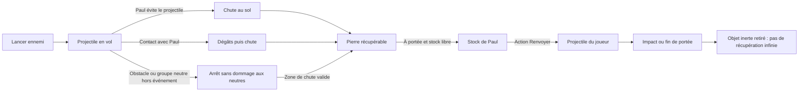
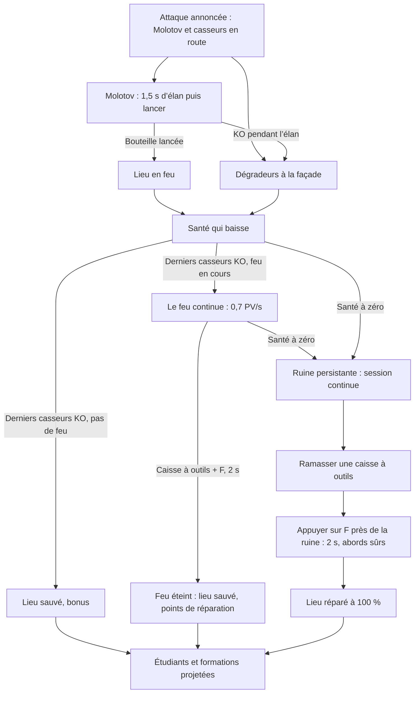

# BreakBreaker — Cahier des charges fonctionnel et technique

**Version :** 1.9.22 — 22 octobre 2026  
**Périmètre :** jeu web 2D en pixel art, vue du dessus non isométrique, mode arcade par manches sans limite de durée, Paris, Paul (commerçant fictif) comme héros unique, ordinateur et téléphone  
**Statut :** spécification de référence ; les décisions confirmées par le porteur du projet et les recommandations de conception sont identifiées. Une première tranche jouable existe (section 24) ; ce document ne constitue pas une validation de production ni une attestation que toutes les exigences sont déjà implémentées.  
**Langue de lancement :** français  
**Projet :** BreakBreaker

## Sommaire

1. [Vision et positionnement](#1-vision-et-positionnement)
2. [Exigences validées et décisions proposées](#2-exigences-validées-et-décisions-proposées)
3. [Périmètre et priorités](#3-périmètre-et-priorités)
4. [Parcours du joueur](#4-parcours-du-joueur)
5. [Carte, exploration et objectifs](#5-carte-exploration-et-objectifs)
6. [Paul, déplacement et caméra](#6-paul-déplacement-et-caméra)
7. [Commandes](#7-commandes)
8. [Combat, projectiles et groupes protégés](#8-combat-projectiles-et-groupes-protégés)
   - [8.7 Armes ramassables](#87-armes-ramassables)
   - [8.8 Jauge d’énergie et mode furie](#88-jauge-dénergie-et-mode-furie)
   - [8.9 Bouclier et onde d’énergie](#89-bouclier-et-onde-dénergie)
9. [Personnages, hordes et intelligence artificielle](#9-personnages-hordes-et-intelligence-artificielle)
10. [Bâtiments menacés, défense et réparation](#10-bâtiments-menacés-défense-et-réparation)
   - [10.9 Lanceurs sur Paul](#109-lanceurs-sur-paul)
11. [Objectif monument](#11-objectif-monument)
12. [Mode arcade, manches, événements, progression et soins](#12-mode-arcade-manches-événements-progression-et-soins)
   - [12.2 Structure des manches](#122-structure-des-manches)
   - [12.10 Événements dynamiques de secours](#1210-événements-dynamiques-de-secours)
   - [12.14 Nouveaux ennemis et armes de la phase B (à faire)](#1214-nouveaux-ennemis-et-armes-de-la-phase-b-à-faire)
   - [12.15 Chutes de KO et effets de coups de la phase D](#1215-chutes-de-ko-et-effets-de-coups-de-la-phase-d)
   - [12.16 Services d’urgence : cabines, camion de pompiers et police](#1216-services-durgence-cabines-camion-de-pompiers-et-police-livré-v1919)
   - [12.17 Prison : Caïds enfermés, gardiens et évasion](#1217-prison-caïds-enfermés-gardiens-et-évasion-livré-v1920)
13. [Score, compteur de casseurs neutralisés et bilan](#13-score-compteur-de-casseurs-neutralisés-et-bilan)
14. [Interface et accessibilité](#14-interface-et-accessibilité)
15. [Direction artistique et ressources pixel art](#15-direction-artistique-et-ressources-pixel-art)
16. [Son](#16-son)
17. [Choix techniques](#17-choix-techniques)
18. [Architecture logicielle et données](#18-architecture-logicielle-et-données)
19. [Performances et compatibilité](#19-performances-et-compatibilité)
20. [Stockage, chargement et diffusion](#20-stockage-chargement-et-diffusion)
21. [Validation et critères de recette](#21-validation-et-critères-de-recette)
22. [Production et livrables](#22-production-et-livrables)
23. [Extensions prévues](#23-extensions-prévues)
24. [Écart avec le prototype actuel](#24-écart-avec-le-prototype-actuel)
25. [Décisions restantes et sources](#25-décisions-restantes-et-sources)
26. [Landing page et accès au jeu](#26-landing-page-et-accès-au-jeu)

## 1. Vision et positionnement

### 1.1 Concept

Jeu web d’action arcade en **2D pixel art, vu du dessus, sans isométrie**, proche d’un hack-and-slash rétro. Le joueur incarne Paul, un commerçant de quartier fictif, représenté avec des cheveux longs, des lunettes rectangulaires noires, une tenue noire et une écharpe blanche qui le distingue des casseurs.

Il se déplace librement dans une carte parisienne fictive : places, école, monument et commerces. Des hordes de casseurs arrivent par plusieurs accès. Le joueur les combat au contact, à mains nues ou avec des armes ramassées dans les rues, évite leurs projectiles, peut récupérer certaines pierres tombées puis les renvoyer, défend l’école et reprend des drapeaux.

Des groupes de manifestants pacifiques occupent des parties de la carte. Ils ne sont pas des cibles pour Paul et doivent être contournés. Certains peuvent être menacés par des casseurs lors d’événements de secours. D’autres rencontres mettent en scène une personne ou un couple âgé victime de vol ou d’intimidation, à aider rapidement.

La session est découpée en manches : chaque manche fixe un nombre de casseurs à neutraliser et un à trois objectifs. La santé, les soins (stations ; petits soins de terrain livrés, v1.9.18) et la survie jusqu’au KO restent conservés. Aucun compte à rebours global et aucune victoire terminant automatiquement la session. Une barre de santé indique en revanche l’état d’un lieu attaqué, et un délai local le temps restant pour intervenir auprès de personnes menacées. Un lieu détruit peut être réparé avec une caisse à outils trouvée sur la carte.

### 1.2 Promesse

« Se déplacer, repousser les hordes, ramasser des armes, renvoyer leurs pavés et tenir le quartier manche après manche, aussi longtemps que possible. »

Le plaisir repose sur le mouvement, la lecture des groupes, les coups, l’esquive par déplacement, le renvoi de projectiles, la défense des lieux et la gestion de la santé. La récupération d’objets est limitée et compréhensible ; aucun inventaire complexe.

### 1.3 Direction visuelle

Vue orthogonale du dessus, carte à axes horizontaux/verticaux, sprites et décors dessinés en pixels. De petits volumes dessinés et des faces de bâtiment peuvent améliorer la lisibilité, sans projection isométrique ni grille en losanges.

La référence GTA / The Division n’est plus une cible de rendu. La crédibilité vient désormais des détails reconnaissables, des animations, des réactions et du son, dans une représentation rétro cohérente.

### 1.4 Public et accès

Navigateur sur ordinateur et téléphone, sans compte ni installation obligatoire. Caméra automatique, commandes simples et version tactile. Le pixel art réduit certains besoins graphiques, mais ne dispense pas de limiter les hordes, les collisions et les effets ni de tester sur téléphone réel.

### 1.5 Paul, protagoniste unique

**Confirmé (révision 1.5) :** le héros est Paul, un commerçant de quartier entièrement fictif. Repères visuels : cheveux longs, lunettes rectangulaires noires (v1.9.10), vêtements noirs et un accent clair (écharpe ou bavoir blanc) qui le distingue des casseurs vêtus de sombre ; silhouette identifiable à la taille réelle du sprite. Aucun choix de sexe, de teint ou d’un autre héros.

Paul ne représente aucune personne réelle. Les missions parisiennes, les dialogues et les positions exprimées dans le jeu relèvent de la fiction. Aucun nom de famille, élément biographique ou référence de presse n’est associé au personnage.

## 2. Exigences validées et décisions proposées

### 2.1 Statut

- **Confirmé** : demandé explicitement par le porteur du projet.
- **Proposé** : solution concrète de conception à essayer.
- **Paramètre initial** : valeur d’équilibrage modifiable sans changer la vision.
- **Extension** : hors première version de diffusion.

La présente révision remplace la cible 3D. Les dernières demandes annulent la vue derrière l’épaule, la personnalisation et le chronomètre global. L’idée de murs ou de ruelles imposés a été retirée par l’utilisateur ; elle ne doit pas devenir une fonctionnalité à développer.

La révision 1.5 intègre des décisions **confirmées** : héros fictif Paul, barème égal pour tous les casseurs, compteur neutre « Casseurs neutralisés », frappe circulaire, soins appliqués au contact, armes ramassables, manches à effectif fixe et lancement direct depuis la landing. Les valeurs chiffrées associées restent des paramètres initiaux sauf mention contraire.

### 2.2 Exigences confirmées

| ID | Exigence |
| --- | --- |
| EX-01 | Jeu web, un joueur, ordinateur et téléphone, sans compte. |
| EX-02 | 2D pixel art, vue du dessus, non isométrique, action de type hack-and-slash rétro. |
| EX-03 | Déplacement libre sur la carte ; Paris pour la première version. |
| EX-04 | Paul, commerçant fictif, héros unique ; aucun écran de sélection d’apparence ; aucune référence à une personne réelle. |
| EX-05 | Trois variantes de casseurs : classique, drapeau palestinien, drapeau Antifa. Le drapeau est purement cosmétique : même barème (+1 au KO), mêmes rôles possibles. |
| EX-06 | Arrivée de hordes ; casseurs hostiles jusqu’au KO, sans reddition ni interpellation. |
| EX-07 | Combat au contact, à mains nues ou avec des armes ramassées ; aucun gore, aucun sang. **Modifié (v1.9) :** le porteur du projet lève l’ancienne interdiction des armes à feu pour les tireurs ennemis (AK-47, manches tardives) et le flashball de Paul, en style cartoon, tirs lisibles et esquivables ; livré en phase B de la tranche 2 (v1.9.15, section 12.14). |
| EX-08 | Projectiles ennemis de type caillou, pavé ou brique. |
| EX-09 | Possibilité de récupérer des projectiles et de les renvoyer contre les casseurs. |
| EX-10 | Groupes de manifestants pacifiques à éviter et non ciblables par Paul ; certains peuvent subir une menace ennemie et être secourus. |
| EX-11 | Étudiants, professeurs, policiers, pompiers, soignants et commerçants restent non ennemis. |
| EX-12 | Santé et petits soins conservés (stations de soin livrées ; petits soins de terrain livrés en v1.9.18, section 12.5). |
| EX-13 | Session arcade sans durée limite, découpée en manches, poursuivie jusqu’au KO du joueur. |
| EX-14 | École à défendre : première ligne, renforts, réparation, retour des étudiants et formations projetées (étudiants et formations à faire, section 10.8). |
| EX-15 | Captures de drapeau sur des monuments, avec zone contestée et changement de drapeau. **Modifié (v1.9.4, demande du porteur du projet) :** une statue équestre dont le cavalier tient un drapeau français ; des casseurs s’en prennent à la statue et, en quelques secondes, remplacent le drapeau français par un drapeau palestinien ; Paul le reprend en capture du drapeau (section 11). |
| EX-16 | Flèche et zone au sol pour les objectifs. |
| EX-17 | Chaque casseur KO ajoute une unité au compteur neutre « Casseurs neutralisés », sans doublon. |
| EX-18 | Score, record local, pause, arrêt volontaire et son après geste utilisateur. |
| EX-19 | Assez de contenu et de renouvellement pour plusieurs manches. |
| EX-20 | Santé d’un lieu attaqué (feu, dégradeurs) avant sa destruction, pour créer une urgence de défense ; elle remplace l’ancien délai local (v1.9, section 10.2). |
| EX-21 | Caisses à outils récupérables sur la carte ; près d’un lieu détruit ou en feu, un appui sur Agir (F, bouton Agir) lance la réparation ou l’extinction, qui se termine 2 s plus tard sans maintenir la touche, abords sûrs (v1.9.1, section 10.6). Un lieu en feu ou détruit le reste tant qu’il n’est pas réparé. |
| EX-22 | Événements dynamiques de secours : manifestants agressés, personne ou couple âgé menacé ou dépouillé ; délai local d’intervention. |
| EX-23 | Déplacement libre, mais impossibilité de traverser les bâtiments, les troncs d’arbre et les obstacles solides. |
| EX-24 | Landing page publique simple donnant accès au jeu ; contenu et fonctionnement définis ici, direction visuelle traitée séparément avec Claude. |
| EX-25 | Armes ramassables apparaissant aléatoirement dans les rues, en petit nombre (v1.9.16, section 8.7) ; chacune met un casseur KO en un coup (2 dégâts seulement sur un costaud ou « Le Caïd », section 12.14), avec portée et nombre de coups propres ; armes à feu cartoon seulement dans les conditions d’EX-07 (section 8.7). |
| EX-26 | Manches à effectif fixe : un nombre de casseurs à neutraliser et un à trois objectifs par manche, panneau « Manche N terminée » non bloquant pendant un répit voulu de 6 s sans entrée de casseur, puis la manche suivante est annoncée (v1.9, section 12.2). |
| EX-27 | Landing sobre (titre, accroche, boutons Jouer et Commandes, pied de page) avec visuel original ; règles et instructions affichées au lancement du jeu ; bouton « Commandes » (modale) sur la landing et dans le jeu (section 26). |
| EX-28 | Alerte visible dans le style pixel du jeu à l’apparition de chaque incident (« ÉCOLE EN FEU ! », « AGRESSION EN COURS ! », « VOL EN COURS ! ») avec flèche et distance, puis indicateur en bord d’écran par incident actif hors écran ; système générique réutilisé par les futurs événements de casse (section 14.1). |

### 2.3 Propositions de départ

| Sujet | Proposition |
| --- | --- |
| Carte | Quartier unique, 48 × 48 tuiles de 32 pixels (1 536 × 1 536 pixels logiques) |
| Vue | Caméra qui suit Paul, orientation fixe et zoom entier |
| Déplacement | Huit directions, diagonales normalisées ; quatre orientations dessinées au minimum |
| Contact | **Confirmé :** frappe circulaire à 360° autour de Paul, les plus proches d’abord, jusqu’à trois casseurs, chacun touché une seule fois ; Paul se tourne vers le plus proche |
| Armes | **Confirmé :** armes ramassées en passant dessus, une tenue à la fois, KO en un coup (2 dégâts sur un costaud ou le Caïd, v1.9.13), usure par coup utile (section 8.7) |
| Pierres | Ramassage automatique des pierres ennemies déjà tombées, stock maximal de trois |
| Renvoi | Action distincte, direction choisie ; pas de capture parfaite de projectile en vol en V1 |
| Manifestants | Non ciblables par Paul ; menace ennemie représentée par un état de détresse pendant un événement de secours |
| Objectifs | École, monument, boutique proposée pour varier les manches |
| Manches | **Confirmé :** manches à effectif fixe et un à trois objectifs ; progression des effectifs proposée en section 12.2, avec plafond de simulation |
| Soins | **Confirmé :** stations limitées appliquées au contact (+25) ; petits soins de terrain (+10, livrés en v1.9.18), sans régénération passive |
| Réparation après perte | Caisse à outils distincte des soins, une portée au maximum, réparation ou extinction lancée par un appui sur F (Agir), interrompable |
| Urgences | Une barre de santé par lieu attaqué, un délai local par secours, pas de fin de partie à leur échec |
| Technique | Retenu : Phaser 4.2.1, TypeScript, Vite et Vitest ; simulation pure séparée du rendu ; validation sur appareils réels |

Les seuils précis sont proposés, pas déjà validés par l’utilisateur, sauf mention « Confirmé ». La récupération au sol est une première interprétation de « récupérer pour renvoyer », plus accessible que l’interception en vol.

## 3. Périmètre et priorités

| Priorité | Contenu |
| --- | --- |
| P0 | Vue du dessus non isométrique, Paul unique, déplacement libre, hordes et trois variantes, frappe circulaire, armes ramassables, projectiles récupérables et renvoi, groupes pacifiques protégés, santé, soins, caisses à outils, urgences locales et secours, arcade par manches sans limite, école et capture, score, compteur de casseurs neutralisés, pause. |
| P1 | Pixel art abouti, boutique, nouvelles armes débloquées par manche (section 8.7), diversité d’assauts, repérage, accessibilité, optimisation et longue session sur téléphone réel. |
| P2 | Autres cartes/villes, dialogues complets, récupération de projectile en vol si utile, PWA. |

La cible de diffusion inclut P0 et P1. Contenu minimal proposé : un quartier, trois objectifs récurrents, trois variantes visuelles hostiles et deux comportements de combat (contact/lanceur), trois groupes pacifiques, deux points de soin, trois armes de contact et au moins quatre compositions d’assaut.

La carte doit pouvoir être parcourue librement, y compris entre deux objectifs. Les objectifs peuvent être activés progressivement pour l’apprentissage ; le joueur n’est pas enfermé dans une succession d’arènes fermées. La caméra ne doit pas tirer le joueur de force vers une mission.

Hors périmètre : 3D, isométrie, monde ouvert de grande taille, construction de murs, couloirs obligatoires, conduite, armes à feu réalistes, gore, multijoueur, compte et inventaire complexe. Les tireurs ennemis et le flashball cartoon d’EX-07 (v1.9) font exception.

Cible de variété : plusieurs situations différentes dans les dix premières minutes si le joueur survit, sans durée minimale ou maximale imposée.

## 4. Parcours du joueur

### 4.1 Accueil

Le site s’ouvre sur une landing page légère, distincte du jeu, volontairement sobre : titre, accroche, bouton « Jouer » (qui lance directement la partie) et bouton « Commandes » (modale des touches). **Confirmé (1.6) :** les règles et instructions de jeu ne sont pas sur la landing ; elles s’affichent au lancement du jeu (§26.4). Son contenu détaillé est défini en section 26. Aucun choix de sexe ou teint ; aucune limite globale de durée annoncée.

### 4.2 Entrée

**Confirmé :** « Jouer » ouvre `/jouer/?go`. La page du jeu affiche sa progression de chargement (moteur, sprites, tuiles, collisions, sons utiles et premiers adversaires), puis, dès que les ressources indispensables sont prêtes, la carte « Comment jouer » s’affiche : **modifié (v1.9.4)** elle est bloquante, la partie attend une touche, un clic ou un toucher (RC-70, RC-87), puis démarre (intro de 4 s, manche 1). Le son se déverrouille à ce premier geste. Une visite directe sur `/jouer/` (sans `?go`) affiche l’écran des règles avec l’action « Commencer ». Caméra du dessus dès la prise de contrôle, pas de cinématique derrière l’épaule ni de modèle 3D.

La première école est indiquée, ainsi qu’un groupe pacifique et un soin proche. Les premières secondes permettent de se déplacer avant d’être pressé par une horde. La première attaque est annoncée et laisse le temps du trajet depuis le point de départ (la santé ne baisse qu’au feu ou sous les coups) ; il n’attend pas obligatoirement que Paul entre dans le cercle. Le premier lanceur est introduit seul ou en petit nombre pour enseigner la récupération.

### 4.3 Boucle

Explorer → repérer un objectif / un soin / une arme → combattre ou contourner → esquiver et récupérer des pierres → les renvoyer → résoudre les objectifs et neutraliser l’effectif de la manche → panneau « Manche N terminée » (non bloquant) pendant que la manche suivante démarre.

La réussite des objectifs n’arrête pas la session. Santé, score, KO, soins utilisés, stock porté et arme tenue persistent entre objectifs et manches, sous les règles de réapprovisionnement.

### 4.4 Fin

Santé à zéro : KO, bilan et Rejouer. Un arrêt volontaire reste accessible depuis Pause. Rejouer réinitialise tout l’état de la session, pas les préférences et records compatibles.

## 5. Carte, exploration et objectifs

### 5.1 Carte

Paris fictif en tuiles orthogonales : sol, places, rues ouvertes, bâtiments, école, monument, boutique, soins et emplacements de groupes pacifiques. Gabarit retenu pour la première tranche : 48 × 48 tuiles de 32 pixels, soit 1 536 × 1 536 pixels logiques, à ajuster aux essais.

La taille doit produire de vrais choix de trajet sans longues traversées vides. Deux objectifs proches peuvent être visibles dans des directions différentes. La première destination reste atteignable rapidement depuis le départ.

### 5.2 Déplacement libre

Pas de murs ajoutés comme mécanique, pas de labyrinthes de ruelles imposés. Les empreintes de bâtiments, les troncs d’arbre et les objets solides restent des obstacles cohérents. Paul ne peut pas les traverser ; le feuillage dessiné peut être au-dessus du personnage sans agrandir artificiellement la collision du tronc. Les limites de carte sont lisibles et les accès ne forment pas de pièges involontaires.

Aucun objectif ne doit avoir un seul passage pouvant être entièrement condamné par un groupe pacifique. Les points de soin, caisses à outils et zones de secours ont des accès praticables. La distance de parcours réelle est utilisée pour planifier un événement urgent, pas seulement la distance à vol d’oiseau. Les groupes laissent plusieurs possibilités de contournement ; ils ne constituent pas des refuges fermés invulnérables.

### 5.3 Couches

Sol ; détails de sol ; empreintes solides ; objets ; personnages ; parties hautes des bâtiments ; effets ; marqueurs d’objectifs ; HUD. Ordre de profondeur lié à la position des pieds pour les éléments qui se chevauchent.

Les toits ou parties hautes qui masquent Paul deviennent transparents ou disparaissent localement. La collision d’un bâtiment suit son empreinte, pas toute la hauteur dessinée du sprite.

### 5.4 États

École dégradée/en feu, reconstruction, ouverte, perdue puis éventuellement reconquise. Monument au drapeau français, attaqué, drapeau remplacé, zone contestée, drapeau repris (v1.9.4). Boutique de jeux rétro, voitures et abribus : intacts, attaqués, en feu, en ruine, réparés (mêmes états que l’école). Soins chargés/épuisés ; armes au sol ; groupes pacifiques toujours reconnaissables.

Chaque nouvel assaut est annoncé et identifié ; les bonus ne sont pas rejoués par un changement purement graphique. Un lieu détruit reste en ruine tant qu’il n’a pas été réparé avec une caisse à outils ; une transition de manche ne le répare pas gratuitement.

## 6. Paul, déplacement et caméra

### 6.1 Héros

Sprite de Paul aux cheveux longs, **lunettes rectangulaires noires** (v1.9.10, demande du porteur du projet ; visibles dans les trois orientations de face et de profil, reprises dans l’icône du site et l’image de la landing) et vêtements noirs, avec un accent clair (écharpe ou bavoir blanc), lisible dans quatre orientations au minimum. Accent clair, silhouette, animation et contour doivent permettre de le distinguer des casseurs classiques également vêtus de couleurs sombres.

Sprite retenu : personnage composé à partir des spritesheets Universal LPC, cellules de 64 × 64 pixels pour une silhouette visible d’environ 32 × 48, avec variantes d’animation et accessoires séparés. Les pieds définissent l’ancrage et la petite zone de collision au sol.

### 6.2 Déplacement

Huit directions libres. Gauche déplace à gauche de la carte, haut vers le haut, indépendamment de l’orientation précédente. Le schéma 3D « gauche fait tourner le nez » est remplacé. Les diagonales sont normalisées pour ne pas accélérer.

Valeurs initiales proposées, adaptées aux tuiles de 32 pixels : 180 pixels logiques/seconde en déplacement, 250 en course. La vitesse exacte reste à équilibrer. Arrêt rapide et léger lissage, sans inertie qui empêche d’esquiver un caillou.

Pas de saut, de roulade ou de barre d’endurance indispensable en V1. L’esquive demandée repose d’abord sur le déplacement. Une roulade éventuelle est une extension, pas une condition implicite de la jouabilité.

### 6.3 Caméra

Caméra du dessus à orientation fixe, centrée avec une petite zone morte. Aucun contrôle de rotation et aucune perspective isométrique. Le suivi est fluide mais arrondi au pixel au rendu pour préserver la netteté ; le zoom de caméra est toujours entier.

La visibilité autour du héros doit laisser le temps de lire une préparation de lancer. Un indicateur de menace peut annoncer un lanceur hors écran ; un projectile ne doit pas atteindre Paul sans signal ou délai suffisant.

Adaptation paysage/portrait par cadrage et zones de HUD, sans étirer les sprites. Le changement d’orientation ne fait pas apparaître d’ennemis à portée immédiate et ne modifie pas leur vitesse.

## 7. Commandes

| Action | Ordinateur | Téléphone | Manette, si retenue |
| --- | --- | --- | --- |
| Déplacer | ZQSD, WASD ou flèches | Joystick gauche | Stick gauche |
| Viser / orienter | Souris ; repli vers dernière direction de mouvement | Direction du mouvement, ou glisser depuis Renvoyer pour viser | Stick droit, repli vers déplacement |
| Frapper (frappe circulaire autour de Paul ; **v1.9.15 :** avec le gant de boxe, coup droit vers la visée ou l’orientation ; avec le flashball, tir vers la souris ou l’orientation avec aide à la visée ; un coup par appui, 0,45 s entre deux) | Espace ou clic gauche (remappage à faire) | Bouton Frapper | Bouton principal |
| Charger l’onde d’énergie (**modifié v1.9.14 :** jauge d’énergie à 50 ou plus, section 8.9) | Maintenir C 1 s (Paul immobile) | Maintenir le bouton Onde | Maintenir un bouton dédié |
| Déclencher le mode furie (**modifié v1.9.14 :** jauge d’énergie pleine, section 8.8) | R (un appui) | Bouton Furie | Bouton dédié |
| Renvoyer une pierre portée | E ou clic droit (remappage à faire) | Bouton Renvoyer : toucher = dernière visée, glisser = viser | Bouton secondaire |
| Ramasser une pierre au sol | Automatique à portée si stock disponible | Automatique | Automatique |
| Ramasser une arme ou le bouclier | Automatique en passant dessus ; une arme remplace l’arme tenue, le bouclier s’y ajoute (protection de 20 s, v1.9.16) | Automatique | Automatique |
| Ramasser une caisse à outils ou un objet volé | Automatique en passant dessus | Automatique | Automatique |
| Se soigner à une station | Automatique en passant sur une station chargée | Automatique | Automatique |
| Agir : réparer une ruine ou éteindre un lieu en feu avec une caisse à outils (un appui lance l’action, 2 s sans maintien, v1.9.1) ; aucune action ne demande de maintenir F (le secours et la capture du drapeau sont automatiques) ; **v1.9.19 :** devant une cabine téléphonique (porte à 40 px au plus), un appui appelle les pompiers (cabine rouge) ou la police (cabine bleue), sans maintien (section 12.16) | F | Bouton Agir, nommé « Réparer » / « Éteindre » / « Appeler », masqué sans action possible | Bouton d’action |
| Passer la cinématique de l’école (manche 1) | F, Espace ou clic | Toucher l’écran | Bouton d’action |
| Courir | Maj (maintien) | Joystick poussé à fond | Bouton ou pression stick |
| Pause / arrêter | Échap / menu | Bouton Pause | Menu |

Le clic secondaire n’est pas obligatoire : une touche doit permettre de renvoyer sans dépendre d’un menu contextuel. Sur téléphone, une pression simple renvoie vers la dernière direction de visée ; le glissement permet une direction plus précise. La visée sert au renvoi et, **v1.9.15**, aux deux armes qui frappent en ligne droite : le gant de boxe (coup droit) et le flashball (tir) suivent la visée de la souris, à défaut l’orientation de Paul (avec une légère aide à la visée pour le flashball) ; avec les mains nues, les autres armes, le bouclier et en mode furie, la frappe reste circulaire. Aucune frappe sur un groupe pacifique ne peut être déclenchée par une aide au ciblage. Agir ne sert plus à se soigner (section 12.6) ni à terminer un secours (section 12.12).

Options (à faire, aucune n’est livrée dans la première tranche) : remappage, sensibilité de visée, maintien/bascule pour frapper, courir et Agir, désactivation du glissement de visée si gênant. L’option d’assistance de renvoi ne sélectionne que des casseurs actifs visibles et ne traverse pas un groupe ou un obstacle.

Les pointeurs tactiles du joystick et des actions sont indépendants. Une annulation, un menu ou une perte de focus relâche tous les boutons. Les commandes ne déclenchent ni zoom de page, ni défilement, ni sélection de texte.

## 8. Combat, projectiles et groupes protégés

### 8.1 Contact

Hack-and-slash de proximité. **Confirmé : frappe circulaire.** Chaque coup touche tout autour de Paul (360°) les casseurs actifs à portée, les plus proches d’abord, au plus trois par attaque ; Paul se tourne vers le plus proche des casseurs touchés. Portée à mains nues : 56 pixels logiques (tuiles de 32 pixels). Cadence proposée : un coup toutes les 0,45 seconde. Chaque cible ne reçoit qu’un contact par identifiant de coup. Une arme tenue remplace la portée et met KO en un coup (section 8.7).

À mains nues (1 dégât par coup), la résistance commence à deux coups, puis des ennemis renforcés clairement signalés en demandent davantage (livré v1.9.13, section 12.14) : le coureur tombe en un coup, le costaud en quatre, « Le Caïd » en quatorze dès la manche 3, davantage ensuite (v1.9.16) ; les autres casseurs ont 2 PV. Le premier coup ne provoque jamais de reddition.

Les contacts sont synchronisés aux images utiles de l’animation. Recul court, réaction et flash d’impact lisible sans sang. Les corps KO ne sont plus ciblables, ne bloquent pas le passage et ne rapportent plus de points.

### 8.2 Lanceurs ennemis

Le rôle « lanceur » est indépendant de la variante visuelle : un casseur classique ou à drapeau peut lancer une pierre. Aucun drapeau n’attribue automatiquement une statistique supérieure.

Objets : caillou, pavé, brique. En V1, ils peuvent partager les mêmes valeurs de dégâts avec des sprites différents. Pas d’explosif ni d’arme à feu ajouté implicitement. La bouteille incendiaire (Molotov) est réservée au casseur dédié de la section 10.2, qui vise les lieux, et, **modifié (v1.9.4)**, aux lanceurs sur Paul de la section 10.9, dont la bouteille laisse une flaque de feu au sol.

Chaque lancer possède une préparation, une direction/zone annoncée et un délai de trajet. Paramètres de départ : préparation d’au moins 0,6 seconde ; portée 280 à 360 pixels ; trajet d’au moins 0,5 seconde sur une cible éloignée ; 5 PV perdus par impact au départ. Un intervalle individuel empêche le tir continu.

Un petit arc visuel et une ombre peuvent représenter la trajectoire, mais la collision est calculée dans le plan 2D. Le point d’impact ou la trajectoire est visible avant les dégâts. Les lancers hors écran nécessitent un avertissement et ne sont pas autorisés à très courte distance sans préparation.

### 8.3 Cycle de récupération et renvoi



Proposition V1 : récupération des **projectiles ennemis au sol**, pas interception en vol. Ramassage automatique dans un rayon d’environ 28 pixels, seulement s’il reste une place. Un projectile en vol ne peut pas être ramassé.

Stock maximal : trois objets. Stock plein : l’objet reste au sol. Le nombre porté est visible. Aucun achat, fabrication ou inventaire à ouvrir.

Renvoyer consomme un objet porté, crée un projectile appartenant au joueur et suit la direction choisie au lancement. Aucun guidage automatique une fois en vol. Paramètres initiaux : un point de dégât, portée d’environ 360 pixels et intervalle de 0,5 seconde. Un seul casseur touché, pas de ricochet en chaîne en V1.

Après un renvoi, l’objet devient inerte à son prochain contact ou en fin de course et est retiré ; il n’alimente pas une boucle de ramassage infinie. Seules les nouvelles pierres ennemies produisent des objets récupérables. La collision avec Paul du projectile qu’il vient de renvoyer est désactivée.

### 8.4 Règles d’impact

| Source | Cible | Effet |
| --- | --- | --- |
| Contact du joueur | Casseur actif | Dégâts et éventuellement KO ; KO immédiat avec une arme |
| Pierre ennemie en vol | Paul | Dégâts, puis chute récupérable en zone valide |
| Pierre renvoyée | Casseur actif | Dégâts ; score seulement si KO |
| Coup / pierre de Paul | Groupe pacifique ou victime à secourir | Aucun dégât, aucun KO, aucune unité au compteur de casseurs neutralisés |
| Attaque d’un agresseur affecté à un secours | Victime de cet événement | Réduit le délai / la jauge de détresse de cet événement, sans gore |
| Attaque ennemie ordinaire hors secours | Groupe pacifique | Pas de dégâts de foule non scénarisés ni d’événement silencieux |
| Pierre en vol | Obstacle solide | Arrêt ; chute ou retrait selon espace disponible |
| Pierre renvoyée | Corps KO | Pas de nouveau score ; ne sert pas de cible active |

Le KO a le même barème quelle que soit l’origine des dégâts de Paul : mains nues, arme ou renvoi. Aucun bonus supplémentaire pour un projectile ou une arme.

### 8.5 Groupes pacifiques protégés

Les manifestants sont regroupés, avec pancartes et animation calme. Le ciblage, la frappe circulaire et le renvoi de Paul les excluent : un manifestant dans le rayon de frappe n’est ni touché ni compté parmi les trois cibles. Ils ne possèdent pas de transition de KO infligée par le joueur. Pendant un secours identifié, un sous-ensemble du groupe ou une victime désignée peut passer en détresse sous la menace des agresseurs affectés à cet événement.

**Ajouté (v1.9.10, demande du porteur du projet) — bulle de mécontentement.** Au-dessus du groupe de manifestants pacifiques, une bulle pixel à bordure et texte rouges affiche tour à tour une phrase de protestation neutre, 2,8 s sur 4,2 s, avec un léger tremblement : « ÇA SUFFIT ! », « ON EN A MARRE ! », « ARRÊTEZ ÇA ! », « STOP À LA CASSE ! », « C’EST HONTEUX ! ». Les phrases ne visent aucun groupe en particulier, ne contiennent ni insulte ni mot-clé politique, et la bulle ne change rien au jeu (le groupe reste non ciblable).

Les groupes occupent un espace identifiable à contourner. Leurs positions ne peuvent pas bloquer entièrement un objectif, une sortie ou un soin. Le joueur ne peut pas les déplacer ou les disperser à coups. Les ennemis doivent également pouvoir les contourner.

Un projectile de Paul qui rencontre le volume protégé du groupe est arrêté sans blessure. Un projectile ennemi ordinaire suit aussi cette protection ; seule une attaque explicitement affectée à un secours peut faire avancer sa menace. Une chute récupérable exige une position libre hors du groupe ; sinon l’objet est retiré. Les pierres renvoyées arrêtées deviennent inertes. Les sprites neutres ne servent pas à masquer un casseur intouchable : ordre d’affichage, navigation et trajectoires doivent être vérifiés.

L’intérêt d’éviter les groupes vient du déplacement et des lignes de renvoi, pas de dégâts infligés par Paul aux manifestants. Il faut distinguer cette protection permanente contre le joueur de la détresse provoquée par des ennemis dans un secours annoncé. Aucun score positif ou négatif de « frappe sur manifestant » n’est déclenché, puisque ces contacts sont exclus. Les pénalités héritées restent applicables aux autres personnes protégées si elles sont touchables ; une extension d’invulnérabilité à tous les neutres reste possible, à décider explicitement.

### 8.6 Santé

100 PV au départ, pas de régénération passive en normal. Contacts et projectiles peuvent réduire la santé. Brève invulnérabilité après impact, proposée à 0,6 seconde, pour éviter des dégâts simultanés illisibles. Un projectile ne produit qu’un événement de dommage par trajectoire.

La progression des dégâts est plafonnée comme celle des assauts. Les soins décrits en section 12 sont conservés. Le KO du héros reste la seule défaite globale.

### 8.7 Armes ramassables

**Confirmé (EX-25) :** des armes apparaissent au hasard dans les rues. Elles remplacent l’ancienne extension « accessoires de contact ». Aucun gore. **Modifié (v1.9) :** l’interdiction des armes à feu est levée pour le flashball de Paul et les tireurs ennemis, en style cartoon (EX-07, livrés en v1.9.15).

| Règle | Valeur |
| --- | --- |
| Emplacement d’apparition | Point libre et praticable, à 160–480 pixels logiques de Paul, hors groupe pacifique et hors obstacle |
| Rythme | **Modifié (v1.9.16, demande du porteur du projet : « il y a peut-être un poil trop d’armes ») :** première arme après 20 secondes (`weapons.firstSpawn`), puis une toutes les 30 à 45 secondes (`spawnEvery`) ; une apparition manquée (plafond, arme proche de Paul) attend le tour suivant |
| Plafond au sol | **Modifié (v1.9.16) :** le minuteur de rue ne pose une arme que s’il n’y en a aucune au sol (`maxGround` : 1, toutes origines comptées) ; au-delà, aucune apparition ni réserve invisible. L’arme du retournement (une fois sur deux quand ce n’est pas le bouclier), celle du répit (fin des manches paires seulement) et celle du Caïd (une fois sur deux) s’y ajoutent hors plafond, à 160–480 px de Paul (le Caïd : là où il tombe), et disparaissent après 15 s (`weapons.dropLifetime`) |
| Pas de tas | **Ajouté (v1.9.16) :** aucune arme ordinaire n’est déposée (rue, retournement, répit, Caïd) tant qu’une arme est déjà au sol à 200 px ou moins de Paul (`weapons.clearRadius`) ; le bouclier et le flashball garanti du premier tireur n’y sont pas soumis |
| Fréquence obtenue | Mesurée avec le bot de test (KO différé de 6 à 12 s, ramassage 4 s après l’apparition, graines 1 à 6) : environ 31 à 39 armes et boucliers posés pour 10 manches, contre 61 à 76 avant v1.9.16 (à peu près moitié moins) |
| Ramassage | Automatique en passant dessus (20 px) ; la nouvelle arme remplace l’arme tenue, qui disparaît (le mode furie et l’onde d’énergie viennent de la jauge d’énergie et n’y touchent pas, sections 8.8 et 8.9 ; **modifié (v1.9.16) :** le bouclier non plus : il s’ajoute à l’arme tenue) |
| Effet | Toute arme met un casseur KO en un coup ; **modifié (v1.9.13) :** sur un costaud (4 PV) ou « Le Caïd » (14 PV en manche 3, puis davantage, v1.9.16) un coup d’arme ordinaire ne fait que 2 dégâts (`toughWeaponDamage` et `caid.damageFrom.weapon` : 2 coups pour un costaud, 7 pour le Caïd de la manche 3 ; section 12.14) ; portée propre à chaque arme ; frappe circulaire, trois cibles au maximum, sauf le gant de boxe (coup droit de 160 px, premier casseur sur la ligne) et le flashball (tir visé, premier casseur touché) (v1.9.15) |
| Usure | Seul un coup touchant au moins un casseur consomme une charge ; à zéro, l’arme se brise et Paul revient à mains nues (56 pixels) |
| Manches | L’arme tenue et ses coups restants sont conservés d’une manche à la suivante |

Armes de contact actuelles (**Confirmé**, valeurs en paramètre initial) :

| Arme | Portée | Coups |
| --- | ---: | ---: |
| Bâton | 72 pixels | 15 |
| Marteau | 64 pixels | 8 |
| Panneau de signalisation (« Panneau » en jeu) | 96 pixels | 10 |

Présentation : une arme au sol flotte, oscille et brille pour être repérée ; l’arme tenue tourne sur elle-même à chaque coup. La ligne « ARME » de la liste de score (section 14.1) affiche « <nom> (<coups>) » ou « Mains nues ». Le score d’un KO à l’arme est identique à celui d’un KO à mains nues ou par renvoi.

**Nouvelles armes débloquées par manche — tranche 2 :**

| Arme | Comportement | Disponibilité |
| --- | --- | --- |
| Gant de boxe à ressort (« Gant de boxe » en jeu) | **Livré (v1.9.15, section 12.14)** : Frapper donne un coup de poing à ressort de 160 px en ligne droite (vers la visée, sinon l’orientation) ; le premier casseur touché est mis KO et repoussé de 32 px (corps projeté en culbute) ; arrêté par le premier obstacle, le groupe pacifique et la victime ; 6 coups, un coup n’est usé que s’il touche | Rues dès la manche 3 |
| Flashball (cartoon) | **Livré (v1.9.15, section 12.14)** : Frapper tire une balle à 420 px/s (480 px au plus) vers la souris ; sans visée, vers l’orientation avec une légère aide (le casseur actif le plus proche à ±12° et 320 px, ligne dégagée) ; KO du premier casseur touché ; arrêtée par bâtiments, mobilier, groupe pacifique et victime ; 6 coups, chaque tir en use un, touché ou non | Rues dès la manche 5 ; un flashball garanti à l’entrée du premier tireur de la partie (manche 6) |
| Onde d’énergie (identifiant `kamehame`) | **Modifié (v1.9.14) :** n’est plus une arme ramassée ; pouvoir de la jauge d’énergie, voir section 8.9 | Dès la manche 1, jauge à 50 ou plus |
| Bouclier | **Confirmé et livré (v1.9.7)**, protection seule depuis v1.9.16 : voir section 8.9 | Retournement dès la manche 3 (une fois sur deux), rue dès la manche 5 |

Ton cartoon, aucun gore ; armes à feu cartoon seulement dans les conditions d’EX-07. Équilibrage : les armes puissantes restent rares et sont associées à l’arrivée de casseurs plus résistants. Les rayons et coups à distance respectent la protection des groupes pacifiques et des victimes (section 8.5) : ils s’arrêtent sur leur volume sans les blesser.

### 8.8 Jauge d’énergie et mode furie

**Modifié (v1.9.14, demande du porteur du projet : « plutôt que le mode saiyan et le kamehame soient des armes qu’on ramasse, je préfère que ça soit une sorte de barre de mana qu’on alimente à chaque fois qu’on met KO un émeutier. Une fois que cette barre de mana est pleine, on peut l’activer quand on veut ») :** le mode furie et l’onde d’énergie ne se ramassent plus. Ils viennent d’une **jauge d’énergie** que chaque KO remplit ; le joueur les déclenche quand il veut. Aucun objet furie ou onde n’apparaît au sol, au retournement, dans la rue ou au répit, et il n’y a plus ni bannière ni indicateur pour eux.

| Règle | Valeur (paramètres `CONFIG.energy`) |
| --- | --- |
| Jauge | 0 à 100 (`max`), simulée (déterministe) ; conservée d’une manche à l’autre, remise à 0 par Rejouer ; aucune baisse avec le temps |
| Remplissage | Chaque casseur mis KO compté par la règle de score (`Rules.onKnockout`) : +4 (`gain.rioter`, coureurs compris), +8 pour un costaud (`gain.brute`), +20 pour « Le Caïd » (`gain.boss`), plafonné à 100. Aucun gain pendant le mode furie ni pour les KO de l’onde d’énergie (pas de recharge en chaîne). Les KO à mains nues, à l’arme et par pierre renvoyée remplissent la jauge |
| Seuils | 50 (`ondeCost`) : l’onde d’énergie devient disponible ; 100 (`furieCost`) : le mode furie devient disponible. Événement `EnergyReady { level: 'onde' \| 'furie' }` une fois à chaque franchissement vers le haut (de nouveau après être repassé sous le seuil) |
| Mode furie | R (téléphone : bouton Furie) avec la jauge pleine : la jauge entière est dépensée et le mode démarre aussitôt pour 12 s (`FurieStarted`) ; une charge d’onde en cours est annulée sans coût. Pendant le mode la jauge reste vide et ne se remplit pas. Ignoré pendant le mode, la pause ou Paul KO |
| Refus | R avec une jauge incomplète, ou C sous 50 : rien ne se passe, `EnergyRefused { need }`, court message « Énergie insuffisante » dans la ligne ÉNERGIE et son sourd « toc » |

Le mode furie lui-même est inchangé (paramètres `CONFIG.furie`) :

| Règle | Valeur |
| --- | --- |
| Activation | Depuis la jauge pleine (ci-dessus), 12 s (`durationSec`) ; l’arme tenue garde ses coups et reste utilisable |
| Déplacement | Marche et course ×1,35 (`speedMul`) |
| Frappe | Portée ×1,5 à mains nues comme avec une arme (`reachMul`), jusqu’à 8 casseurs par coup (`maxTargets`, 3 hors mode), KO en un coup même à mains nues, sauf « Le Caïd » qui prend 5 dégâts par coup (v1.9.16, section 12.14) ; le coup ne consomme pas de charge d’arme |
| Dégâts reçus | ×0,5 (`damageTakenMul`) |
| Fin | Minuteur écoulé, ou Paul KO (fin immédiate) ; la pause gèle le minuteur ; Rejouer repart sans mode et jauge vide |
| Envol | Chaque casseur mis KO par un coup de Paul pendant le mode s’envole en tourbillon (purement visuel, aucune règle de jeu changée) : direction opposée à Paul avec un léger écart, 220–420 px, 2 à 5 tours, tirés d’un flux aléatoire séparé et déterministe ; chaque KO compte toujours +1. Le renvoi de pierre est inchangé |

Présentation : aura jaune-blanc additive à pointes derrière Paul avec pulsation, étincelles en flammes qui montent, teinte chaude du sprite et contour doré, fin anneau de minuterie aux pieds ; l’aura faiblit et clignote pendant les 2 dernières secondes. Les corps envolés tournoient pendant environ 0,7 s (trajet amorti, arc, léger écrasement, traînée d’étoiles et de poussière) au-dessus du décor, puis retombent au point libre le plus éloigné de leur trajet, jamais hors de la carte ni dans un mur, et restent au sol comme les autres corps. Chaque coup qui touche pendant le mode affiche une courte bulle pixel « POW ! » / « BOUM ! » (réutilisée) et une très légère secousse de caméra, supprimée avec `prefers-reduced-motion`. HUD : ligne « ÉNERGIE » (section 14.1) dont la barre se vide sur les 12 s ; ligne « ARME » « Bâton (12) · Mode furie 9 s » (secondes arrondies au supérieur, valeur en jaune ; « Bâton (12) · Bouclier 14 s · Mode furie 9 s » avec le bouclier) ; bannière courte sans flèche « MODE FURIE ! » à l’activation. Son : carillon clair quand la jauge est pleine, montée synthétique au début, bourdonnement grave pendant le mode (une voix du plafond, coupé par la sourdine et la pause), descente à la fin.

### 8.9 Bouclier et onde d’énergie

**Confirmé (v1.9.7), modifié (v1.9.14, v1.9.16) :** le **bouclier** reste le seul spécial ramassé : il se ramasse en passant dessus. **Modifié (v1.9.16, demande du porteur du projet : « le bouclier doit juste protéger, pas faire des dégâts supplémentaires ») :** il **ne remplace plus l’arme tenue** et **ne frappe plus** : le ramasser lance un minuteur de protection par-dessus l’arme tenue (ou les mains nues), comme le faisait l’ancien minuteur du mode furie ; Frapper reste exactement le coup normal de Paul. L’**onde d’énergie** n’est plus une arme : c’est le second pouvoir de la jauge d’énergie (section 8.8), sans emplacement d’arme ni compteur d’usages ; elle se combine avec l’arme tenue et le bouclier. Visuels originaux en pixel art, sans emprunt à une franchise existante ; l’identifiant interne de l’onde reste `kamehame`, le nom en jeu est « Onde d’énergie ».

| Règle | Bouclier (`CONFIG.bouclier`) | Onde d’énergie (`CONFIG.kamehame`, coût `CONFIG.energy.ondeCost`) |
| --- | --- | --- |
| Durée / usages | 20 s de temps de jeu actif (`durationSec`), la pause gèle le minuteur ; un second bouclier ramassé le remet à 20 s ; Paul KO l’arrête aussitôt ; à la fin, la bulle éclate (« ShieldEnded », v1.9.16) et l’arme tenue reste en main avec ses coups ; aucun compteur de coups | Disponible dès que la jauge atteint 50 ; chaque tir coûte 50, payés au départ du rayon (deux tirs depuis une jauge pleine) |
| Effet | **Modifié (v1.9.12, demande du porteur du projet : « il faut que le bouclier soit une sorte de bulle de protection ») :** une **bulle de protection** autour de Paul, dans toutes les directions (360°, plus de cône ni d’orientation) : toute pierre, toute bouteille des lanceurs sur Paul et (v1.9.15) toute balle des tireurs qui l’atteindrait est bloquée, de face, de côté ou de dos (même pendant l’invulnérabilité ; une balle bloquée disparaît). Une pierre bloquée tombe au point d’impact, récupérable, sans dégât ; une bouteille bloquée s’éteint sans flaque (« ShieldBlocked » sur le bord de Paul, du côté du lanceur). Une pierre qui passe à côté de Paul n’est pas arrêtée. Coups au contact et flaques déjà au sol : non bloqués | **Modifié (v1.9.14) :** maintenir C (téléphone : bouton Onde) charge 1 s (`chargeSec`) ; la charge démarre sur un nouvel appui (front montant) ; Paul ne se déplace pas (la visée à la souris l’oriente). Relâcher avant 1 s, prendre un coup, déclencher le mode furie ou être KO annule **sans rien dépenser**. À 1 s le rayon part seul et 50 d’énergie sont dépensés : 320 px (`length`) dans l’orientation de Paul, 16 px de demi-largeur (`halfWidth`), arrêté au premier obstacle (bâtiment, objet, tronc, socle du monument, groupe pacifique) ; tous les casseurs actifs à moins de 16 px + leur rayon de la ligne sont KO (+1 chacun, sans gain d’énergie) ; jamais les victimes ni le groupe. Un tir sans cible coûte quand même son énergie. Le mode furie ne bloque pas la charge, mais la jauge y est vide (elle a été dépensée et ne se remplit pas pendant le mode) |
| Frappe | **Modifié (v1.9.16) :** plus de coup de bouclier (paramètres `bashRange` et `knockback` retirés) : Frapper est le coup normal de Paul, avec l’arme tenue (portée, dégâts et usure de l’arme) ou à mains nues ; aucun dégât, aucune portée ni aucun repoussement en plus ; la bulle ne blesse personne | Frapper (Espace) reste le coup circulaire ; aucun coup pendant la charge ni à l’appui qui la lance ; **modifié (v1.9.8) :** les casseurs KO par le rayon sont **satellisés** (voir ci-dessous) |
| HUD | **Modifié (v1.9.16) :** la ligne « ARME » garde l’arme tenue et ajoute le temps du bouclier : « Bâton (12) · Bouclier 14 s », « Mains nues · Bouclier 14 s » (secondes arrondies au supérieur) ; instantané `shield: { secondsLeft } \| null` | Ligne « ÉNERGIE » (« ONDE · C » qui clignote doucement dès 50) ; petite barre de charge pixel sous la barre d’énergie de Paul pendant la charge |
| Présentation | **Modifié (v1.9.12) :** bulle de savon translucide autour de Paul (rayon d’environ 24 px, voile bleu clair et blanc, lueur douce additive, liseré plus clair de 1 px, reflet en arc qui tourne lentement, légère pulsation de ±1 px), dessinée au-dessus de Paul et sous sa barre de santé, en pixels entiers ; à chaque blocage, le liseré s’éclaire, une onde (anneau) et des étincelles partent du point touché sur la bulle ; les 3 dernières secondes elle pâlit et clignote de plus en plus vite, puis éclate (« pop » : anneau qui s’élargit et gouttelettes). `prefers-reduced-motion` : ni pulsation ni clignotement, reflet fixe | Lueur bleu-blanc qui grandit dans les mains, fin anneau qui se resserre ; rayon de dessin animé bleu-blanc (≈ 250 ms, largeurs par paliers, lueur additive) et légère secousse de caméra (aucune avec `prefers-reduced-motion`) |
| Objet au sol | Bouclier rond bleu et acier avec reflet, flottant et pulsant (inchangé ; indicateur « BOUCLIER », icône bouclier) | Aucun (plus d’orbe au sol) |
| Son | Choc métallique bref au blocage | Petit « ping » doux quand la jauge atteint 50 ; bourdonnement montant pendant la charge, décharge au tir (WebAudio, dans le plafond de voix) |

**Satellisation (v1.9.8, demande du porteur du projet : « j’ai envie que les émeutiers soient satellisés »).** Chaque casseur mis KO par l’onde d’énergie est expédié dans le ciel le long du rayon, au lieu du tourbillon du mode furie : envol `satellite` de la charge visuelle (`launch.kind`), 1 100 à 1 800 px (`satellitePower`), 6 à 10 tours (`satelliteSpin`), ± 0,15 rad autour du rayon (`satelliteJitter`), tirés du flux aléatoire séparé des envols (déterministe, aucune autre séquence décalée). À l’écran : environ 1,3 s d’accélération (lente puis très rapide) en tournoyant, en montant et en rapetissant jusqu’à 25 %, petite traînée d’étoiles et de poussière, au-dessus de tout, sans limite de carte (il peut sortir du monde et de l’écran). L’étoile est toujours vue : une petite étoile pixel « ✦ » scintille (avec une fois sur deux une minuscule bulle « PING ! », à l’échelle du zoom comme les autres bulles) au point où le corps quitte l’écran, ramené à l’intérieur du bord (8 px), ou là où il finit s’il finit à l’écran ; jamais deux étoiles pour un même corps. Les corps d’un même rayon décollent l’un après l’autre (0, 30, 60, 90, 120 ms selon leur rang, sans hasard). Le corps est ensuite retiré : aucun corps ne reste au sol. Seize satellites au plus en vol à la fois (au-delà, le corps disparaît aussitôt avec son étoile) ; étoiles et bulles réutilisées. `prefers-reduced-motion` : vol de 0,5 s sans rotation. Purement visuel : chaque KO compte toujours +1, aucun point en plus ; le mode furie garde son tourbillon (`tumble`), les KO à mains nues, à l’arme ou à la pierre n’ont pas d’envol.

**Qui dépose le bouclier.** **Modifié (v1.9.14) :** le bouclier est le seul spécial au sol. Le retournement a lieu à **chaque** manche dès la manche 2 (les manches impaires dès la 3 y ajoutent la seconde urgence, section 12.2) : dès la manche 3, un tirage (graine) donne le bouclier une fois sur deux (`bouclier.dropShare`) ; sinon (et toujours en manche 2), **modifié (v1.9.16) :** une arme ordinaire une fois sur deux (`weapons.twistRegularShare`), rien sinon (le retournement est alors annoncé sans arme). Dans la rue, le bouclier s’ajoute aux armes ordinaires avec un poids d’environ un sur six dès la manche 5 (`spawnShare`) ; un bouclier de la rue ne disparaît pas, celui du retournement après 15 s. Le mode furie et l’onde d’énergie ne sont jamais déposés.

**Indicateur.** Seul le bouclier au sol a un indicateur de bord d’écran (« BOUCLIER », icône bouclier, quelle que soit son origine) et seul un bouclier du retournement a une bannière : « BOUCLIER DISPONIBLE ! » / « Fonce le ramasser ». Les armes ordinaires (bâton, marteau, panneau, gant de boxe, flashball), y compris celle du retournement, n’ont ni bannière ni indicateur ; seul le flashball garanti du premier tireur a sa bannière d’une ligne « FLASHBALL AU SOL » (section 12.14). Le retournement, la fin de manche et le Caïd, quand ils déposent une arme ordinaire (v1.9.16 : pas toujours, section 8.7), en déposent une des trois de départ ; le gant et le flashball viennent de la rue (et du premier tireur).

## 9. Personnages, hordes et intelligence artificielle

### 9.1 Catégories visuelles

| Catégorie | Fonction | Score et compteur « Casseurs neutralisés » |
| --- | --- | --- |
| Casseur classique | Contact, dégradation ou lancer selon rôle | +1 point et +1 au compteur au KO |
| Casseur avec drapeau palestinien | Même familles de rôles, drapeau distinct | +1 point et +1 au compteur au KO |
| Casseur avec drapeau Antifa | Même familles de rôles, drapeau distinct | +1 point et +1 au compteur au KO |
| Groupe de manifestants pacifiques | Groupe neutre à contourner et protéger ; secours possible si menacé | Jamais |
| Victime individuelle ou couple âgé | Vol/intimidation pendant un événement de secours, jamais adversaire | Jamais |
| Étudiants / professeurs | Présence pacifique et retour à l’école | Jamais |
| Police / pompiers / soignants / commerçants | Présence et fonctions protégées | Jamais |

Les teints des PNJ varient dans toutes les catégories. La tenue, la pancarte ou le drapeau ne remplace pas la logique d’entité et son comportement hostile ou neutre. **Confirmé :** le drapeau est purement cosmétique ; il ne modifie ni le score, ni le compteur, ni les statistiques.

### 9.2 Rôles d’ennemis

- Contact : rejoint Paul, prépare puis frappe à portée.
- Dégradeur : rejoint une façade tant que l’objectif est actif, puis change de cible si elle est perdue.
- **Attirés par Paul (v1.9.1) :** un dégradeur ou un agresseur de victime s’en prend à Paul quand il passe à 220 px au plus avec une ligne dégagée, et retourne à son poste au-delà de 320 px (hystérésis). Quand il ne reste que trois hostiles actifs au plus, un dégradeur qui tient son poste depuis plus de 6 s le quitte pour Paul, définitivement. **Modifié (v1.9.5) :** un agresseur de victime n’est plus concerné : il reste sur la victime (et la vole, section 12.12) tant que Paul ne s’approche pas à 220 px ; un petit secours seul sur la carte perd donc ses objets si Paul tarde. Un Molotov n’est jamais détourné avant son lancer. Paramètres `hostile.aggroRadius`, `aggroRelease`, `fewLeft`, `postSec`.
- Lanceur : cherche une distance de lancer et une ligne lisible, prépare puis projette ; revient au contact si nécessaire.

La première manche enseigne le contact seul ; les lanceurs apparaissent à partir de la manche 2 (section 12.2). Une horde mélange ensuite les rôles. Aucun état de reddition, de fuite comptée comme victoire ou de disparition donnant gratuitement un KO.

### 9.3 Hordes et pression

Les hordes sont plus nombreuses que dans la version 3D prévue. Dans une manche, les casseurs entrent un par un (1,5 seconde d’écart), par les trois points d’entrée les plus proches de Paul parmi ceux situés à 320 px au moins (v1.9.1), et seulement tant que moins de douze hostiles sont actifs sur la carte (`round.gate`) ; les suivants attendent dans une file d’entrée. Les agresseurs d’un secours apparaissent directement autour de la victime (48 à 80 px d’elle, à 160 px au moins de Paul), hors de cette file. Le plafond technique reste de quarante hostiles actifs, agresseurs d’événements compris, à valider par les budgets mobile. Ce plafond reste une règle commune aux qualités graphiques, pas un nombre réduit automatiquement sur les appareils lents.

Le directeur limite les préparations d’attaques simultanées : au départ deux frappes de contact et deux lancers ; augmentation progressive plafonnée à quatre contacts et quatre lancers en préparation. Les autres ennemis approchent, se repositionnent ou dégradent. Le total de projectiles en vol est plafonné séparément.

### 9.4 Navigation

Grille orthogonale, empreintes de bâtiments et volumes de groupes pacifiques. Évitement local et partage des chemins ou champs de direction pour ne pas recalculer une recherche complète pour chaque ennemi à chaque image.

Partition spatiale pour voisinage, contacts et projectiles. Aucun parcours quadratique de toute la foule à chaque image comme solution de production. Les apparitions sont hors du champ proche, dans un emplacement libre, jamais au milieu d’un groupe pacifique.

Une horde ne doit pas bloquer définitivement son propre trajet. Un agent coincé recalcule ou rejoint une autre cible valide ; pas de téléportation visible près de Paul.

### 9.5 Groupes pacifiques

Trois groupes proposés sur la carte, de six à huit sprites chacun, sur des emplacements non obligatoires. La première tranche n’en a qu’un, de six manifestants, au centre de la carte (les deux autres sont à faire). Déplacements lents de groupe possibles après validation, sans couper brutalement la seule voie d’esquive.

Leurs pancartes et leur densité les distinguent des hordes. Ils restent neutres même quand Paul passe près ou se fait poursuivre. Un événement peut les faire appeler à l’aide ou se replier ; ils ne deviennent pas hostiles et ne sont pas exposés à des dégâts libres de Paul. Ils ne nourrissent pas les systèmes de butin, de soins ou de score de KO.

## 10. Bâtiments menacés, défense et réparation

### 10.1 Boucle d’un lieu attaqué

**Modifié (v1.9) :** l’ancienne réserve de temps (30 s) est remplacée partout, école comprise, par un modèle de santé. La boucle vaut pour tous les lieux de casse (école, voiture, abribus, **ajouté (v1.9.4)** boutique de jeux rétro, puis ceux de la section 12.2).



### 10.2 Alerte, Molotov et santé

Chaque lieu a une **barre de santé** : bâtiments 100 PV (école, boutique de jeux rétro, école maternelle, mairie, bibliothèque ; v1.9.18), mobilier urbain (deux voitures, abribus, kiosque ; v1.9.18 ; deux cabines, v1.9.19) 60 PV, la **prison** (v1.9.20) 400 PV, quatre fois un bâtiment ordinaire (section 12.17). Elle est dessinée au-dessus du lieu sur la carte et reprise dans la carte d’incident du HUD (« École 64 % ») ; le HUD n’affiche pas de compte à rebours pour un lieu.

Une attaque commence par un **casseur Molotov** : il marche vers le lieu, s’arrête à 96 px au plus avec une ligne dégagée, lève une bouteille allumée pendant 1,5 s (élan visible), puis la lance ; le lieu **prend feu**. Le mettre KO pendant l’élan empêche ce feu. **Modifié (v1.9.1) :** une attaque compte plusieurs lanceurs de Molotov, en plus de ses autres casseurs : min(4, 1 + manche ÷ 2 arrondi à l’inférieur), soit 1 en manche 1, 2 en manches 2–3, 3 en manches 4–5, 4 ensuite (aussi pour la boutique de jeux rétro, v1.9.4, qui est un bâtiment), deux au plus pour une voiture ou l’abribus ; ils arrivent en tête de la première ligne, sauf pour l’école de la manche 1 dont le second lanceur vient avec les renforts, après la cinématique. Plusieurs lanceurs du même lieu ne lancent jamais ensemble : chacun garde sa bouteille levée 0,25 s de plus que le précédent. Une bouteille sur un lieu déjà en feu ne le rallume pas (pas de nouvelle bannière ni d’alarme) mais lui retire d’un coup 8 PV (`molotov.burstDamage`), avec une gerbe de flammes visible ; à zéro, même ruine et même pénalité unique que pour le feu. Les autres casseurs de l’attaque se partagent entre **dégradeurs** (ils frappent la façade) et casseurs qui s’en prennent à Paul ; ce mélange est le réglage d’équilibrage. Composition livrée (hors école de la manche 1, section 10.4) : les lanceurs de Molotov, deux dégradeurs et un casseur au contact, plus, pour un bâtiment, min(6, 2 + ⌊pression ÷ 3⌋) dégradeurs et casseurs au contact en alternance, et pour une voiture ou l’abribus min(3, ⌊pression ÷ 4⌋) casseurs au contact ; variantes alternées.

Le feu retire 2 PV/s ; chaque dégradeur en train de frapper retire 1,2 PV/s, quatre au plus comptés. La santé ne baisse que pendant ces dégradations effectives ; elle ne dépend pas de l’entrée de Paul dans une zone. La première école (manche 1) présente sa première ligne puis huit renforts ; ces casseurs comptent dans l’effectif de la manche (section 12.2).

### 10.3 Source de vérité de la santé

La santé du lieu, tenue par la simulation, est l’unique source de vérité : pas de second minuteur. Elle ne se réinitialise pas quand Paul quitte la zone et ne remonte pas pendant l’attaque.

À zéro : lieu détruit. La perte est résolue une seule fois (−3 pour l’école, −2 pour la boutique, une voiture ou l’abribus ; barème complet en section 12.2) et le bonus de sauvetage est perdu. La ruine (brûlée, fumante) persiste d’une manche à l’autre et n’est plus attaquée tant qu’elle n’est pas réparée. Un lieu détruit ne termine jamais la session ; seul le KO de Paul y met fin. Les survivants de l’attaque se reportent sur Paul.

### 10.4 Première ligne et renforts

L’entrée du cercle déclenche la confrontation, pas le début du danger. Les KO obtenus avant l’entrée sont conservés. Aucun agent ne réapparaît à cause d’une sortie/rentrée.

Après la première ligne entièrement KO, une courte cinématique annonce les huit renforts ; elle n’existe que pour l’école de la manche 1. Pendant cette présentation suspendue, la santé du lieu et tous les autres incidents sont également suspendus. Passer la séquence (F, Espace ou toucher) ne double pas les renforts.

Si le bâtiment a déjà été détruit, cette occurrence ne crée pas ses renforts en retard. Les survivants restent à traiter, mais la voie de résolution devient la réparation par caisse à outils.

### 10.5 Sauvetage avant destruction

Tous les casseurs de l’attaque KO avec une santé strictement positive et **aucun feu** : le lieu est sauvé aussitôt. Bonus +8 pour l’école, +6 pour la boutique, +4 pour une voiture ou l’abribus, une seule fois par occurrence ; drapeau français sur l’école ; aucune caisse consommée. La santé d’un lieu sauvé revient au maximum à la fin de la manche.

**Modifié (v1.9.1) — un feu ne s’éteint jamais seul.** Si le lieu brûle quand ses derniers casseurs tombent, l’attaque est réglée pour la manche (objectif « réussi » tant que le lieu tient debout, la manche peut se terminer) mais le feu **continue** : il retire 0,7 PV/s (`target.smoulderDps` ; école de 100 PV ≈ 143 s, voiture de 60 PV ≈ 86 s), à travers les fins de manche et le répit, sans remise à niveau de la santé. Seule une caisse à outils l’éteint (section 10.6) : le lieu est alors sauvé (drapeau de l’école, statistiques), sans le bonus de sauvetage, avec les points de réparation. S’il atteint zéro avant, il devient une ruine (pénalité unique). Un lieu en feu n’est pas attaqué de nouveau ; sa carte « en feu » et son indicateur flamme restent affichés pour guider Paul, sans nouvelle bannière.

### 10.6 Caisses à outils après destruction

**Modifié (v1.9.1) :** la réparation se lance avec la touche Agir (F, bouton Agir), sans la maintenir. Une ruine se répare, et un lieu en feu s’éteint, avec une **caisse à outils** trouvée sur la carte. Elle est distincte des soins médicaux : caisse orange/rouge, même animation flottante que les soins ; portée, son icône flotte au-dessus de Paul (**modifié v1.9.6 :** plus de compteur « Caisse » dans le HUD). Elle ne rend pas de santé à Paul.

Stock : une caisse portée au maximum, au plus deux au sol, posées sur des emplacements libres prévus (quatre sur la carte, à 64 px au moins de Paul) au début et à la fin de chaque manche (la manche 1 en a donc). Paul la ramasse en passant dessus (rayon de 20 px) ; une caisse au sol ne disparaît pas s’il en porte déjà une. Une caisse portée est conservée entre manches. Les emplacements sont accessibles sans traverser bâtiment, tronc ou groupe ; aucune caisse dans la ruine à réparer.

Pour réparer ou éteindre : à 48 px au plus de la porte d’un lieu en ruine ou en feu (la ruine d’abord si les deux sont proches), Paul debout, caisse portée et **sans casseur actif à 64 px**, **appuyer une fois sur Agir** (F au clavier, bouton Agir au tactile) ; l’action dure ensuite **2 secondes** sans maintenir la touche. S’éloigner, laisser un casseur approcher ou un KO de Paul remet la progression à zéro et il faut appuyer de nouveau ; sans appui, rien ne se passe. **Modifié (v1.9.12) :** seul un **nouvel appui** compte (front montant de la touche, suivi par la simulation) : garder F enfoncé en arrivant près du lieu, pendant qu’un casseur s’éloigne ou en ramassant la caisse ne lance rien ; l’appui doit avoir lieu à portée, caisse portée et abords sûrs. Une tape plus courte qu’un pas de simulation (16,7 ms) n’est pas perdue : la saisie la retient pour une lecture. Le HUD l’affiche sous Paul : « F — Réparer » (ruine) ou « F — Éteindre le feu » (feu), sans la touche au tactile où le bouton Agir prend le libellé « Réparer » / « Éteindre » ; « Réparation… » (en cours) ; « Caisse à outils requise » (sans caisse) et « Abords non sécurisés » (casseur trop proche), informatifs.

La caisse n’est consommée qu’à la fin des 2 s. Interruption : aucun gain, aucune caisse consommée. **Modifié (v1.9.11, aligné sur le jeu) :** éteindre un lieu en feu (pendant ou après l’attaque) lui rend toute sa santé, comme une réparation (section 10.7), et rapporte une fois par feu les points de réparation (+5 école, +4 boutique, +3 voiture ou abribus).

### 10.7 Résultat d’une réparation

Le lieu revient à **100 % de sa santé** (ruine réparée ou feu éteint) ; sa fonction reprend (l’école peut de nouveau recevoir des étudiants). Points : +5 pour l’école, +4 pour la boutique, +3 pour une voiture ou l’abribus, sans effacer la pénalité déjà subie ni ajouter le bonus de sauvetage : sauver avant destruction reste mieux récompensé.

Une réparation ne recrée ni l’attaque perdue ni une nouvelle occurrence d’assaut. Chaque lieu conserve la référence de son dernier incident détruit et de sa réparation pour empêcher le double bonus. Une nouvelle attaque ultérieure est annoncée et identifiée séparément.

### 10.8 Étudiants et formations

**À faire :** les étudiants et les formations projetées ne sont pas livrés dans la première tranche ; seul le drapeau français de l’école l’est. **Modifié (v1.9.12) :** il flotte dès que l’école est debout et ne brûle pas, quel que soit l’état de son dernier incident (dès le début de la partie, de retour après une réparation ou une extinction) ; une école en feu ou en ruine n’en a pas.

Après sauvetage ou réparation, quatre étudiants puis de petits groupes peuvent rejoindre la porte. Chaque entrée produit une seule formation projetée, ingénieur ou scientifique. Pas de points de classement par attente. Au plus cinq étudiants en déplacement.

Les arrivées se suspendent si l’école est attaquée ou détruite. Les compteurs déjà obtenus ne sont pas effacés. Une réparation les fait reprendre sans remettre à zéro l’historique de session.

### 10.9 Lanceurs sur Paul

**Confirmé (v1.9.4, demande du porteur du projet) :** quelques casseurs à cocktail Molotov lancent aussi leurs bouteilles **sur Paul**, pas seulement sur les lieux. Ce sont les **lanceurs sur Paul** (rôle `firebomber`), peu nombreux.

- **Comportement :** comme le lanceur de pierres, il se tient entre 140 et 260 px de Paul avec une ligne dégagée, lève une bouteille allumée pendant **1,2 s** (« ! » au-dessus de la tête et ligne de visée en pointillés jusqu’au sol, avec l’anneau de la future flaque), puis lance. La bouteille vole **0,7 s** vers l’endroit où se trouvait Paul **au début de l’élan** : Paul qui se déplace l’évite. Un lancer toutes les 5 s. Paul à moins de 100 px : il se bat au contact comme un casseur ordinaire. Le mettre KO pendant l’élan empêche le lancer. Ses élans comptent dans le plafond des élans de lancer (avec les pierres).
- **Flaque de feu :** là où la bouteille tombe, une flaque de 30 px de rayon brûle **3,5 s** (six au plus à la fois : une nouvelle chasse la plus ancienne). Une bouteille qui tomberait dans un obstacle s’allume au point libre le plus proche (aucune flaque à défaut). Paul debout dedans perd **4 PV toutes les 0,5 s** par le chemin normal des dégâts : les images d’invulnérabilité s’appliquent (un coup refusé est retenté dès qu’elles finissent) et le mode furie les réduit de moitié. La flaque ne blesse aucun casseur et n’enflamme jamais un lieu. La pause la fige.
- **Qui :** jamais en manches 1–2. Dès la manche 3, environ **un casseur de remplissage sur huit** (au moins un dès que le remplissage en compte quatre, trois au plus par manche ; comptés hors meute de coureurs depuis la v1.9.13, section 12.14) ; et, dans chaque attaque de lieu, le **dernier lanceur de Molotov** de la composition, après sa bouteille sur le lieu (inchangée), devient un lanceur sur Paul au lieu d’un simple casseur de contact. Ce sont des casseurs ordinaires de la manche : ils comptent dans K/T, doivent être mis KO, +1 chacun ; leurs variantes alternent comme les autres.
- **Rendu et son :** bouteille en main comme le casseur Molotov, même trajectoire de bouteille, flaque en pixel art (lueur, flammes, étincelles, léger anneau de danger) qui s’estompe sur sa dernière demi-seconde ; même souffle que le Molotov au lancer. Aucune bannière ni nouvel élément de HUD.

## 11. Objectif monument

**Réécrit (v1.9.4, demande du porteur du projet).** L’ancienne version (monument occupé dès le départ, défenseurs à l’entrée dans la zone, capture de 12 s) est remplacée par la règle ci-dessous.

### 11.1 Présentation

Une **statue équestre** fictive en pixel art : un cheval et son cavalier en bronze sombre sur un socle de pierre à plaque vierge, le cavalier tenant une hampe. **Le drapeau tenu est d’abord le drapeau français** (bleu #0055a4, blanc, rouge #ef4135). Le tissu ondule (trois images). Aucune personne réelle n’est représentée. Le socle est solide comme le mobilier urbain : tuiles 33–34 × 21–22 (`R(33,21,2,2)`), mât en {1088, 672}, zone de capture circulaire {1088, 704} de rayon 112 px. Huit points d’occupation entourent le socle sur les tuiles libres ; socle, bord de zone et points sont atteignables depuis l’apparition de Paul et les entrées, sans chevaucher bâtiment, mobilier, station, arbre ni groupe pacifique.

Le monument n’a pas de santé et n’est pas un lieu de casse : il ne brûle pas, n’est pas réparé par caisse à outils et n’entre pas dans les ruines. Son drapeau, en revanche, **persiste comme une ruine** : une fois remplacé, il le reste d’une manche à l’autre et pendant les répits, jusqu’à ce que Paul le reprenne.

### 11.2 Occupation (« MONUMENT ATTAQUÉ ! »)

Dès la manche 4, la deuxième étape de la manche alterne entre le monument et le secours : monument quand le drapeau est français et que la manche précédente n’avait pas le monument, sinon secours. **Aucune occupation ne démarre tant que le drapeau est palestinien.** Si aucun lieu de casse n’est libre, l’étape restante est seule et donne son titre à la manche (« Monument menacé »).

Une occupation (`monument#n`) envoie **6 casseurs** la première fois, puis min(8, 5 + ⌊manche ÷ 3⌋). Ils entrent par la file d’entrée (en tête, comme les autres objectifs), variantes **mélangées en alternance** (classique, drapeau palestinien, Antifa), et marchent jusqu’au socle comme des dégradeurs ; ils comptent dans K/T et chaque KO vaut +1. Ils peuvent se détourner vers Paul quand il approche (règle d’attraction de la section 9).

Tant qu’au moins un casseur de l’occupation se tient au socle, un compteur de remplacement avance d’1 s par seconde **par casseur au socle (trois au plus comptés)** ; il garde sa valeur quand ils s’en éloignent. À **4 s** (environ 1,3 s à trois), le drapeau français est remplacé par le drapeau palestinien : animation (le drapeau descend, l’autre monte, 0,5 s), bannière « DRAPEAU REMPLACÉ ! » / « Reprends le monument », −3 une seule fois par occurrence. L’occupation est alors réglée pour la manche (objectif « perdu ») : la manche peut se clore, mais ses casseurs restent au socle et doivent être mis KO comme les autres. Si tous les casseurs de l’occupation sont KO avant le remplacement, le monument est **défendu** : +4 une fois, objectif « réussi ».

### 11.3 Capture du drapeau

Seulement quand le drapeau est palestinien, **à tout moment, répit compris** :

| Situation | Progression |
| --- | --- |
| Drapeau français | Aucune capture |
| Paul hors de la zone (distance au centre > 112 px) | Suspendue, valeur conservée |
| Paul dans la zone avec un hostile actif à l’intérieur | Suspendue : « zone contestée » |
| Paul dans la zone, aucun hostile actif à l’intérieur | Avance d’1 s par seconde |
| 8 s atteintes | Drapeau français rétabli |

Aucune touche : rester dans la zone suffit. Les corps KO et les personnes protégées ne contestent pas ; pause et KO de Paul figent la progression. À 8 s : drapeau français (animation inverse), son de confirmation, étincelles bleu-blanc-rouge, bannière courte « DRAPEAU RÉCUPÉRÉ ! », **+10 une seule fois par remplacement** (clé `monument#<n° du remplacement>:captured`). Plusieurs cycles remplacement / capture dans une session sont comptés chacun.

### 11.4 Affichage

Bannière « MONUMENT ATTAQUÉ ! » / « Défends le drapeau » au début de l’occupation (palette jaune, icône fanion neutre, flèche et distance), indicateur en bord d’écran « MONUMENT » pendant l’occupation puis « DRAPEAU » tant que le drapeau est palestinien ; carte « Drapeau — capture N/8 s » avec une mini-barre, « zone contestée » quand un hostile bloque. Au sol, l’anneau de la zone est discret quand le drapeau est français, rouge quand il est palestinien, hachuré quand la zone est contestée, avec un arc qui se remplit pendant la capture. Les drapeaux des casseurs restent purement cosmétiques (section 9) ; aucune variante n’est désignée comme occupante.

## 12. Mode arcade, manches, événements, progression et soins

### 12.1 Règle centrale

**Aucune durée limite de session. Aucun compte à rebours global. La session se poursuit jusqu’au KO du héros.** La session est découpée en manches (section 12.2). Réussir l’école, le monument ou une manche augmente le score et renouvelle le contenu, sans réinitialiser la santé et sans afficher une victoire finale. Un objectif échoué ne termine jamais la session : seul le KO de Paul y met fin.

Les délais de frappe, la destruction d’un bâtiment attaqué, la détresse d’un secours, les cinématiques, la capture et les interactions ont des durées locales. Une mesure de durée de survie peut apparaître au bilan, en temps écoulé, sans pression de compte à rebours.

### 12.2 Structure des manches

**Confirmé :** les manches remplacent les vagues sans fin comme structure cible. Une manche fixe un nombre de casseurs à mettre KO et un à trois objectifs. Elle se termine quand tout son effectif a été neutralisé et que ses objectifs sont résolus, réussis ou perdus. Un objectif échoué ne termine jamais la session ; seul le KO de Paul y met fin.

**Modifié (v1.9) — rythme d’une manche.** Une manche alterne temps forts et temps faibles : (1) **répit de 6 s** sans aucune entrée de casseur, avec le panneau non bloquant « Manche N terminée » (KO, objectifs « réussi » / « perdu », points, « Bonus +5 » s’il est gagné, « Soins rechargés », compte à rebours « Manche N+1 dans 6… » jusqu’à 1), stations de soin rechargées, santé des lieux intacts remise au maximum (jamais celle d’un lieu encore en feu), caisses à outils reposées (aussi au début de la manche) et, **modifié (v1.9.16) :** à la fin des manches paires seulement, une arme ordinaire posée à 160–480 px de Paul (disparaît après 15 s ; aucune si une arme est déjà au sol à 200 px de Paul) ; les patrouilles en attente sont annulées et celles encore sur la carte s’en vont ; la manche 1 n’a pas de répit, l’intro de 4 s en tient lieu ; (2) **annonce** par la bannière pixel « MANCHE N ! » avec la casse phare de la manche (« Voiture menacée · 18 casseurs » : rien n’est encore en feu) ; (3) **montée** : le premier groupe file vers le lieu attaqué ; (4) **retournement** dès que la moitié de l’effectif (arrondie au supérieur) est KO : **modifié (v1.9.12) :** une arme à aller chercher dès la manche 2 (disparaît après 15 s ; **modifié (v1.9.14, v1.9.16)** : dès la manche 3 le bouclier, avec sa bannière, une fois sur deux ; sinon, et en manche 2, une arme ordinaire sans bannière une fois sur deux, rien sinon ; section 8.9), et **en plus**, aux manches impaires dès la 3, une seconde urgence ailleurs si le plafond d’urgences le permet (le joueur choisit entre courir à l’arme et défendre) ; (5) **apogée** : le dernier groupe de la manche entre plus serré (0,8 s d’intervalle) ; (6) **récompense** : bonus +5 si tous les objectifs sont réussis, puis retour au répit. Le répit commence quand tout l’effectif de la manche est KO. Le joueur conserve sa santé, son score, ses KO, son stock de pierres, sa caisse à outils portée, son arme tenue avec ses coups restants et son historique de soins.

Les casseurs affectés aux objectifs (première ligne, renforts, occupants du monument, agresseurs de secours) font partie de l’effectif de la manche. Une réparation optionnelle d’un bâtiment déjà perdu n’empêche pas la transition. Un secours déclenché est toujours résolu (réussi ou manqué) avant la fin de sa manche, puisque ses agresseurs font partie de l’effectif. **Modifié (v1.9.4, demande du porteur du projet) :** l’ancien « commerce pillé » (rideau, commerçant, section 23.1) n’est pas livré ; la boutique livrée est une **boutique de jeux vidéo rétro** (« JEUX RÉTRO »), un bâtiment à protéger comme l’école (santé, Molotov, dégradeurs, feu qui couve jusqu’à la caisse à outils, réparation à pleine santé), sans rideau ni commerçant ; elle entre dans le tirage au sort de la casse phare dès la manche 2 (tirage aléatoire, v1.9.4).

**Progression des manches — éléments livrés / à faire (v1.9.11, retournement v1.9.12).** Effectifs (paramètres `round.totals`, `growth`, `maxTotal`) ; la colonne « Livré » décrit le jeu actuel, la colonne « À faire » les nouveautés prévues par la conception de la tranche 2 et pas encore réalisées (sections 12.14 et 12.15).

| Manche | Casseurs à neutraliser | Livré | À faire |
| --- | ---: | --- | --- |
| 1 | 10 | École (Molotov, dégradeurs, cinématique et huit renforts) puis secours ; casseurs au contact, dégradeurs et Molotov ; bâton, marteau, panneau dans la rue ; jauge d’énergie (onde à 50, mode furie à 100, v1.9.14) dès la manche 1 | — |
| 2 | 14 | Casse phare tirée au sort (école, boutique de jeux rétro, voiture, abribus) puis secours ; lanceurs de pierres ; retournement : arme ordinaire une fois sur deux (v1.9.16) ; première arme du répit à la fin de la manche (manches paires, v1.9.16) | — |
| 3 | 18 | Lanceurs sur Paul ; meute de coureurs et « Le Caïd » en dernier casseur de chaque manche dès celle-ci (v1.9.13 ; 14 PV, +2 toutes les deux manches, v1.9.16) ; retournement : bouclier une fois sur deux, sinon arme ordinaire une fois sur deux (v1.9.14, v1.9.16) **et** seconde urgence (deux urgences simultanées au plus dès cette manche) ; gant de boxe à ressort dans la rue (v1.9.15) ; deux cabines téléphoniques en jeu, attaquables dès cette manche (v1.9.19) ; le premier Caïd KO est enfermé dans la prison (v1.9.20) | — |
| 4 | 22 | Monument en alternance avec le secours ; un costaud par manche (deux dès la 6, trois dès la 8, v1.9.13) ; retournement : bouclier ou arme ordinaire ; **prison attaquable (v1.9.20)** : 400 PV, les Caïds mis KO y sont enfermés (dès la manche 3, tant qu’elle tient), ses 5 gardiens sont postés dès la manche 1 | — |
| 5 | 26 | Retournement : bouclier ou arme ordinaire, et seconde urgence ; bouclier et flashball (v1.9.15) dans la rue ; **deux lieux attaqués à la fois dès le début de la manche ; école maternelle et kiosque (v1.9.18)** | — |
| 6 | 30 | Tireur AK-47 cartoon (un par manche aux manches 6–7, dans le dernier groupe), flashball garanti avec le premier tireur de la partie (v1.9.15) | — |
| 7 | 34 | Mairie (v1.9.18) | — |
| 8 | 38 | Deux tireurs par manche (v1.9.15) | — |
| 9 et suivantes | 40 (plafond) | Même mélange, pression croissante ; deux tireurs par manche (trois au plus, plafond de `shooter.maxPerRound`) ; bibliothèque (manche 9, v1.9.18) ; effectif pouvant dépasser 40 (voir ci-dessous) | — |

**Catalogue de casse.** Chaque élément de casse est un lieu de la carte (bâtiment existant ou mobilier urbain ajouté) avec des états visibles : intact → attaqué (feu, fumée, vitres brisées) → ruine persistante → réparé par caisse à outils. Il réutilise la mécanique de l’école : santé qui ne baisse que sous le feu ou une dégradation effective (section 10.2), ruine qui persiste entre les manches, réparation par caisse à outils (section 10.6), apparitions comptées dans l’effectif de la manche. Un lieu en ruine n’est plus tiré au sort tant qu’il n’est pas réparé ; s’il était prévu, ses casseurs rejoignent la file de la manche.

| Élément | Lieu | Disponible dès | Santé | Points sauvé / perdu / réparé |
| --- | --- | ---: | ---: | --- |
| École en feu (livré) | École (nord-ouest) | Manche 1 | 100 PV | +8 / −3 / +5 |
| Boutique de jeux rétro (livré, v1.9.4) | Bâtiment 5, au sud-ouest du centre (porte au sud) ; pas de rideau | Manche 2 | 100 PV | +6 / −2 / +4 |
| Voiture en feu (livré) | Deux emplacements de voiture garée | Manche 2 | 60 PV | +4 / −2 / +3 |
| Abribus saccagé (livré) | Abribus | Manche 2 | 60 PV | +4 / −2 / +3 |
| Monument attaqué (livré, v1.9.4) | Statue équestre au drapeau français, à l’est du centre (section 11) | Manche 4 | — (pas de santé) | +4 défendu / −3 drapeau remplacé / +10 drapeau repris |
| École maternelle en danger (livré, v1.9.18) | Bâtiment 9, au sud-ouest (R(6,30,7,6), porte en C(9,36) côté rue, quatre points d’attaque sur la rangée 36) | Manche 5 | 100 PV | +8 / −3 / +5 |
| Kiosque saccagé (livré, v1.9.18) | Kiosque à journaux, mobilier urbain R(34,40,2,1) en terrain dégagé au sud-est, au sud du bâtiment 7 et à l’ouest du bâtiment 11 | Manche 5 | 60 PV | +4 / −2 / +3 |
| Mairie attaquée (livré, v1.9.18) | Bâtiment 1, au nord (R(15,3,6,4), porte en C(18,7)) | Manche 7 | 100 PV | +8 / −3 / +5 |
| Bibliothèque en feu (livré, v1.9.18) | Bâtiment 10, au sud (R(22,38,8,5), porte en C(26,43), attaquée par son front sud, rangée 43) | Manche 9 | 100 PV | +8 / −3 / +5 |
| Cabine saccagée (livré, v1.9.19) | Deux cabines téléphoniques, mobilier urbain 1 × 1 : la rouge en R(4,22), la bleue en R(5,22), côte à côte sur la place dégagée du centre-ouest (section 12.16) | Manche 3 | 60 PV | +4 / −2 / +3 |
| Prison attaquée (livré, v1.9.20) | Bâtiment 11, au sud-est (R(38,36,6,6), porte en C(41,42) sur la rangée de rue 42, points d’attaque en C(39|40|42|43, 42)) ; gardiens, Caïds enfermés et évasion (section 12.17) | Manche 4 | 400 PV | +8 / −3 / +5 |

**Urgences simultanées.** Livré : une seule urgence à la fois en manches 1 et 2, deux au plus dès la manche 3 ; la seconde vient du retournement des manches impaires (dès la 3), en plus de l’arme déposée, sur un lieu libre tiré au sort, de préférence un lieu pas encore attaqué dans la manche (rien de plus à défaut de place ou de lieu libre ; **modifié v1.9.12**). **Livré (v1.9.18) :** à partir de la manche 5 (`TWO_URGENCIES_FROM`), la première séquence de la manche lance deux casses à la fois, sur deux lieux libres distincts, au début de la manche. Règle de sélection : les types qui ouvrent cette manche passent d’abord (manche 5 : école maternelle puis kiosque ; manche 7 : mairie ; manche 9 : bibliothèque) ; les places restantes sont tirées par le tirage pondéré existant (poids 1 pour un type de la première séquence de la manche précédente, 2 pour les autres, ce qui favorise les lieux absents). Un type différent est préféré ; s’il n’en reste aucun de libre, un second lieu du même type est pris (voiture 1 et voiture 2). Les deux cabines (v1.9.19) et la prison (v1.9.20) comptent comme des lieux libres de ce tirage à partir de la manche 5, comme les deux voitures (les deux cabines peuvent être tirées). Avec un seul lieu libre, une seule attaque ; sans lieu libre, seule la seconde séquence se déroule. Un lieu en ruine ou en feu n’est jamais tiré. Les types de lieux s’ouvrent selon `CONFIG.casse.fromRound` (école 1 ; voiture, abribus, boutique 2 ; maternelle, kiosque 5 ; mairie 7 ; bibliothèque 9 ; cabines 3, v1.9.19 ; prison 4, v1.9.20) ; les manches 2 à 4 tirent exactement comme avant, hors cabines à partir de la 3 et prison à partir de la 4 (les graines d’avant la v1.9.19, puis d’avant la v1.9.20, ne se rejouent donc plus à l’identique). La prison peut être tirée comme première casse dès la manche 4 et comme seconde urgence dès la manche 4 ; elle compte pour la règle des deux urgences comme n’importe quel lieu. La seconde séquence (secours ou monument en alternance) attend toujours que la première soit réglée et que le plafond d’urgences soit respecté. **Le retournement des manches impaires n’ajoute jamais une troisième urgence :** il est ignoré tant que deux urgences sont en cours. Seule l’école de la manche 1 garde la séquence première ligne + renforts ; les autres attaques ont une seule ligne de casseurs. Chaque incident déclenche l’alerte pixel de la section 14.1. Le mobilier urbain ajouté (voitures, abribus, kiosque, cabines) est solide, laisse au moins une tuile libre autour de lui, reste à l’écart du groupe pacifique, des points d’apparition et des stations, et ne coupe aucun passage.

Déroulement interne : les casseurs entrent un par un, le premier d’un groupe 2 s après sa mise en file puis à 1,5 s d’intervalle (0,8 s pour le groupe d’apogée), seulement tant que moins de douze hostiles sont actifs sur la carte ; les suivants attendent dans une file d’entrée. Les casseurs des objectifs passent en tête de file. Le reste de l’effectif (remplissage) est découpé en groupes d’environ six (les plus gros en dernier : le dernier est l’apogée) ; un groupe n’entre qu’une fois le précédent entièrement entré et KO. Dès la manche 2, un casseur de remplissage sur cinq lance des pierres ; dès la manche 3, quelques-uns lancent des Molotov sur Paul (section 10.9). Un secours compte de deux à quatre agresseurs en manche 1, trois ensuite. L’effectif T de la manche vaut `max(casseurs des objectifs, [10, 14, 18, 22][N−1] ou min(40, 22 + 4·(N − 4)))` ; il compte tous les casseurs de la manche (objectifs, agresseurs, retournement), seules les patrouilles de maintien du flux en sont exclues. **Ajouté (v1.9.18) :** dès la manche 5, T est relevé au besoin à « casseurs des objectifs + réserve de remplissage » (`fillReserve`) : la meute de coureurs de la manche plus le plus petit remplissage dont les places « contact » (après les lanceurs de pierres et les lanceurs de Molotov) tiennent le Caïd, les costauds et les tireurs ; deux attaques simultanées ne laissent donc jamais une manche sans tireur, costaud, Caïd ni meute. L’effectif d’une manche peut alors **dépasser 40 à partir de la manche 9** (41 en manche 9, une cinquantaine au pire avec deux gros bâtiments et le monument), mais le plafond de 40 hostiles actifs simultanés reste en vigueur.

**Numérotation et objectif des manches.** Les manches sont numérotées à partir de 1 dès le début de la partie ; le numéro n’affiche jamais 0. Chaque manche a un objectif « K/T » : T casseurs à neutraliser, K casseurs de cette manche déjà mis KO (borné entre 0 et T). Pendant l’intro de 4 s, aucun objectif n’est encore fixé (« Manche 1 »). **Modifié (v1.9.4, demande du porteur du projet : « ça ne peut pas être aléatoire ? ») :** la manche 1 est l’école puis le secours (apprentissage : premier Molotov, cinématique, renforts) ; **à partir de la manche 2, la casse phare est tirée au sort** (tirage déterministe par graine) parmi tous les lieux libres — debout, hors feu, sans attaque en cours : école, boutique, voitures, abribus — poids 2, poids 1 pour celui de la manche précédente (il peut revenir, rarement ; rien n’est imposé). Deuxième étape : le secours, ou dès la manche 4 le monument en alternance (section 11). Aucun lieu libre : la deuxième étape seule. Retournement (**modifié v1.9.12**) : une arme à chaque manche dès la manche 2 (le bouclier une fois sur deux dès la manche 3, section 8.9), plus une seconde urgence aux manches impaires dès la manche 3 quand le plafond d’urgences le permet. Attaque de la boutique : ses lanceurs de Molotov en tête, puis deux dégradeurs et un casseur au contact, plus min(6, 2 + pression ÷ 3) dégradeurs et casseurs au contact en alternance, comme l’école après la manche 1 ; variantes toujours mélangées.

**Flux régulier dans une manche, répit entre deux (RC-94).** À l’intérieur d’une manche, une fois l’intro terminée, il ne s’écoule jamais plus d’environ 3 s sans casseur actif sur la carte : si personne n’est actif pendant 1,5 s, le groupe suivant entre aussitôt, sinon une patrouille hors effectif. **Exception voulue :** les 6 s de répit entre deux manches sont un temps faible délibéré, sans aucune entrée, demandé par le porteur du projet ; elles remplacent l’ancienne règle « la manche suivante démarre pendant le bilan ».

Préparer au moins quatre compositions d’assaut et plusieurs points d’apparition. Aucun nouvel objectif ne doit se déclencher pendant une cinématique suspendue. Le panneau de bilan entre manches est un délai local d’affichage ; il n’impose pas un chronomètre de partie.

### 12.3 Directeur de pression

Le directeur suit la manche, ses groupes, les objectifs résolus, les KO, la file d’entrée et les agents actifs. La difficulté augmente avec la progression, pas uniquement avec le temps passé à attendre dans un coin.

Proposition de niveau de pression : `P = min(12, 1 + floor(manche / 2) + floor(KO / 30))`, où `manche` est le numéro de la manche en cours (v1.9). Elle remplace la formule de la révision 1.4 et reste un point de départ à tester. Elle rend le combat d’adversaires additionnels progressivement plus dangereux, même si le joueur retarde un objectif.

Les paramètres augmentent par paliers avec plafonds : nombre total de renforts par épisode, variantes de comportement, rapidité de décision, résistance de certains casseurs et dégâts. La vitesse d’animation ne doit jamais supprimer la lisibilité de la préparation d’attaque.

| Paramètre | Départ normal proposé | Plafond proposé |
| --- | --- | --- |
| Santé joueur | 100 | 100, sans hausse automatique par manche |
| Coups nécessaires par casseur | 2 à mains nues ; 1 avec une arme | 4 à mains nues pour les adversaires renforcés clairement signalés (à faire, section 12.14) ; toujours 1 avec une arme |
| Préparations simultanées contre le héros | 2 contacts + 2 lancers | min(4, 2 + ⌊P ÷ 4⌋) contacts et autant de lancers (pierres et bouteilles), avec fenêtres lisibles |
| Dégâts par coup ennemi au contact | 5 | min(12, 5 + ⌊P ÷ 2⌋) ; pierres : 5 fixes ; flaque de feu : 4 toutes les 0,5 s |
| Intervalle individuel d’attaque | 1,8 s au contact, 3 s entre deux pierres, 5 s entre deux bouteilles sur Paul | Fixe aujourd’hui ; pas moins de 1,2 s si on l’accélère ; préparation toujours visible |
| Casseurs de manche sur la carte | Entrée un par un toutes les 1,5 s | Entrée suspendue à 12 hostiles actifs ; plafond technique de 40 hostiles actifs, agresseurs compris |
| Étudiants en déplacement (à faire, section 10.8) | Jusqu’à 5 | 5 |

Les augmentations de dégâts ou de résistance sont annoncées par l’apparence, le statut ou la jauge, sans bonus aléatoire incompréhensible. Les statistiques des rôles renforcés sont une variation de difficulté séparée. Les rôles de lanceur ou de dégradeur sont indépendants de la variante visuelle.

Un plafond d’agents est un plafond de calcul, pas une fin d’assaut : le directeur garde des renforts en file d’entrée et les fait entrer après libération d’une place. Les agents survivants d’un objectif perdu occupent ces places. Aucun adversaire actif ne doit être supprimé silencieusement pour résoudre le problème.

### 12.4 Anti-stagnation

Le joueur peut quitter un objectif, mais pas attendre indéfiniment dans un refuge invulnérable en gagnant des points ou des soins. Les ennemis actifs poursuivent le héros selon leur rôle. **Modifié (v1.9.11, aligné sur le jeu) :** pendant une manche, si aucun hostile n’est actif ni en attente pendant 1,5 s, le directeur fait entrer aussitôt le groupe suivant, ou à défaut un casseur de patrouille hors effectif (RC-94), sous le même plafond d’agents ; la règle ne joue pas pendant la courte fin d’un secours sécurisé ni pendant le répit, où les patrouilles s’en vont. L’ancienne proposition d’une patrouille après 20 à 30 s d’inaction est remplacée.

La patrouille n’entraîne ni gain de points gratuit ni soin automatique. Les KO augmentent la pression. Les bonus d’objectifs restent liés à des occurrences uniques, pas au fait d’entrer et sortir d’un cercle.

### 12.5 Santé et petits soins

Santé maximale : 100. Aucune régénération passive automatique en normal. Le joueur doit repérer et atteindre des soins. Chaque ressource est un état de gameplay persistant pour la session, pas un effet qui réapparaît à chaque visite.

Deux points de soin sont proposés dans le quartier : trousse près d’un poste de secours et armoire ou trousse dans une arrière-boutique (livrés : deux stations « Soins », prises en passant à 28 px au plus). Les petits soins de terrain ci-dessous sont **livrés (v1.9.18)**. Ils sont signalés par un pictogramme médical accompagné d’un texte. Leur implantation laisse une voie de retrait sans garantir l’absence d’ennemis.

| Ressource proposée | Effet | Stock / obtention |
| --- | --- | --- |
| Point de soin | +25 PV appliqués au contact, sans dépasser 100 | Une charge par point et par manche, deux points au départ |
| Petit soin de terrain (livré, v1.9.18) | +10 PV (`CONFIG.fieldHeal`) | Un soin après chaque tranche de 8 KO éligibles (KO du remplissage de la manche, victimes de domino comprises, jamais les patrouilles ; le décompte repart de 0 à chaque manche, le compteur de tranches est conservé) ; au plus deux au sol ; chaque soin disparaît 20 s après sa pose |
| Réapprovisionnement de manche | Restaure les charges des deux points de soin | Une fois à la fin de la manche, pas au simple retour au point |

Les quantités sont à équilibrer. Les deux points ne donnent pas un soin complet ; la santé n’est pas remise à 100 après un objectif ou une manche.

### 12.6 Soin au contact

**Confirmé :** marcher sur un point de soin chargé applique immédiatement +25 PV, plafonnés à 100, et consomme sa charge de la manche. Aucune touche, aucun maintien, aucune interruption possible. La charge et le gain de santé sont appliqués ensemble, une seule fois, par identifiant de charge.

À pleine santé, aucune charge n’est consommée et l’interface indique « Santé au maximum ». Station utilisée : « Épuisé » jusqu’à la manche suivante. Une station ne remet pas les ennemis à zéro et ne suspend pas le combat.

Une trousse chargée flotte et pulse doucement (petite animation) pour être repérée de loin ; une station épuisée reste immobile.

**Livré (v1.9.18) :** le petit soin de terrain (trousse réduite à 0,625, lueur verte, étiquette « +10 », flottement) se pose sur une tuile dégagée à 48–112 px de Paul, à 14 px au moins de tout solide, hors du groupe pacifique, avec une ligne dégagée vers Paul et jamais sur un autre soin ; les tirages ont un flux aléatoire propre. Il se ramasse en passant à 20 px au plus, seulement sous la santé maximale (à pleine santé il reste au sol) ; le gain réel est plafonné à 100 PV, un « +N PV » vert flotte au-dessus de Paul et le son de ramassage retentit. Rien n’est pris si Paul est KO ou la session terminée. Il **expire 20 s après sa pose** : il clignote pendant les 3 dernières secondes, comme les armes, puis disparaît. Aucun indicateur de bord d’écran.

Quand deux petits soins sont déjà au sol, **un seul soin peut attendre** : la tranche suivante se pose dès qu’une place se libère. Le reste du compteur est conservé et plafonné à 15 KO (2 × 8 − 1), de sorte que libérer des places ne déclenche jamais une pile différée. Un objet porte un identifiant unique empêchant la double consommation.

### 12.7 Équilibrage des soins

Les soins récompensent le déplacement et la progression, sans garantir une survie illimitée sur place. Chaque nouveau stock est lié à la manche ou aux KO éligibles. Aucun réapprovisionnement continu uniquement parce qu’un temps s’est écoulé ou qu’un menu a été ouvert.

Le mode découverte peut augmenter les soins ou réduire les dégâts, avec record séparé. L’ajustement automatique de la qualité graphique ne modifie jamais la santé, les soins, la pression ou le nombre d’adversaires à vaincre.

### 12.8 Horloges et suspension

- **Simulation active** : mouvements, contacts, IA, soins, capture et délais de renforts.
- **Présentation suspendue** : menus, aide, cinématiques et préparation obligatoire de ressources ; aucune santé perdue.
- **Durée de survie** : mesure monotone facultative du temps actif, affichée au bilan si retenue.

Une baisse de fréquence de rendu ne doit pas modifier les trajectoires et contacts de projectiles, ni faire progresser une capture ou une réparation différemment à durée active égale. Le passage en arrière-plan suspend la simulation et relâche les commandes ; la reprise est explicite.

### 12.9 Fins de session

| Cause | Résultat |
| --- | --- |
| Santé du héros à zéro | Défaite arcade et bilan définitif |
| Objectif perdu | Pénalité ou bonus manqué ; session poursuivie |
| Manche terminée | Répit de 6 s avec le panneau « Manche N terminée » non bloquant, stations rechargées, puis manche suivante ; santé, score et arme conservés |
| Pause | Session suspendue, aucun résultat validé |
| Arrêt volontaire | Bilan marqué « Session interrompue volontairement » |
| Problème technique irrécupérable | Sortie technique signalée, pas de fausse défaite enregistrée |

Un KO ne doit pas être annulé par un soin traité plus tard dans le même pas. Ordonner les contacts, les dégâts, la vérification du KO, puis les interactions encore valides. Un événement terminal empêche les nouveaux gains après ce point.


### 12.10 Événements dynamiques de secours

Le terme de conception est **événement dynamique** ou **rencontre aléatoire**. Il s’agit d’un incident court qui apparaît pendant l’exploration et invite à changer temporairement de priorité.

Trois variantes proposées ; les deux variantes livrées sont tirées à pile ou face à chaque secours (**modifié v1.9.12 :** tirage fait à la préparation du secours, au début de la manche, pour que l’annonce d’une manche de secours nomme la bonne variante ; « RescueStarted » porte la même) :

| Rencontre | Mise en scène | Intervention |
| --- | --- | --- |
| Groupe pacifique harcelé (livré, « AGRESSION EN COURS ! ») | Deux à quatre casseurs en manche 1, trois ensuite, menacent une personne | Neutraliser les agresseurs ; la victime remercie (« MERCI ! ») |
| Personne âgée victime de vol (livré, « VOL EN COURS ! ») | Une personne âgée menacée, casseurs à proximité, objets personnels volés (section 12.12) | Neutraliser les agresseurs ; la victime remercie, sans action supplémentaire |
| Manifestante agressée ; couple âgé (à faire) | Victime en détresse, animation d’intimidation ou de recul ; deux civils pour le couple | Intervenir avant l’expiration puis prise en charge |

**Ajouté (v1.9.5, demande du porteur du projet) :** dans chaque secours, la victime se fait peu à peu voler ses affaires pendant l’agression, et Paul peut les lui rapporter (section 12.12, « Objets volés à rendre »). Uniquement des objets personnels ordinaires (sac, chapeau, canne, lunettes, écharpe, casquette, sac à dos) : jamais de vêtement porté, de déshabillage, de nudité ni rien de dégradant, ni dans les sprites, ni dans les textes, ni dans les bulles.

Ces rencontres sont fictives. Les anecdotes citées par l’utilisateur servent d’inspiration narrative ; le cahier ne les présente pas comme des faits historiques vérifiés. Le gameplay ne nécessite ni reproduction d’une blessure au visage, ni nudité, ni recette ou simulation détaillée d’un dispositif incendiaire. La violence est rendue par détresse, recul, appel à l’aide et menace lisible.

### 12.11 Déclenchement et équité

Le directeur choisit un emplacement atteignable, hors obstacle et hors groupe encombrant un passage obligatoire. L’événement n’apparaît pas sous les pieds de Paul. Alerte visuelle, direction, distance et délai sont disponibles dès le début, y compris hors écran : bannière d’alerte à l’apparition (« AGRESSION EN COURS ! » ou « VOL EN COURS ! ») puis indicateur en bord d’écran (section 14.1). Dès que Paul arrive, la victime affiche une bulle « À L’AIDE ! ».

Délai livré : 25 s de menace effective pour un secours (`rescue.threatSeconds` ; fourchette proposée de vingt à trente secondes). Le délai minimal doit couvrir le trajet praticable, une confrontation raisonnable et une marge de réaction. Le trajet est calculé sur la navigation, pas à travers les bâtiments : le lieu du secours est tiré parmi ceux situés à 300–900 px de trajet de Paul (à défaut, le plus proche au-delà de 300 px).

Plafond livré : un incident urgent à la fois en manches 1 et 2, puis au plus deux, bâtiments, secours et monument confondus. Ne pas déclencher deux incidents impossibles à atteindre successivement. Les objectifs ordinaires sans échéance peuvent rester actifs en parallèle.

Le directeur varie les types, lieux et groupes ; il évite de répéter immédiatement le même scénario. Les agresseurs utilisent le même plafond de quarante hostiles que les hordes. Les victimes sont prises dans un groupe existant si possible ; le nombre de personnages supplémentaires reste borné.

Une fenêtre de repos entre rencontres et une sélection pondérée suffisent en V1. L’apparition aléatoire est contrôlée : aucun besoin d’une génération procédurale complète ou d’un scénario tiré sans tenir compte de la position du joueur.

### 12.12 Détresse, secours et échec local

La protection contre Paul est permanente : ses coups et ses pierres ne blessent jamais ces victimes. En revanche, les agresseurs désignés peuvent faire avancer une **jauge de détresse / un compte à rebours de secours**, uniquement dans l’événement concerné. Les autres passants ne deviennent pas subitement vulnérables à toute la foule.

La menace à portée est un état continu pendant l’intimidation ou le cycle d’agression, pas seulement l’image d’impact. La jauge et le délai affiché représentent une seule réserve autoritaire, sans seconde santé cachée pour la victime.

Le délai décroît tant qu’au moins un agresseur de cet événement exécute une menace valide à portée de la victime ; il se suspend si cette menace est interrompue. Ne pas retirer une seconde barre de vie indépendante au même rythme : une source de vérité par incident.

Tous les agresseurs affectés KO avant zéro (coup ou pierre renvoyée, peu importe) : menace arrêtée, délai figé, et le secours se termine **automatiquement** : aucune touche, aucun maintien, aucune distance à respecter. La victime affiche une bulle « MERCI ! » environ 1,5 seconde (paramètre `rescue.thanksSec`), puis le secours est validé et le bonus accordé une seule fois, proposé à +6 par événement, indépendamment du nombre de victimes. La pause suspend aussi ce court délai.

Bulles de la victime (pixel art, police pixel, au-dessus de la tête) : « À L’AIDE ! » en rouge avec un léger rebond saccadé tant qu’elle est menacée ; « MERCI ! » en vert une fois sauvée, jusqu’à ce qu’elle s’éloigne ; aucune bulle en cas d’échec. Jamais de marqueur d’ennemi sur la victime.

**Objets volés à rendre (v1.9.5, demande du porteur du projet).** La victime porte trois objets personnels ordinaires : « sac à main », « chapeau », « canne » (personne âgée volée) ou « sac à dos », « écharpe », « casquette » (groupe harcelé). Quand la réserve de détresse passe à 75 %, 50 % puis 25 % (`rescue.theftAt`), l’agresseur actif le plus proche de la victime lui prend l’objet suivant et l’emporte (petite icône pixel au-dessus de sa tête) ; aucun vol sans agresseur debout à ce moment, donc des agresseurs neutralisés avant un seuil = objet jamais volé. Un voleur KO lâche l’objet au point libre le plus proche (jamais dans un obstacle) : l’objet flotte au sol avec un léger halo. Paul le ramasse en passant dessus (20 px, `rescue.pickupRadius`, jusqu’à trois, sans conflit avec l’arme ni la caisse à outils ; ligne « OBJETS N » de la liste de score) puis, à 48 px de la victime au plus (`rescue.returnRadius`), lui rend d’un coup tout ce qu’il porte : +2 par objet (`rescue.itemBonus`, une seule fois par objet et par secours) et bulle « MERCI ! ». Aucune touche.

Sécurisé alors qu’un objet volé n’est pas revenu (au sol ou porté par Paul) : la victime attend ses affaires jusqu’à 12 s (`rescue.returnSec` ; carte « Rends les objets · 8 s », indicateur en bord d’écran vers la victime tant qu’un objet est au sol ou porté), puis les 1,5 s de « MERCI ! » et le bonus de +6 une fois, comme avant ; tout rendu = les 1,5 s commencent aussitôt. Les objets non rendus à l’issue de l’attente sont simplement perdus, sans pénalité ; les objets au sol disparaissent quand le secours se termine. Secours manqué : les objets emportés, au sol ou portés sont perdus, rien d’autre ne change. Cette attente est une fin d’objectif minutée : elle n’ajoute aucun casseur et la manche se clôt toujours à K = T. La carte du secours affiche « Objets 1/3 rendus » (rendus / objets de la victime) dès le premier vol. Les agresseurs d’un secours ne quittent plus la victime d’eux-mêmes quand peu de casseurs restent (section 9.2, « Attirés par Paul ») : seul Paul qui s’approche les détourne. Bulles : « MON SAC ! » (« MON CHAPEAU ! », « MA CANNE ! », « MON SAC À DOS ! », « MON ÉCHARPE ! », « MA CASQUETTE ! ») environ 2 s après un vol, et pendant l’attente pour le premier objet manquant ; « MERCI ! » à chaque remise. Son de ramassage à la prise, carillon à la remise. Pas de nouvelle bannière.

À zéro avant sécurisation : secours manqué, bonus perdu, session continuée. La victime passe dans un état de repli ou de prise en charge par les secours ; pas de mort graphique ni de nudité. Les agresseurs restants redeviennent des hostiles ordinaires. L’échec n’incrémente pas le compteur de casseurs neutralisés et ne remet pas la santé de Paul à zéro.

Un secours ne réapparaît pas par entrée/sortie de zone. Une personne déjà secourue n’est pas choisie de nouveau immédiatement. Les KO des agresseurs sont comptés une seule fois, avec le barème ordinaire ; le bonus d’événement est distinct.

### 12.13 Délais locaux et mode arcade

Les délais de bâtiment, détresse, capture et interaction n’imposent aucune durée totale de partie. Leur expiration affecte seulement l’incident concerné. Pause, aide, cinématique et perte de focus suspendent tous les délais et toutes les actions hostiles.

La réduction de qualité graphique ne modifie pas ces délais. Un mode découverte peut les allonger explicitement avec record séparé. Le HUD réserve les nombres d’urgence aux incidents actifs, sans remettre une case globale « Temps restant ».

### 12.14 Nouveaux ennemis et armes de la phase B (livré)

Exigences issues de la conception de la tranche 2 « Fun » (sections 2, 4 et 5 de la [conception](superpowers/specs/2026-10-20-slice-2-fun-design.md)) ; les ennemis arrivent progressivement pour casser le « toujours plus de casseurs ». **Livré (v1.9.13) :** coureur, costaud et « Le Caïd », avec leurs règles de dégâts ; **livré (v1.9.15) :** tireur AK-47 cartoon et ses balles, flashball, gant de boxe à ressort ; les autres éléments déjà livrés de la phase B (bouclier, jauge d’énergie avec l’onde d’énergie et le mode furie — v1.9.14, ils ne se ramassent plus —, lanceurs sur Paul) sont décrits aux sections 8.8, 8.9 et 10.9. La phase B est entièrement livrée. Tous ces casseurs font partie de l’effectif de la manche et remplacent des places du remplissage sans l’augmenter (+1 chacun au KO, quelle que soit sa variante, sauf le bonus propre du Caïd) ; les variantes cosmétiques restent distribuées à tour de rôle, jamais liées à un rôle.

| Ennemi | À partir de | Comportement | Lisibilité | Statut |
| --- | --- | --- | --- | --- |
| Coureur (`runner`) | Manche 3 | Au contact, vitesse ×1,6, 1 PV. Chaque manche, une **meute** de 4 + (manche mod 3) coureurs (4 à 6) est prise sur le remplissage : un groupe à elle (le deuxième groupe quand le reste en fait au moins deux, sinon le premier), qui entre serrée (0,8 s d’intervalle), sans bannière ; lanceurs de pierres et lanceurs sur Paul sont répartis sur le reste du remplissage | Silhouette LPC plus claire à capuche (`rioter_runner_a/b`), marche accélérée, petites bouffées de poussière | Livré (v1.9.13) |
| Costaud (`brute`) | Manche 4 | Au contact, vitesse ×0,75, 4 PV ; un coup qui touche repousse Paul de 28 px (déplacement bloqué par les obstacles, aucun dégât en plus). Un par manche, deux dès la 6, trois dès la 8 (plafond), sur des places « contact » du remplissage | Sprite ×1,25, casque d’acier, barre de vie rouge dès qu’il est touché, impact plus grave | Livré (v1.9.13) |
| Tireur AK-47 (cartoon, `shooter`) | Manche 6 | Se tient à 220–300 px de Paul avec une ligne dégagée (sinon s’approche, recule s’il est trop près) ; vise 0,8 s l’endroit où se trouve Paul au début de la visée, puis tire une rafale de 3 balles espacées de 0,12 s **le long de cette ligne fixe** (Paul qui bouge l’esquive), recharge 3 s ; Paul à moins de 100 px : il se bat au contact ; 3 PV (une arme ordinaire le met KO d’un coup, trois coups à mains nues). 1 tireur aux manches 6–7, 2 dès la 8 (3 au plus par manche), sur des places « contact » du dernier groupe de remplissage (l’apogée) | Fusil pixel sombre dessiné à l’exécution, relevé le long de la ligne pendant la visée ; ligne de visée rouge fine avec une croix là où était Paul (et flèche de bord d’écran s’il est hors champ) ; « ! » au-dessus de la tête ; petite bouffée jaune à la bouche du canon ; balles en petits traits jaunes ; aucun sang, aucune douille | Livré (v1.9.15) |
| « Le Caïd » (`boss`, mini-boss) | Manche 3 | Au contact, vitesse ×0,9. **Modifié (v1.9.16, demande du porteur du projet : « pour les caïds, ils doivent être un peu plus résistants, là c’est un peu trop facile ») :** PV qui montent avec la manche, 14 + ⌊(manche − 3) / 2⌋ × 2, plafonnés à 26 (`caid.hp`, `hpStep`, `hpEvery`, `hpMax` : 14 en manches 3–4, 16 en 5–6, … 26 dès la 15) ; dégâts reçus selon la source (`caid.damageFrom`, ci-dessous) ; il frappe plus fort : dégâts au contact ×1,5 arrondis (`damageMul`), Paul repoussé de 52 px (`knockback`, 40 avant), un coup toutes les 0,85 × l’intervalle des casseurs (`attackIntervalMul`). Il **clôt chaque manche** dès la 3 : dernier casseur du dernier groupe de remplissage (il compte dans l’effectif ; si le remplissage est vide, il est ajouté comme dernier casseur et l’effectif augmente de 1). KO : +1 comme tout casseur, **+5** une fois (`caid#<manche>`, à sa position) et, **modifié (v1.9.16) :** une fois sur deux (tirage à graine, `caid.dropShare`), une arme ordinaire tirée au sort tombe à sa place (sans indicateur, disparaît après 15 s ; aucune si une arme est déjà au sol à 200 px de Paul). **Modifié (v1.9.20) :** un Caïd mis KO ne disparaît plus tout à fait : tant que la prison tient, un fourgon l’emmène et il est **enfermé** (section 12.17, quelle que soit la source du KO, y compris la police ou un gardien) ; si la prison est en ruine, il reste simplement KO comme avant. La prison détruite les libère : ils reviennent alors comme Caïds de la manche en cours | Sprite ×1,5, couronne dorée, barre de vie rouge toujours visible, **segmentée (v1.9.16)** : un segment par 2 PV (13 au plus) séparés d’un pixel sombre, pour lire la progression ; bref éclair blanc et impact plus grave à chaque coup reçu ; bannière courte sans flèche « LE CAÏD ARRIVE ! » / « Mets-le KO » à son entrée et indicateur de bord d’écran « CAÏD » (couronne) tant qu’il est debout, retirés à son KO ; fourgon de la prison et « BOUCLÉ ! » (v1.9.20) | Livré (v1.9.13) |

**Dégâts (v1.9.13, modifié v1.9.16).** Mains nues : 1 dégât par coup. Arme ordinaire tenue (bâton, marteau, panneau, gant, flashball) : KO en un coup, sauf sur un costaud ou le Caïd, qui ne prennent que 2 dégâts (`toughWeaponDamage` : deux coups pour un costaud). Mode furie et onde d’énergie : KO immédiat de tous (dégâts 99), sauf le Caïd. Pierre renvoyée : 1 dégât. La bulle du bouclier ne blesse personne (plus de coup de bouclier, v1.9.16). **Le Caïd** prend ses dégâts de la table `caid.damageFrom` : mains nues 1, coup d’arme tenue, tir de flashball ou coup de gant 2, pierre renvoyée 1, coup du mode furie 5, onde d’énergie 10, bulle 0 ; soit, en manche 3 (14 PV), 14 coups à mains nues, 7 au bâton, 3 en mode furie, 2 ondes. Les règles du costaud ne changent pas. Le `HitConfirmed` d’un costaud ou du Caïd est marqué « lourd » (son d’impact plus grave), et le `PlayerDamaged` d’un coup qui repousse porte le déplacement (`push`).

**Balles (v1.9.15).** 260 px/s, 3 px de rayon, 1,6 s de vol au plus ; 8 dégâts à Paul par le chemin normal des dégâts (images d’invulnérabilité : une balle qui arrive pendant celles-ci le traverse ; mode furie : moitié) ; arrêtées par bâtiments, mobilier, troncs, socle du monument (étincelle d’impact), par le groupe pacifique et la victime (sans les blesser) et par la bulle du bouclier de tous les côtés (`ShieldBlocked`, la balle disparaît) ; elles ne touchent jamais un casseur ; au plus 30 en vol (une balle au-delà n’est pas tirée).

**Armes (v1.9.15, valeurs de la section 8.7)** : armes ordinaires (sans indicateur de bord d’écran), avec la règle de dégâts ci-dessus (2 sur un costaud ou le Caïd, KO des autres). **Flashball** (« Flashball (6) ») : tir visé à la souris, vers l’orientation au tactile avec une légère aide à la visée, KO d’un coup, arrêté par les murs, le groupe pacifique et la victime ; un tir usé par appui, touché ou non. À l’entrée du **premier tireur de la partie** (manche 6), un flashball est posé à 120–220 px de Paul (il ne disparaît pas) avec une bannière courte d’une ligne « FLASHBALL AU SOL » (flèche et distance, retirée dès qu’il est ramassé). **Gant de boxe à ressort** (« Gant de boxe (6) ») : coup de poing à ressort de 160 px en ligne droite, KO et repoussement de 32 px du premier casseur touché (corps projeté), bulle « BOING ! ». En mode furie, Frapper reste le coup du mode furie avec ces deux armes (rien n’est usé). La règle « jamais d’arme à feu » est levée pour ces seuls éléments, en style cartoon, sans sang ni gore (EX-07).

### 12.15 Chutes de KO et effets de coups de la phase D (livré, v1.9.17)

Exigences issues de la section 6 de la [conception](superpowers/specs/2026-10-20-slice-2-fun-design.md). **Livré (v1.9.17) :** les chutes de KO par source, les chutes rares « WTF », l’effet domino, les onomatopées par source, la secousse, le gel d’impact doublé sur un KO « WTF » et le comportement `prefers-reduced-motion`. **Déjà livré avant :** l’envol en tourbillon des KO du mode furie (section 8.8), la satellisation de l’onde d’énergie (section 8.9), les bulles « POW ! » / « BOUM ! » du mode furie, les points flottants (section 14.1) et trois variantes de son d’impact. **Reste à faire :** la hauteur de son légèrement aléatoire et les étoiles d’étourdissement qui précèdent la disparition du corps (un corps KO reste allongé et atténué).

**Chute par source (simulation, `src/sim/falls.ts`).** Chaque `ActorKnockedOut` porte une `fall` (`kind`, `wtf`, `dir`), choisie par la simulation sur un **flux aléatoire séparé** (`fallRand`, graine `seed ^ 0x9e3779b1`) : trois tirages à chaque KO (jet « WTF », sous-type, variante), quelle que soit la branche, pour que le flux reste aligné. La source du KO est donnée par l’appelant du coup : mains nues, arme tenue, pierre renvoyée, mode furie, onde, flashball, gant ou corps tombant (domino). `dir` est la direction du lancer s’il y en a un, sinon la direction qui éloigne le corps de Paul (celle du coup pour une victime du domino).

| Source | Chute | Rendu |
| --- | --- | --- |
| Mains nues | `crumple` ou `spin` (variante, une chance sur deux) | tassement debout (écrasement) puis pose allongée ; ou un tour sur soi au sol |
| Panneau, bâton | `flyspin` | saut d’environ 70 px le long de `dir`, un tour et demi, poussière à l’atterrissage |
| Marteau | `pancake` | aplati (×1,5, ×0,15) 500 ms puis qui se redresse avec un rebond et un petit saut, « SPLOTCH » |
| Gant | `bounce` | le vol existant du lancer, avec « BOING ! » à l’atterrissage |
| Flashball | `backflip` | arc arrière de 40 px avec un tour complet |
| Pierre renvoyée | `wobble` | trois oscillations amorties debout puis bascule à 90° |
| Mode furie, onde | `flyspin` (inchangé : le vol du lancer, section 8.8 et 8.9, reste joué) | envol et satellisation existants |
| Caïd | toujours `crumple` | tassement, plus forte secousse ; son lancer éventuel (furie, onde) reste joué |

**Chutes rares « WTF » (`CONFIG.falls.wtfChance` = 0,1).** Un KO sur dix, jamais le Caïd, jamais un corps lancé (furie, onde, gant), jamais une victime de domino. Sous-type uniforme parmi cinq : `tripleflip` (trois saltos, arc de 60 px, 60 px de course), `helicopter` (monte de 60 px à la verticale en tournant cinq fois, puis retombe), `faceplant` (petit saut puis glissade à plat ventre d’environ 90 px avec traînée de poussière), `trashcan` (plonge la tête la première dans une poubelle dont les jambes dépassent environ 1,5 s, puis la poubelle s’efface et le corps reste à côté ; sans poubelle libre dans le réservoir de 3, le corps s’allonge simplement) et `domino`.

**Effet domino (seul effet de simulation).** Le corps `domino` vole de 80 px avec deux tours. Au moment de son KO, la simulation émet `DominoTriggered` (`from`, `lifeIds`) puis fait tomber jusqu’à `CONFIG.falls.dominoMax` = 2 casseurs vivants non boss à moins de `CONFIG.falls.dominoRadius` = 56 px du corps, les plus proches d’abord (égalité : plus petit `lifeId`). Chaque victime est un vrai KO (source « knocked », chute `knocked` : debout 150 ms puis bascule le long de `dir`), compté +1 et remplissant la jauge d’énergie (sauf en mode furie). **Pas de chaîne** : une victime ne déclenche pas d’autre domino. **Jamais le Caïd**. Sans voisin à portée, le domino devient un `faceplant`. Les victimes n’émettent pas de `HitConfirmed`. Bulle « DOMINO ×N ! » (grande).

**Onomatopées.** Une bulle pixel à chaque coup, selon la source : « POW ! » / « PAF ! » (mains nues), « BONK ! » / « TCHAC ! » (bâton), « SPLOTCH ! » / « SPLATCH ! » (marteau), « BOING ! » / « BOÏNG ! » (gant), « PIOU ! » / « PIOU PIOU ! » (flashball), « TOC ! » / « BLONK ! » (pierre), tirée dans le rendu seul (`Math.random`). Sur un coup qui met KO dans le même lot, le mot du KO remplace celui du coup ; l’onde et le gant ne disent rien au coup (rayon avec son effet, le coup du gant dit déjà « BOING ! »). Les chutes WTF affichent « WTF !? », « OUPS ! », « WOUAAH ! » ou « NOOON ! » en grande bulle (×1,5, durée plus longue).

**Secousse d’écran.** Mains nues : 1 px pendant 80 ms ; arme, pierre ou flashball : 2 px pendant 110 ms ; KO « WTF », KO du Caïd ou domino : 4 px pendant 240 ms. Une secousse plus faible ne coupe jamais une plus forte.

**Gel d’impact.** 60 ms à chaque coup ; **doublé (120 ms) sur un KO « WTF »**. La chute démarre à la fin du gel.

**Mouvement réduit (`prefers-reduced-motion`).** Aucune secousse ; tous les gels divisés par deux (30 ms, 60 ms sur un KO « WTF ») ; chutes à 0,6 de leur durée, sans tour, saut ni oscillation ; la course, la crêpe et la poubelle restent.

**Coût et plafonds.** Les chutes sont **cosmétiques**, sauf le domino (section 18.3) : elles ne changent ni la santé, ni le score propre au corps, ni l’IA. Au plus **8 corps animés** à la fois (`MAX_FALLS`) : au-delà, le corps reste allongé sans animation. 3 poubelles au plus dans le réservoir, 10 bulles de mots. La course d’une chute est limitée au sol libre (jamais dans un mur ni hors de la carte). Le calcul de pose (`src/game/render/fallMath.ts`) est pur et ne fait aucune allocation par image.


### 12.16 Services d’urgence : cabines, camion de pompiers et police (livré, v1.9.19)

Conception : [services d’urgence](superpowers/specs/2026-10-22-emergency-services-design.md), validée par le porteur du projet (« très bien, go pour ça » pour les pompiers ; « 3 de chaque » pour les utilisations). Valeurs de référence dans `CONFIG.services` (`src/sim/config.ts`) ; logique des appels dans `src/sim/services.ts`, des alliés dans `src/sim/allies.ts`, calculs de rendu dans `src/game/render/serviceMath.ts`. Les points marqués *(choix de Claude)* sont des propositions que le porteur n’a pas contredites. Anti-buts : aucun secours qui règle tout (appels limités), aucun camion ni policier invincible, aucune règle de maintien, aucun sang ni violence réaliste (matraque cartoon), aucune personne réelle.

**Cabines.** Deux cabines côte à côte : la **rouge** en R(4,22) appelle les pompiers, la **bleue** en R(5,22) appelle la police, sur la place dégagée du centre-ouest, présentes dès la manche 1 et utilisables à pied. *(emplacement : choix de Claude)* Elles sont des cibles comme un accessoire (« attaquées comme les autres constructions ») : 60 PV, points d’attaque, feu, ruine, réparation, points sauvé / perdu / réparé +4 / −2 / +3 *(valeurs : choix de Claude)*. Avant la manche 3 elles ne sont ni attaquées ni en feu ; elles entrent dans le tirage de la casse phare et de la seconde urgence dès la manche 3, et comptent comme des lieux pour la règle des deux urgences dès la manche 5. Une cabine en ruine ne s’utilise plus (« Cabine hors service ») ; les appels déjà dépensés ne sont pas rendus et, une fois réparée, la cabine redevient utilisable avec les appels qu’il lui restait.

**Appels.** 3 appels pompiers et 3 appels police par partie. Paul debout à 40 px au plus de la porte appuie une fois sur Agir (F, bouton « Appeler » sur téléphone) ; aucun maintien. Quand plusieurs actions sont possibles, la plus proche gagne ; à égalité, réparation > cabine rouge > cabine bleue ; si la cabine l’emporte, la caisse à outils ne reçoit pas l’appui. Une réparation ne compte contre une cabine que si elle pourrait démarrer (sans caisse à outils, une cabine rouge en feu appelle les pompiers). Refus, dans cet ordre, sans rien dépenser : « Cabine hors service », « Plus d’appels », « Déjà en route » (un camion ou un groupe de police du même type est encore sur la carte), « Aucun feu à éteindre » (pompiers : aucun lieu ne brûle, cabines comprises), « Pas assez de casseurs » (police : moins de 8 casseurs actifs, file d’entrée non comptée). Un appel accepté compte tout de suite, même si le camion est détruit ensuite. Un « ! » clignote sur la cabine quand l’appel serait accepté.

**Camion de pompiers.** Il arrive par un point d’entrée des casseurs tiré sur un flux aléatoire propre ; il suit le graphe de rues des casseurs avec une autre vitesse, sans bloquer personne (les casseurs peuvent le frapper au contact). Il roule jusqu’au lieu en feu le plus proche par chemin, se gare et lance sa lance : **tous les feux dans 80 px sont éteints ensemble** (deux cabines côte à côte d’un seul stationnement), 2 s par feu. Il enchaîne les feux tant qu’il en reste, puis repart par le bord le plus proche ; au plus 60 s sur la carte. **Il n’éteint que les feux** et ne répare jamais un lieu en ruine ; éteindre vaut les mêmes points « sauvé » que Paul (une seule fois par feu), et le lieu **garde les PV qui lui restent** (pas de remise à 100 %, contrairement à la caisse à outils). 60 PV : attaqué par les casseurs proches, il disparaît en fumée à 0 PV et l’appel est perdu. *(80 px, 60 s, 60 PV : choix de Claude)*

**Police.** 5 policiers de 1 PV arrivent d’un bord, sirène, courent sur les casseurs et les mettent KO à la matraque (+1 chacun, aucune énergie). Ils restent 40 s puis repartent ; un policier assommé est perdu, et le groupe s’en va dès que tous sont perdus. Lorsque le groupe a quitté la carte, la police est de nouveau appelable s’il reste des appels. *(40 s, fragilité : choix de Claude)*

**Ciblage et affrontements.** Rayon de 160 px pour le choix entre Paul, le camion et un policier ; priorité à l’objectif de lieu d’un casseur (RC-145). Les casseurs combattent donc la police d’eux-mêmes.

**Textes et signaux.** Alerte « CABINE SACCAGÉE ! » (section 14.1), sous-titre de manche « Cabine menacée », cartes HUD « Cabine rouge » / « Cabine bleue » ; invites « F — Appeler les pompiers » / « F — Appeler la police » ; lignes de la cabine « Pompiers en route ! », « Police en route ! » et les refus ci-dessus ; sirènes (section 16).

**Équilibre.** Les cabines changent le tirage dès la manche 3 : les graines existantes peuvent donner d’autres parties et les tests de tirage ont été réécrits. Plafonds existants (40 hostiles actifs) inchangés ; camion et policiers sont des alliés hors de ce plafond.

### 12.17 Prison : Caïds enfermés, gardiens et évasion (livré, v1.9.20 ; détenus visibles, v1.9.22)

Conception : [prison](superpowers/specs/2026-10-22-prison-design.md), validée par le porteur du projet (« c’est parfait »). Valeurs de référence dans `CONFIG.prison` et `CONFIG.casse` (`src/sim/config.ts`) ; logique dans `src/sim/prison.ts` (cellules, évasion, gardiens), `src/sim/allies.ts` (rôle `guard`) et `src/sim/director.ts` (`extend`) ; calculs de rendu dans `src/game/render/prisonMath.ts`. Les points marqués *(choix de Claude)* sont des propositions que le porteur n’a pas contredites. Anti-buts : prison indestructible ou trop facile à perdre, gardiens qui bloquent le jeu, aucune personne réelle ni référence à un individu.

**Pourquoi.** Le Caïd était un mini-boss qui disparaissait après son KO. La prison donne une suite à ce KO (les Caïds capturés sont conservés) et un enjeu : si elle tombe, tous les Caïds enfermés reviennent d’un coup.

**Bâtiment.** La prison est le bâtiment 11, au sud-est, R(38,36,6,6), seul bloc libre de ce côté de la carte, atteignable à pied depuis le point d’apparition de Paul et depuis chaque entrée des casseurs. Porte en C(41,42) sur la rangée de rue 42, points d’attaque en C(39|40|42|43, 42). *(emplacement : choix de Claude)* C’est un bâtiment, pas un accessoire, à **400 PV** (`CONFIG.prison.hp`, quatre fois un bâtiment). Attaque, feu, ruine, réparation comme un grand bâtiment (Molotov, dégradeurs, section 10) ; points sauvé / perdu / réparé **+8 / −3 / +5** (`CONFIG.casse.scores.prison`). Elle entre dans le tirage de la casse phare **dès la manche 4** (`CONFIG.casse.fromRound.prison` = 4, `CONFIG.prison.fromRound`) et dans la seconde urgence dès la manche 4 ; elle compte pour la règle des deux urgences de la manche 5 et suivantes (section 12.2). À la fin de chaque manche, une prison intacte retrouve ses 400 PV comme tout lieu intact.

**Emprisonnement.** Un Caïd mis KO **tant que la prison tient** est enfermé (`CaidJailed`, `lifeId`) : une seule fois par vie, **quelle que soit la source du KO** (Paul, la police de la cabine bleue, un gardien). Le +1 et le +5 du Caïd sont inchangés (section 13). Aucune règle de score nouvelle. Si la prison est en ruine au moment du KO, le Caïd est simplement KO comme avant et **n’est pas** enfermé. La prison compte les Caïds enfermés (`Snapshot.prison.jailed`) et garde **l’identité de chacun** (`Snapshot.prison.inmates`, dans l’ordre d’entrée : `id` stable jamais réutilisé dans la partie, `variant` = son apparence sur la carte, classique / palestinien / antifa, `round` = manche où il a été enfermé ; `jailed` vaut toujours le nombre de détenus) *(v1.9.22)* ; elle est vide au départ et après une reconstruction. **Le fourgon emporte le corps** *(v1.9.22)* : le corps KO d’un Caïd enfermé quitte la carte `CONFIG.prison.pickupSec` = 1,6 s après son KO (il sort de la liste des hostiles), même si la prison tombe entre-temps ; un Caïd KO alors que la prison est en ruine reste au sol comme avant.

**Évasion.** Au pas où la prison cesse de tenir (0 PV, par feu, bouteille ou casseurs), **tous** les Caïds enfermés sortent **en même temps** devant la porte, répartis sur deux rangées de 12 px d’écart (`PrisonBreakout`, `count`, `pos`), et visent Paul. Chacun a les PV d’un Caïd de la manche en cours, le rôle `boss` et **la même apparence (`variant`) qu’au moment de son KO**. Ils sont ajoutés à l’effectif T de la manche par `Director.extend(n)` (`RoundTotalChanged` ; K reste ≤ T et chaque Caïd libéré doit être mis KO de nouveau, avec le barème du KO d’avant : +1, et le +5 selon sa clé `caid#<manche>`) ; pendant le répit, ils sont étiquetés de la manche suivante et comptés dans son T quand elle commence. Ils rejoignent la liste des casseurs de la manche (pas le remplissage). Un Caïd que le plafond de 40 hostiles refuse sort à un pas suivant (il est déjà compté dans T). **Si personne n’est enfermé, la chute de la prison ne libère rien** (ni événement `PrisonBreakout`, ni changement de T).

**Gardiens.** 5 gardiens (`CONFIG.prison.guards`), alliés de rôle `guard`, postés aux cinq points de `PRISON_POSTS` autour du bloc, chacun à moins de 160 px de la porte : C(37,40), C(38,43), C(41,43), C(44,43), C(44,40). Ils ne font **rien d’autre** que défendre la prison : ils ne visent que les casseurs à moins de 160 px de leur poste (`postRadius`) et ne s’éloignent jamais de ce cercle. Vie = celle d’un Caïd de la manche en cours (`guardHp(manche)` = max(14, PV du Caïd), soit 14 en manches 1 à 4, 16 en 5–6, … 26 au plus), donc « la même barre de vie que les Caïds ». **À mains nues : 1 PV par coup** (`damageFrom.hands` du Caïd), et non à la matraque de la police. *Raison (choix de Claude, mesuré) :* avec la matraque, qui met un casseur ordinaire KO en un coup, les gardiens rendaient la prison intouchable dans les parties du robot de test (graines 1 à 6, manches 4 à 11 : jamais en feu, 399 PV au plus bas, aucun gardien KO, toutes les attaques sauvées), ce qui contredit l’anti-but « prison indestructible » ; à mains nues, le même essai donne des attaques sauvées, des feux qui couvent et 2 parties sur 9 où la prison tombe. Un gardien mis KO (`GuardDown`, `id`) est emporté après le délai habituel. **Au répit** (fin de chaque manche, `onBreather`), si la prison tient, tout gardien manquant ou KO revient à son poste (`GuardsBack`) et chaque gardien reçoit les PV de la manche suivante ; une prison en ruine n’en rappelle aucun, et ceux qui sont encore debout restent à leur poste (ils reviennent au répit suivant après reconstruction). Ils sont distincts de la police de la cabine bleue (qui reste à 1 PV, matraque et hors prison), présents dès la manche 1 (la première attaque de la prison est en manche 4, mais le premier Caïd tombe en manche 3), et **hors du plafond de 40 hostiles**.

**Reconstruction.** La caisse à outils reconstruit la prison comme tout bâtiment mais la **remet à 60 % de ses PV** (`CONFIG.prison.repairShare` = 0,6, soit 240 PV) ; les autres lieux restent remis à 100 %. *(60 % : choix de Claude, d’après le design ; propre à la prison.)* Les Caïds libérés **restent libres** ; la prison reconstruite est vide et enferme de nouveau un Caïd mis KO ensuite.

**Rendu et HUD.** Façade de béton gris à fenêtres à barreaux, porte d’acier, fil de fer barbelé, mirador avec projecteur qui balaie la rue (immobile avec la préférence de mouvement réduit) et drapeau, enseigne « PRISON » sur le toit ; variante en ruine (mirador réduit à un moignon, porte arrachée, barreaux tordus). Compteur « Caïds enfermés : N » sur le toit (il n’apparaît que tant que la prison tient et gonfle quand N monte). **Fourgon de la prison** sur `CaidJailed` : il s’arrête près du corps, là où il est dessiné (après sa chute ou son vol en mode furie), 600 ms après le KO ; **le corps est chargé** : le sprite couché disparaît de la rue quand le Caïd saute dans le fourgon (avec sa couronne), et il n’est plus jamais dessiné au sol (le simulateur le retire peu après, 1,6 s après le KO) *(v1.9.22 ; avant, le corps restait au sol et seule la couronne sautait)*. Le fourgon va ensuite à la porte et le dépose avec « BOUCLÉ ! » ; le compteur ne le compte qu’une fois entré (un Caïd en route n’en masque qu’un, et non deux comme avant la v1.9.22). Les fourgons en cours sont annulés si la prison tombe (le corps est alors retiré aussi). **Détenus visibles** *(v1.9.22, demande du porteur du projet)* : une cour de promenade au milieu du toit (`YARD`, `src/game/render/prisonMath.ts`), sol de béton et mur du fond, où les détenus se tiennent debout, face à la caméra, avec un léger balancement et un coup d’œil de côté de temps en temps (immobiles avec la préférence de mouvement réduit) : sprite du Caïd de sa variante à l’échelle 1 et sa couronne, **jusqu’à 8** sur deux rangées de 4 (centrées), « +N » à droite de la cour au-delà ; des barreaux sombres devant eux montrent qu’ils sont enfermés ; la cour et les détenus s’estompent avec le toit quand Paul passe dessous. Un Caïd n’y apparaît qu’une fois déposé à la porte. À l’évasion, les détenus de la cour courent vers la porte en 0,5 s (les vrais Caïds libérés y apparaissent), la cour reste vide, assombrie, barreaux arrachés au milieu et tordus, jusqu’à la reconstruction. **Point d’entrée des futurs skins :** `inmateTextureKey(inmate)` (`prisonMath.ts`) donne la planche de chaque détenu (aujourd’hui celle du Caïd de sa variante) ; c’est le seul endroit à changer pour des skins propres aux Caïds enfermés. Gardiens en uniforme gris, béret bordeaux, mains nues (poing levé au coup), avec une barre de vie segmentée verte d’un segment par 2 PV (toujours visible tant qu’ils sont debout). À `PrisonBreakout` : poussière, éclats d’acier, grosse secousse d’écran, bannière « ÉVASION ! » (sous-titre « N Caïds libérés », flèche et distance vers la porte, 3,6 s) ; chaque Caïd libéré a sa couronne, sa barre et son indicateur de bord d’écran « CAÏD » (aucune bannière « LE CAÏD ARRIVE ! » par Caïd). Alerte d’attaque « PRISON ATTAQUÉE ! » (section 14.1), sous-titre de manche « Prison menacée », carte HUD « Prison » avec la ligne « Caïds enfermés : N » tant que N > 0. Sirène de police au fourgon, choc lourd et alarme à l’évasion (section 16).

**Équilibre.** La prison change le tirage dès la manche 4 (graines existantes d’autres parties, tests de tirage réécrits) ; les gardiens sont toujours sur la carte (coût mesuré environ 0,25 ms par pas, section 19.2).

## 13. Score, compteur de casseurs neutralisés et bilan

### 13.1 Barème de référence

| Événement | Points | Statut |
| --- | ---: | --- |
| KO de casseur, quelle que soit sa variante ou son drapeau | +1 | Confirmé (révision 1.5), livré |
| Coup valide sur policier | −3 | Demande initiale ; sans objet tant qu’aucun PNJ touchable n’existe |
| Coup valide sur autre personne protégée hors groupe pacifique | −2 | Héritage conservé si ces PNJ sont touchables ; sans objet aujourd’hui |
| Tentative de coup ou renvoi vers groupe pacifique | 0 ; aucun contact de dégâts accepté | Protection confirmée dans la révision 1.2, livrée |
| École sauvée (tous ses casseurs KO sans feu) | +8 par occurrence | Livré |
| École détruite | −3 une fois par occurrence, sans fin de session | Livré |
| Boutique de jeux rétro sauvée / détruite | +6 / −2 par occurrence | Livré (v1.9.4) |
| Voiture ou abribus sauvé / détruit | +4 / −2 par occurrence | Livré (v1.9) |
| Réparation d’une ruine ou extinction d’un feu par caisse à outils | +5 école, +4 boutique, +3 voiture ou abribus ; une fois par ruine ou par feu, sans le bonus de sauvetage de la même occurrence | Livré (v1.9.1) |
| Secours réussi | +6 par événement, une seule fois | Livré |
| Objet volé rendu à la victime | +2 par objet, une fois par objet et par secours | Livré (v1.9.5) |
| Secours manqué | Aucun bonus ; pas de défaite globale | Livré |
| Monument défendu (tous les occupants KO avant le remplacement) | +4 par occurrence | Livré (v1.9.4) |
| Drapeau du monument remplacé | −3 une fois par occurrence | Livré (v1.9.4) |
| Drapeau du monument repris (capture) | +10 par remplacement | Livré (v1.9.4) |
| Boutique dégagée puis rouverte (rideau) | +4 puis +5 par occurrence | Brief initial, non livré (section 23.1) |
| Manche dont tous les objectifs sont réussis (un lieu qui brûle encore mais tient debout compte comme réussi) | +5 une fois à sa clôture | Livré (v1.9) |
| « Le Caïd » mis KO | +5 en plus du +1, une fois par manche (clé `caid#<manche>`) ; inchangé quand il est enfermé (v1.9.20) : aucun point de plus ni de moins pour l’emprisonnement, ni pour l’évasion | Livré (v1.9.13) |
| Soin ou formation projetée | 0 | Proposition pour éviter l’attente rentable |
| Coup non terminal sur casseur | 0 | Gain au KO seulement |

Aucun bonus ne dépend d’un temps restant. Il n’existe pas de score maximal fini pour toute la session arcade. La référence précédente de 51 points et le compteur limité à 17 casseurs sont supprimés.

L’effectif de chaque manche suit la progression proposée en section 12.2 (10, 14, 18, 22, puis +4 par manche), hors patrouilles additionnelles. Le bonus de manche exige de réussir ses objectifs ; il ne se déclenche pas au seul passage de numéro après un objectif perdu. L’enchaînement sans fin des manches empêche de déduire une limite de score ou de KO.

### 13.2 Compteur « Casseurs neutralisés »

`Casseurs neutralisés = nombre d’identifiants uniques de casseurs passés de actif à KO depuis le lancement de la session.`

Chaque variante ajoute 1, comme au score. Un corps déjà KO, un groupe pacifique, une victime, un soin, une caisse à outils, une réparation, un secours, une capture, un ramassage ou une formation ne l’incrémente jamais. Mains nues, arme et renvoi partagent le même événement de KO, donc jamais deux unités pour un même casseur. Le compteur ne se réinitialise pas à chaque manche.

**Confirmé (révision 1.5) :** le compteur est neutre ; il ne mentionne ni nationalité, ni situation administrative, ni sanction.

### 13.3 Bilan

Score, record compatible, cause de fin, manche atteinte, casseurs neutralisés, armes ramassées et brisées, bâtiments sauvés/détruits/réparés, secours réussis/manqués, objectifs réussis/perdus, KO, erreurs de ciblage, formations, soins et caisses à outils utilisés. Durée de survie écoulée facultative, sans compte à rebours en mission.

Bilan livré (« Résumé de la partie », **modifié v1.9.12**) : cause (« KO » ou « Session interrompue volontairement »), score, record, manche atteinte, manches parfaites, casseurs neutralisés, lieux sauvés / détruits, lieux réparés, **école en comptes de session** (« 2 sauvées · 1 perdue » ; « — » si aucune attaque d’école n’est réglée), **secours en comptes** (« 3 réussis · 1 raté » ; « — »), objets rendus, défenses du monument, drapeaux perdus, drapeaux repris, soins utilisés, pierres ramassées / renvoyées / touchées, durée active, et « Nouveau record ! » (singulier pour 0 et 1). À faire : armes ramassées et brisées.

Le bilan affiche une ligne neutre, livrée sous la forme « Casseurs neutralisés : X » :

> X casseurs neutralisés

X est égal au compteur de la section 13.2. Les anciennes lignes satiriques du bilan sont supprimées (révision 1.5).

Un arrêt volontaire produit un bilan partiel identifié. Une proposition de record définitif de survie n’est validée qu’au KO ; un meilleur score provisoire d’une session arrêtée peut être conservé séparément, sans se confondre avec une session terminée par défaite.

### 13.4 Records

Records par version de règles et difficulté ; score comme classement principal, puis manche atteinte et éventuellement durée active en départage. Une durée plus longue n’apporte aucun point direct et ne doit pas encourager l’attente immobile. Les statistiques de projectiles récupérés, renvoyés et ayant touché peuvent figurer au bilan, sans gain de points par simple ramassage.

Le mode découverte et les réglages modifiant les soins ou la pression utilisent une catégorie distincte. Le record est local et modifiable dans le stockage du navigateur ; aucun classement mondial sécurisé n’est promis.

Dédupliquer le score par identifiants d’événements et d’occurrences d’objectif. Un recyclage de modèle ou de pool d’agent attribue un nouvel identifiant de vie, sans réutiliser à tort l’identité du casseur précédent.

## 14. Interface et accessibilité

### 14.1 Interface

**Ajouté (v1.9.9, demande du porteur du projet : « il faut qu’il y ait le nombre de points gagnés (en vert) et le nombre de points perdus (en rouge) qui apparaît puis disparaît depuis le bâtiment, le corps, etc. »). Points flottants.** Chaque variation du score affiche, dans le monde, un petit texte pixel (Press Start 2P, contour sombre `#14121c` d’un pixel) à l’endroit où les points sont gagnés ou perdus : « +N » en vert (`#7bd88f`), « -N » en rouge (`#ff7b72`, trait d’union de la police pixel, qui n’a pas de signe moins typographique). Endroit : le casseur KO (+1), la porte du lieu sauvé, détruit, éteint ou réparé (le centre de l’emprise pour une voiture ou l’abribus), la victime (secours réussi, objet rendu), le centre de la zone du monument (drapeau repris, monument défendu ou perdu), Paul pour le bonus de manche. Le texte apparaît avec un petit grossissement (80 ms), monte d’environ 28 px en 1 s en ralentissant et s’efface pendant les derniers 40 % ; sa taille croît avec la valeur (1 → 8 px, 2 à 4 → 10 px, 5 à 7 → 12 px, 8 et plus → 14 px), agrandie ×2 au zoom 1 comme les bulles. Plusieurs variations d’une même image (rayon qui met 8 casseurs KO, objets rendus et fin du secours, fin de manche) partent l’une après l’autre (40 ms par rang, 8 rangs au plus) et légèrement décalées sur le côté ; 24 textes au plus à la fois (le plus ancien disparaît), chacun meurt de lui-même (purement visuel : la pause ne les fige pas). `prefers-reduced-motion` : ni grossissement ni montée, apparition puis effacement en 0,6 s. Aucun son ; la liste de score garde son propre saut. Côté simulation, chaque variation appliquée par `Rules` (KO ou bonus/pénalité dédupliqué, jamais après la fin de partie, jamais une variation nulle) porte sa position et devient un événement `ScoreChanged { points, pos }` ; leur somme sur une partie égale le score final.

**Modifié (v1.9.7, demande du porteur du projet) : menus centrés.** Le menu pause (Reprendre, Son, Aide, Crédits, Retour au site, Arrêter la partie) est une colonne étroite centrée à l’écran, horizontalement et verticalement, titre compris ; la confirmation « Retour au site », l’écran de départ, l’aide, la modale Commandes et le résumé sont eux aussi centrés. Un panneau plus haut que l’écran (aide, règles sur téléphone) commence en haut et défile, sans jamais être coupé ; les marges de sécurité des écrans à encoche sont respectées.

**Modifié (v1.9.6, demande du porteur du projet).** **Santé de Paul au-dessus de sa tête :** une barre pixel dessinée dans le monde (environ 28 × 5 px, contour sombre `#14121c`, coordonnées entières, nette au zoom entier de la caméra ; agrandie ×2 au zoom 1 comme les bulles des victimes), verte au-dessus de 50 %, jaune au-dessus de 25 %, rouge en dessous, petit cœur pixel discret à gauche. Elle suit le sprite de Paul, passe au-dessus de lui et de ses objets (l’aura du mode furie reste derrière), clignote en blanc avec une secousse de 1 px quand il perd de la santé (sans secousse avec `prefers-reduced-motion`) et disparaît quand il est KO. Le HUD n’a plus de ligne de santé visible ; un élément masqué visuellement (`role="progressbar"`, « Santé 85 sur 100 ») garde la valeur pour les lecteurs d’écran.

**Liste de score en haut à gauche**, en police pixel (Press Start 2P), dans le même panneau pixel que les bannières et les cartes (fond sombre, bordure dorée en escalier, ombre portée dure de 4 px, sans flou) : une ligne par statistique, libellé petit et atténué, valeur grande et claire, dans cet ordre : « SCORE » (valeur d’environ 20 px, dorée ; elle « saute » d’une image, par paliers, quand le score augmente), « NEUTRALISÉS » (compteur « Casseurs neutralisés », texte complet pour les lecteurs d’écran), « MANCHE N · K/T » (casseurs neutralisés sur l’effectif de la manche, simplement « MANCHE 1 » tant qu’aucun objectif n’est fixé ; texte complet « Manche N : K/T casseurs » pour les lecteurs d’écran ; la ligne clignote une fois, par paliers, quand le numéro change), puis en plus petit « PIERRES » (trois emplacements), « ARME » (« <nom> (<coups>) » ou « Mains nues », suivi de « · Bouclier N s » tant que le bouclier protège Paul, v1.9.16, puis de « · Mode furie N s » pendant le mode furie), **ajouté (v1.9.14) :** « ÉNERGIE » (barre pixel à segments avec un repère à 50 %, qui se remplit par paliers et « saute » quand elle gagne ; dès 50 « ONDE · C » qui clignote doucement en bleu, à 100 « FURIE · R » qui clignote en or — sur téléphone « ONDE ! » / « FURIE ! » ; pendant le mode furie la barre dorée se vide sur les 12 s avec « EN FURIE » ; « Énergie insuffisante » en rouge pendant 1,2 s après un appui refusé ; texte complet « Énergie N sur 100… » pour les lecteurs d’écran) et « OBJETS N » seulement quand Paul porte des objets volés à rendre. Toutes ces animations (clignotements de la ligne ÉNERGIE et des boutons compris) sont coupées avec `prefers-reduced-motion`. **Ajouté (v1.9.14) :** une fine barre d’énergie pixel (cyan, plus claire dès 50, dorée pleine ou pendant le mode furie) est dessinée en permanence sous la barre de santé de Paul, la barre de charge de l’onde s’affichant dessous ; sur téléphone, deux boutons ronds « Onde » (maintenu) et « Furie » (60 px) au-dessus de Renvoyer, atténués (pointillés) tant qu’ils ne sont pas disponibles et lumineux (bleu, or) quand ils le sont. Sur téléphone (375 × 812) la liste reste compacte (score d’environ 16 px, lignes de 8 à 10 px) et ne recouvre ni le bouton Pause, ni le bouton Commandes, ni les commandes tactiles. L’ancien compteur de caisse à outils (« Caisse 0/1 ») est retiré : la caisse portée se voit au-dessus de Paul et les messages « Caisse à outils requise… » restent. Les cartes d’incident s’affichent sous la liste, sans la recouvrir ; bannières, panneau de manche et indicateurs de bord d’écran restent à l’écart de la liste (bordure et ombre comprises). Chaque lieu attaqué a sa carte d’incident avec une mini-barre de santé (« École 64 % », « en feu » / « attaquée »). Objectifs et soins indiqués dans la carte et éventuellement sur une mini-carte. Santé des lieux attaqués, délai local des secours, jauges de capture et de réparation, sans compte à rebours global. Chaque carte d’incident porte le nom de son événement, sa distance et son état (« en feu / attaquée / renforts » pour un lieu, avec sa santé « N % » ; « en cours / interrompu / sécurisé » pour un secours, avec son délai « N s » puis « Rends les objets · N s » ; « à reprendre / en cours / zone contestée » pour le drapeau, avec « capture N/8 s »). Une carte disparaît quand son incident est réglé (lieu sauvé ou détruit, secours terminé, drapeau repris). La mini-carte reste une option non livrée.

Les groupes pacifiques ont un signe lisible de neutralité et une alerte distincte si une victime est en détresse. Une icône neutre ne doit jamais être remplacée par un marqueur d’ennemi sur une victime. La cible de contact ou de renvoi assisté ne peut pas les désigner. Les projectiles doivent se distinguer du sol, des pierres ramassables, des armes au sol, des soins et des décors.

**Ajouté (v1.9.21, demande du porteur du projet : « rien n’indique que F (Agir) peut réparer ou éteindre, ni où ; les alertes ne se voient pas assez »). Action contextuelle dans le monde.** Dès qu’un appui neuf sur **F** (tactile : Agir) ferait quelque chose, une bulle pixel flotte au-dessus du lieu concerné (au-dessus de sa barre de santé, à l’abscisse de sa porte) : touche « F » dessinée en touche de clavier puis le verbe, « Réparer » (ruine, caisse portée, Paul à portée, aucun casseur à 64 px), « Éteindre » (lieu en feu, mêmes conditions), « Appeler les pompiers » / « Appeler la police » (cabine à portée d’appel **et** appel qui serait accepté). Pendant les 2 s de réparation la bulle affiche « Réparation… » et un anneau orange se remplit autour de la touche (sur téléphone, une barre sous le verbe). À côté d’une ruine ou d’un feu sans caisse : « Il faut une caisse à outils » (icône de caisse, sans touche) et une flèche dorée autour de Paul pointe vers la caisse au sol la plus proche. La bulle vient du champ d’instantané `actionHint { kind: 'repair' | 'extinguish' | 'callFire' | 'callPolice' | 'needToolbox', target, at, toolbox }`, calculé par la simulation avec la même règle que l’appui (`agirChoice` : le plus proche entre la réparation qui démarrerait et les cabines à portée, égalité à la réparation puis au rouge) : elle ne promet jamais ce que l’appui ne ferait pas ; un appel qui serait refusé n’affiche plus d’invite. La ligne sous Paul ne reste que pour les lecteurs d’écran quand la bulle parle ; « Cabine hors service », « Abords non sécurisés » et les messages de soin restent sous Paul. Sur téléphone, le bouton Agir n’apparaît que pour une action possible, porte le verbe court (« Réparer », « Éteindre », « Appeler ») et pulse. **Guidage de réparation :** Paul portant une caisse, chaque ruine porte une clé pixel dorée qui pulse et, hors écran, un indicateur de bord en pointillés « RÉPARER » avec flèche et distance ; sans caisse, tant qu’une ruine attend, chaque caisse au sol a son indicateur « OUTILS ». **Première ruine :** la première fois qu’une ruine existe dans la partie, une ligne d’aide « Ramasse une caisse à outils, puis appuie sur F devant le bâtiment. » (tactile : « … puis touche Agir … ») s’affiche 7 s en bas au centre, une seule fois par partie (état du HUD, non sauvegardé). **Alertes plus fortes :** bannière plus grande (titre 20 px, texte 10 px), secousse courte à l’entrée pour les alertes de danger, au moins 3,5 s à l’écran (« LE CAÏD ARRIVE ! », « DRAPEAU RÉCUPÉRÉ ! » passent de 2,6 à 3,5 s), alarme aussi à l’arrivée du Caïd, légère secousse de caméra à chaque nouveau danger (attaque, feu, secours, monument, Caïd) ; tant qu’un lieu est attaqué il clignote en rouge et un anneau rouge pulse à sa porte, de plus en plus vite quand sa santé baisse (900 ms à pleine santé, 250 ms à 0) ; indicateurs de bord plus grands (10 px, bordure de 3 px), leur pulsation suit la même cadence ; un bref halo rouge borde l’écran à chaque nouvelle attaque. Avec `prefers-reduced-motion` : ni secousse, ni rebond de bulle, ni pulsation (anneaux, clés et flash fixes et atténués), halo statique atténué.

**Alertes d’incident.** **Modifié (v1.9.1) :** le feu n’est annoncé que lorsque la bouteille est lancée (« ÉCOLE EN FEU ! », « VOITURE EN FEU ! », « ABRIBUS SACCAGÉ ! » à l’embrasement, ligne « Manche N ») ; le début d’une attaque n’affiche pas de bannière, son lieu a déjà sa carte « attaquée » et un indicateur en bord d’écran en palette jaune, icône d’alerte, qui passe en palette feu, icône flamme, une fois le lieu en feu. À l’apparition de chaque incident, une bannière dans le style pixel du jeu (police pixel, bordures franches, ombre portée dure de 4 px, animations par paliers) s’affiche en haut au centre, sans recouvrir la liste de score ni le bouton Commandes, lisible jusqu’à 320 px de large : « ÉCOLE EN FEU ! » (palette orange/rouge, icône flamme, « Rejoins l’école »), « VOITURE EN FEU ! » (même palette, « Chasse les casseurs »), « ABRIBUS SACCAGÉ ! » (palette jaune, icône vitre brisée, « Arrête la casse »), « AGRESSION EN COURS ! » (« Une personne est menacée ») ou « VOL EN COURS ! » (« Une personne âgée est menacée ») en palette jaune avec icône d’alerte ; boutique et monument : tableau ci-dessous. Elle porte une flèche pixel orientée de Paul vers l’incident, mise à jour en continu, et la distance en mètres (une tuile = 1 m). Elle disparaît seule après environ six secondes ; une seconde alerte attend la fin de la première. Une bannière d’incident (affichée ou en attente) est retirée dès que son incident n’est plus actif (lieu sauvé ou détruit, secours résolu), pour ne jamais annoncer pendant le répit une urgence déjà terminée ; les bannières « MANCHE N ! » et celle du bouclier du retournement (section 8.9) suivent la même file. Elle est annoncée aux lecteurs d’écran (`role="alert"`) et n’est pas interactive. Ensuite, chaque incident actif (lieu attaqué ou en feu, victime menacée, monument occupé ou drapeau à reprendre) et chaque bouclier au sol (section 8.9) dont la cible est hors écran a un indicateur en bord d’écran : icône, libellé court (« ÉCOLE », « VOITURE », « ABRIBUS », « BOUTIQUE », « AGRESSION », « VOL », « MONUMENT », « DRAPEAU », « CAÏD », « BOUCLIER »), distance et flèche, sur fond sombre (contraste ≥ 4,5:1), à l’écart du panneau, du bouton Commandes et des commandes tactiles. Toutes ces animations sont coupées avec `prefers-reduced-motion`. Le système est générique (type, libellé, position) : les futurs événements de casse le réutilisent.

**Annonce des manches (v1.9).** Chaque manche est annoncée par la même bannière pixel (même file d’attente, même durée, `role="alert"`) : titre « MANCHE N ! », sous-titre « <casse phare> · T casseurs » (« École menacée », « Voiture menacée », « Abribus menacé », « Boutique menacée » (v1.9.4), « École maternelle menacée », « Kiosque menacé », « Mairie menacée », « Bibliothèque menacée » (v1.9.18), « Monument menacé » (v1.9.4), « Agression en cours » (v1.9.1) ou « Vol en cours » pour une manche de secours dont la victime est une personne âgée volée (v1.9.12)), icône pixel de horde en palette rouge/orange, sans flèche ni distance (une manche n’a pas de position). Les bannières d’incident portent une seconde petite ligne « Manche N · T casseurs ». **Modifié (v1.9.7, v1.9.14) :** seul un bouclier du retournement est annoncé, avec flèche et distance (section 8.9) : « BOUCLIER DISPONIBLE ! » / « Fonce le ramasser » ; une arme ordinaire n’a ni bannière ni indicateur, le mode furie et l’onde d’énergie (jauge d’énergie, section 8.8) non plus. L’activation du mode furie affiche une bannière courte (environ 2 s) « MODE FURIE ! » / « Frappe, ils volent ! » sans flèche ni distance. La mise en page reste compacte et lisible entre 320 et 375 px de large.

**Panneau de manche (v1.9).** Pendant le répit, le panneau « Manche N terminée » (section 12.2) s’affiche en haut au centre, dans le même style pixel, sous la bannière s’il y en a une et sous la liste de score quand l’écran est trop étroit ; il ne couvre jamais Paul (centre de l’écran) ni la liste de score, n’est pas interactif (`role="status"`) et disparaît à la reprise.

**Alertes des éléments de casse** (même style, même file d’attente ; icônes pixel flamme, vitre brisée et fanion neutre sans drapeau national ; toutes les lignes sont livrées depuis v1.9.18) :

| Élément | Titre | Sous-titre | Libellé du bord d’écran | Palette et icône |
| --- | --- | --- | --- | --- |
| Boutique de jeux rétro (livré, v1.9.4) | « BOUTIQUE EN FEU ! » (au lancer de la bouteille, comme l’école) | « Défends la boutique » | BOUTIQUE | orange/rouge, flamme |
| Voiture en feu (livré, v1.9) | « VOITURE EN FEU ! » | « Chasse les casseurs » | VOITURE | orange/rouge, flamme |
| Abribus saccagé (livré, v1.9) | « ABRIBUS SACCAGÉ ! » | « Arrête la casse » | ABRIBUS | jaune, vitre brisée |
| Kiosque saccagé (livré, v1.9.18) | « KIOSQUE SACCAGÉ ! » | « Protège le kiosque » | KIOSQUE | jaune, vitre brisée |
| Monument attaqué (livré, v1.9.4) | « MONUMENT ATTAQUÉ ! » puis « DRAPEAU REMPLACÉ ! » ; « DRAPEAU RÉCUPÉRÉ ! » (courte, sans flèche) | « Défends le drapeau » puis « Reprends le monument » | MONUMENT puis DRAPEAU | jaune, fanion neutre |
| École maternelle (livré, v1.9.18) | « ÉCOLE MATERNELLE EN DANGER ! » | « Protège les petits » | MATERNELLE | orange/rouge, flamme |
| Cabine saccagée (livré, v1.9.19) | « CABINE SACCAGÉE ! » | « Protège la cabine » | CABINE | jaune, vitre brisée |
| Prison attaquée (livré, v1.9.20) | « PRISON ATTAQUÉE ! » | « Défends la prison » | PRISON | orange/rouge, flamme |
| Évasion (livré, v1.9.20) | « ÉVASION ! » (à `PrisonBreakout`, 3,6 s, flèche et distance vers la porte) | « N Caïds libérés » (« 1 Caïd libéré » au singulier) | CAÏD (un indicateur par Caïd libéré, couronne) | rouge, barreaux |
| Mairie attaquée (livré, v1.9.18) | « MAIRIE ATTAQUÉE ! » | « Défends la mairie » | MAIRIE | orange/rouge, flamme |
| Bibliothèque en feu (livré, v1.9.18) | « BIBLIOTHÈQUE EN FEU ! » | « Sauve les livres » | BIBLIOTHÈQUE | orange/rouge, flamme |

Un lieu attaqué ou en feu et le monument (attaqué, puis tant que son drapeau est à reprendre) ont chacun leur indicateur en bord d’écran tant qu’ils sont actifs.

Afficher les états : préparation ennemie, pierre en vol, pierre récupérable, stock plein, arme au sol, arme brisée, soin chargé ou épuisé, santé au maximum, cercle contesté, objectif résolu, fin de manche. Les annonces ne doivent pas masquer une zone d’impact ou une échappatoire. Au plus deux alertes urgentes sont détaillées ; une sélection affiche le trajet ou la direction vers l’incident choisi.

### 14.2 Accessibilité

Remappage ; grosses actions tactiles ; maintien ou bascule ; options de visée ; contraste ; taille de HUD ; sons doublés par des repères visuels ; focus clavier ; pause automatique. Aucun contrôle de caméra à apprendre en V1. **Mouvement réduit (v1.9.17) :** avec `prefers-reduced-motion`, aucune secousse d’écran, gels d’impact divisés par deux et chutes de KO plus courtes sans tour, saut ni oscillation (section 12.15).

Les alertes de secours ont texte/icône en plus d’un son et de leur couleur. Les sprites peuvent être dessinés à basse résolution, mais le texte de règles et le HUD doivent rester lisibles à taille CSS adaptée. Une police bitmap trop petite n’est pas imposée. Les couleurs rouge/vert sont complétées par formes, icônes ou textes.

Paysage recommandé, portrait pris en charge avec aire de jeu et boutons adaptés. Ne pas simplement réduire tout l’écran paysage en une miniature. Les zones système du téléphone restent dégagées.

Les [Game Accessibility Guidelines](https://gameaccessibilityguidelines.com/basic/) et la [liste complète](https://gameaccessibilityguidelines.com/full-list/) servent de référence, sans déclaration de certification intégrale.

### 14.3 Modes

Normal (seul mode livré) : santé, soins, hordes et trajectoires de référence. Découverte (à faire) : dégâts réduits, préparation des lancers plus longue et visée assistée renforcée, avec record distinct. Aucun mode n’impose une limite globale de temps.

La qualité visuelle ne change jamais la taille des hitboxes, la vitesse des pierres, la pression, le stock ou le score. Une qualité basse garde toutes les alertes utiles.

## 15. Direction artistique et ressources pixel art

### 15.1 Style

Pixel art dessiné, palette cohérente et sprites de même échelle. Vue du dessus orthogonale, sans isométrie. Paul conserve cheveux longs, lunettes rectangulaires noires (v1.9.10) et tenue noire ; l’écharpe ou le bavoir blanc et un contour contrasté le distinguent du sol et de la foule.

Paris est évoqué par les pavés, panneaux, façades, devantures, école et monument. Les silhouettes et panneaux doivent rester compréhensibles à la taille de jeu. Les drapeaux sont lisibles sans agrandir tous les adversaires.

### 15.2 Gabarits retenus

| Élément | Gabarit |
| --- | --- |
| Tuile de sol | 32 × 32 pixels logiques (tuiles Kenney / LPC CC0) |
| Paul et personnages courants | Cellules de 64 × 64 des spritesheets Universal LPC, silhouette visible d’environ 32 × 48, ancrage aux pieds |
| Grandes animations de contact | Cellule plus large si nécessaire, hitbox séparée |
| Drapeau | Accessoire séparé, lisible et non retourné avec du texte inversé |
| Caillou / pavé / brique | Environ 8 à 16 pixels, contour visible |
| Arme au sol | Sprite lisible avec halo, flottement et oscillation |
| Vue interne paysage | Base de 640 × 360 pixels logiques |
| Vue interne portrait | Base de 360 × 640 pixels logiques, sans étirement |

Mise à l’échelle retenue : mode RESIZE de Phaser (le canevas occupe la fenêtre) et zoom de caméra entier, calculé à partir de la base paysage ou portrait, minimum 1. Les pixels restent nets ; des marges ou un champ visible plus large sont acceptés plutôt qu’une déformation.

### 15.3 Ressources

Un jeu de sprites de Paul ; armes au sol et tenues (bâton, marteau, panneau de signalisation) ; victimes individuelles et couple âgé ; caisse à outils au sol et portée ; objets personnels de secours ; trois variantes de casseurs avec rôles contact/lanceur ; manifestants en groupe avec pancartes ; étudiants et secours ; tuiles de sol et bâtiment ; école à plusieurs états ; monument et drapeaux ; boutique ; stations de soin ; pierres en vol et au sol ; icônes.

Les groupes pacifiques doivent se lire comme un ensemble calme. Éviter de donner aux sprites neutres les mêmes animations de charge ou de lancer que les hostiles.

Sources retenues pour la première tranche : personnages Universal LPC, tuiles Kenney et LPC sous CC0, sons Kenney sous CC0. Chaque auteur et licence est listé dans `public/CREDITS.md`, accessible depuis la landing et le menu Pause.

### 15.4 Animations

Au minimum : repos, déplacement, frappe circulaire, rotation de l’arme tenue à chaque coup, flottement et halo des armes au sol, flottement et pulsation des trousses chargées, réaction, KO, ramassage bref ou indication de ramassage, renvoi, soin, lancer ennemi, dégradation, port de drapeau, manifestation calme, appel à l’aide, recul de victime, aide/rassurance, réparation, marche des étudiants, feu, ruine, réparation et changement de drapeau. Aucune animation de nudité ou de brûlure graphique n’est nécessaire.

Quatre directions dessinées au minimum ; huit directions de déplacement logique. Le choix de huit directions dessinées est une amélioration, pas un prérequis au premier prototype. Les effets de contact ne remplacent pas une animation lisible du héros.

**Chutes de KO (v1.9.17).** Treize types de chute (`crumple`, `spin`, `flyspin`, `pancake`, `bounce`, `backflip`, `wobble`, `tripleflip`, `helicopter`, `faceplant`, `trashcan`, `domino`, `knocked`) jouées par transformation du sprite KO existant (pivot, écrasement, rotation, hauteur), sans nouvelle planche ; la poubelle est une texture créée à l’exécution (12×14, ×2). Détail en section 12.15.

### 15.5 Préparation

Sources éditables de sprites et carte ; exports PNG avec transparence ; atlas de textures et données d’animation ; carte en JSON de tuiles et objets ; validation des ancrages, collisions et cadres. Pas de pipeline de modèles GLB ou de squelette 3D dans cette version.

Registre des auteurs, licences, attributions, sources et modifications (`public/CREDITS.md`). Les ressources du prototype ne doivent pas être de simples carrés colorés présentés comme une direction pixel art finale. Une création ou adaptation artistique reste nécessaire.

## 16. Son

Le premier clic, toucher ou geste clavier pertinent autorise l’initialisation audio. Le son reste désactivable depuis l’accueil et la pause. L’échec de l’audio ne bloque pas le jeu.

Prévoir des groupes de volume séparés : ambiance, effets, musique éventuelle, voix. La musique est facultative ; la lisibilité du combat prime. Les sons proches sont spatialisés avec mesure et le nombre de voix simultanées plafonné.

Les sons de la première tranche proviennent de Kenney (CC0). Les pas suivent le rythme de déplacement ; les impacts correspondent au contact ; les alarmes ou crépitements indiquent la présence du feu. Les répétitions de coups utilisent plusieurs variantes pour éviter un effet mécanique.

Repères sonores de la tranche 2 (phase A) : alarme une fois par attaque, au moment où le lieu prend feu (v1.9.1), et une fois par secours, souffle bref à chaque lancer de Molotov (sur un lieu ou, v1.9.4, sur Paul), crépitement du feu qui suit le lieu le plus touché tant qu’un lieu est attaqué ou brûle, carillon bref (deux notes) quand un lieu est sauvé, éteint ou réparé et en fin de manche (un seul par image), son de ramassage pour la caisse à outils. **Ajouté (v1.9.11, aligné sur le jeu) :** alarme aussi au début d’une occupation du monument ; carillon quand le monument est défendu, quand le drapeau est repris et à chaque objet rendu ; son de chute quand le drapeau est remplacé et quand une arme se brise ; son de ramassage pour les pierres, armes, objets volés et soins ; trois variantes de son d’impact tirées au hasard. Souffle et carillon sont synthétisés (WebAudio), sans nouveau fichier. **Ajouté (v1.9.3) :** mode furie (section 8.8) : montée synthétique au ramassage, bourdonnement grave tant que le mode dure (une voix du plafond de huit, soumis à la sourdine et suspendu en pause), descente à la fin ; sans nouveau fichier. **Ajouté (v1.9.7) :** bourdonnement montant pendant la charge de l’onde d’énergie (coupé au tir ou à l’annulation), décharge au tir, choc métallique quand le bouclier bloque (section 8.9) ; synthétisés, dans le plafond de voix. **Ajouté (v1.9.14) :** jauge d’énergie (section 8.8) : petit « ping » doux (sinus) quand elle atteint 50, arpège plus brillant quand elle est pleine, une fois par remplissage ; « toc » sourd quand Furie ou Onde est refusé ; la montée du mode furie retentit à l’activation.

Repères sonores de la phase B (v1.9.15, WebAudio, dans le plafond de voix) : petit « pop » cartoon à chaque balle d’un tireur, « thump » grave au tir du flashball, « boing » à ressort quand le gant touche (souffle simple s’il frappe dans le vide).

Sirènes des services d’urgence (v1.9.19, WebAudio, par le même assistant de voix et dans le plafond de voix) : à `ServiceCalled`, sirène des pompiers (onde triangle, « pin-pon » à 580 / 435 Hz, 4 notes de 0,32 s) ou de la police (onde carrée filtrée passe-bas, 880 / 660 Hz, 6 notes de 0,18 s) ; à `ServiceRefused`, le « tock » existant ; à `TruckDestroyed`, un choc lourd d’atterrissage.

Sons de la prison (v1.9.20, WebAudio, dans le plafond de voix) : à `CaidJailed`, la sirène de police existante (le fourgon) ; à `PrisonBreakout`, un choc lourd suivi de l’alarme.

Une cinématique ne doit pas déclencher une seconde copie des sons de la scène à sa reprise. Retour d’onglet et reprise de contexte audio sont gérés explicitement.

## 17. Choix techniques

### 17.1 Stack retenue

| Domaine | Choix | Motif |
| --- | --- | --- |
| Langage | TypeScript compilé en JavaScript | États, objets, collisions et tests typés |
| Build | Vite, version verrouillée | Développement local et build statique |
| Moteur 2D | Phaser 4.2.1, version verrouillée | Rendu des sprites, animations, caméra, entrées, son et scènes |
| Simulation | Module TypeScript pur et déterministe à pas fixe (60 Hz), sans dépendance à Phaser, séparé du rendu | Règles testables et reproductibles |
| Rendu | WebGL, pixelArt activé, mode d’échelle RESIZE, zoom de caméra entier, base 640 × 360 / 360 × 640 | Netteté sans étirement |
| Collisions | Cercles et rectangles 2D calculés par la simulation ; grille de tuiles de 32 pixels | Contacts, projectiles et top-down sans dépendre du moteur de rendu |
| Projectiles | Trajectoires 2D et arc visuel séparé | Contrôle et coût prévisible |
| Carte | Tuiles orthogonales et objets JSON | Sol, collisions, objectifs, groupes et apparitions |
| Animation | Spritesheets/atlas | Pas de squelette 3D requis |
| IA | États, directeur de hordes, grille et voisinage spatial | Beaucoup d’agents simples, logique testable |
| Interface | HUD de jeu et menus HTML/CSS accessibles | Séparer commandes de jeu et navigation de menus |
| Son | Système audio Phaser / Web Audio | Mixage et reprise après interruption |
| Tests | Vitest pour la simulation et les règles ; parcours navigateur | Projeter, ramasser, renvoyer, protéger les groupes, frapper, armes |
| Ressources | Universal LPC, Kenney / LPC CC0, sons Kenney CC0 | Crédits dans `public/CREDITS.md` |
| Livraison | Fichiers statiques sur HTTPS | Sans compte, API payante ou serveur applicatif |

### 17.2 Changement par rapport à Three.js

La direction visuelle a changé : la conservation du moteur 3D n’est plus un objectif. Phaser a été retenu pour utiliser un cadre 2D de jeu plutôt que reconstituer sprites, scènes et collisions autour d’un moteur 3D.

Les règles pures de score, capture, santé et objectifs peuvent être réutilisées après adaptation. Le rendu, la caméra, les entrées directionnelles et les ressources doivent être refaits. Aucun portage automatique des modèles et animations procédurales du prototype ne donnera un résultat pixel art final.

Three.js, Rapier 3D, KTX2, GLB et le choix WebGPU ne font plus partie de la cible. Ils ne doivent pas être chargés dans le build 2D de production.

### 17.3 Références et limites

Le [téléchargement officiel](https://phaser.io/download) et les [archives de versions](https://phaser.io/download/archive) indiquent les versions disponibles. La documentation [Arcade Physics](https://docs.phaser.io/phaser/concepts/physics/arcade) reste une référence ; la première tranche calcule toutefois ses collisions dans la simulation pure.

Le [Scale Manager](https://docs.phaser.io/phaser/concepts/scale-manager) et les [caméras](https://docs.phaser.io/phaser/concepts/cameras) servent à adapter l’affichage. Les options [pixel art](https://docs.phaser.io/api-documentation/typedef/types-core) permettent de préserver des pixels nets.

Le Canvas de Phaser 4 est annoncé comme déprécié dans la [présentation officielle du moteur de rendu](https://phaser.io/news/2026/04/phaser-4-renderer-faster-cleaner-and-built-for-modern-games). Le cahier ne promet donc pas un mode Canvas de secours équivalent avant essai. La base de recette est WebGL ; l’absence de prise en charge produit un message clair.

### 17.4 Première validation technique

Avant de figer la version : faire fonctionner Paul, quarante adversaires, trois groupes pacifiques, les collisions et des projectiles sur les téléphones cibles. Vérifier le poids réel du moteur et des atlas, pas seulement la facilité du démarrage sur ordinateur.

Pas de backend, IA générative à l’exécution, dépendance réseau à chaque manche, physique de débris complète ou effet WebGPU obligatoire.

## 18. Architecture logicielle et données

### 18.1 Systèmes

```text
src/
  site/         landing HTML/CSS, contenu, aperçu et lien vers le jeu
  app/          démarrage, menus, chargement et erreurs
  scenes/       accueil, quartier, HUD, pause et bilan
  sim/          simulation pure et déterministe, sans Phaser : entités, règles, manches, armes
  core/         états, horloges, identifiants, événements
  input/        clavier, souris, tactile, manette
  player/       Paul, déplacement, visée, frappe circulaire, santé
  weapons/      armes au sol, apparition, ramassage, usure et bris
  projectiles/  lancers, trajectoires, impacts, ramassage, stock, renvoi
  crowds/       groupes pacifiques et volumes protégés
  ai/           hordes, rôles, pression, navigation et voisinage
  objectives/   école, monument, boutique, résistance locale et occurrences
  incidents/    directeur, urgences de bâtiment et secours de victimes
  repairs/      caisses à outils, stock, réparation / extinction lancée par Agir, interruption et restauration
  healing/      stations au contact, petits soins et charges
  rules/        dégâts, KO, score, casseurs neutralisés et bilan
  rendering/    atlas, animations, profondeur, effets et qualité
  audio/        groupes de sons et interruptions
  storage/      préférences et records versionnés
  data/         carte, atlas, manches, compositions et paramètres
public/assets/  sprites, tuiles, atlas, sons et cartes exportés
public/CREDITS.md  auteurs et licences des ressources
assets-source/  sources artistiques et fichiers de carte
tests/          règles, intégration, navigateur et endurance
```

Cette arborescence est une cible ; la première tranche regroupe la simulation dans `src/sim/` et le rendu, les entrées et l’interface dans `src/game/`. La logique de mission ne doit pas dépendre d’un sprite visible ou du nom d’une image. Une séparation entre entités de jeu et objets de rendu facilite les tests et le recyclage.

### 18.2 États de projectile

`EnemyWindup → EnemyFlying → LandedRecoverable → InInventory → PlayerFlying → Inert/Removed`.

Chaque projectile possède identifiant, propriétaire, type visuel, état, position, vitesse, durée de vie et identifiant d’impact. Un événement de transition est accepté une seule fois. Un pool réinitialise entièrement les champs avant réutilisation et attribue une nouvelle identité de vie.

Seul `LandedRecoverable` peut entrer dans le stock. `PlayerFlying` ne redevient pas récupérable. Le stock n’est jamais supérieur à trois ou inférieur à zéro. Un objet retiré ne peut pas être consommé de nouveau.

### 18.3 Événements

**Modifié (v1.9.11) :** catalogue livré (`src/sim/types.ts`, type `SimEvent`) :

- Manches : `RoundStarted` (avec `rescueKind` quand la casse phare est le secours, v1.9.12), `RoundTotalChanged`, `TwistStarted` (aux manches impaires dès la 3, deux à la suite : `weaponDrop` puis `secondUrgency`, v1.9.12), `RoundCompleted`, `StationsRecharged`.
- Combat et projectiles : `HitConfirmed`, `ActorKnockedOut` (porte `fall` depuis v1.9.17), `DominoTriggered` (`from`, `lifeIds`, v1.9.17), `PlayerDamaged`, `PlayerKnockedOut`, `EnemyThrowStarted`, `EnemyRockThrown`, `ProjectileLanded`, `ProjectilePickedUp`, `ProjectileReturned`, `ProtectedGroupBlockedImpact`, `ShieldBlocked`.
- Lieux : `SchoolStarted` et `CasseStarted` (position), `MolotovThrown`, `TargetIgnited`, `BuildingThreatStarted`, `BuildingThreatPaused`, `TargetSaved`, `SchoolRestored`, `BuildingDestroyed`, `FirebombThrown`, `FirePatchStarted`.
- Petits soins de terrain (v1.9.18) : `SmallHealDropped` (`id`, `pos`), `SmallHealPicked` (`id`, `amount` = PV réellement gagnés). L’instantané ajoute `fieldHeals` (`id`, `pos`, `expiresAt`).
- Services d’urgence (v1.9.19) : `ServiceCalled` (`kind` 'fire' ou 'police'), `ServiceRefused` (`kind`, `reason` parmi `noFire`, `fewRioters`, `noCalls`, `busy`, `ruined`), `TruckArrived` (`from`), `TruckSprayed` (`target`, une fois par lieu), `TruckDestroyed` (`pos`), `TruckLeft`, `PoliceArrived` (`from`, `count`), `PoliceDown` (`id`), `PoliceLeft`. L’instantané ajoute `services` (`calls` { fire, police } = appels restants ; `hint` { fire, police } = un appel serait accepté à l’instant) et `allies` (`truck` : `pos`, `hp`, `maxHp`, `state` 'arriving' / 'spraying' / 'leaving', `target`, ou null ; `police` : liste d’agents `id`, `role`, `pos`, `hp`, `maxHp`, `state` 'run' / 'strike' / 'down').
- Prison (v1.9.20) : `CaidJailed` (`lifeId`, une fois par vie de Caïd enfermé), `PrisonBreakout` (`count` Caïds libérés, `pos` = la porte ; jamais émis si personne n’est enfermé), `GuardDown` (`id`, un gardien KO ; un policier de la cabine donne `PoliceDown`), `GuardsBack` (au répit, des gardiens reviennent). `Director.extend` émet `RoundTotalChanged` quand T grandit. L’instantané ajoute `prison` (`jailed` = Caïds enfermés ; `guards` : liste de `id`, `pos`, `hp`, `maxHp`, `state` ; `standing`). `allies.police` ne liste que la police, jamais les gardiens.
- Caisses à outils : `ToolboxSpawned`, `ToolboxPickedUp`, `FireOut`, `TargetRepaired`.
- Secours : `RescueStarted` (position et type, émis une fois ; il déclenche l’alerte), `ItemStolen`, `ItemDropped`, `ItemPickedUp`, `ItemReturned`, `RescueSecured`, `RescueCompleted`, `RescueFailed`.
- Monument : `MonumentAttacked`, `FlagSwapped`, `MonumentDefended`, `FlagCaptured`.
- Armes et spéciaux : `WeaponSpawned`, `WeaponPickedUp`, `WeaponBroken`, `FurieStarted`, `FurieEnded`, `BeamCharging`, `BeamCancelled`, `BeamFired`, `ShieldBlocked`.
- Tireurs et armes de la phase B (v1.9.15) : `ShooterAimStarted` (`lifeId`, `from`, `to`, `until`), `BulletFired` (`id`), `BulletImpact` (`pos`, `owner`), `FlashballFired` (`id`, `from`, `dir`), `FlashballDropped` (`pos`), `GlovePunched` (`from`, `to`, `lifeId`) ; `HitConfirmed.source` vaut aussi 'gant' ou 'flashball'. L’instantané ajoute `aims`, `bullets`, `flashballs` et `hostiles[].aiming`.
- Jauge d’énergie (v1.9.14) : `EnergyReady` (`level` 'onde' ou 'furie', une fois par franchissement), `EnergyRefused` (`need`). L’entrée `InputFrame` porte `chargeHeld` (C ou bouton Onde maintenu) et `furie` (appui sur R ou Furie) ; `strikeHeld` est retiré.
- Soins et score : `HealCompleted`, `ScoreChanged` (points et position, section 14.1).

Les événements de la cible initiale non repris (`SessionStarted`, `SessionEnded`, `ObjectiveActivated`, `ObjectiveLost`, `RepairStarted`, `RepairCancelled`, `StudentEnteredSchool`, `WaveStarted`) restent à ajouter si un besoin apparaît ; la fin de session passe par l’état `ended` de la simulation.

Le système de règles est seul auteur du score et du compteur de casseurs neutralisés. Les KO, consommations de soins, ramassages et bonus d’objectif sont dédupliqués. Les groupes pacifiques et victimes ne peuvent jamais émettre un KO valide. Les santés de lieu, délais de secours, consommation de caisse à outils, réparation et bonus de secours sont dédupliqués par identifiant propre. Une ancienne perte encore réparable garde seulement son état minimal ; elle n’oblige pas à conserver tout le journal historique.

### 18.4 Configuration cible

```json
{
  "rulesVersion": "slice-0.2.0",
  "sessionMode": "arcade",
  "view": "top-down-orthogonal",
  "artStyle": "pixel-art",
  "districtId": "paris-sciences",
  "playerCharacterId": "paul",
  "characterCustomization": false,
  "tileSize": 32,
  "flagAffectsScore": false,
  "playerStrikeArcDegrees": 360,
  "playerStrikeRange": 56,
  "maxStrikeTargets": 3,
  "sessionTimeLimitSeconds": null,
  "endOnPlayerKnockout": true,
  "endOnObjectiveLoss": false,
  "playerMaxHealth": 100,
  "captureSeconds": 8,
  "maxCarriedProjectiles": 3,
  "recoverFlyingProjectiles": false,
  "recoverReturnedProjectiles": false,
  "pacifistGroupsTargetable": false,
  "pacifistGroupsDamageableByPlayer": false,
  "rescueVictimsThreatenedByHostiles": true,
  "rescueUsesDistressMeter": true,
  "buildingHealth": 100,
  "propHealth": 60,
  "fireDamagePerSecond": 2,
  "degraderDamagePerSecond": 1.2,
  "smoulderDamagePerSecond": 0.7,
  "rescueThreatSeconds": 25,
  "maxUrgentIncidents": 2,
  "destroyedBuildingsPersistAcrossRounds": true,
  "maxCarriedRepairKits": 1,
  "maxGroundRepairKits": 2,
  "repairApplicationSeconds": 2,
  "repairSafetyRadius": 64,
  "repairBonus": 5,
  "rescueBonus": 6,
  "maxActiveHostiles": 40,
  "maxFlyingProjectiles": 24,
  "maxRecoverableProjectiles": 16,
  "maxActiveStudents": 5,
  "maxGroundHeals": 2,
  "stationHealAmount": 25,
  "stationHealOnContact": true,
  "firstWeaponSpawnSeconds": 20,
  "weaponSpawnIntervalSeconds": [30, 45],
  "weaponSpawnDistance": [160, 480],
  "maxGroundWeapons": 1,
  "weaponClearRadius": 200,
  "twistRegularWeaponShare": 0.5,
  "breatherWeaponEveryRounds": 2,
  "shieldSeconds": 20,
  "caidHealth": { "base": 14, "step": 2, "everyRounds": 2, "max": 26 },
  "caidDamageFrom": { "hands": 1, "weapon": 2, "rock": 1, "furie": 5, "beam": 10, "bubble": 0 },
  "caidContactDamageMultiplier": 1.5,
  "caidKnockback": 52,
  "caidAttackIntervalMultiplier": 0.85,
  "caidWeaponDropShare": 0.5,
  "prison": { "hp": 400, "guards": 5, "postRadius": 160, "fromRound": 4, "repairShare": 0.6 },
  "roundEnemyCounts": [10, 14, 18, 22],
  "roundEnemyIncrement": 4,
  "maxRoundEnemies": 40,
  "maxRoundEnemiesOnMap": 12,
  "enemyEntryIntervalSeconds": 1.5,
  "waveRestSeconds": 6,
  "smallHealAmount": 10
}
```

**Modifié (v1.9.11) :** ce bloc est un résumé ; la source de vérité des paramètres est `CONFIG` dans `src/sim/config.ts` (ancienne réserve de 30 s remplacée par la santé des lieux, capture de 8 s, réparation de 2 s ; `repairBonus` est la valeur de l’école ; `smallHealAmount` correspond aux petits soins livrés en v1.9.18, `CONFIG.fieldHeal`). Les valeurs sont proposées. Les caps de simulation sont communs aux profils graphiques ; un réglage de difficulté distinct peut changer les effectifs, pas une baisse automatique de qualité.

### 18.5 Collisions et temps

Simulation fixe cible 60 Hz, rendu séparé. Coordonnées logiques flottantes ; arrondi seulement au rendu. Utiliser des volumes de pieds pour les agents, des empreintes de bâtiments et des volumes de groupe séparés.

Les projectiles rapides utilisent une vérification du segment parcouru ou des sous-pas bornés pour éviter de traverser une petite hitbox entre deux images. Les groupes protégés et obstacles doivent être considérés avant une cible derrière eux.

Pause : santé des lieux, feu, détresse, capture, réparation, apparition d’armes, entrée des casseurs, IA, projectiles, particules utiles et dégâts suspendus. Perte de focus : commandes relâchées et reprise explicite. Ne pas rejouer toute une trajectoire en accéléré au retour d’onglet.

### 18.6 Ressources bornées

Pool de sprites, corps, pierres, armes, soins, caisses à outils, victimes et effets. Le directeur de secours utilise les mêmes plafonds d’agents hostiles ; ses agresseurs ne sont pas une population supplémentaire hors budget. Plafonds distincts pour projectiles en vol et pierres au sol. Après le plafond au sol, remplacer la plus ancienne pierre récupérable par une nouvelle chute ou retirer la nouvelle selon une règle unique documentée ; proposition : recycler la plus ancienne hors de proximité immédiate du joueur.

Les projectiles en attente de lancement ne créent pas une réserve infinie : le directeur retarde la préparation quand le budget de vol est atteint. Les corps et pierres sont nettoyés entre manches ou hors vue selon les règles annoncées. Aucun retrait d’un projectile en vol dangereux sans résolution explicite.

Conserver les totaux historiques, pas tous les événements, corps ou identifiants depuis le lancement. Rejouer et enchaîner des manches ne doivent pas augmenter indéfiniment textures, écouteurs, minuteries ou sons.

## 19. Performances et compatibilité

### 19.1 Statut

Budgets proposés à mesurer sur un vrai prototype 2D. Le pixel art n’est pas une garantie automatique de performance : transparences, projectiles, chemins et collisions peuvent rester coûteux.

### 19.2 Budgets de départ

| Indicateur | Cible proposée |
| --- | --- |
| Premier chargement jouable | Au plus 8 Mo transférés |
| Quartier complet | Au plus 20 Mo de ressources, audio compris |
| Mobile modeste de référence | Cible nominale 30 images/s, 95 % des images actives ≤ 40 ms |
| Ordinateur de référence | Cible nominale 60 images/s, 95 % des images actives ≤ 20 ms |
| Hostiles actifs | 40 au maximum ; entrée de la file suspendue à 12 hostiles actifs (l’effectif d’une manche peut dépasser 40 dès la manche 9, v1.9.18, sans changer ce plafond) |
| Groupes pacifiques | 3 groupes de 6 à 8 sprites dans la carte de référence (1 groupe de 6 livré) |
| Étudiants actifs | 5 au maximum (à faire) |
| Projectiles en vol | 24 pierres au maximum, plus 30 balles des tireurs (v1.9.15) et les tirs de flashball de Paul |
| Pierres récupérables au sol | 16 au maximum |
| Flaques de feu | 6 au maximum |
| Petits soins au sol | 2 au maximum, 20 s de vie (v1.9.18) |
| Alliés des services d’urgence | 1 camion et 5 policiers au maximum à la fois (v1.9.19), hors du plafond de 40 hostiles actifs ; coût mesuré d’environ 0,02 ms par pas avec le camion, 5 policiers et 40 casseurs, banc complet ≤ 0,3 ms par pas |
| Prison (v1.9.20) | 5 gardiens toujours sur la carte, hors du plafond de 40 hostiles actifs, plus au plus les Caïds libérés (comptés dans l’effectif de la manche) ; banc complet mesuré de 0,248 à 0,253 ms par pas sous charge (0,233 sans la prison, même charge), sous la limite de 0,3 ms par pas |
| Armes au sol | 1 apparition chronométrée au maximum (v1.9.16), plus les dépôts du retournement, du répit et du Caïd (15 s) ; aucun dépôt ordinaire à 200 px de Paul d’une arme déjà au sol |
| Caisses à outils au sol / portées | 2 au sol et 1 portée au maximum |
| Incidents urgents simultanés | 1 en manches 1 et 2, puis 2 au maximum (deux dès le début de la manche à partir de la manche 5, v1.9.18) |
| Effets purement visuels | 16 casseurs satellisés en vol, 24 points flottants à la fois |
| Corps visibles / persistants | Budget borné, proposé à 16 avant recyclage hors vue |
| Chargement puis contrôle | Cible ≤ 8 secondes sur le profil rapide de recette |

Profil rapide : cache froid, 20 Mbit/s descendants, 80 ms de latence, appareil documenté. Profil contraint : 5 Mbit/s et 150 ms, progression explicite et reprise possible, sans promesse de huit secondes.

Percentiles sur scénario reproductible de dix minutes, hors chargement/pause, cinq essais par configuration. Endurance sur appareil réel pendant trente minutes ; cent manches en simulation.

### 19.3 Rendu pixel art

Atlas raisonnables, proposés à 2 048 × 2 048 pixels maximum par page pour la base de recette. Partager les atlas entre variantes, éviter les changements de texture et de mode de fusion permanents. Le texte et les dessins de foule ne sont pas recréés en bitmap à chaque image.

La définition interne n’est pas multipliée sans limite par le ratio de pixels du téléphone. Un agrandissement net est privilégié ; pas de flou, d’anticrénelage ou de zoom continu obligatoire. Les effets lumineux et les ombres sont simples et désactivables sans masquer la lecture du combat.

### 19.4 Qualité

Économie, Standard, Élevée : varier particules, détails décoratifs, ombres et effets. Ne pas réduire silencieusement les hordes, les alertes de lancer, les groupes protégés ou les hitboxes. Les projectiles restent visibles en Économie.

Les positions et collisions sont calculées avec le même système quel que soit le rendu. Les formats portrait/paysage peuvent modifier le champ visible mais pas la simulation ou la vitesse.

### 19.5 Compatibilité

WebGL comme base de production, détection au démarrage, pas de WebGPU ou WebAssembly de physique obligatoire. Aucun écran vide si le contexte n’est pas disponible. Un mode Canvas équivalent n’est pas promis sans validation spécifique.

Recette : Safari iPhone ancien compatible et récent ; Chrome Android modeste et récent ; Chrome/Edge/Firefox sur portable Windows intégré ; Safari/Chrome sur Mac. Modèles et versions exacts consignés avant validation. Navigateur intégré à une autre application non déclaré compatible sans essai.

Vérifier chauffe, mémoire, multi-touch, interruptions, rotation, reprise audio et vingt transitions de manche au minimum. Les textures doivent se stabiliser après le chargement de la carte ; la durée de session ne doit pas faire croître le nombre d’objets.

## 20. Stockage, chargement et diffusion

### 20.1 Local

Préférences de commandes, audio, accessibilité, qualité et records par version de règles/difficulté. Aucun choix d’apparence du héros, aucun compte. Une ancienne préférence de sexe/teint du prototype est ignorée à la migration.

Un stockage indisponible n’empêche pas de jouer. Le record d’une session interrompue est distingué selon la règle arcade. Le chargement d’une ancienne donnée invalide revient à des valeurs sûres.

### 20.2 Ressources

La landing et le jeu ont des points d’entrée séparés. La landing ne télécharge ni moteur ni atlas ni sons du jeu ; le chargement de ces ressources commence à l’ouverture de la page du jeu. Les exigences détaillées de navigation et de poids sont en section 26.

Moteur, atlas de Paul et ennemis, armes, carte, collisions, pierres, soins et alertes indispensables chargés avant le contrôle. Autres sons et détails possibles ensuite. Les hordes suivantes ne redescendent pas le même atlas à chaque manche.

Les sprites réutilisent des textures partagées mais conservent leur état d’animation indépendant. Aucun chargement synchrone au premier coup ou à la première pierre renvoyée.

### 20.3 Livraison

Build statique HTTPS, fichiers versionnés et compression adaptée. Sprites et sons hébergés avec le jeu, sans dépendance à une URL de démonstration externe. La session continue hors connexion après le chargement complet du quartier ; rechargement hors connexion réservé à une évolution PWA.

Aucun backend, publicité, analyse d’audience ou API générative nécessaire. Les diagnostics de développement sont locaux. La spécification n’autorise ni achat ni nouvelle publication externe.

## 21. Validation et critères de recette

### 21.1 Preuves

Tests de règles ; intégration avec horloge contrôlée ; navigateur avec rendu ; téléphone réel ; essais de prise en main. Aucun test de l’ancien moteur 3D ne valide le rendu ou les entrées du futur jeu 2D.

### 21.2 Cas de recette

| ID | Scénario | Résultat attendu |
| --- | --- | --- |
| RC-01 | Lancer | Accueil sans compte, héros Paul unique, aucune personnalisation. |
| RC-02 | Observer le jeu | Vue du dessus orthogonale, pixels nets, aucune isométrie. |
| RC-03 | Déplacer dans huit directions | Traduction directe sur la carte, diagonales sans vitesse supérieure. |
| RC-04 | Explorer hors objectif | Déplacement libre et retour possible, aucune caméra imposant une arène. |
| RC-05 | Passer derrière un bâtiment | Paul reste visible ; collision sur l’empreinte uniquement. |
| RC-06 | Frappe circulaire | Casseurs touchés à 360° dans un rayon de 56 px à mains nues, les plus proches d’abord, trois au maximum, un dégât par cible et attaque ; Paul se tourne vers le plus proche. |
| RC-07 | Premier coup | Réaction, aucune reddition. |
| RC-08 | KO et corps frappé ensuite | Un gain de score et une unité au compteur « Casseurs neutralisés », aucun doublon. |
| RC-09 | Voir une horde | Trois variantes lisibles, rôles contact/lanceur possibles indépendamment ; KO d’un casseur à drapeau : +1 comme un casseur classique. |
| RC-10 | Préparation de lancer | Animation et trajectoire/zone annoncées avant dégâts. |
| RC-11 | Éviter une pierre | Pierre au sol récupérable, dégâts évités. |
| RC-12 | Recevoir une pierre | Dégâts une seule fois, santé cohérente, pas de rafale multi-contact. |
| RC-13 | Passer sur une pierre en vol | Aucun ramassage. |
| RC-14 | Passer sur une pierre au sol | Stock +1 et objet retiré une seule fois si place disponible. |
| RC-15 | Stock déjà à trois | Pas de dépassement ; pierre au sol conservée. |
| RC-16 | Renvoyer | Stock −1, direction choisie au lancement, aucune arme à feu. |
| RC-17 | Renvoyer à stock vide | Aucun projectile ni stock négatif. |
| RC-18 | Toucher un casseur par renvoi | Dégâts puis éventuel KO avec le même barème que le contact. |
| RC-19 | Pierre renvoyée en fin de trajectoire | Inerte/retirée, pas de recyclage infini en stock. |
| RC-20 | Plusieurs tentatives simultanées de ramassage | Une seule acquisition par objet. |
| RC-21 | Groupe pacifique autour de Paul | Aucune sélection par la frappe circulaire, aucun dégât de contact. |
| RC-22 | Projectile de Paul vers un groupe pacifique | Arrêt sans blessure ni KO ; aucun point ni casseur neutralisé compté pour les manifestants. |
| RC-23 | Contourner un groupe | Plusieurs passages praticables, objectif et soin non bloqués définitivement. |
| RC-24 | Casseur derrière un groupe | Pas de frappe ou renvoi à travers le groupe ; contournement possible. |
| RC-25 | École attaquée avant arrivée du joueur | Alerte, Molotov et première ligne, feu et barre de santé lisibles ; la santé baisse déjà sous le feu ou une dégradation valide. |
| RC-26 | Entrer/sortir/rentrer | Une occurrence, pas de résurrection ni bonus répété. |
| RC-27 | Renforts de l’école | Renforts après première ligne (manche 1) ; santé de l’école retirée seulement par le feu ou une dégradation valide. |
| RC-28 | Défendre l’école avec succès | Drapeau français sur l’école, bonus unique (+8) ; drapeau visible dès que l’école est debout et hors feu, de retour après une réparation ou une extinction, absent en feu ou en ruine (v1.9.12) ; étudiants à faire (section 10.8). |
| RC-29 | Santé de l’école à zéro | Ruine persistante, pénalité unique, session continuée et réparation par caisse à outils possible. |
| RC-30 | Étudiant entrant (à faire, section 10.8) | Une formation par entrée, aucune file ou population illimitée. |
| RC-31 | Capture avec contestation / sortie | Jauge suspendue, valeur conservée. |
| RC-32 | Capture réussie | **Modifié (v1.9.4) :** drapeau palestinien, Paul 8 s cumulées dans la zone sans hostile actif à l’intérieur (pause hors zone ou zone contestée, progression gardée) → drapeau français, +10 une fois par remplacement, session poursuivie. |
| RC-33 | Boutique rouverte | Sans objet tant que la réouverture (rideau, section 23.1) n’est pas livrée ; la boutique de jeux rétro suit RC-105. |
| RC-34 | Passer une manche | Effectif neutralisé et objectifs résolus : répit de 6 s sans entrée de casseur avec le panneau non bloquant « Manche N terminée », stations rechargées, puis annonce « MANCHE N+1 ! » ; score, santé, stock, caisse et arme conservés ; la règle des 3 s sans casseur actif ne s’applique qu’à l’intérieur d’une manche (RC-94). |
| RC-35 | Reprendre un objectif | Nouvelle occurrence explicite et nouveaux gains possibles, pas un doublon. |
| RC-36 | Marcher sur un point de soin chargé | +25 immédiat plafonné à 100, sans touche ni maintien ; charge consommée une seule fois. |
| RC-37 | Repasser sur une station utilisée | « Épuisé », aucun gain jusqu’à la manche suivante. |
| RC-38 | Marcher sur une station à pleine santé | Pas de charge consommée ; « Santé au maximum ». |
| RC-39 | Stations épuisées | Pas de réapprovisionnement par attente ou menu ; recharge selon manche. |
| RC-40 | Perte de focus / pause | Paul, ennemis, trajectoires, captures et soins suspendus ; commandes relâchées. |
| RC-41 | Santé de Paul à zéro | Défaite et bilan, pas de soin tardif annulant le KO. |
| RC-42 | Session prolongée | Aucune fin à l’ancienne limite ; aucune victoire finale après une manche. |
| RC-43 | Stockage indisponible | Jeu possible, pas de plantage. |
| RC-44 | Rotation / redimensionnement | Carte et HUD adaptés, pixels non étirés, actions accessibles. |
| RC-45 | Profil Économie | Projectiles et alertes lisibles ; règles inchangées. |
| RC-46 | Plafonds d’agents et projectiles | Pas de réserve invisible infinie ni suppressions dangereuses incohérentes. |
| RC-47 | Réutiliser un pool | Nouveaux identifiants, propriétaire/stock/hitbox correctement remis à zéro. |
| RC-48 | Session de trente minutes | Ressources stables, commandes et soins toujours fonctionnels. |
| RC-49 | Bilan | Compteurs de session cohérents ; ligne « Casseurs neutralisés : X » égale au nombre de KO ; « École » et « Secours » en comptes (« 2 sauvées · 1 perdue », « 3 réussis · 1 raté », « — » sans rien), objets rendus, lieux réparés, défenses du monument, drapeaux perdus et repris (v1.9.12). |
| RC-50 | Cent manches en simulation | Progression bornée, aucune croissance sans limite, fin au KO toujours possible. |
| RC-51 | Marcher vers bâtiment ou tronc | Collision solide ; aucune traversée malgré liberté d’exploration. |
| RC-52 | Casseurs en trajet vers un lieu | Santé du lieu intacte tant qu’aucun feu ni dégradation valide. |
| RC-53 | Dégradation valide puis interruption | La santé baisse puis cesse de baisser (hors feu) ; barre sur la carte et carte HUD cohérentes. |
| RC-54 | Quitter/rentrer dans la zone attaquée | Même santé du lieu et même identifiant d’incident. |
| RC-55 | Lieu détruit puis changement de manche | Lieu toujours en ruine jusqu’à sa réparation par caisse à outils. |
| RC-56 | Ramasser une caisse à outils | En passant dessus : un objet retiré, icône de caisse au-dessus de Paul (aucun compteur « Caisse » dans le HUD, v1.9.6) ; stock jamais supérieur à un. |
| RC-57 | Caisse déjà portée | Caisse au sol non consommée et aucun doublon. |
| RC-58 | Réparer en zone sûre | Un appui sur F près de la ruine sans casseur proche, puis 2 s sans maintien : caisse consommée une fois, lieu à 100 %, fonction rétablie. |
| RC-59 | Réparation interrompue (éloignement ou casseur à 64 px) | Progression remise à zéro, aucune caisse consommée ni réparation partielle gratuite. |
| RC-60 | Caisse portée près d’un lieu intact | Aucune réparation, consommation ou gain de points. |
| RC-61 | Réparer après une perte | Bonus tardif unique, pénalité conservée, pas de cumul avec bonus de sauvetage. |
| RC-62 | Déclencher un secours | Victime, agresseurs, délai, direction et accès valides ; pas plus de deux urgences ; alerte « AGRESSION EN COURS ! » ou « VOL EN COURS ! » émise une seule fois avec la position. |
| RC-63 | Paul frappe ou renvoie vers la victime | Aucun dégât ; aucune sélection comme ennemi, aucun KO ni casseur neutralisé compté. |
| RC-64 | Agresseur affecté menace la victime | Détresse de cet événement seulement ; protection des autres groupes inchangée. |
| RC-65 | Neutraliser tous les agresseurs avant zéro | Délai figé, bulle « MERCI ! », puis secours validé automatiquement après environ 1,5 s, sans aucune touche, avec un seul bonus (+6). |
| RC-66 | Délai de secours épuisé | Secours manqué, repli/prise en charge sans bulle, session continuée sans violence graphique. |
| RC-67 | Pause pendant une attaque, une détresse ou une réparation | Santé des lieux, feu, délais et réparation suspendus sans consommation de ressource. |
| RC-68 | Transition de manche avec incident ou ruine | Pas de disparition, guérison ou réparation gratuite ; état reporté ou résolu explicitement. |
| RC-69 | Ouvrir la racine du site | Visuel, titre, boutons Jouer et Commandes visibles ; ni règles ni tableau des touches affichés d’emblée ; aucune session démarrée. |
| RC-70 | Activer Jouer | Navigation dans le même onglet vers `/jouer/?go`, chargement lisible puis carte « Comment jouer » **bloquante** : la partie attend, rien ne bouge, jusqu’à une touche, un clic ou un toucher ; audio déverrouillé par ce geste. |
| RC-71 | Ouvrir directement `/jouer/` | Jeu accessible sans passage préalable par la landing, y compris après rechargement ; écran des règles avec Commencer. |
| RC-72 | Inspecter le réseau avant Jouer | Aucun moteur, atlas ou son du jeu téléchargé par la landing. |
| RC-73 | Naviguer au clavier et sur téléphone | Liens utilisables, focus visible, texte lisible, aucun débordement horizontal. |
| RC-74 | Consulter le visuel et les textes | Visuel original sans photographie réelle ; absence de promesse 3D, de durée globale ou de fonctionnalité absente. |
| RC-75 | Ouvrir le site puis le jeu avec son bloqué | Aucun son automatique ; activation par geste sur la page du jeu, mode muet toujours jouable. |
| RC-76 | Revenir au site depuis Pause ou Bilan | Navigation fonctionnelle ; abandon d’une session active explicitement confirmé dans le jeu. |
| RC-77 | Aperçu indisponible ou JavaScript désactivé sur la landing | Présentation et vrai lien vers le jeu restent accessibles ; aucun bloc vide bloquant. |
| RC-78 | Charger landing et jeu sur hébergement statique | Deux routes servies correctement, ressources versionnées, budgets mesurés séparément. |
| RC-79 | Apparition d’armes (modifié v1.9.16) | Emplacement libre praticable à 160–480 px de Paul, hors groupe pacifique ; première à 20 s, puis toutes les 30 à 45 s ; le minuteur ne pose rien s’il y a déjà une arme au sol (dépôts du retournement, du répit et du Caïd en plus, 15 s) ; aucun dépôt ordinaire tant qu’une arme est au sol à 200 px de Paul (bouclier et flashball garanti exceptés) ; arme du répit à la fin des manches paires seulement ; arme du retournement une fois sur deux quand ce n’est pas le bouclier ; arme du Caïd une fois sur deux. |
| RC-80 | Ramasser une arme en tenant déjà une | Nouvelle arme tenue, ancienne remplacée ; ligne « ARME » « <nom> (<coups>) ». |
| RC-81 | Frapper avec une arme | KO en un coup à la portée de l’arme (2 dégâts sur un costaud ou le Caïd, RC-120) ; charge consommée seulement si au moins un casseur est touché. |
| RC-82 | Arme à zéro coup | Arme brisée, ligne « ARME » « Mains nues », portée de 56 px rétablie. |
| RC-83 | Changer de manche avec une arme | Arme et coups restants conservés. |
| RC-84 | Objectif échoué en cours de manche | Pénalité ou bonus manqué, manche poursuivie ; seule la santé de Paul à zéro termine la session. |
| RC-85 | Entrée des casseurs d’une manche | Premier casseur d’un groupe 2 s après sa mise en file, puis un toutes les 1,5 s (0,8 s pour le groupe d’apogée), entrée suspendue tant que 12 hostiles sont actifs ; la manche suivante ne commence qu’après le KO de tout l’effectif et le répit de 6 s. |
| RC-86 | Landing : bouton Commandes | La modale s’ouvre sans JavaScript, liste toutes les commandes (clavier et tactile), se ferme par Fermer, Échap ou clic extérieur ; sans API popover, le tableau reste lisible sous le contenu. |
| RC-87 | Lancer le jeu via Jouer | Carte « Comment jouer » (objectif, touches principales, « Appuie sur une touche pour commencer » / « Touche l’écran pour commencer ») **bloquante** : la simulation est en pause, aucun minuteur ne la ferme ; une touche (hors Maj/Ctrl/Alt seuls), un clic ou un toucher la ferme, sans que ce geste agisse dans le jeu, et lance la partie (intro de 4 s, puis manche 1) ; touches tactiles affichées sur téléphone. |
| RC-88 | Bouton Commandes en jeu | Un clic met la partie en pause, ouvre la modale (touches et règles) avec le focus sur Fermer ; Fermer ou Échap reprend la partie sans perte d’état. |
| RC-89 | Visuel de la landing | Illustration originale, aucune photographie réelle ; texte lisible (contraste ≥ 4,5:1) sur ordinateur et téléphone, sans débordement horizontal. |
| RC-90 | Visuel pixel art de la landing | L’image de fond est générée par `npm run hero` à partir des tuiles et sprites du jeu (sortie déterministe, au plus 250 Ko) ; aucun drapeau, aucune photographie ni personne réelle ; la police pixel (OFL) est créditée et pèse au plus 100 Ko. |
| RC-91 | Apparition d’un incident (école, voiture, abribus, boutique, agression, vol, monument) | Bannière dans le style pixel du jeu avec le bon titre, sous-titre, icône, flèche vers l’incident et distance ; disparition après environ 6 s, seconde alerte mise en file ; un indicateur en bord d’écran par incident actif hors écran, à l’écart du HUD et des commandes tactiles ; animations coupées avec `prefers-reduced-motion`. |
| RC-92 | Bulles de la victime | « À L’AIDE ! » (rouge, rebond par paliers) pendant la menace, « MERCI ! » (vert) une fois sauvée jusqu’à son départ, aucune bulle en cas d’échec ; rendu net sous zoom entier, jamais de marqueur d’ennemi. |
| RC-93 | Début d’une manche | Bannière pixel « MANCHE N ! » avec « <casse phare> · T casseurs », sans flèche ni distance, mise en file comme les autres alertes ; manche de secours : « Agression en cours » (groupe harcelé) ou « Vol en cours » (personne âgée volée), même variante que le secours lancé (v1.9.12) ; bannières d’incident avec la ligne « Manche N · T casseurs ». |
| RC-94 | Compteur et rythme des manches | Jamais 0 : manche 1 dès le départ ; HUD « Manche N : K/T casseurs » avec K borné à T et ne comptant que les KO de la manche ; à l’intérieur d’une manche, une fois l’intro terminée, aucune période de plus de 3 s sans casseur actif ; **exception :** le répit de 6 s entre deux manches, sans aucune entrée (v1.9). |
| RC-95 | Molotov | Élan visible de 1,5 s (0,25 s de plus par lanceur du même lieu déjà en élan) à 96 px au plus du lieu, ligne dégagée ; KO pendant l’élan = pas de bouteille ; plusieurs lanceurs par attaque selon la manche (1, 2, 3 puis 4 ; 2 au plus pour le mobilier urbain) ; une bouteille sur un lieu en feu ne relance ni bannière ni alarme et retire 8 PV d’un coup. |
| RC-96 | Santé d’un lieu | Barre au-dessus du lieu et carte HUD « <lieu> N % » ; feu 2 PV/s, dégradeurs 1,2 PV/s chacun (quatre au plus) ; un feu ne s’éteint jamais seul : après le dernier KO il continue à 0,7 PV/s, à travers les manches, jusqu’à son extinction par caisse à outils ou la ruine ; à zéro, ruine persistante, pénalité unique, session poursuivie. |
| RC-97 | Réparation et extinction par Agir | Caisse ramassée en passant dessus (une portée, deux au sol au plus, posées en début et en fin de manche) ; à 48 px d’une ruine ou d’un lieu en feu sans casseur à 64 px, « F — Réparer » / « F — Éteindre le feu » (bouton Agir au tactile) ; un appui puis 2 s sans maintien → ruine ou feu éteint, santé remise à 100 %, points de réparation ; sans appui rien ne se passe ; F gardé enfoncé en arrivant à portée, en ramassant la caisse ou pendant qu’un casseur s’éloigne ne lance rien, seul un nouvel appui à portée compte ; relâcher et rappuyer pendant l’action ne la relance ni ne la double ; une tape plus courte qu’un pas n’est pas perdue (v1.9.12) ; s’éloigner ou laisser approcher un casseur remet à zéro ; messages « Caisse à outils requise », « Abords non sécurisés », « Réparation… ». |
| RC-98 | Panneau de manche | Pendant le répit uniquement : « Manche N terminée », KO, objectifs réussi/perdu, points, « Bonus +5 » seulement s’il est gagné, « Soins rechargés », « Manche N+1 dans 6… » jusqu’à 1 ; non modal, ne couvre ni Paul ni la liste de score, lisible à 375 × 812. |
| RC-99 | Déclencher le mode furie (modifié v1.9.14) | R ou bouton Furie avec la jauge pleine : jauge vidée, mode actif à l’instant pour 12 s, arme tenue et coups conservés ; ligne « ARME » « … · Mode furie N s », barre ÉNERGIE dorée qui se vide ; bannière courte « MODE FURIE ! » ; jauge incomplète = refus (« Énergie insuffisante », « toc »), rien de dépensé ; ignoré pendant le mode ; aucun gain d’énergie pendant le mode ; pause = minuteur gelé ; KO de Paul = fin immédiate ; Rejouer = sans mode, jauge vide. |
| RC-100 | Frapper en mode furie | Vitesse ×1,35, portée ×1,5, jusqu’à 8 casseurs KO en un coup même à mains nues, aucune charge d’arme consommée, dégâts reçus ×0,5 ; chaque KO compte +1. |
| RC-101 | Envol des casseurs en mode furie | Les corps KO par un coup de Paul s’envolent en tourbillon loin de Paul (même graine = même envol), retombent sur la carte hors des murs ; aucun KO ni point en plus ; secousse absente avec `prefers-reduced-motion`. |
| RC-102 | Jauge d’énergie (remplace l’apparition du mode furie, v1.9.14) | 0 au départ, +4 par KO (+8 costaud, +20 Caïd), plafond 100, conservée d’une manche à l’autre, remise à 0 par Rejouer, aucune baisse ; rien pendant le mode furie ni pour les KO de l’onde ; `EnergyReady` à 50 puis à 100, une fois par remplissage (ping, carillon) ; ligne ÉNERGIE (« ONDE · C », « FURIE · R »), barre sous la santé de Paul, boutons tactiles atténués / lumineux ; aucun mode furie ni onde au sol, au retournement, dans la rue ou au répit, ni bannière ni indicateur pour eux. |
| RC-103 | Lanceur sur Paul (v1.9.4) | Élan de 1,2 s visible (bouteille levée, « ! », ligne de visée) puis bouteille vers l’endroit où Paul était au début de l’élan ; Paul qui bouge ne prend rien ; KO pendant l’élan = aucune bouteille ; flaque de 3,5 s, 4 PV toutes les 0,5 s dedans (moitié en mode furie), rien dehors, six flaques au plus ; aucun casseur ni lieu touché. |
| RC-104 | Présence des lanceurs sur Paul (v1.9.4) | Aucun en manches 1–2 ; dès la manche 3, au moins un dans un remplissage de quatre casseurs ou plus, trois au plus par manche ; le dernier lanceur de Molotov d’une attaque devient lanceur sur Paul après sa bouteille sur le lieu ; manches toujours closes à K = T. |
| RC-105 | Boutique de jeux rétro (v1.9.4) | Bâtiment de 100 PV devant lequel les casseurs se placent (trois points d’attaque et la porte, atteignables depuis l’apparition) ; Molotov = « BOUTIQUE EN FEU ! » / « Défends la boutique », indicateur « BOUTIQUE », carte « Boutique NN % » ; tous les casseurs KO sans feu = +6, ruine = −2 une fois, extinction ou réparation par caisse à outils = +4 et retour à 100 PV ; enseigne « JEUX RÉTRO », manette pixel, auvent rayé, vitrines éclairées ; chaque KO compte +1, variantes mélangées. |
| RC-106 | Place de la boutique dans les manches (v1.9.4) | **Modifié (v1.9.4) :** dès la manche 2, la boutique est tirée au sort avec les autres lieux intacts hors feu, moitié moins souvent juste après une manche où elle était la casse phare ; jamais en ruine ou en feu. |
| RC-107 | Statue équestre (v1.9.4) | Socle solide R(33,21,2,2) qui bloque déplacement et vue ; zone {1088, 704, 112} ; points d’occupation et bord de zone atteignables ; cavalier en bronze tenant un drapeau français qui ondule au début de la partie. |
| RC-108 | Occupation du monument (v1.9.4) | Dès la manche 4, en alternance avec le secours tant que le drapeau est français ; 6 casseurs la première fois puis min(8, 5 + ⌊manche ÷ 3⌋), variantes mélangées ; un casseur au socle remplace le drapeau en 4 s (trois : environ 1,3 s, pas plus vite au-delà) → « DRAPEAU REMPLACÉ ! », −3 une fois ; tous KO avant = +4 ; manche close à K = T. |
| RC-109 | Drapeau persistant et capture (v1.9.4) | Le drapeau palestinien reste d’une manche à l’autre et pendant les répits, sans nouvelle occupation ; capture possible à tout moment, répit compris ; deux cycles remplacement / capture rapportent chacun +10. |
| RC-110 | Casse phare aléatoire (v1.9.4) | Manche 1 = école ; dès la manche 2, tirage déterministe par graine parmi les lieux libres, chaque type de lieu pouvant ouvrir la manche 2 selon la graine ; aucun lieu en ruine ou en feu tiré. |
| RC-111 | Objets volés au secours (v1.9.5) | Trois objets ordinaires par victime ; un vol à 75, 50 et 25 % de la réserve, par l’agresseur actif le plus proche, seulement s’il en reste un debout ; aucun vol après la neutralisation ; voleur KO = objet au sol sur un point libre ; ramassage à 20 px, trois au plus ; remise à 48 px = +2 par objet une seule fois par secours ; bulles « MON SAC ! » puis « MERCI ! » ; jamais de vêtement porté, de nudité ni rien de dégradant. |
| RC-112 | Attente des objets (v1.9.5) | Sécurisé avec un objet dehors : attente de 12 s au plus (carte « Rends les objets · N s », indicateur vers la victime), puis 1,5 s et +6 une fois ; tout rendu = 1,5 s aussitôt ; non rendus perdus sans pénalité ; échec du secours = objets perdus ; pause = tout figé ; manche close à K = T, déterministe par graine ; un secours de trois agresseurs seul sur la carte, Paul au loin, perd ses trois objets aux trois seuils puis échoue. |
| RC-113 | Bouclier : bulle de protection (v1.9.7, v1.9.12, v1.9.16) | 20 s de jeu actif (pause = figé ; un second bouclier remet 20 s ; Paul KO = fin) par-dessus l’arme tenue, qui reste en main avec ses coups, puis éclate (`ShieldEnded`) ; bulle translucide d’environ 24 px autour de Paul ; toute pierre ou bouteille qui atteindrait Paul, de face, de côté ou de dos = bloquée (pierre récupérable au point d’impact, bouteille sans flaque, aucun dégât, « ShieldBlocked », onde et étincelles sur la bulle, choc métallique) ; coups au contact et flaques au sol jamais bloqués ; les 3 dernières secondes la bulle clignote de plus en plus vite puis éclate ; `prefers-reduced-motion` : ni pulsation ni clignotement ; même graine = mêmes blocages. |
| RC-114 | Bouclier : aucun coup (v1.9.7, modifié v1.9.16) | Avec le bouclier, Frapper est exactement le coup normal de Paul (arme tenue : sa portée, ses dégâts et son usure ; mains nues : 1 dégât à 56 px) : aucun KO, aucun repoussement ni portée en plus ; la bulle ne blesse personne ; HUD « Bâton (12) · Bouclier N s ». |
| RC-115 | Onde d’énergie : charge (v1.9.7, modifié v1.9.14) | C ou bouton Onde maintenu 1 s avec au moins 50 d’énergie : Paul immobile, lueur dans les mains et barre de charge sous la barre d’énergie ; sous 50 = refus (« Énergie insuffisante », « toc ») et Frapper reste un coup normal ; relâché à 0,9 s, un coup reçu, le mode furie déclenché ou Paul KO = annulé sans rien dépenser ; la simulation en pause fige la charge, mais ouvrir la pause en jeu relâche toutes les commandes (C compris) : la charge est donc annulée sans rien dépenser à la reprise et un nouvel appui sur C est nécessaire ; un appui très bref sur C (plus court qu’un pas de simulation) est mémorisé jusqu’à la lecture suivante, il lance donc la charge (aussitôt annulée sans coût s’il est relâché) ou affiche le refus sous 50 (v1.9.15) ; le tir part seul à 1 s même si la touche reste enfoncée et coûte 50, une nouvelle charge demande un nouvel appui ; possible avec une arme ou le bouclier tenu et pendant le mode furie. |
| RC-116 | Onde d’énergie : rayon (v1.9.7, v1.9.8) | Rayon de 320 px dans l’orientation de Paul, 16 px de demi-largeur : tous les casseurs actifs sur la ligne KO (+1 chacun), satellisés le long du rayon (1 100–1 800 px, 6–10 tours, départs décalés de 0 à 120 ms, même graine = même envol, aucun corps laissé au sol, une seule étoile « ✦ » / « PING ! » par corps, au bord de l’écran où il sort ou là où il finit, 0,5 s sans rotation avec `prefers-reduced-motion`) ; arrêté par un bâtiment, un objet, un tronc, le socle ou le groupe pacifique, jamais de victime touchée ; **modifié (v1.9.14) :** 50 d’énergie par tir même sans cible, aucune énergie pour ses KO, aucun emplacement d’arme. |
| RC-117 | Bouclier : apparition et indicateur (v1.9.7, v1.9.12, modifié v1.9.14) | Retournement : une arme à chaque manche dès la manche 2 (les manches impaires dès la 3 ajoutent la seconde urgence) ; pas de bouclier en manche 2, puis tirage (graine) du bouclier une fois sur deux ; rue : bouclier ≈ 1 sur 6 dès la manche 5 ; **modifié (v1.9.16) :** quand le retournement n’est pas un bouclier, arme ordinaire une fois sur deux, rien sinon ; indicateur « BOUCLIER » pour tout bouclier au sol, bannière « BOUCLIER DISPONIBLE ! » seulement pour un bouclier du retournement ; aucune bannière ni indicateur pour bâton, marteau, panneau. |
| RC-118 | Points flottants (v1.9.9) | Chaque variation du score émet un `ScoreChanged` à sa position (KO : le casseur ; lieu sauvé / détruit / éteint / réparé : sa porte ; secours réussi et objet rendu : la victime ; monument : centre de la zone ; bonus de manche : Paul) ; somme des `ScoreChanged` = score final (déterministe) ; à l’écran « +N » vert / « -N » rouge, grossissement 80 ms, montée de 28 px en 1 s, effacement sur les derniers 40 %, taille selon la valeur, décalage de 40 ms par rang, 24 au plus ; mouvement réduit : effacement simple en 0,6 s. |
| RC-119 | Coureurs (v1.9.13) | Aucun avant la manche 3 ; dès la 3, une meute de 4 à 6 coureurs (1 PV, vitesse ×1,6) dans un seul groupe de remplissage, entrée à 0,8 s d’intervalle, sans bannière ; l’effectif de la manche est inchangé ; silhouette claire à capuche et poussière. |
| RC-120 | Costauds et dégâts (v1.9.13) | Aucun avant la manche 4, puis 1, 2 dès la 6, 3 dès la 8 ; 4 PV, vitesse ×0,75 ; mains nues : 4 coups, arme ordinaire : 2 coups, mode furie ou onde : 1 (plus de coup de bouclier, v1.9.16) ; un coup du costaud repousse Paul de 28 px au plus sans traverser un obstacle ; barre de vie dès qu’il est touché. |
| RC-121 | « Le Caïd » (v1.9.13, modifié v1.9.16) | Dès la manche 3, un et un seul Caïd par manche, dernier casseur du remplissage à entrer ; PV 14 + ⌊(manche − 3) / 2⌋ × 2, 26 au plus (manche 3 : 14 coups à mains nues, 7 à l’arme, 3 en mode furie, 2 ondes ; pierre 1, bulle 0) ; barre de vie toujours visible, un segment par 2 PV (13 au plus) ; dégâts au contact ×1,5, repousse Paul de 52 px, frappe toutes les 0,85 × l’intervalle ; KO : +1 et +5 une seule fois à sa position, une arme ordinaire posée là une fois sur deux (graine) ; K = T à chaque manche sur 12 manches et plusieurs graines (bot) ; modifié v1.9.20 : enfermé dans la prison tant qu’elle tient (RC-147), libéré et compté de nouveau dans T à l’évasion (RC-148). |
| RC-122 | Alerte du Caïd (v1.9.13) | À son entrée, bannière courte sans flèche « LE CAÏD ARRIVE ! » / « Mets-le KO » et indicateur « CAÏD » (couronne) en bord d’écran tant qu’il est debout ; les deux disparaissent à son KO. |
| RC-123 | Tireurs AK-47 (v1.9.15) | Aucun avant la manche 6, 1 aux manches 6–7, 2 dès la 8 (3 au plus), pris sur des places « contact » du remplissage (K = T inchangé) ; à 220–300 px avec une ligne dégagée, ligne de visée rouge et « ! » pendant 0,8 s vers l’endroit où se trouvait Paul, puis 3 balles à 0,12 s d’intervalle le long de cette ligne fixe, rechargement 3 s ; à moins de 100 px, combat au contact ; KO pendant la visée : aucune balle, la ligne disparaît ; 3 PV. |
| RC-124 | Balles (v1.9.15) | 260 px/s, 1,6 s au plus, 8 dégâts une fois par impact (images d’invulnérabilité et moitié en mode furie respectées), Paul qui s’écarte de la ligne n’est pas touché ; arrêtées par bâtiments, mobilier, groupe pacifique et victime (sans dégât) et par la bulle du bouclier de tous les côtés ; jamais de dégât aux casseurs ; 30 en vol au plus. |
| RC-125 | Flashball (v1.9.15) | 6 tirs, un par appui sur Frapper (délai de frappe), usé touché ou non, bris à 0 ; visée souris, sinon orientation aimantée vers le casseur actif le plus proche à ±12° et 320 px ; KO du premier casseur touché (2 dégâts à un costaud ou au Caïd) ; arrêté par les obstacles, le groupe et la victime ; rues dès la manche 5 ; un seul flashball garanti à 120–220 px de Paul à l’entrée du premier tireur de la partie, avec la bannière « FLASHBALL AU SOL ». |
| RC-126 | Gant de boxe à ressort (v1.9.15) | 6 coups ; coup droit de 160 px vers la visée ou l’orientation, arrêté par le premier obstacle, le groupe et la victime ; le premier casseur actif sur le segment est mis KO (2 dégâts à un costaud ou au Caïd) et repoussé de 32 px, son corps projeté en culbute, bulle « BOING ! » ; un coup n’est usé que s’il touche ; rues dès la manche 3. |
| RC-127 | Chute de KO par source (v1.9.17) | Chaque `ActorKnockedOut` porte une `fall` choisie par la simulation sur un flux séparé (3 tirages par KO). Mains nues : `crumple` ou `spin` ; panneau et bâton : `flyspin` ; marteau : `pancake` ; gant : `bounce` ; flashball : `backflip` ; pierre : `wobble` ; Caïd : toujours `crumple`. Même graine, mêmes chutes ; la chute ne change pas le flux aléatoire du reste du jeu. |
| RC-128 | Chutes rares « WTF » (v1.9.17) | `CONFIG.falls.wtfChance` = 0,1 : environ un KO sur dix, jamais le Caïd, jamais un corps lancé ou une victime de domino ; sous-type uniforme parmi `tripleflip`, `helicopter`, `faceplant`, `trashcan`, `domino`. Poubelle : jambes dépassant environ 1,5 s ; sans poubelle libre, le corps s’allonge. |
| RC-129 | Effet domino (v1.9.17) | Jusqu’à 2 casseurs vivants non boss à moins de 56 px du corps `domino` tombent (KO réels, +1 chacun, jauge d’énergie sauf en mode furie), les plus proches d’abord ; pas de chaîne ; jamais le Caïd ; sans voisin, `faceplant`. `DominoTriggered` est émis après le KO du corps ; bulle « DOMINO ×N ! ». Seul effet de simulation des chutes. |
| RC-130 | Onomatopées par source (v1.9.17) | Un mot par coup selon la source (POW/PAF, BONK/TCHAC, SPLOTCH/SPLATCH, BOING/BOÏNG, PIOU/PIOU PIOU, TOC/BLONK) ; le mot du KO remplace celui du coup dans le même lot ; mots « WTF » (WTF !?, OUPS !, WOUAAH !, NOOON !) en grande bulle ; rendu seul, sans effet sur la simulation. |
| RC-131 | Secousse et gel d’impact (v1.9.17) | Secousse : mains nues 1 px / 80 ms ; arme, pierre, flashball 2 px / 110 ms ; KO « WTF », Caïd ou domino 4 px / 240 ms, sans jamais couper une plus forte. Gel : 60 ms par coup, 120 ms sur un KO « WTF ». |
| RC-132 | Chutes et mouvement réduit (v1.9.17) | Avec `prefers-reduced-motion` : aucune secousse, gels divisés par deux (30 / 60 ms), chutes à 0,6 de leur durée sans tour, saut ni oscillation ; course, crêpe et poubelle conservées. |
| RC-133 | Plafond et coût des chutes (v1.9.17) | Au plus 8 corps animés à la fois, au-delà le corps reste allongé ; 3 poubelles ; course limitée au sol libre ; aucune allocation par image dans le calcul de pose. Les chutes sont cosmétiques sauf le domino. |
| RC-134 | Nouveaux lieux de casse (v1.9.18) | École maternelle (bâtiment 9, sud-ouest, 100 PV), kiosque (mobilier R(34,40,2,1), 60 PV), mairie (bâtiment 1, nord, 100 PV) et bibliothèque (bâtiment 10, sud, 100 PV) suivent la boucle des autres lieux (feu, ruine, caisse à outils, sauvé / perdu / réparé) ; ouverture aux manches 5, 5, 7 et 9 (`CONFIG.casse.fromRound`) ; chaque porte de bâtiment est sur la rangée de rue sous l’emprise (front dessiné), le kiosque garde une tuile libre autour, à plus de 5 tuiles des apparitions et stations et à plus de 10 tuiles du groupe pacifique ; au plus 4 Molotov pour un bâtiment, 2 pour le kiosque ; points 8 / −3 / +5 (bâtiments) et 4 / −2 / +3 (kiosque). |
| RC-135 | Alertes des nouveaux lieux (v1.9.18) | « ÉCOLE MATERNELLE EN DANGER ! » / « Protège les petits » (MATERNELLE), « KIOSQUE SACCAGÉ ! » / « Protège le kiosque » (KIOSQUE), « MAIRIE ATTAQUÉE ! » / « Défends la mairie » (MAIRIE), « BIBLIOTHÈQUE EN FEU ! » / « Sauve les livres » (BIBLIOTHÈQUE) ; sous-titres de manche « École maternelle menacée », « Kiosque menacé », « Mairie menacée », « Bibliothèque menacée » ; cartes HUD « Maternelle », « Kiosque », « Mairie », « Bibliothèque » ; indicateurs de bord d’écran. |
| RC-136 | Deux urgences dès la manche 5 (v1.9.18) | Dès la manche 5, la première séquence de la manche lance deux casses sur deux lieux libres distincts à l’émission de `RoundStarted` ; types ouvrant la manche d’abord, puis tirage pondéré (poids 1 pour un type de la manche précédente, 2 sinon) ; type différent préféré, même type en dernier recours ; une seule attaque s’il ne reste qu’un lieu libre ; aucun lieu en ruine ou en feu tiré ; manches 1 à 4 inchangées ; le retournement n’ajoute jamais une troisième urgence ; même graine = mêmes tirages. |
| RC-137 | Réserve de remplissage (v1.9.18) | Dès la manche 5, T ≥ casseurs des objectifs + `fillReserve(N)` : tireurs, costauds, Caïd et meute de coureurs restent présents malgré deux attaques ; l’effectif peut dépasser 40 (41 en manche 9) ; K ≤ T ; au plus 40 hostiles actifs à la fois. |
| RC-138 | Petits soins de terrain : pose (v1.9.18) | Un soin de +10 PV après chaque tranche de 8 KO éligibles (KO du remplissage et victimes de domino, jamais les patrouilles) ; au plus deux au sol ; à plafond atteint, un soin attend au plus et le reste du compteur est plafonné à 15 ; tuile dégagée à 48–112 px de Paul, ≥ 14 px des solides, hors groupe pacifique, ligne dégagée, jamais sur un autre soin ; flux aléatoire propre (aucune autre séquence aléatoire ne bouge) ; même graine = mêmes poses ; événement `SmallHealDropped`. |
| RC-139 | Petits soins de terrain : ramassage et expiration (v1.9.18) | Ramassage à 20 px au plus, seulement sous 100 PV (le soin reste au sol à pleine santé), gain plafonné à 100, `SmallHealPicked` porte les PV réellement gagnés, « +N PV » vert au-dessus de Paul ; rien si Paul est KO ou la session terminée ; expiration 20 s après la pose, clignotement les 3 dernières secondes ; pas d’indicateur de bord d’écran. |
| RC-140 | Cabines téléphoniques (v1.9.19) | Deux cabines 1 × 1 : rouge en R(4,22) (pompiers), bleue en R(5,22) (police), sur la place dégagée du centre-ouest, accessibles à pied, à plus de 160 px des points d’apparition, des stations et du lieu de sauvetage, et à plus de 320 px du groupe pacifique ; porte au centre de l’accessoire ; Paul appelle depuis la rangée de rue 23 (à 32 px de la porte). Lieux comme les autres accessoires : 60 PV, points d’attaque, feu, ruine, réparation, points +4 / −2 / +3 (`CONFIG.casse.scores.booth`), ouverture à la manche 3 (`CONFIG.casse.fromRound.booth`) ; jamais attaquées ni en feu avant la manche 3 ; comptées comme lieux de la règle des deux urgences dès la manche 5. |
| RC-141 | Appels : quotas et refus (v1.9.19) | `CONFIG.services.calls` = 3 appels pompiers et 3 appels police par partie, remis à zéro à chaque nouvelle partie ; un appel n’est compté que s’il est accepté, et reste compté même si le camion est détruit. Ordre des refus : cabine en ruine (« Cabine hors service ») > plus d’appels (« Plus d’appels ») > aide déjà sur la carte (« Déjà en route ») > aucun feu (« Aucun feu à éteindre », pompiers) ou moins de 8 casseurs actifs (« Pas assez de casseurs », police ; file d’entrée non comptée, `policeMinHostiles`). Un refus ne dépense rien et émet `ServiceRefused` (son « tock », ligne jaune sous la cabine). Un seul camion et un seul groupe de police à la fois. Une cabine réparée garde les appels qu’il lui restait. |
| RC-142 | Agir et invite d’appel (v1.9.19) | Appel sur un appui frais d’Agir (F, bouton Agir), jamais par maintien, avec Paul debout à 40 px au plus de la porte (`callRange`). Priorité entre actions possibles : la plus proche gagne ; à égalité, réparation (caisse à outils portée, qui peut démarrer) > cabine rouge > cabine bleue. Invite sous Paul : « F — Appeler les pompiers » / « F — Appeler la police » (tactile : bouton « Appeler »), « Cabine hors service » sans bouton pour une ruine ; l’invite se masque 1,8 s pendant la ligne de la cabine. Pastille de compteur sur le coin extérieur de chaque cabine (grise à 0, cabine grisée une fois épuisée, masquée sur une ruine) ; « ! » clignotant (500 ms) tant que `Snapshot.services.hint` du service est vrai ; lignes de 1,8 s dont 0,4 s de fondu : « Pompiers en route ! » / « Police en route ! » (vert), refus en jaune. |
| RC-143 | Camion de pompiers (v1.9.19) | Appelé seulement tant qu’au moins un lieu brûle. Arrive par un point d’entrée des casseurs tiré sur son propre flux aléatoire (graine ^ 0x27d4eb2f, aucune autre séquence ne bouge), suit le graphe de rues (`speed` 160 px/s), collisions contre les solides seulement (Paul et casseurs passent à travers). Va au lieu en feu le plus proche par chemin, se gare à son point d’attaque le plus proche et éteint à la fois toutes les portes en feu dans 80 px (`sprayRadius`) à `sprayRate` 0,5 par seconde (2 s par feu) ; `TruckSprayed` une fois par lieu ; `FireOut` à l’extinction, jamais `TargetRepaired` : le lieu garde ses PV restants, points « sauvé » comptés une seule fois par feu quel que soit l’éteigneur. N’éteint que les feux, ne répare jamais une ruine. Enchaîne les feux, puis repart par le point d’entrée le plus proche (`TruckLeft`), sinon après 60 s au plus (`maxStaySec`) ; s’il ne reste aucun feu à son choix de cible, il repart aussitôt. 60 PV : à 0 il disparaît en fumée (`TruckDestroyed`), l’appel est perdu mais reste compté. |
| RC-144 | Police (v1.9.19) | Appelée seulement avec au moins 8 casseurs actifs. 5 policiers de 1 PV arrivent par un point d’entrée tiré sur le même flux (`PoliceArrived`), `speed` 150 px/s. Chacun vise le casseur actif le plus proche non déjà pris par un collègue (à défaut, le plus proche) ; à 18 px, 0,3 s de préparation puis coup de matraque si le casseur est encore à 26 px, 0,8 s entre deux coups. Le coup est un coup d’arme : KO d’un casseur ordinaire, `toughWeaponDamage` pour un costaud, dégâts d’arme sur le Caïd (+5 du Caïd conservé) ; +1 par KO comme tout KO, `ActorKnockedOut` émis ; aucune énergie gagnée (ni par domino). Un coup d’un casseur assomme un policier (`PoliceDown`, étoiles d’étourdissement, retiré après 3 s) : il est perdu. Le groupe repart après 40 s ou quand il n’y a plus de policier (`PoliceLeft`) ; il est alors rappelable s’il reste des appels. Uniforme bleu, képi, matraque cartoon, aucune arme à feu. |
| RC-145 | Ciblage des casseurs (v1.9.19) | Un casseur dont l’objectif est un lieu continue vers ce lieu. Un casseur dont la cible est Paul prend le plus proche de Paul, du camion et d’un policier à 160 px au plus (`hostileTargetRadius`) avec ligne dégagée (égalité : Paul) et le combat au corps à corps quel que soit son rôle : coup de contact (celui du Caïd ×`damageMul`) qui retire des PV à l’allié ; les coups à distance (pierres, balles, bouteilles) restent dirigés vers Paul ; les casseurs de façade et les victimes ignorent les alliés ; un coup abandonné si l’allié disparaît pendant la préparation. Alliés hors du plafond de 40 hostiles actifs. |
| RC-146 | Rendu et déterminisme des services (v1.9.19) | Simulation pure (aucun Phaser, aucun `Math.random`) ; même graine, mêmes événements et même instantané ; `services.active` suit les alliés sur la carte (alimente le refus « Déjà en route »). Rendu : cabines rouge / bleue / grise, ruines, camion vu de côté, de face ou de dos (feux bleus à deux images), lances à eau en arc sur chaque porte en feu, fumée à la destruction, policiers à quatre images (deux de marche, coup, au sol), étincelle et « PAF ! » aux coups, textures par rôle (`ALLY_LOOKS`) ; sirènes de la section 16. |
| RC-147 | Prison : bâtiment et attaque (v1.9.20) | Bâtiment 11 au sud-est, R(38,36,6,6), porte en C(41,42), points d’attaque en C(39|40|42|43, 42), atteignable depuis le point d’apparition de Paul et chaque entrée ; 400 PV (`CONFIG.prison.hp`) ; points +8 / −3 / +5 (`CONFIG.casse.scores.prison`) ; jamais tirée avant la manche 4 (`CONFIG.casse.fromRound.prison`), tirée dès la 4 comme casse phare ou seconde urgence, comptée pour la règle des deux urgences ; feu, ruine et réparation comme un grand bâtiment ; rendue à 400 PV à la fin de la manche si intacte. |
| RC-148 | Emprisonnement (v1.9.20) | Un Caïd mis KO tant que la prison tient est enfermé (`CaidJailed`), une fois par vie et quelle que soit la source du KO (Paul, police, gardien) ; +1 et +5 inchangés ; aucun emprisonnement si la prison est en ruine ; compteur `Snapshot.prison.jailed`. |
| RC-149 | Évasion (v1.9.20) | Quand la prison cesse de tenir, tous les Caïds enfermés sortent en même temps à la porte (`PrisonBreakout`), de rôle `boss`, aux PV d’un Caïd de la manche en cours, visent Paul, et sont ajoutés à T par `Director.extend` (`RoundTotalChanged` ; pendant le répit, comptés dans la manche suivante) ; un Caïd refusé par le plafond de 40 hostiles sort plus tard ; aucun enfermé : rien ne sort, T inchangé ; K ≤ T à la fin de la manche ; même graine, mêmes événements. |
| RC-150 | Gardiens (v1.9.20) | 5 gardiens de rôle `guard` aux cinq postes de `PRISON_POSTS`, à 160 px au plus de la porte, qui ne ciblent que les casseurs à 160 px de leur poste et ne s’en éloignent jamais ; PV = max(14, PV du Caïd de la manche) ; coups à mains nues, 1 PV par coup (le premier coup d’un gardien sur un Caïd retire exactement 1 PV) ; un gardien KO (`GuardDown`) est emporté ; au répit, si la prison tient, les gardiens manquants reviennent (`GuardsBack`) et tous reçoivent les PV de la manche suivante, sinon aucun ne revient ; hors plafond de 40 hostiles ; absents de `allies.police`. |
| RC-151 | Reconstruction de la prison (v1.9.20) | La caisse à outils remet la prison à 60 % de ses PV (240 ; `repairShare`), les autres lieux à 100 % ; les Caïds libérés restent libres ; la prison reconstruite est vide et enferme de nouveau un Caïd mis KO ensuite. |
| RC-152 | Rendu et HUD de la prison (v1.9.20) | Façade, mirador avec projecteur et drapeau, ruine (moignon, porte arrachée), compteur « Caïds enfermés : N » (compté à l’entrée du fourgon), fourgon et « BOUCLÉ ! » sur `CaidJailed`, gardiens en gris avec béret et barre segmentée, bannière « ÉVASION ! », secousse, bannière « PRISON ATTAQUÉE ! », ligne « Caïds enfermés : N » de la carte « Prison » ; indicateur « CAÏD » par Caïd libéré ; aucune erreur de console ; sons de la section 16. |
| RC-153 | Bulle d’action dans le monde (v1.9.21) | Ruine + caisse portée à portée, aucun casseur proche : « F · Réparer » au-dessus du lieu ; feu : « F · Éteindre » ; cabine rouge avec un feu en cours : « F · Appeler les pompiers » ; appel qui serait refusé : aucune bulle ; un casseur à 64 px : aucune bulle. Chaque bulle correspond à ce que fait l’appui (`Snapshot.actionHint` dérivé de `agirChoice`). |
| RC-154 | Réparation guidée (v1.9.21) | Pendant les 2 s, « Réparation… » et anneau qui se remplit ; ruine sans caisse : « Il faut une caisse à outils » et flèche vers la caisse au sol la plus proche ; caisse portée : clé pulsante sur chaque ruine et indicateur « RÉPARER » hors écran ; sans caisse et ruine en attente : indicateur « OUTILS » par caisse au sol. |
| RC-155 | Agir tactile (v1.9.21) | Le bouton Agir n’apparaît qu’avec une action possible, porte son verbe court et pulse (pas de pulsation avec mouvement réduit) ; « Il faut une caisse à outils » ne l’affiche pas. |
| RC-156 | Alertes plus fortes (v1.9.21) | Bannière agrandie avec secousse d’entrée, 3,5 s au moins, alarme et légère secousse de caméra à un nouveau danger ; lieu attaqué en rouge clignotant avec anneau à la porte, cadence 900 → 250 ms selon la santé ; indicateurs de bord agrandis à la même cadence ; halo rouge bref au bord de l’écran à chaque nouvelle attaque ; tout est fixe ou atténué avec `prefers-reduced-motion`. |
| RC-157 | Aide de première ruine (v1.9.21) | À la première ruine d’une partie seulement : « Ramasse une caisse à outils, puis appuie sur F devant le bâtiment. » pendant 7 s ; une nouvelle partie la remontre, une seconde ruine non. |
| RC-158 | Le fourgon emporte le corps (v1.9.22) | Un Caïd mis KO alors que la prison tient : son corps reste au sol jusqu’à l’arrivée du fourgon, disparaît quand il y saute (couronne comprise) et n’est plus jamais dessiné couché ; le simulateur le retire de la liste des hostiles 1,6 s après le KO ; un Caïd KO avec la prison en ruine reste couché ; le compteur « Caïds enfermés » ne masque qu’un Caïd par fourgon en route. |
| RC-159 | Détenus visibles (v1.9.22) | `Snapshot.prison.inmates` liste chaque Caïd enfermé (`id` stable, `variant` de la carte, `round` de l’enfermement), `jailed` = leur nombre ; dans la cour du toit, jusqu’à 8 détenus (sprite du Caïd de sa variante et couronne, face à la caméra, balancement, barreaux devant), « +N » au-delà ; 3 Caïds enfermés : 3 détenus visibles ; à l’évasion, ils courent vers la porte, la cour se vide et ses barreaux sont arrachés ; les Caïds libérés gardent leur variante. |
| RC-160 | Skins de détenus (v1.9.22) | `inmateTextureKey(inmate)` (`src/game/render/prisonMath.ts`) est le seul choix de texture des détenus ; aujourd’hui la planche du Caïd de sa variante (a / b selon la parité de l’`id`), toujours une planche chargée. |

### 21.3 Recette visuelle

Évaluer la taille réelle à l’écran : Paul identifiable grâce à son accent clair, armes au sol repérables, groupes pacifiques distincts, drapeaux lisibles, pierres en vol/au sol différentes, soins et caisses à outils distincts, victime identifiable, barre de santé et alerte lisibles, frappe et renvoi compréhensibles. Vérifier profondeur des pieds et bâtiments, pixel art net, aucune caméra isométrique.

### 21.4 Joueurs et performance

Scénario de dix minutes sur appareils cibles, puis trente minutes de session continue. Premier panel de cinq à huit personnes : compréhension des groupes protégés, du stock de pierres, de l’esquive et du renvoi sans explication orale prolongée.

La première minute doit enseigner le mouvement et un lancer récupérable. Un premier secours introduit ensuite le choix d’urgence ; les deux événements simultanés ne sont ajoutés qu’après cet apprentissage. Vérifier que l’interface tactile ne demande pas simultanément de déplacer, tourner la caméra et viser : la caméra est automatique.

## 22. Production et livrables

| Lot | Livrable | Condition de passage |
| --- | --- | --- |
| L0 | Référence de pixel art, Paul, carte et règles | Vue orthogonale et gabarits validés à taille réelle |
| L1 | Scène 2D avec déplacement, frappe circulaire, armes ramassables et trois variantes | Contrôle précis au clavier et au tactile |
| L2 | Groupes protégés, lanceur, pierres, stock et renvoi | Aucun dommage de Paul aux groupes ; cycle de projectile cohérent |
| L3 | École et capture | Objectifs lisibles dans la vue du dessus |
| L4 | Soins, caisses à outils, santé des lieux et secours dynamiques | Urgences lisibles, ruines réparables, protection des victimes contre Paul |
| L4b | Boutique, manches à effectif fixe, nouvelles armes et hordes | Session arcade renouvelée jusqu’au KO |
| L5 | Habillage, sons, menus, accessibilité et records | Parcours complet sans outils de développement |
| L5b | Landing et accès au jeu | Présentation, règles, commandes, navigation directe et chargement séparé validés |
| L6 | Profilage et endurance | Quarante hostiles, groupes et projectiles sur appareils réels |
| L7 | Livraison | Sources, build, ressources, mesures et limites |

L1 et L2 précèdent la production de tous les décors. Le changement de moteur et de direction artistique nécessite une nouvelle scène de référence ; les résultats du prototype 3D ne suffisent pas.

Livrables : code et dépendances verrouillés, build statique, sources de sprites/cartes/sons, registre de ressources, paramètres de hordes et soins, tests et rapports d’appareils réels, vidéos de gameplay. Compétences : développement de jeu 2D web, pixel art et animation, conception de carte, équilibrage, son et QA mobile.

Le budget et le calendrier restent à chiffrer après la scène de référence 2D. Pas d’achat ou de calendrier ferme implicitement approuvé par ce document.

## 23. Extensions prévues

### 23.1 Boutique — contenu proposé pour la V1 arcade (non livré)

Disperser un attroupement de casseurs devant une boutique : +4. Si un incident de destruction vise cette boutique, sa santé suit les mêmes règles que l’école (section 10.2). Puis rester 2 s à la porte pour relever le rideau, automatiquement (v1.9) : +5, une fois. Le commerçant reste protégé et sa frappe coûte −2. Le rideau ne peut être relevé tant que les casseurs requis sont actifs. Si le bâtiment est détruit, une caisse à outils est nécessaire pour la restauration, et le bonus tardif remplace les gains de sauvetage non acquis afin d’éviter un double paiement. Quitter la porte remet la progression du rideau à zéro.

**Modifié (v1.9.4) :** la boutique livrée est la boutique de jeux vidéo rétro de la section 12.2, un lieu de casse ordinaire (santé, feu, ruine, caisse à outils ; +6 / −2 / +4). Le rideau, le commerçant et le bonus de réouverture décrits ci-dessus ne sont pas livrés.

Cette mission devient le troisième type d’objectif proposé pour varier la session arcade. Elle est répétable lors de nouvelles occurrences annoncées, avec des identifiants propres. Elle ne remet pas la santé à 100. Un point de soin en arrière-boutique peut être rendu plus facile d’accès après réouverture, sans devenir un stock illimité.

### 23.2 Étudiants et professeurs : dialogues

Conversation à proximité, trois répliques, commandes Suivant / Terminer / Plus tard ; pause de simulation et bonus de +3 une seule fois par session à l’échange terminé. Quitter ne donne pas de bonus ; reprendre ne doit pas dupliquer le gain.

Contenus demandés initialement : établissement dégradé par les casseurs plutôt que par le cortège ; réplique attribuant 32 % du budget de l’Éducation nationale aux retraites ; pour les professeurs, argument sur les salaires, les conditions de travail et les embauches.

Le chiffre de 32 % est conservé ici comme formulation demandée pour un argument de personnage, non comme donnée vérifiée par ce cahier. Avant son intégration finale, préciser période, périmètre et formulation, ou retenir une réplique sans chiffre. Ces dialogues ne sont pas un préalable à la V1 Paris.

### 23.3 Autres villes et tension

Lille, Limoges, Bordeaux, Lyon, Grenoble, Marseille et Nice, en complément de Paris. Retour éventuel de la carte de France uniquement à ce stade, sans écran de personnalisation du héros. Chaque destination possède un lieu public et des étudiants ou des professeurs. Une tension entre 2 et 5 modifie la taille des vagues selon une configuration documentée.

Ne pas publier huit noms pour un quartier identique en les présentant comme huit environnements distincts. Une réutilisation de kit est possible, mais chaque destination doit apporter une implantation ou un habillage identifiable.

### 23.4 Armes supplémentaires

L’ancienne extension « accessoires de contact » est remplacée par les armes ramassables de la section 8.7 (Bâton, Marteau, Panneau de signalisation). Parmi les armes débloquées par manche, le bouclier est livré (v1.9.7, section 8.9) ; l’onde d’énergie (« kamehame ») et le mode furie sont livrés comme pouvoirs de la jauge d’énergie (v1.9.14, sections 8.8 et 8.9) ; le gant de boxe à ressort et le flashball sont livrés (v1.9.15, sections 8.7 et 12.14). Les armes à feu suivent EX-07 (v1.9) : flashball cartoon pour Paul, tireurs ennemis à partir de la manche 6 (livrés, v1.9.15). Toute nouvelle arme définit animations, portée, nombre de coups et rareté avant ajout ; le score d’un KO reste identique quelle que soit l’arme.

### 23.5 Diffusion et confort

Installation PWA facultative, démarrage hors connexion après cache complet, manette étendue, autres langues, davantage de réglages et nouveaux quartiers. Un classement mondial ou un mode multijoueur constituerait un projet distinct avec backend et règles propres.

## 24. Écart avec le prototype actuel

**Le prototype Three.js est remplacé.** Le prototype 02 (Three.js, personnalisation, limite de 120 secondes) est abandonné et reste consultable dans l’historique ; ses tests ne valident pas le jeu 2D. Une première tranche jouable 2D est disponible sur la branche principale (`main`) : Phaser 4.2.1, Vite, TypeScript, Vitest, simulation pure séparée du rendu.

| Sujet | Première tranche livrée (`main`) | Reste à faire (tranche 2) |
| --- | --- | --- |
| Vue et rendu | 2D du dessus non isométrique, tuiles de 32 px, sprites Universal LPC, zoom de caméra entier en mode RESIZE | Habillage abouti, optimisation |
| Héros | Paul unique (cheveux longs, lunettes rectangulaires noires, tenue noire, écharpe blanche), déplacement en huit directions, frappe circulaire, santé au-dessus de la tête | — |
| Hordes | Trois variantes cosmétiques, rôles contact, dégradeur, lanceur de pierres, Molotov et lanceur sur Paul (v1.9.4), coureur, costaud et mini-boss « Le Caïd » (v1.9.13 ; enfermé en prison à son KO, libéré à l’évasion, v1.9.20), gardiens de prison (v1.9.20), tireur AK-47 cartoon (v1.9.15), agresseur de secours, occupant du monument ; barème +1 égal ; un groupe pacifique de six avec sa bulle de mécontentement (v1.9.10) | Deux autres groupes pacifiques |
| Projectiles | Lancers annoncés, récupération au sol, stock de trois, renvoi, blocage par la bulle du bouclier dans toutes les directions (v1.9.7, v1.9.12), flaques de feu des lanceurs sur Paul, balles des tireurs arrêtées par les obstacles, le groupe, la victime et la bulle (v1.9.15) | — |
| Armes | Bâton, Marteau, Panneau de signalisation ; apparition aléatoire, usure et bris ; bouclier (indicateur et bannière réservés à lui) ; jauge d’énergie remplie par les KO qui donne l’onde d’énergie (« kamehame ») à tir chargé et le mode furie (v1.9.14) ; gant de boxe à ressort (dès la manche 3) et flashball (dès la manche 5, garanti avec le premier tireur) (v1.9.15) | — |
| Objectifs | École, deux voitures, abribus et boutique de jeux rétro (v1.9.4) avec santé, Molotov, feu qui couve jusqu’à son extinction et ruines ; monument à cavalier avec drapeau français, occupation et capture du drapeau ; caisses à outils (réparation ou extinction par un appui sur Agir, 2 s) ; secours dynamique (agression, vol) avec objets volés à rendre (v1.9.5) ; casse phare tirée au sort à partir de la manche 2 ; seconde urgence en retournement ; école maternelle, kiosque, mairie, bibliothèque et deux lieux attaqués à la fois dès la manche 5 (v1.9.18) ; cabines téléphoniques (v1.9.19) ; prison de 400 PV à gardiens, Caïds enfermés et évasion, dès la manche 4 (v1.9.20, section 12.17) | Étudiants et formations (section 10.8) ; boutique à rideau (section 23.1) |
| Soins | Stations au contact (+25, rechargées entre les manches) | Petits soins de terrain : +10 tous les 8 KO, deux au sol au plus (section 12.5) |
| Structure | Manches à effectif fixe (10, 14, 18, 22, puis +4), répit de 6 s avec panneau « Manche N terminée », annonce, retournement et apogée (tranche 2, phase A) | Nouveautés par manche de la section 12.2 (ennemis, armes, casse) |
| Score et bilan | Score, compteur « Casseurs neutralisés », points flottants (v1.9.9), liste de score pixel (v1.9.6), panneau de manche, record local, bilan | Statistiques d’armes et de monument au bilan (section 13.3) |
| Accès et interface | Landing sur `/`, jeu sur `/jouer/`, `/jouer/?go` avec carte « Comment jouer » bloquante, menus centrés (v1.9.7) | Remappage, options de visée, mode découverte, qualités graphiques (sections 7, 14, 19.4) |
| Validation | Tests Vitest de simulation et build de vérification | Recette sur appareils réels et endurance |

Les éléments de la colonne « Reste à faire » demeurent des exigences de la cible de diffusion.

**Services d’urgence (v1.9.19).** Livrés : cabines téléphoniques, camion de pompiers et police (section 12.16, RC-140 à RC-146).

**Prison (v1.9.20).** Livrés : prison de 400 PV au sud-est dès la manche 4, Caïds mis KO enfermés tant qu’elle tient, évasion de tous les enfermés à sa chute, 5 gardiens à mains nues, reconstruction à 60 % (section 12.17, RC-147 à RC-152) ; détenus visibles dans la cour du toit et corps emporté par le fourgon (v1.9.22, RC-158 à RC-160).

**Tranche 2 « Fun » — éléments livrés / à faire (v1.9.15).** Conception : [tranche 2 « Fun »](superpowers/specs/2026-10-20-slice-2-fun-design.md), qui l’emporte sur les règles plus anciennes qu’elle contredit.

| Phase | Livré | À faire |
| --- | --- | --- |
| A — rythme et lieux | Manches (répit, annonce, montée, retournement, apogée, bonus), santé des lieux, Molotov, feu qui couve, ruines, caisses à outils (Agir), école, voitures, abribus, casse phare tirée au sort | — |
| B — ennemis et armes | Bouclier, jauge d’énergie avec onde d’énergie (C maintenu) et mode furie (R) (v1.9.14), lanceurs sur Paul et flaques de feu, coureurs, costauds, mini-boss « Le Caïd » (v1.9.13), tireurs AK-47 cartoon, gant de boxe à ressort, flashball (v1.9.15) | — |
| C — plus de casse | Boutique de jeux rétro, monument et capture du drapeau, seconde urgence en retournement (deux urgences au plus dès la manche 3), objets volés à rendre, école maternelle, kiosque, mairie, bibliothèque, deux lieux attaqués à la fois dès la manche 5, petits soins de terrain (v1.9.18, sections 12.2 et 12.5), cabines téléphoniques (v1.9.19), prison (v1.9.20, section 12.17) | — |
| D — chutes et effets | Envol du mode furie, satellisation de l’onde, bulles « POW ! » / « BOUM ! » et secousse du mode furie, points flottants, chutes de KO par source, chutes rares « WTF » et effet domino, gel d’impact, secousse et onomatopées sur tous les coups, mouvement réduit (v1.9.17, section 12.15) | Hauteur de son aléatoire, étoiles d’étourdissement |

## 25. Décisions restantes et sources

### 25.1 Paramètres à valider par le prototype 2D

| Sujet | Proposition de travail |
| --- | --- |
| Direction | Pixel art orthogonal du dessus, pas d’isométrie |
| Héros | Paul (fictif), cheveux longs, lunettes rectangulaires noires, tenue noire, accent clair, sprite unique |
| Gabarits | Tuile 32 × 32 ; cellules LPC 64 × 64, silhouette environ 32 × 48 |
| Déplacement | Huit directions, diagonales normalisées |
| Contact | Frappe circulaire de 56 px à mains nues, trois cibles maximum (confirmé) |
| Armes | Portées, coups et rythme d’apparition de la section 8.7 |
| Manches | Effectifs 10, 14, 18, 22 puis +4 ; 12 casseurs sur la carte au plus |
| Récupération | Pierres ennemies tombées, ramassage automatique |
| Stock | Trois pierres ; renvois non récupérables |
| Groupes pacifiques | Non ciblables par Paul ; détresse ennemie seulement dans un événement annoncé |
| Bâtiments urgents | Santé 100 PV (bâtiments) / 60 PV (mobilier) ; feu 2 PV/s, dégradeur 1,2 PV/s (quatre au plus), feu qui couve 0,7 PV/s ; Molotov sur un lieu en feu −8 PV |
| Monument | 6 occupants la première fois, puis min(8, 5 + ⌊manche ÷ 3⌋) ; remplacement en 4 s (trois occupants comptés au plus) ; capture de 8 s dans une zone de 112 px |
| Secours | Délai local de 25 s (fourchette 20 à 30 s), deux urgences simultanées maximum dès la manche 3 |
| Caisses à outils | Une portée, deux au sol (posées en début et fin de manche), réparation ou extinction lancée par F / Agir, 2 s sans maintien et sans casseur à 64 px |
| Autres neutres | Anciennes pénalités conservées s’ils restent touchables ; option de protection généralisée à décider |
| Hordes | Quarante hostiles maximum pour la référence normale |
| Projectiles | Vingt-quatre en vol et seize récupérables au sol au maximum |
| Moteur | Phaser 4.2.1 retenu ; compatibilité à confirmer sur appareils réels |
| Durée | Arcade par manches sans limite, santé et soins conservés |
| Ressources et diffusion | Universal LPC, Kenney / LPC CC0 retenus ; aucune nouvelle publication autorisée par cette spécification |

Ces paramètres permettent de construire une version de travail sans attendre chaque détail artistique. La première tranche 2D existe (section 24) ; elle ne valide pas encore ces paramètres sur appareils réels.

### 25.2 Sources techniques

Consultation le 19 octobre 2026, mise à jour le 20 octobre 2026. Les budgets et règles sont des choix de projet, pas des garanties fournies par les sources.

- [Phaser — téléchargement officiel](https://phaser.io/download).
- [Phaser — archives et versions](https://phaser.io/download/archive).
- [Phaser — Arcade Physics](https://docs.phaser.io/phaser/concepts/physics/arcade).
- [Phaser — caméras](https://docs.phaser.io/phaser/concepts/cameras).
- [Phaser — Scale Manager](https://docs.phaser.io/phaser/concepts/scale-manager).
- [Phaser — options de rendu et pixel art](https://docs.phaser.io/api-documentation/typedef/types-core).
- [Phaser — état du moteur de rendu et Canvas](https://phaser.io/news/2026/04/phaser-4-renderer-faster-cleaner-and-built-for-modern-games).
- [Vite](https://vite.dev/guide/).
- [Game Accessibility Guidelines](https://gameaccessibilityguidelines.com/basic/).
- [Universal LPC Spritesheet Character Generator](https://github.com/LiberatedPixelCup/Universal-LPC-Spritesheet-Character-Generator).
- [Kenney — ressources CC0](https://kenney.nl/assets).

Le héros Paul est un personnage fictif ; aucune source ne le rattache à une personne réelle.

### 25.3 Définition de « terminé »

Landing accessible et jeu accessible directement ; chargement séparé ; Paul jouable dans une carte du dessus non isométrique ; pixel art de référence atteint ; mouvement libre ; hordes lisibles ; frappe circulaire, armes et projectiles cohérents ; récupération/stock/renvoi sans duplication ; groupes protégés contre Paul et secourables ; santé/soins ; santé des lieux et délais de secours équitables ; ruines persistantes et caisses à outils ; école/capture et manches à effectif fixe ; fin au KO ; performances et longue session validées sur appareils réels.

Une capture d’écran pixelisée, une conversion de perspective ou les anciens tests 3D ne suffisent pas.

### 25.4 Historique

- **1.0 — 19 octobre 2026 :** mission Paris 3D chronométrée et personnage personnalisable.
- **1.1 — 19 octobre 2026 :** protagoniste unique, arcade sans limite, soins, manches et échecs d’objectifs non terminaux.
- **1.2 — 19 octobre 2026 :** 2D pixel art du dessus non isométrique, héros nommé, exploration libre, hordes, groupes pacifiques protégés, pierres récupérables et renvoi ; nouvelle stack 2D proposée.
- **1.3 — 19 octobre 2026 :** collisions bâtiments/arbres précisées, délais locaux de destruction, kits pour ruines persistantes, événements de secours et distinction entre protection contre le héros et détresse ennemie.
- **1.4 — 19 octobre 2026 :** landing page, contenu de présentation, routes distinctes, chargement différé du jeu et recette du parcours site → jeu.
- **1.5 — 20 octobre 2026 :** héros renommé Paul, commerçant fictif, sans référence à une personne réelle ; barème égal (+1 par KO, drapeaux cosmétiques) ; compteur neutre « Casseurs neutralisés » à la place de l’ancien compteur et suppression des lignes satiriques du bilan ; frappe circulaire à 360° (56 px, trois cibles) ; soins appliqués au contact ; armes ramassables (section 8.7, EX-25) et nouvelles armes proposées pour la tranche 2 ; manches à effectif fixe remplaçant les vagues sans fin (EX-26) et nouvelle formule de pression ; choix techniques effectifs (Phaser 4.2.1, Vite, TypeScript, Vitest, simulation pure, tuiles 32 px, LPC/Kenney) ; lancement direct par `/jouer/?go` ; section 24 décrivant la première tranche ; recette RC-79 à RC-85.
- **1.6 — 20 octobre 2026 :** landing sobre avec visuel original en pixel art (scène composée à partir des tuiles et sprites du jeu par `npm run hero`, drapeaux exclus ; pas de photographie d’événement réel) et police pixel Press Start 2P (licence SIL OFL 1.1, créditée) ; règles et instructions affichées au lancement du jeu (carte « Comment jouer » non bloquante avec `?go`, écran de départ pour l’accès direct) ; bouton « Commandes » (modale) sur la landing et dans le jeu ; EX-27 et RC-86 à RC-90.
- **1.7 — 21 octobre 2026 :** le secours se termine automatiquement une fois les agresseurs neutralisés (bulle « MERCI ! » environ 1,5 s, bonus +6 une fois), sans maintien de F ; bulles de victime « À L’AIDE ! » / « MERCI ! » ; alertes d’incident dans le style pixel du jeu (bannière « ÉCOLE EN FEU ! », « AGRESSION EN COURS ! », « VOL EN COURS ! » avec flèche et distance, indicateurs en bord d’écran par incident actif), génériques pour les futurs événements de casse ; ligne Agir de la section 7 réservée aux réparations et au rideau ; icône du site (favicon pixel, tête de Paul) ; EX-28, RC-62, RC-65, RC-66 ajustés, RC-91 et RC-92.
- **1.8 — 21 octobre 2026 :** vagues numérotées à partir de 1 (école = vague 1, secours = vague 2, puis vagues de remplissage), jamais 0 ; objectif K/T par vague affiché dans le HUD (« Vague N : K/T casseurs ») ; chaque vague annoncée (bannière pixel « VAGUE N ! » sans flèche, ligne « Vague N · T casseurs » sur les bannières de l’école et du secours) ; flux régulier sans repos entre vagues (premier casseur ≤ 1,5 s après le début d’une vague, respiration école → secours de 2 s, jamais plus de 3 s sans casseur actif) ; RC-85 ajustée, RC-93 et RC-94. Entre les manches, le bilan devient un panneau non bloquant sans temps mort (la manche suivante démarre pendant son affichage). Vagues distinctes (effectif fixe, la suivante n’est annoncée qu’une fois la vague en cours entièrement neutralisée ; premier casseur 2 s après l’annonce).
- **1.9 — 21 octobre 2026 :** tranche 2 « Fun », phase A. Les vagues deviennent des manches rythmées (répit de 6 s avec panneau non bloquant « Manche N terminée », annonce « MANCHE N ! » avec la casse phare, montée, retournement à mi-effectif, apogée, bonus +5) ; RC-94 garde la règle des 3 s à l’intérieur d’une manche avec l’exception voulue du répit. Modèle de santé pour tous les lieux à la place de la réserve de 30 s (section 10) : casseur Molotov (élan 1,5 s, KO = pas de feu), feu et dégradeurs, extinction automatique 1,5 s après le dernier KO, ruines persistantes ; voiture et abribus attaquables ; caisses à outils et réparation automatique sans F (sections 10.6 et 10.7). Levée de l’interdiction des armes à feu pour des tireurs et un flashball cartoon (EX-07, phase B à venir) ; renvoi vers la conception des phases B à D (section 24). EX-20, EX-21, EX-26 et les RC des kits, délais et manches (RC-25, RC-27, RC-29, RC-34, RC-52 à RC-60, RC-67, RC-85, RC-91, RC-93, RC-94) alignées ; RC-95 à RC-98 ; une bannière d’incident devenue caduque est retirée de la file.
- **1.9.1 — 21 octobre 2026 :** retours de partie (phase A). Le feu n’est annoncé (bannière, alarme) qu’au lancer de la bouteille ; titres de manche neutres (« École menacée »…) ; indicateur jaune puis flamme. Casseurs attirés par Paul (220 px / 320 px, ligne dégagée ; à trois hostiles actifs au plus, ceux qui tiennent leur poste depuis 6 s viennent à lui ; Molotov jamais détourné) et entrées par les trois points les plus proches à 320 px au moins. Réparation et extinction lancées par Agir (F, bouton Agir) sans maintien, 2 s, interrompues par l’éloignement ou un casseur ; caisses posées aussi en début de manche. Un lieu en feu ou détruit le reste jusqu’à sa réparation : plus d’extinction automatique, le feu continue à 0,7 PV/s après l’attaque. Plusieurs lanceurs de Molotov par attaque selon la manche (1, 2, 3 puis 4 ; deux au plus pour le mobilier urbain ; le second de la manche 1 avec les renforts de l’école), décalés de 0,25 s ; une bouteille sur un lieu déjà en feu lui retire 8 PV d’un coup. Les mentions de la v1.9 sur l’extinction et la réparation automatiques sont remplacées (sections 7, 9.2, 9.3, 10, 12.2, 14.1, 18, RC-58, RC-96, RC-97).
- **1.9.3 — 21 octobre 2026 :** mode furie (section 8.8), à la demande du porteur du projet : bonus rare ramassé comme une arme qui active pour 12 s vitesse ×1,35, portée ×1,5, 8 cibles, KO en un coup sans usure d’arme et dégâts reçus ×0,5, sans remplacer l’arme tenue ; casseurs KO envolés en tourbillon (visuel seulement) ; aura jaune-blanc, bulles « POW ! » / « BOUM ! », bannières « MODE FURIE DISPONIBLE ! » et « MODE FURIE ! », indicateur « FURIE », sons dédiés. Arme du retournement remplacée par un mode furie dès la manche 4 et environ une apparition chronométrée sur six dès la manche 6 (sections 8.8, 12.2, 14, 16 ; RC-99 à RC-102).
- **1.9.4 — 21 octobre 2026 :** lanceurs sur Paul (section 10.9), à la demande du porteur du projet : dès la manche 3, quelques casseurs lancent leurs Molotov sur Paul (environ un casseur de remplissage sur huit, trois au plus par manche, et le dernier lanceur de Molotov de chaque attaque après sa bouteille sur le lieu) ; élan de 1,2 s avec ligne de visée, bouteille de 0,7 s vers la position de Paul au début de l’élan, flaque de feu de 3,5 s (4 PV toutes les 0,5 s, moitié en mode furie, six au plus), sans bannière (sections 8, 10.9, 16 ; RC-103, RC-104). Carte « Comment jouer » bloquante au lancement (RC-70, RC-87) : la partie attend une touche, un clic ou un toucher. Boutique de jeux vidéo rétro (sections 10, 12.2, 14, 24 ; RC-105, RC-106), à la demande du porteur du projet : nouveau bâtiment à protéger (100 PV, +6 / −2 / +4), tirée au sort comme casse phare avec les autres lieux libres dès la manche 2 ; « BOUTIQUE EN FEU ! », enseigne pixel « JEUX RÉTRO » ; le rideau et le commerçant de la section 23.1 restent non livrés. Statue équestre au drapeau français et capture du drapeau (section 11 réécrite, EX-15, sections 12.2, 13, 14.1 ; RC-32, RC-107 à RC-109), à la demande du porteur du projet : dès la manche 4, en alternance avec le secours, des casseurs attaquent la statue et remplacent en quelques secondes le drapeau français par un drapeau palestinien (−3) ; tous KO avant = +4 ; le drapeau reste palestinien jusqu’à ce que Paul tienne 8 s la zone sans hostile à l’intérieur (+10 par reprise). Casse phare tirée au sort à partir de la manche 2 (manche 1 = école ; RC-106, RC-110), à la demande du porteur du projet.
- **1.9.5 — 21 octobre 2026 :** objets volés à rendre (sections 12.10, 12.12 ; RC-111, RC-112), à la demande du porteur du projet : pendant un secours, aux seuils de 75, 50 et 25 % de la réserve, un agresseur prend un objet personnel ordinaire de la victime (sac, chapeau, canne, sac à dos, écharpe, casquette ; jamais de vêtement porté ni rien de dégradant) ; le voleur KO le lâche, Paul le ramasse et le rend près de la victime (+2 par objet) ; un secours sécurisé attend jusqu’à 12 s les objets dehors avant les 1,5 s de « MERCI ! » et le +6 ; objets non rendus perdus sans pénalité ; carte « Objets 1/3 rendus », case « Objets N », bulles « MON SAC ! ». Les agresseurs de victime ne quittent plus leur poste pour Paul quand il reste peu de casseurs (les dégradeurs, si ; section 10).
- **1.9.6 — 21 octobre 2026 :** HUD (section 14.1, sections 10.6 et 12.12 ; RC-56, RC-98), à la demande du porteur du projet : santé au-dessus de Paul (barre pixel dans le monde, verte / jaune / rouge, clignotement blanc au coup, masquée au KO ; valeur gardée pour les lecteurs d’écran), liste de score en police pixel en haut à gauche (SCORE en grand, NEUTRALISÉS, MANCHE N · K/T, PIERRES, ARME, OBJETS), indicateur de caisse retiré.
- **1.9.7 — 21 octobre 2026 :** armes spéciales (section 8.9 ; sections 8.7, 8.8, 12.2, 14.1, 16 ; RC-102, RC-113 à RC-117), à la demande du porteur du projet : **bouclier** (20 s, bloque de face pierres et bouteilles, coup de bouclier qui repousse sans usure) et **onde d’énergie** (identifiant `kamehame` ; maintenir Frapper 1 s, Paul immobile, rayon de 320 px qui met KO toute la ligne et s’arrête aux obstacles et au groupe ; 2 tirs) ; entrée « Frapper maintenu » (`strikeHeld`) ; le retournement tire au sort parmi les spéciaux débloqués (bouclier dès la manche 3, mode furie dès la 4, onde dès la 5), une arme ordinaire avant ; bannière et indicateur de bord d’écran **seulement pour les spéciaux** (« FURIE », « BOUCLIER », « RAYON »), plus jamais pour une arme ordinaire (fin de « ARME SPÉCIALE ! »). Menu pause et autres panneaux superposés centrés à l’écran, horizontalement et verticalement (défilement conservé pour les panneaux longs).
- **1.9.8 — 21 octobre 2026 :** casseurs satellisés par l’onde d’énergie (section 8.9 ; RC-116), à la demande du porteur du projet : envol `satellite` (1 100–1 800 px, 6–10 tours, le long du rayon) au lieu du tourbillon du mode furie ; vol d’environ 1,3 s qui accélère, tournoie, monte et rapetisse, sans limite de carte, puis étoile « ✦ » (et « PING ! » une fois sur deux) au bord de l’écran où il sort, ou à sa fin s’il reste à l’écran, départs décalés de 0 à 120 ms, et plus aucun corps au sol ; 16 satellites au plus ; 0,5 s sans rotation avec `prefers-reduced-motion`.
- **1.9.9 — 21 octobre 2026 :** points flottants (section 14.1 ; RC-118), à la demande du porteur du projet : « +N » vert et « -N » rouge en police pixel, qui apparaissent puis montent et s’effacent depuis le casseur KO, la porte du lieu, la victime, le monument ou Paul (bonus de manche) ; chaque variation du score de `Rules` porte sa position (événement `ScoreChanged`).
- **1.9.10 — 21 octobre 2026 :** mise en cohérence du cahier avec le jeu livré : tableau et paragraphe de la section 24 mis à jour (bouclier, onde d’énergie, monument, boutique, secours à objets volés livrés ; maternelle, kiosque, mairie, bibliothèque, petits soins de terrain, nouveaux ennemis, gant, flashball, chutes comiques restent à faire) ; nouvelles sections 12.14 (ennemis et armes de la phase B) et 12.15 (chutes et effets de coups de la phase D) reprises de la conception ; lunettes de Paul (section 6.1) ; bulle de mécontentement du groupe pacifique.
- **1.9.11 — 21 octobre 2026 :** audit du cahier contre le code livré (`src/sim`, `src/game`, `src/content`), à la demande du porteur du projet : statut « livré / à faire » explicite (tableau de progression des manches en section 12.2, tableau par phase en section 24, sections 12.14 et 12.15 marquées « à faire » et alignées sur la conception, petits soins de terrain, étudiants et formations, maternelle, kiosque, mairie, bibliothèque, deux lieux attaqués à la fois, mode découverte et options non livrés) ; barèmes par lieu (+8 / −3 / +5 école, +6 / −2 / +4 boutique, +4 / −2 / +3 voiture et abribus) dans les sections 10.3 à 10.7 et le tableau 13.1 (objet rendu +2, manche parfaite livrée) ; l’extinction par caisse à outils rend toute la santé (section 10.6) ; commandes (section 7 : charge de l’onde, cinématique, course au tactile) ; plafond d’entrée à 12 hostiles actifs, groupes de remplissage, part des lanceurs, agresseurs de secours, urgences par manche, délai de secours de 25 s, flux de 1,5 s remplaçant la patrouille de 20–30 s (sections 9.3, 12.2, 12.4, 12.11) ; HUD (ligne « ARME », cartes d’incident, indicateurs, compte à rebours de 6 s) ; bilan livré (section 13.3) ; sons (section 16) ; événements et configuration (sections 18.3, 18.4) ; budgets (section 19.2) ; carte « Comment jouer » bloquante (sections 4.2, 26.4) ; lunettes de Paul (sections 1, 15.1, 25.1) ; recette triée par numéro (RC-28, RC-30, RC-33, RC-49, RC-79, RC-80, RC-82, RC-85, RC-91, RC-98, RC-99 ajustées) ; historique remis dans l’ordre ; sommaire complété.
- **1.9.12 — 21 octobre 2026 :** suites de l’audit et bouclier en bulle, à la demande du porteur du projet (« fix tout », « il faut que le bouclier soit une sorte de bulle de protection ») : retournement avec une arme à chaque manche dès la manche 2, plus la seconde urgence aux manches impaires dès la 3, pour que le bouclier et l’onde d’énergie apparaissent dès leur manche (sections 8.8, 8.9, 12.2 ; RC-102, RC-117) ; drapeau de l’école dérivé de l’état du lieu, de retour après réparation (sections 10.3, 10.8 ; RC-28) ; bilan en comptes (école, secours), objets rendus, lieux réparés, monument (section 13.3 ; RC-49) ; annonce « Vol en cours » d’une manche de secours, variante tirée au début de la manche (sections 12.10, 14.1, 18.3 ; RC-93) ; Agir ne compte qu’au nouvel appui (section 10.6 ; RC-97) ; bouclier en bulle de protection à 360° avec son rendu de bulle de savon (section 8.9 ; RC-113).
- **1.9.13 — 21 octobre 2026 :** phase B, nouveaux ennemis (section 12.14 ; sections 8.1, 8.7, 10.9, 12.2, 13.1, 24 ; RC-81 ajustée, RC-119 à RC-122) : **coureur** (1 PV, ×1,6, meute de 4 à 6 dès la manche 3, silhouette claire à capuche et poussière), **costaud** (4 PV, ×0,75, repousse Paul de 28 px, 1 dès la manche 4, 2 dès la 6, 3 dès la 8, casque) et **« Le Caïd »** (6 PV, ×0,9, repousse Paul de 40 px, dernier casseur de chaque manche dès la 3, +5 et une arme ordinaire à sa chute, couronne, barre de vie, bannière « LE CAÏD ARRIVE ! » et indicateur « CAÏD ») ; tous pris sur le remplissage sans changer l’effectif ; une arme ordinaire ne fait que 2 dégâts aux costauds et au Caïd ; lanceurs de pierres et lanceurs sur Paul répartis sur le remplissage hors meute.
- **1.9.14 — 21 octobre 2026 :** jauge d’énergie (« mana », sections 8.8 et 8.9 ; sections 7, 8.7, 12.2, 12.14, 14.1, 16, 18.3, 23.4, 24, 26.3 ; RC-99, RC-102, RC-115 à RC-117 réécrites), à la demande du porteur du projet (« une sorte de barre de mana qu’on alimente à chaque fois qu’on met KO un émeutier ») : le mode furie et l’onde d’énergie ne se ramassent plus ; chaque KO remplit la jauge (+4, +8 costaud, +20 Caïd, rien en mode furie ni par l’onde), conservée entre les manches ; R (jauge pleine) dépense tout pour le mode furie, C maintenu (dès 50) charge l’onde qui coûte 50 au tir ; refus « Énergie insuffisante » ; ligne ÉNERGIE, barre sous la santé de Paul, boutons tactiles Furie et Onde, sons ; le bouclier reste le seul spécial au sol (retournement une fois sur deux dès la manche 3).
- **1.9.15 — 21 octobre 2026 :** phase B, tireurs et nouvelles armes (section 12.14 ; sections 2 (EX-07), 8.7, 8.9, 16, 18, 24 ; RC-123 à RC-126) : **tireur AK-47 cartoon** (3 PV, à 220–300 px, ligne de visée rouge 0,8 s et « ! », rafale de 3 balles le long de la ligne fixe, rechargement 3 s ; 1 aux manches 6–7, 2 dès la 8, sur le dernier groupe de remplissage), **balles** (8 dégâts, 260 px/s, arrêtées par obstacles, groupe, victime et bulle du bouclier, 30 au plus), **flashball** (6 tirs visés avec aide à la visée au tactile, garanti à l’entrée du premier tireur avec « FLASHBALL AU SOL », rues dès la manche 5) et **gant de boxe à ressort** (coup droit de 160 px, KO et repoussement de 32 px, « BOING ! », rues dès la manche 3) ; armes ordinaires (2 dégâts aux costauds et au Caïd) ; sons « pop », « thump » et « boing ».
- **1.9.16 — 21 octobre 2026 :** équilibrage à la demande du porteur du projet (« il y a peut-être un poil trop d’armes. Aussi, le bouclier doit juste protéger, pas faire des dégâts supplémentaires. Et pour les caïds, ils doivent être un peu plus résistants ») (sections 2 (EX-25), 7, 8.1, 8.7, 8.8, 8.9, 12.2, 12.14, 14.1, 18.4, 19.2 ; RC-79, RC-113, RC-114, RC-117, RC-120, RC-121) : **moins d’armes** (rue à 20 s puis toutes les 30 à 45 s, une seule au sol, aucun dépôt ordinaire à 200 px d’une arme près de Paul, arme du retournement une fois sur deux hors bouclier, arme du répit aux manches paires seulement, arme du Caïd une fois sur deux ; environ moitié moins d’armes posées) ; **bouclier de protection seule** (plus de coup de bouclier ; minuteur de 20 s par-dessus l’arme tenue, HUD « Bâton (12) · Bouclier 14 s ») ; **Caïd plus résistant** (14 PV en manche 3, +2 toutes les deux manches, 26 au plus ; table de dégâts reçus : mains nues 1, arme 2, pierre 1, furie 5, onde 10 ; dégâts ×1,5, repoussement 52 px, frappe ×0,85 ; barre de vie segmentée).
- **1.9.17 — 22 octobre 2026 :** phase D, chutes de KO (section 12.15 ; sections 14.2, 15.4, 18.3, 24 ; RC-127 à RC-133) : chute par source (mains nues tassement ou tour, panneau et bâton vol en rotation, marteau crêpe, gant rebond, flashball salto arrière, pierre qui vacille), **chutes rares « WTF »** (un KO sur dix : triple salto, hélice, glissade à plat ventre, poubelle jambes dehors, domino), **effet domino** (jusqu’à 2 voisins à 56 px, +1 chacun, sans chaîne, jamais le Caïd), onomatopées par source, secousse à trois niveaux, gel d’impact doublé sur un KO « WTF », mouvement réduit (sans secousse, gels et chutes plus courts, sans tour ni saut), plafond de 8 corps animés ; chutes cosmétiques sauf le domino ; flux aléatoire séparé de la simulation. Reste à faire : hauteur de son aléatoire, étoiles d’étourdissement.
- **1.9.18 — 22 octobre 2026 :** phase C, plus de casse (sections 12.2, 12.5, 12.6, 14.1, 18.3, 19.2, 24 ; RC-134 à RC-139) : **quatre nouveaux lieux** (école maternelle, bâtiment 9 au sud-ouest, manche 5 ; kiosque à journaux, mobilier au sud-est, manche 5 ; mairie, bâtiment 1 au nord, manche 7 ; bibliothèque, bâtiment 10 au sud, manche 9) avec leurs alertes, cartes et rendus intact / ruine ; **deux lieux attaqués à la fois dès la manche 5** (types nouveaux d’abord, puis tirage favorisant les absents de la manche précédente, jamais une troisième urgence par le retournement) ; **réserve de remplissage** (`fillReserve`) qui relève l’effectif au-delà de 40 si besoin, sans toucher au plafond de 40 hostiles actifs ; **petits soins de terrain** (+10 PV toutes les 8 KO éligibles, deux au sol au plus, 20 s de vie avec clignotement, un soin en attente et compteur plafonné à 15, « +N PV » au ramassage ; événements `SmallHealDropped` et `SmallHealPicked`). **Modifié :** les anciennes règles « plein = aucune réserve » et « pas d’expiration temporelle » des petits soins cèdent la place à l’attente d’un soin et à l’expiration de 20 s. Plus rien à faire dans la phase C.
- **1.9.19 — 22 octobre 2026 :** services d’urgence (section 12.16 ; sections 7, 10.2, 12.2, 14.1, 16, 18.3, 19.2, 24 ; RC-140 à RC-146), à la demande du porteur du projet (appeler les pompiers ou la police depuis une cabine, 3 appels de chaque, camion et policiers qu’on peut attaquer) : **deux cabines téléphoniques** (rouge R(4,22) pompiers, bleue R(5,22) police ; 60 PV, +4 / −2 / +3, tirage dès la manche 3, règle des deux urgences dès la 5) ; **3 + 3 appels par partie**, un appui sur Agir à 40 px de la porte (invite « F — Appeler les pompiers » / « F — Appeler la police », bouton « Appeler »), priorité à la plus proche puis réparation > rouge > bleue, refus « Aucun feu à éteindre », « Pas assez de casseurs » (moins de 8 actifs), « Plus d’appels », « Déjà en route », « Cabine hors service » sans rien dépenser ; **camion de pompiers** (arrivée par un bord tiré sur un flux aléatoire propre, lance de 80 px qui éteint plusieurs feux à la fois, garde les PV restants du lieu, jamais de réparation, 60 s au plus, 60 PV, détruit = appel perdu) ; **police** (5 policiers de 1 PV, 40 s, matraque, +1 par KO, aucune énergie) ; casseurs qui visent le camion ou un policier à 160 px ; événements `ServiceCalled`, `ServiceRefused`, `Truck*`, `Police*`, champs d’instantané `services` et `allies` ; sirènes WebAudio. **Modifié :** les cabines entrent dans le tirage dès la manche 3, donc les graines d’avant ne se rejouent plus à l’identique.
- **1.9.20 — 22 octobre 2026 :** prison (section 12.17 ; sections 10, 12.2, 12.14, 13, 14.1, 16, 18.3, 19.2, 24 ; RC-147 à RC-152, RC-121 modifié), à la demande du porteur du projet (une prison où les Caïds KO sont enfermés, défendue par 5 policiers, qui libère tous les Caïds si elle est détruite et qu’on peut reconstruire) : **bâtiment 11 au sud-est**, R(38,36,6,6), porte en C(41,42), **400 PV**, +8 / −3 / +5, tirée dès la manche 4, comptée pour la règle des deux urgences ; **un Caïd mis KO est enfermé** tant que la prison tient, quelle que soit la source du KO (Paul, police, gardien), +5 inchangé, sans emprisonnement si elle est en ruine ; **évasion** : à sa chute, tous les Caïds enfermés sortent d’un coup à la porte, aux PV d’un Caïd de la manche en cours, ajoutés à T par `Director.extend` (rien si personne n’est enfermé) ; **5 gardiens** (poste de 160 px, PV = max(14, PV du Caïd), **mains nues, 1 PV par coup** parce qu’à la matraque la prison restait intouchable dans les parties du robot, de retour au répit sauf prison en ruine, hors plafond de 40 hostiles) ; **reconstruction à 60 %** des PV (prison seulement, `repairShare`), les Caïds libérés restent libres ; rendu (façade, mirador, ruine, compteur « Caïds enfermés : N », fourgon « BOUCLÉ ! », bannières « PRISON ATTAQUÉE ! » et « ÉVASION ! », carte « Prison », sirènes) ; événements `CaidJailed`, `PrisonBreakout`, `GuardDown`, `GuardsBack`, champ d’instantané `prison`. **Modifié :** le Caïd mis KO ne disparaît plus quand la prison tient ; la prison entre dans le tirage dès la manche 4, donc les graines d’avant ne se rejouent plus à l’identique ; la ligne « Objectifs » de la section 24 range maintenant en livré la maternelle, le kiosque, la mairie et la bibliothèque (v1.9.18).
- **1.9.21 — 22 octobre 2026 :** clarté de l’action et des alertes (section 14.1 ; RC-153 à RC-157), à la demande du porteur du projet (rien n’indiquait que F répare ou éteint, ni où ; alertes trop discrètes) : bulle d’action dans le monde au-dessus du lieu (« F · Réparer », « F · Éteindre », « F · Appeler les pompiers / la police », « Il faut une caisse à outils » avec flèche vers la caisse la plus proche, anneau pendant la réparation), champ d’instantané `actionHint` calculé avec la règle de l’appui ; bouton Agir tactile pulsant ; clés sur les ruines et indicateurs « RÉPARER » / « OUTILS » ; aide unique à la première ruine ; bannières plus grandes et plus longues (3,5 s au moins), secousse, alarme du Caïd, lieux attaqués en rouge pulsant, indicateurs agrandis à cadence liée à la santé, halo rouge au bord de l’écran. **Modifié :** un appel de cabine qui serait refusé n’affiche plus « F — Appeler … » (le refus reste dit sous la cabine si l’on appuie).
- **1.9.22 — 22 octobre 2026 :** prison, deux retours du porteur du projet (section 12.17 ; RC-158 à RC-160) : **le fourgon emporte le corps** du Caïd enfermé (le sprite couché disparaît quand il saute dans le fourgon, le simulateur retire le corps 1,6 s après le KO, `CONFIG.prison.pickupSec`) au lieu de le laisser au sol ; **détenus visibles** : `Snapshot.prison.inmates` (`id`, `variant`, `round`) en plus de `jailed`, cour de promenade au milieu du toit avec jusqu’à 8 Caïds (sprite de leur variante, couronne, balancement, barreaux devant), « +N » au-delà, course vers la porte à l’évasion, cour vide aux barreaux arrachés en ruine ; les Caïds libérés gardent leur variante ; point d’entrée unique des futurs skins `inmateTextureKey`. **Modifié :** le compteur ne masque plus deux Caïds par fourgon en route (il comptait le ramassage et le dépôt) ; la verrière du toit de la prison laisse la place à la cour, ses aérations sont déplacées.

## 26. Landing page et accès au jeu

### 26.1 Rôle et périmètre

Une seule page publique présente le jeu et permet de le lancer rapidement. Elle fait comprendre le genre et donne accès aux commandes (modale) ; les règles sont expliquées dans le jeu, au lancement. Elle ne demande ni compte, ni inscription, ni téléchargement d’application.

La structure fonctionnelle et les contenus sont définis ci-dessous. **Confirmé (1.6) :** peu d’éléments, un visuel travaillé en plein écran. **Le visuel de la landing est original** : une scène en pixel art vue du dessus, composée à partir des tuiles et sprites du jeu (script `npm run hero`, une seule image PNG décorative à sa taille native, agrandie sans lissage), **drapeaux exclus** (accessoires cosmétiques du jeu, jamais utilisés comme visuel promotionnel) ; aucune photographie d’un événement réel, ni de personnes réelles, n’est utilisée sans droits ni consentement, et aucune image ne présente des manifestants ou des groupes réels comme des adversaires du jeu. Le nom définitif et les textes de promotion restent modifiables sans changer le parcours.

Landing et navigation sont P0. L’habillage final et un aperçu représentatif sont P1, requis pour une diffusion publique de la version aboutie. Pas de boutique, newsletter, faux avis, compteur de joueurs inventé ou réseau social nécessaire à la première version.

### 26.2 Contenu recommandé, dans l’ordre de lecture

| Bloc | Contenu attendu | Action |
| --- | --- | --- |
| Visuel plein écran | Scène originale en pixel art composée à partir des tuiles et sprites du jeu (école en feu, Paul, casseurs « classiques », projectiles, panneau au sol, kit de soins, groupe pacifique aux pancartes vierges), drapeaux exclus ; décorative, sans texte porteur d’information, avec braises et lueur animées en CSS (coupées si la réduction des animations est demandée) | Aucune |
| Présentation | Nom du jeu et une phrase de promesse (le genre est dans la description du site, pas en surtitre) | Bouton principal « Jouer » ; bouton secondaire « Commandes » |
| Commandes | Modale (sans JavaScript) avec le tableau des commandes ordinateur et téléphone, issu de la même source que le jeu | Ouverte par le bouton « Commandes », fermée par « Fermer », Échap ou clic extérieur |
| Pied de page | Version et statut prototype/version jouable, crédits, lien vers le code source, mention de fiction satirique | Crédits, code source |
| Icône du site | Favicon pixel art tiré de la tête de Paul (`npm run favicon` : `favicon.png` 32 × 32 et `apple-touch-icon.png` 180 × 180), couleur de thème `#14121c`, liée depuis `/` et `/jouer/`, créditée comme dérivé LPC | Aucune |

Texte de présentation retenu : **« Défends le quartier. Tiens aussi longtemps que possible. »**

**Confirmé (1.6) :** aucune ligne de mentions (solo, plateformes, sans compte) sous le bouton Jouer. Si une telle mention revient, elle n’affichera que les compatibilités réellement vérifiées. La mention « gratuit » ne sera ajoutée que si ce modèle de diffusion est confirmé.

Les chiffres d’équilibrage, l’architecture technique, les règles détaillées et la liste des fonctionnalités n’ont pas leur place sur la landing.

### 26.3 Règles à expliquer au lancement du jeu

**Confirmé (1.6) :** ces règles sont affichées par le jeu, pas par la landing : sur la carte de lancement (§26.4) et dans la modale « Commandes » du jeu.

- La session n’a pas de limite globale de temps : elle se termine au KO ou par arrêt volontaire.
- La partie avance par manches, avec un court répit entre deux : neutraliser l’effectif de la manche et traiter ses objectifs pour passer à la suivante. Les lieux attaqués ont une barre de santé et les secours un délai local. Manquer une intervention n’arrête pas la partie ; une caisse à outils et la touche F (bouton Agir) permettent d’éteindre un lieu en feu ou de réparer une ruine.
- Les groupes pacifiques et les victimes sont à protéger et à contourner. La frappe de Paul les exclut.
- Les projectiles ennemis tombés peuvent être récupérés puis renvoyés ; des armes et, quand ça chauffe, un bouclier apparaissent dans les rues ; chaque KO remplit une jauge d’énergie qui donne l’onde d’énergie (C maintenu, dès la moitié) et le mode furie (R, jauge pleine) ; la santé et les soins sont limités, une station soigne quand on passe dessus.
- Les commandes affichées reprennent les affectations réellement livrées de la section 7 ; ne pas maintenir une seconde liste divergente. Présenter le clavier et le tactile sans laisser croire qu’une souris est obligatoire sur téléphone.

Le statut satirique du jeu est indiqué en une phrase lisible. Le site ne présente pas les scènes fictives comme une reconstitution ; Paul est un personnage fictif. Les marqueurs de gameplay et compteurs sont expliqués dans les règles et le bilan, sans leur attribuer une valeur documentaire.

### 26.4 Navigation et lancement

Routes proposées : **`/` pour la landing**, **`/jouer/` pour le jeu**. Elles peuvent être servies comme deux entrées statiques dans le même dépôt, sans framework de site supplémentaire. Les deux routes et leurs ressources doivent fonctionner après navigation directe et rechargement sur l’hébergement retenu.

**Confirmé :** « Jouer » est un vrai lien vers `/jouer/?go`, dans le même onglet. Le jeu ne commence pas à se charger au survol, au défilement ou à l’ouverture de la landing. Aucun préchargement automatique du moteur ou des atlas. La page de jeu affiche l’avancement, les erreurs et une action Réessayer en cas d’échec. Avec `?go`, dès que les ressources indispensables sont prêtes, **la carte « Comment jouer »** (objectif, touches principales, « Appuie sur une touche pour commencer » / « Touche l’écran pour commencer ») s’affiche par-dessus la partie ; **modifié (v1.9.4) :** elle est bloquante, la partie attend une touche, un clic ou un toucher pour démarrer, sans minuteur (RC-70, RC-87) ; un bouton **« Commandes »** reste dans l’interface et ouvre une modale (touches et règles) qui met la partie en pause jusqu’à sa fermeture. L’audio se déverrouille à la première touche, au premier clic ou au premier toucher.

L’accès direct au jeu est autorisé : la landing n’est pas une étape obligatoire. Une visite directe sur `/jouer/` affiche l’écran des règles essentielles et des commandes avec l’action « Commencer ». L’activation audio se fait sur un geste dans la page du jeu ; le clic effectué sur une autre page ne doit pas être supposé suffisant.

Pause et bilan proposent « Retour au site ». Depuis une session en cours, une confirmation intégrée précise qu’elle sera abandonnée, avec « Continuer la partie » et « Quitter la partie ». Depuis le bilan, retour direct. Le rechargement ou la fermeture ne garantissent pas la reprise : aucune sauvegarde de session n’est prévue en V1. Le record et les préférences déjà enregistrés restent locaux au navigateur et à la même origine.

Avant livraison du nouveau jeu 2D, ne pas relier un bouton annonçant ce jeu à l’ancien prototype 3D sans avertissement. En revue interne, un aperçu peut être marqué « maquette » ; pour diffusion, employer une vraie capture de la version jouable. Une fonctionnalité absente est retirée de la présentation ou clairement annoncée comme à venir.

### 26.5 Accessibilité, téléphone et médias

HTML sémantique, un titre principal, ordre de lecture cohérent, vrais liens et boutons, navigation clavier complète, focus visible et contrastes suffisants. Le titre, les boutons et le titre de la modale utilisent la police pixel Press Start 2P (licence SIL OFL 1.1, sous-ensemble latin, créditée dans les crédits) avec une police de repli ; le texte courant reste en police système. La présentation reste lisible sans JavaScript ; le jeu affiche son besoin de JavaScript et de WebGL si ces fonctions manquent. La compatibilité du jeu reste celle de la section 19.

Le lien Jouer doit être repérable dans le premier écran sur les formats cibles, sans masquer les règles ni recouvrir le contenu. Les zones tactiles visent au moins 44 × 44 pixels CSS. Vérifier petits écrans, zoom du navigateur et absence de débordement horizontal. Une image n’est pas le seul support du titre, des règles ou des commandes.

Aucun son automatique. Une vidéo éventuelle se lance volontairement, avec commandes, image d’affiche et alternative textuelle ; elle ne bloque pas le lancement du jeu. Respecter la réduction des animations. L’aperçu utilise un texte alternatif utile et des dimensions réservées pour éviter les sauts de mise en page. Son indisponibilité laisse la présentation et le lien Jouer utilisables.

### 26.6 Chargement et budgets proposés

| Mesure | Cible de départ |
| --- | --- |
| HTML, CSS et JavaScript propres à la landing | Au plus 300 Ko transférés compressés, hors aperçu optionnel |
| Aperçu principal fixe | Au plus 250 Ko, format adapté, dimensions explicites |
| Moteur, atlas et sons de jeu avant navigation vers Jouer | Zéro téléchargement |
| Vidéo éventuelle | Aucun téléchargement vidéo avant action, hors image d’affiche |
| Ressources sous la ligne de flottaison | Chargement différé quand utile |
| Mesures | Poids, stabilité visuelle et temps d’affichage relevés séparément du chargement du jeu |

Ces budgets sont des objectifs de projet à vérifier sur un profil de réseau et un appareil documentés. La landing utilise un script minimal si nécessaire ; aucun framework supplémentaire, service d’analytique ou cookie de suivi n’est requis. Les ressources du jeu restent soumises aux budgets de la section 19.

### 26.7 Livrables et recette

Livrer les textes, les deux points d’entrée, le lien vers le jeu, l’aperçu fidèle à la version, les commandes synchronisées avec le jeu et les crédits. Fournir les consignes de build et d’hébergement pour les deux routes. Le travail visuel de Claude devra respecter ces contrats de navigation, de chargement et d’accessibilité.

La recette RC-69 à RC-78 et RC-86 à RC-90 complète la recette du jeu. Elle doit vérifier le trajet landing → jeu → bilan → landing, ainsi qu’une entrée directe sur le jeu. Le présent document décrit cette cible ; il ne constitue pas une preuve que la landing ou le nouveau jeu ont déjà été réalisés.
