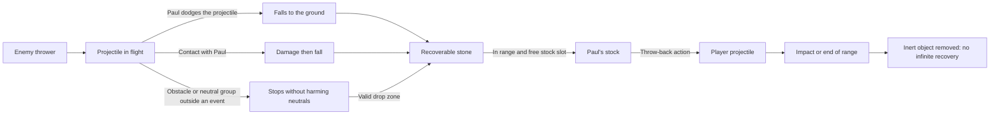

# BreakBreaker — Specifications: Combat and Enemies

> **Purpose of this file:** combat, projectiles, weapons, energy, protected groups, characters, hordes and artificial intelligence.  
> Part of the BreakBreaker specifications (version 1.1.2), split into several files. Back to the [specifications index](SPECS%20-%20Index.md) (overall table of contents, version history, conventions, file map).

## 8. Combat, projectiles and protected groups

### 8.1 Contact

Close-range hack-and-slash. **Confirmed: circular strike.** Each hit strikes every active rioter in range all around Paul (360°), nearest first, at most three per attack; Paul turns toward the nearest of the rioters hit. Bare-handed reach: 56 logical pixels (32-pixel tiles). Proposed rate: one hit every 0.45 seconds. Each target receives only one contact per hit identifier. A held weapon replaces the reach and knocks out in one hit (section 8.7).

Bare-handed (1 damage per hit), toughness starts at two hits, then clearly marked reinforced enemies demand more (delivered v1.9.13, section 12.14): the runner falls in one hit, the brute in four, « Le Caïd » in fourteen from round 3, more afterwards (v1.9.16); the other rioters have 2 HP. The first hit never causes a surrender.

Contacts are synchronised with the useful frames of the animation. Short knockback, reaction and a readable impact flash without blood. KO bodies can no longer be targeted, do not block passage and no longer earn points.

### 8.2 Enemy throwers

The "thrower" role is independent of the visual variant: a classic or flag-bearing rioter can throw a stone. No flag automatically grants a higher statistic.

Objects: pebble, cobblestone, brick. In V1, they may share the same damage values with different sprites. No explosive or firearm added implicitly. The incendiary bottle (Molotov) is reserved for the dedicated rioter of section 10.2, who targets places, and, **changed (v1.9.4)**, for the throwers aimed at Paul in section 10.9, whose bottle leaves a pool of fire on the ground.

Each throw has a wind-up, an announced direction/zone and a travel delay. Starting parameters: wind-up of at least 0.6 seconds; range 280 to 360 pixels; travel of at least 0.5 seconds against a distant target; 5 HP lost per impact at the start. An individual interval prevents continuous fire.

A small visual arc and a shadow may represent the trajectory, but the collision is computed in the 2D plane. The impact point or trajectory is visible before the damage. Off-screen throws require a warning and are not allowed at very short distance without a wind-up.

### 8.3 Recovery and throw-back cycle

V1 proposal: recovery of **enemy projectiles on the ground**, not interception in flight. Automatic pickup within a radius of about 28 pixels, only if a slot remains. A projectile in flight cannot be picked up.

Maximum stock: three objects. Stock full: the object stays on the ground. The number carried is visible. No purchase, crafting or inventory to open.

Throwing back consumes one carried object, creates a projectile belonging to the player and follows the direction chosen at launch. No automatic guidance once in flight. Initial parameters: one point of damage, range of about 360 pixels and interval of 0.5 seconds. Only one rioter hit, no chain ricochet in V1.

After a throw-back, the object becomes inert on its next contact or at the end of its course and is removed; it does not feed an infinite pickup loop. Only new enemy stones produce recoverable objects. Collision with Paul of the projectile he has just thrown back is disabled.

### 8.4 Impact rules

| Source | Target | Effect |
| --- | --- | --- |
| Player contact | Active rioter | Damage and possibly KO; immediate KO with a weapon |
| Enemy stone in flight | Paul | Damage, then recoverable fall in a valid zone |
| Thrown-back stone | Active rioter | Damage; score only if KO |
| Paul's hit / stone | Peaceful group or victim to rescue | No damage, no KO, no unit added to the « Casseurs neutralisés » counter |
| Attack by an aggressor assigned to a rescue | Victim of that event | Reduces the deadline / distress gauge of that event, without gore |
| Ordinary enemy attack outside a rescue | Peaceful group | No unscripted crowd damage or silent event |
| Stone in flight | Solid obstacle | Stops; falls or is removed depending on available space |
| Thrown-back stone | KO body | No new score; not used as an active target |

KO has the same scale whatever the origin of Paul's damage: bare hands, weapon or throw-back. No additional bonus for a projectile or a weapon.

### 8.5 Protected peaceful groups

The demonstrators are grouped, with placards and a calm animation. Paul's targeting, circular strike and throw-back exclude them: a demonstrator within the strike radius is neither hit nor counted among the three targets. They have no KO transition inflicted by the player. During an identified rescue, a subset of the group or a designated victim may go into distress under the threat of the aggressors assigned to that event.

**Added (v1.9.10, project owner's request) — discontent bubble.** Above the group of peaceful demonstrators, a pixel bubble with red border and text displays in turn a neutral protest phrase, 2.8 s out of every 4.2 s, with a slight tremble: « ÇA SUFFIT ! » (Enough!), « ON EN A MARRE ! » (We've had enough!), « ARRÊTEZ ÇA ! » (Stop that!), « STOP À LA CASSE ! » (Stop the damage!), « C’EST HONTEUX ! » (It's shameful!). The phrases target no group in particular, contain no insult or political keyword, and the bubble changes nothing in the game (the group remains untargetable).

The groups occupy an identifiable space to go around. Their positions cannot entirely block an objective, an exit or a heal. The player cannot move or disperse them by hitting. Enemies must also be able to go around them.

A projectile from Paul that meets the group's protected volume is stopped without injury. An ordinary enemy projectile also follows this protection; only an attack explicitly assigned to a rescue can advance its threat. A recoverable drop requires a free position outside the group; otherwise the object is removed. Thrown-back stones that are stopped become inert. Neutral sprites must not be used to hide an untouchable rioter: display order, navigation and trajectories must be checked.

The point of avoiding the groups comes from movement and throw-back lines, not from damage dealt by Paul to the demonstrators. This permanent protection against the player must be distinguished from the distress caused by enemies in an announced rescue. No positive or negative "hit on demonstrator" score is triggered, since these contacts are excluded. Inherited penalties remain applicable to other protected persons if they can be touched; an extension of invulnerability to all neutrals remains possible, to be decided explicitly.

### 8.6 Health

100 HP at the start, no passive regeneration in normal mode. Contacts and projectiles can reduce health. Brief invulnerability after impact, proposed at 0.6 seconds, to avoid unreadable simultaneous damage. A projectile produces only one damage event per trajectory.

Damage progression is capped like that of the assaults. The heals described in section 12 are kept. The hero's KO remains the only global defeat.

### 8.7 Pickup weapons

**Confirmed (EX-25):** weapons appear at random in the streets. They replace the former "contact props" extension. No gore. **Changed (v1.9):** the ban on firearms is lifted for Paul's flashball and the enemy shooters, in cartoon style (EX-07, delivered in v1.9.15).

| Rule | Value |
| --- | --- |
| Spawn location | Free, walkable point, 160–480 logical pixels from Paul, outside a peaceful group and outside an obstacle |
| Rate | **Changed (v1.9.16, project owner's request: « il y a peut-être un poil trop d’armes » — there may be a touch too many weapons):** first weapon after 20 seconds (`weapons.firstSpawn`), then one every 30 to 45 seconds (`spawnEvery`); a missed spawn (cap, weapon near Paul) waits for the next turn |
| Ground cap | **Changed (v1.9.16):** the street timer places a weapon only if there is none on the ground (`maxGround`: 1, all origins counted); beyond that, no spawn and no invisible reserve. The weapon from the twist (one time in two when it is not the shield), the one from the breather (end of even rounds only) and the Caïd's (one time in two) are added outside the cap, at 160–480 px from Paul (the Caïd's: where he falls), and disappear after 15 s (`weapons.dropLifetime`). **Added (v1.9.24):** a street weapon that nobody picks up disappears after **60 s** (`weapons.groundLifetime`), which frees the cap (the timer can place a weapon again on the next turn); the first shooter's guaranteed flashball too (60 s, it no longer stayed indefinitely); special drops keep their 15 s. Any weapon about to disappear blinks during its last 3 seconds (faster in the last one), like special drops and small heals (snapshot `weaponsOnGround[].expiresAt`) |
| No piles | **Added (v1.9.16):** no ordinary weapon is dropped (street, twist, breather, Caïd) while a weapon is already on the ground within 200 px of Paul (`weapons.clearRadius`); the shield and the first shooter's guaranteed flashball are not subject to it |
| Frequency obtained | Measured with the test bot (deferred KO of 6 to 12 s, pickup 4 s after the spawn, seeds 1 to 6): about 31 to 39 weapons and shields placed over 10 rounds, against 61 to 76 before v1.9.16 (roughly half as many) |
| Pickup | Automatic by walking over it (20 px); the new weapon replaces the held weapon, which disappears (fury mode and the energy wave come from the energy gauge and do not touch it, sections 8.8 and 8.9; **changed (v1.9.16):** neither does the shield: it is added to the held weapon) |
| Effect | Any weapon knocks a rioter out in one hit; **changed (v1.9.13):** against a brute (4 HP) or « Le Caïd » (14 HP in round 3, then more, v1.9.16) an ordinary weapon hit deals only 2 damage (`toughWeaponDamage` and `caid.damageFrom.weapon`: 2 hits for a brute, 7 for the Caïd of round 3; section 12.14); reach specific to each weapon; circular strike, three targets at most, except the boxing glove (straight punch of 160 px, first rioter on the line) and the flashball (aimed shot, first rioter hit) (v1.9.15) |
| Wear | Only a hit touching at least one rioter consumes a charge; at zero, the weapon breaks and Paul returns to bare hands (56 pixels) |
| Rounds | The held weapon and its remaining hits are kept from one round to the next |

Current contact weapons (**Confirmed**, values as initial parameters):

| Weapon | Reach | Hits |
| --- | ---: | ---: |
| Stick | 72 pixels | 15 |
| Hammer | 64 pixels | 8 |
| Road sign (« Panneau » in game) | 96 pixels | 10 |

Presentation: a weapon on the ground floats, oscillates and shines to be spotted; the held weapon spins on itself with each hit. The « ARME » (weapon) line of the score list (section 14.1) displays « <name> (<hits>) » or « Mains nues » (bare hands). The score for a KO with a weapon is identical to that of a KO bare-handed or by throw-back.

**New weapons unlocked per round — slice 2:**

| Weapon | Behaviour | Availability |
| --- | --- | --- |
| Spring boxing glove (« Gant de boxe » in game) | **Delivered (v1.9.15, section 12.14)**: Strike throws a spring punch of 160 px in a straight line (toward the aim, otherwise the facing); the first rioter hit is knocked out and pushed back 32 px (body thrown in a tumble); stopped by the first obstacle, the peaceful group and the victim; 6 hits, a hit is used only if it connects | Streets from round 3 |
| Flashball (cartoon) | **Delivered (v1.9.15, section 12.14)**: Strike fires a ball at 420 px/s (480 px at most) toward the mouse; with no aim, toward the facing with slight assistance (the nearest active rioter within ±12° and 320 px, clear line); KO of the first rioter hit; stopped by buildings, furniture, the peaceful group and the victim; 6 hits, each shot uses one, hit or miss | Streets from round 5; a guaranteed flashball at the entry of the game's first shooter (round 6; it disappears after 60 s if not picked up, v1.9.24) |
| Energy wave (identifier `kamehame`) | **Changed (v1.9.14):** is no longer a picked-up weapon; energy gauge power, see section 8.9 | From round 1, gauge at 50 or more |
| Shield | **Confirmed and delivered (v1.9.7)**, protection only since v1.9.16: see section 8.9 | Twist from round 3 (one time in two), street from round 5 |

Cartoon tone, no gore; cartoon firearms only under the conditions of EX-07. Balance: powerful weapons remain rare and are associated with the arrival of tougher rioters. Rays and ranged hits respect the protection of peaceful groups and victims (section 8.5): they stop on their volume without hurting them.

### 8.8 Energy gauge and fury mode

**Changed (v1.9.14, project owner's request: « plutôt que le mode saiyan et le kamehame soient des armes qu’on ramasse, je préfère que ça soit une sorte de barre de mana qu’on alimente à chaque fois qu’on met KO un émeutier. Une fois que cette barre de mana est pleine, on peut l’activer quand on veut » — rather than the saiyan mode and the kamehame being weapons you pick up, I would prefer a sort of mana bar that is fed each time a rioter is knocked out; once that mana bar is full, it can be activated whenever wanted):** fury mode and the energy wave are no longer picked up. They come from an **energy gauge** that each KO fills; the player triggers them whenever they want. No fury or wave object appears on the ground, at the twist, in the street or at the breather, and there is no longer any banner or indicator for them.

**Changed (v1.9.23, project owner's feedback: they could not manage to launch the energy wave and wanted a longer fury mode):** the gauge fills faster (+6 per rioter, +10 per brute, +25 for the Caïd, instead of +4 / +8 / +20), fury mode lasts **18 s** instead of 12 s, and the wave is launched with **a single press** (section 8.9). The ÉNERGIE line says which key to press: « C · Onde » (C · Wave) from 50, « R · Furie » (R · Fury) at 100.

| Rule | Value (`CONFIG.energy` parameters) |
| --- | --- |
| Gauge | 0 to 100 (`max`), simulated (deterministic); kept from one round to the next, reset to 0 by Replay; no decrease over time |
| Filling | Each rioter knocked out and counted by the score rule (`Rules.onKnockout`): +6 (`gain.rioter`, runners included), +10 for a brute (`gain.brute`), +25 for « Le Caïd » (`gain.boss`), capped at 100 (**changed v1.9.23**, previously +4 / +8 / +20). No gain during fury mode nor for KOs from the energy wave (no chain recharge). KOs bare-handed, with a weapon and by thrown-back stone fill the gauge |
| Thresholds | 50 (`ondeCost`): the energy wave becomes available; 100 (`furieCost`): fury mode becomes available. Event `EnergyReady { level: 'onde' \| 'furie' }` once at each upward crossing (again after dropping back below the threshold) |
| Fury mode | R (phone: Furie button) with the gauge full: the entire gauge is spent and the mode starts at once for 18 s (`FurieStarted`; **changed v1.9.23**, previously 12 s); a wave charge in progress is cancelled at no cost. During the mode the gauge stays empty and does not fill. Ignored during the mode, the pause or when Paul is KO |
| Refusal | R with an incomplete gauge, or C below 50: nothing happens, `EnergyRefused { need }`, short message « Énergie insuffisante » (Not enough energy) in the ÉNERGIE line and a dull "toc" sound |

Fury mode itself is unchanged (`CONFIG.furie` parameters):

| Rule | Value |
| --- | --- |
| Activation | From the full gauge (above), 18 s (`durationSec`, **changed v1.9.23**, previously 12 s); the held weapon keeps its hits and remains usable |
| Movement | Walking and running ×1.35 (`speedMul`) |
| Strike | Reach ×1.5 bare-handed as with a weapon (`reachMul`), up to 8 rioters per hit (`maxTargets`, 3 outside the mode), KO in one hit even bare-handed, except « Le Caïd » who takes 5 damage per hit (v1.9.16, section 12.14); the hit does not consume a weapon charge |
| Damage taken | ×0.5 (`damageTakenMul`) |
| End | Timer elapsed, or Paul KO (immediate end); the pause freezes the timer; Replay restarts with no mode and an empty gauge |
| Flight | Each rioter knocked out by a hit from Paul during the mode flies off in a whirl (purely visual, no game rule changed): direction opposite to Paul with a slight deviation, 220–420 px, 2 to 5 turns, drawn from a separate, deterministic random stream; each KO still counts +1. The stone throw-back is unchanged |

Presentation: additive yellow-white spiked aura behind Paul with pulsation, rising flame-shaped sparks, warm tint of the sprite and golden outline, thin timer ring at the feet; the aura weakens and blinks during the last 2 seconds. The flown bodies whirl for about 0.7 s (damped path, arc, slight squash, trail of stars and dust) above the scenery, then fall back at the free point farthest along their path, never off the map nor into a wall, and stay on the ground like the other bodies. Each hit that connects during the mode displays a short pixel bubble « POW ! » / « BOUM ! » (reused) and a very slight camera shake, suppressed with `prefers-reduced-motion`. HUD: « ÉNERGIE » line (section 14.1) whose bar empties over the 18 s (`durationSec`); « ARME » line « Bâton (12) · Mode furie 9 s » (seconds rounded up, value in yellow; « Bâton (12) · Bouclier 14 s · Mode furie 9 s » with the shield); short arrowless banner « MODE FURIE ! » on activation. Sound: clear chime when the gauge is full, synthetic rise at the start, low hum during the mode (one voice from the cap, cut by mute and pause), descent at the end.

### 8.9 Shield and energy wave

**Confirmed (v1.9.7), changed (v1.9.14, v1.9.16):** the **shield** remains the only special picked up: it is picked up by walking over it. **Changed (v1.9.16, project owner's request: « le bouclier doit juste protéger, pas faire des dégâts supplémentaires » — the shield must just protect, not deal extra damage):** it **no longer replaces the held weapon** and **no longer strikes**: picking it up starts a protection timer on top of the held weapon (or bare hands), as the former fury mode timer did; Strike remains exactly Paul's normal hit. The **energy wave** is no longer a weapon: it is the second power of the energy gauge (section 8.8), with no weapon slot or use counter; it combines with the held weapon and the shield. Original pixel-art visuals, with no borrowing from an existing franchise; the internal identifier of the wave remains `kamehame`, the in-game name is « Onde d’énergie » (Energy wave).

| Rule | Shield (`CONFIG.bouclier`) | Energy wave (`CONFIG.kamehame`, cost `CONFIG.energy.ondeCost`) |
| --- | --- | --- |
| Duration / uses | 20 s of active game time (`durationSec`), the pause freezes the timer; a second shield picked up resets it to 20 s; Paul KO stops it at once; at the end, the bubble bursts (« ShieldEnded », v1.9.16) and the held weapon stays in hand with its hits; no hit counter | Available as soon as the gauge reaches 50; each shot costs 50, paid when the ray leaves (two shots from a full gauge) |
| Effect | **Changed (v1.9.12, project owner's request: « il faut que le bouclier soit une sorte de bulle de protection » — the shield must be a sort of protection bubble):** a **protection bubble** around Paul, in all directions (360°, no more cone or facing): any stone, any bottle from the throwers aimed at Paul and (v1.9.15) any ball from the shooters that would reach him is blocked, from the front, side or back (even during invulnerability; a blocked ball disappears). A blocked stone falls at the impact point, recoverable, without damage; a blocked bottle goes out with no pool (« ShieldBlocked » on Paul's edge, on the thrower's side). A stone that passes beside Paul is not stopped. Contact hits and pools already on the ground: not blocked | **Changed (v1.9.23, project owner's feedback: they could not launch the wave):** **a single press** of C (phone: Onde button) starts a 0.7 s charge (`chargeSec`, previously 1 s) that **ends by itself**: the key does not have to stay held and releasing it no longer cancels anything. The charge starts on a new press (rising edge); a new press during the charge changes nothing. Paul does not move during the charge (mouse aiming orients him). Only **Paul's KO** or **the triggering of fury mode** cancel it, **spending nothing**; **taking a hit no longer cancels it**. At 0.7 s the ray leaves by itself and 50 energy is spent (nothing before): 320 px (`length`) in Paul's facing direction, 16 px of half-width (`halfWidth`), stopped at the first obstacle (building, object, trunk, monument base, peaceful group); all active rioters within 16 px + their radius of the line are KO (+1 each, with no energy gain); never the victims nor the group. A shot with no target still costs its energy. Fury mode does not block the charge, but the gauge is empty then (it was spent and does not fill during the mode) |
| Strike | **Changed (v1.9.16):** no more shield bash (`bashRange` and `knockback` parameters removed): Strike is Paul's normal hit, with the held weapon (reach, damage and weapon wear) or bare-handed; no extra damage, reach or knockback; the bubble hurts no one | Strike (Space) remains the circular hit; no hit during the charge nor on the press that starts it; **changed (v1.9.8):** the rioters KO'd by the ray are **launched into orbit** (see below) |
| HUD | **Changed (v1.9.16):** the « ARME » line keeps the held weapon and adds the shield time: « Bâton (12) · Bouclier 14 s », « Mains nues · Bouclier 14 s » (seconds rounded up); snapshot `shield: { secondsLeft } \| null` | « ÉNERGIE » line (**changed v1.9.23:** « C · Onde », the key first, which blinks softly from 50; « R · Furie » at 100); small pixel charge bar under Paul's energy bar during the charge |
| Presentation | **Changed (v1.9.12):** translucent soap bubble around Paul (radius of about 24 px, light blue and white veil, soft additive glow, lighter 1 px edge, arc-shaped highlight turning slowly, slight pulsation of ±1 px), drawn above Paul and under his health bar, in whole pixels; on each block, the edge lights up, a wave (ring) and sparks leave from the point hit on the bubble; during the last 3 seconds it fades and blinks faster and faster, then bursts ("pop": widening ring and droplets). `prefers-reduced-motion`: no pulsation or blinking, fixed highlight | Blue-white glow growing in the hands; **changed (v1.9.23):** a **charge ring** around Paul (radius 20 px, dark track, light blue arc closing clockwise from twelve o'clock, white head) shows the progress, in place of the thin ring that used to tighten in the hands; blue-white cartoon ray (≈ 250 ms, widths in steps, additive glow) and slight camera shake (none with `prefers-reduced-motion`) |
| Object on the ground | Round blue and steel shield with a highlight, floating and pulsing (unchanged; « BOUCLIER » indicator, shield icon) | None (no more orb on the ground) |
| Sound | Brief metallic clang on block | Soft little "ping" when the gauge reaches 50; rising hum during the charge, discharge on firing (WebAudio, within the voice cap) |

**Launch into orbit (v1.9.8, project owner's request: « j’ai envie que les émeutiers soient satellisés » — I want the rioters to be launched into orbit).** Each rioter knocked out by the energy wave is shot into the sky along the ray, instead of the fury mode whirl: `satellite` flight in the visual payload (`launch.kind`), 1,100 to 1,800 px (`satellitePower`), 6 to 10 turns (`satelliteSpin`), ± 0.15 rad around the ray (`satelliteJitter`), drawn from the separate flight random stream (deterministic, no other sequence shifted). On screen: about 1.3 s of acceleration (slow then very fast) while whirling, rising and shrinking down to 25%, small trail of stars and dust, above everything, with no map limit (it may leave the world and the screen). The star is always seen: a small pixel star « ✦ » twinkles (with, one time in two, a tiny « PING ! » bubble, scaled to the zoom like the other bubbles) at the point where the body leaves the screen, brought back inside the edge (8 px), or where it ends if it ends on screen; never two stars for the same body. The bodies of a same ray take off one after the other (0, 30, 60, 90, 120 ms according to their rank, no randomness). The body is then removed: no body stays on the ground. At most sixteen satellites in flight at once (beyond that, the body disappears at once with its star); stars and bubbles reused. `prefers-reduced-motion`: 0.5 s flight with no rotation. Purely visual: each KO still counts +1, no extra point; fury mode keeps its whirl (`tumble`), KOs bare-handed, with a weapon or by stone have no flight.

**Who drops the shield.** **Changed (v1.9.14):** the shield is the only special on the ground. The twist happens in **every** round from round 2 (round 3 adds the second emergency to it, every odd round from 3 before v1.1.1, section 12.2): from round 3, a draw (seed) gives the shield one time in two (`bouclier.dropShare`); otherwise (and always in round 2), **changed (v1.9.16):** an ordinary weapon one time in two (`weapons.twistRegularShare`), nothing otherwise (the twist is then announced without a weapon). In the street, the shield is added to the ordinary weapons with a weight of about one in six from round 5 (`spawnShare`); a street shield does not disappear, the twist's after 15 s. Fury mode and the energy wave are never dropped.

**Indicator.** Only the shield on the ground has a screen-edge indicator (« BOUCLIER », shield icon, whatever its origin) and only a twist shield has a banner: « BOUCLIER DISPONIBLE ! » (Shield available!) / « Fonce le ramasser » (Run and grab it). Ordinary weapons (stick, hammer, road sign, boxing glove, flashball), including the twist's, have neither banner nor indicator; only the first shooter's guaranteed flashball has its one-line banner « FLASHBALL AU SOL » (Flashball on the ground) (section 12.14). The twist, the end of round and the Caïd, when they drop an ordinary weapon (v1.9.16: not always, section 8.7), drop one of the three starting ones; the boxing glove and the flashball come from the street (and from the first shooter).

## 9. Characters, hordes and artificial intelligence

### 9.1 Visual categories

| Category | Function | Score and « Casseurs neutralisés » counter |
| --- | --- | --- |
| Classic rioter | Contact, damage or throwing depending on role | +1 point and +1 on the counter at KO |
| Rioter with Palestinian flag | Same role families, distinct flag | +1 point and +1 on the counter at KO |
| Rioter with Antifa flag | Same role families, distinct flag | +1 point and +1 on the counter at KO |
| Group of peaceful demonstrators | Neutral group to go around and protect; rescue possible if threatened | Never |
| Individual victim or elderly couple | Theft/intimidation during a rescue event, never an opponent | Never |
| Students / teachers | Peaceful presence and return to school | Never |
| Police / firefighters / healthcare workers / shopkeepers | Protected presence and functions | Never |

NPC skin tones vary in all categories. The outfit, placard or flag does not replace the entity logic and its hostile or neutral behaviour. **Confirmed:** the flag is purely cosmetic; it changes neither the score, nor the counter, nor the statistics.

### 9.2 Enemy roles

- Contact: joins Paul, prepares then strikes within range.
- Degrader: joins a facade as long as the objective is active, then changes target if it is lost.
- **Drawn to Paul (v1.9.1):** a degrader or a victim's aggressor goes after Paul when he passes within 220 px at most with a clear line, and returns to its post beyond 320 px (hysteresis). When only three active hostiles at most remain, a degrader that has held its post for more than 6 s leaves it for Paul, permanently. **Changed (v1.9.5):** a victim's aggressor is no longer concerned: it stays on the victim (and robs them, section 12.12) as long as Paul does not come within 220 px; a small rescue alone on the map therefore loses its items if Paul is slow. A Molotov is never diverted before its throw. Parameters `hostile.aggroRadius`, `aggroRelease`, `fewLeft`, `postSec`.
- Thrower: looks for a throwing distance and a readable line, prepares then hurls; returns to contact if necessary.

The first round teaches contact alone; throwers appear from round 2 (section 12.2). A horde then mixes the roles. No surrender state, no flight counted as a victory, no disappearance giving a KO for free.

### 9.3 Hordes and pressure

The hordes are larger than in the planned 3D version. Within a round, the rioters enter one by one (1.5 seconds apart), through the three entry points nearest to Paul among those located at least 320 px away (v1.9.1), and only while fewer than twelve hostiles are active on the map (`round.gate`); the following ones wait in an entry queue. The aggressors of a rescue appear directly around the victim (48 to 80 px from them, at least 160 px from Paul), outside this queue. The technical cap remains forty active hostiles, event aggressors included, to be validated against mobile budgets. This cap remains a rule common to all graphics qualities, not a number automatically reduced on slow devices.

The director limits simultaneous attack preparations: at the start two contact hits and two throws; progressive increase capped at four contacts and four throws in preparation. The other enemies approach, reposition or degrade. The total of projectiles in flight is capped separately.

### 9.4 Navigation

Orthogonal grid, building footprints and volumes of peaceful groups. Local avoidance and sharing of paths or direction fields so as not to recompute a full search for every enemy at every frame.

Spatial partitioning for neighbourhood, contacts and projectiles. No quadratic traversal of the whole crowd at every frame as a production solution. Spawns are outside the near field, in a free location, never in the middle of a peaceful group.

A horde must not permanently block its own path. A stuck agent recomputes or joins another valid target; no visible teleportation near Paul.

### 9.5 Peaceful groups

Three groups proposed on the map, of six to eight sprites each, in non-mandatory locations. **Delivered (v1.1.0):** the map has three groups of six demonstrators on the main square, at group(22,16), group(30,25) and group(22,32) (section 5.5); the first slice had only one, at the centre. Slow group movements possible after validation, without abruptly cutting off the only dodge route.

Their placards and their density distinguish them from the hordes. They remain neutral even when Paul passes close or is being chased. An event may make them call for help or fall back; they do not become hostile and are not exposed to free damage from Paul. They do not feed the loot, heal or KO score systems.
