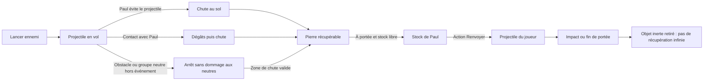

# BreakBreaker — Spécifications : Combat et ennemis

> **Rôle du fichier :** combat, projectiles, armes, énergie, groupes protégés, personnages, hordes et intelligence artificielle.  
> Fait partie des spécifications de BreakBreaker (version 1.9.25), découpées en plusieurs fichiers. Retour à l’[index des spécifications](SPECS%20-%20Index.md) (sommaire général, historique des versions, conventions, plan des fichiers).

## 8. Combat, projectiles et groupes protégés

### 8.1 Contact

Hack-and-slash de proximité. **Confirmé : frappe circulaire.** Chaque coup touche tout autour de Paul (360°) les casseurs actifs à portée, les plus proches d’abord, au plus trois par attaque ; Paul se tourne vers le plus proche des casseurs touchés. Portée à mains nues : 56 pixels logiques (tuiles de 32 pixels). Cadence proposée : un coup toutes les 0,45 seconde. Chaque cible ne reçoit qu’un contact par identifiant de coup. Une arme tenue remplace la portée et met KO en un coup (section 8.7).

À mains nues (1 dégât par coup), la résistance commence à deux coups, puis des ennemis renforcés clairement signalés en demandent davantage (livré v1.9.13, section 12.14) : le coureur tombe en un coup, le costaud en quatre, « Le Caïd » en quatorze dès la manche 3, davantage ensuite (v1.9.16) ; les autres casseurs ont 2 PV. Le premier coup ne provoque jamais de reddition.

Les contacts sont synchronisés aux images utiles de l’animation. Recul court, réaction et flash d’impact lisible sans sang. Les corps KO ne sont plus ciblables, ne bloquent pas le passage et ne rapportent plus de points.

### 8.2 Lanceurs ennemis

Le rôle « lanceur » est indépendant de la variante visuelle : un casseur classique ou à drapeau peut lancer une pierre. Aucun drapeau n’attribue automatiquement une statistique supérieure.

Objets : caillou, pavé, brique. En V1, ils peuvent partager les mêmes valeurs de dégâts avec des sprites différents. Pas d’explosif ni d’arme à feu ajouté implicitement. La bouteille incendiaire (Molotov) est réservée au casseur dédié de la section 10.2, qui vise les lieux, et, **modifié (v1.9.4)**, aux lanceurs sur Paul de la section 10.9, dont la bouteille laisse une flaque de feu au sol.

Chaque lancer possède une préparation, une direction/zone annoncée et un délai de trajet. Paramètres de départ : préparation d’au moins 0,6 seconde ; portée 280 à 360 pixels ; trajet d’au moins 0,5 seconde sur une cible éloignée ; 5 PV perdus par impact au départ. Un intervalle individuel empêche le tir continu.

Un petit arc visuel et une ombre peuvent représenter la trajectoire, mais la collision est calculée dans le plan 2D. Le point d’impact ou la trajectoire est visible avant les dégâts. Les lancers hors écran nécessitent un avertissement et ne sont pas autorisés à très courte distance sans préparation.

### 8.3 Cycle de récupération et renvoi

Proposition V1 : récupération des **projectiles ennemis au sol**, pas interception en vol. Ramassage automatique dans un rayon d’environ 28 pixels, seulement s’il reste une place. Un projectile en vol ne peut pas être ramassé.

Stock maximal : trois objets. Stock plein : l’objet reste au sol. Le nombre porté est visible. Aucun achat, fabrication ou inventaire à ouvrir.

Renvoyer consomme un objet porté, crée un projectile appartenant au joueur et suit la direction choisie au lancement. Aucun guidage automatique une fois en vol. Paramètres initiaux : un point de dégât, portée d’environ 360 pixels et intervalle de 0,5 seconde. Un seul casseur touché, pas de ricochet en chaîne en V1.

Après un renvoi, l’objet devient inerte à son prochain contact ou en fin de course et est retiré ; il n’alimente pas une boucle de ramassage infinie. Seules les nouvelles pierres ennemies produisent des objets récupérables. La collision avec Paul du projectile qu’il vient de renvoyer est désactivée.

### 8.4 Règles d’impact

| Source | Cible | Effet |
| --- | --- | --- |
| Contact du joueur | Casseur actif | Dégâts et éventuellement KO ; KO immédiat avec une arme |
| Pierre ennemie en vol | Paul | Dégâts, puis chute récupérable en zone valide |
| Pierre renvoyée | Casseur actif | Dégâts ; score seulement si KO |
| Coup / pierre de Paul | Groupe pacifique ou victime à secourir | Aucun dégât, aucun KO, aucune unité au compteur de casseurs neutralisés |
| Attaque d’un agresseur affecté à un secours | Victime de cet événement | Réduit le délai / la jauge de détresse de cet événement, sans gore |
| Attaque ennemie ordinaire hors secours | Groupe pacifique | Pas de dégâts de foule non scénarisés ni d’événement silencieux |
| Pierre en vol | Obstacle solide | Arrêt ; chute ou retrait selon espace disponible |
| Pierre renvoyée | Corps KO | Pas de nouveau score ; ne sert pas de cible active |

Le KO a le même barème quelle que soit l’origine des dégâts de Paul : mains nues, arme ou renvoi. Aucun bonus supplémentaire pour un projectile ou une arme.

### 8.5 Groupes pacifiques protégés

Les manifestants sont regroupés, avec pancartes et animation calme. Le ciblage, la frappe circulaire et le renvoi de Paul les excluent : un manifestant dans le rayon de frappe n’est ni touché ni compté parmi les trois cibles. Ils ne possèdent pas de transition de KO infligée par le joueur. Pendant un secours identifié, un sous-ensemble du groupe ou une victime désignée peut passer en détresse sous la menace des agresseurs affectés à cet événement.

**Ajouté (v1.9.10, demande du porteur du projet) — bulle de mécontentement.** Au-dessus du groupe de manifestants pacifiques, une bulle pixel à bordure et texte rouges affiche tour à tour une phrase de protestation neutre, 2,8 s sur 4,2 s, avec un léger tremblement : « ÇA SUFFIT ! », « ON EN A MARRE ! », « ARRÊTEZ ÇA ! », « STOP À LA CASSE ! », « C’EST HONTEUX ! ». Les phrases ne visent aucun groupe en particulier, ne contiennent ni insulte ni mot-clé politique, et la bulle ne change rien au jeu (le groupe reste non ciblable).

Les groupes occupent un espace identifiable à contourner. Leurs positions ne peuvent pas bloquer entièrement un objectif, une sortie ou un soin. Le joueur ne peut pas les déplacer ou les disperser à coups. Les ennemis doivent également pouvoir les contourner.

Un projectile de Paul qui rencontre le volume protégé du groupe est arrêté sans blessure. Un projectile ennemi ordinaire suit aussi cette protection ; seule une attaque explicitement affectée à un secours peut faire avancer sa menace. Une chute récupérable exige une position libre hors du groupe ; sinon l’objet est retiré. Les pierres renvoyées arrêtées deviennent inertes. Les sprites neutres ne servent pas à masquer un casseur intouchable : ordre d’affichage, navigation et trajectoires doivent être vérifiés.

L’intérêt d’éviter les groupes vient du déplacement et des lignes de renvoi, pas de dégâts infligés par Paul aux manifestants. Il faut distinguer cette protection permanente contre le joueur de la détresse provoquée par des ennemis dans un secours annoncé. Aucun score positif ou négatif de « frappe sur manifestant » n’est déclenché, puisque ces contacts sont exclus. Les pénalités héritées restent applicables aux autres personnes protégées si elles sont touchables ; une extension d’invulnérabilité à tous les neutres reste possible, à décider explicitement.

### 8.6 Santé

100 PV au départ, pas de régénération passive en normal. Contacts et projectiles peuvent réduire la santé. Brève invulnérabilité après impact, proposée à 0,6 seconde, pour éviter des dégâts simultanés illisibles. Un projectile ne produit qu’un événement de dommage par trajectoire.

La progression des dégâts est plafonnée comme celle des assauts. Les soins décrits en section 12 sont conservés. Le KO du héros reste la seule défaite globale.

### 8.7 Armes ramassables

**Confirmé (EX-25) :** des armes apparaissent au hasard dans les rues. Elles remplacent l’ancienne extension « accessoires de contact ». Aucun gore. **Modifié (v1.9) :** l’interdiction des armes à feu est levée pour le flashball de Paul et les tireurs ennemis, en style cartoon (EX-07, livrés en v1.9.15).

| Règle | Valeur |
| --- | --- |
| Emplacement d’apparition | Point libre et praticable, à 160–480 pixels logiques de Paul, hors groupe pacifique et hors obstacle |
| Rythme | **Modifié (v1.9.16, demande du porteur du projet : « il y a peut-être un poil trop d’armes ») :** première arme après 20 secondes (`weapons.firstSpawn`), puis une toutes les 30 à 45 secondes (`spawnEvery`) ; une apparition manquée (plafond, arme proche de Paul) attend le tour suivant |
| Plafond au sol | **Modifié (v1.9.16) :** le minuteur de rue ne pose une arme que s’il n’y en a aucune au sol (`maxGround` : 1, toutes origines comptées) ; au-delà, aucune apparition ni réserve invisible. L’arme du retournement (une fois sur deux quand ce n’est pas le bouclier), celle du répit (fin des manches paires seulement) et celle du Caïd (une fois sur deux) s’y ajoutent hors plafond, à 160–480 px de Paul (le Caïd : là où il tombe), et disparaissent après 15 s (`weapons.dropLifetime`). **Ajouté (v1.9.24) :** une arme de rue que personne ne ramasse disparaît au bout de **60 s** (`weapons.groundLifetime`), ce qui libère le plafond (le minuteur peut reposer une arme au tour suivant) ; le flashball garanti du premier tireur aussi (60 s, il ne restait plus indéfiniment) ; les dépôts spéciaux gardent leurs 15 s. Toute arme qui va disparaître clignote pendant ses 3 dernières secondes (plus vite la dernière), comme les dépôts spéciaux et les petits soins (instantané `weaponsOnGround[].expiresAt`) |
| Pas de tas | **Ajouté (v1.9.16) :** aucune arme ordinaire n’est déposée (rue, retournement, répit, Caïd) tant qu’une arme est déjà au sol à 200 px ou moins de Paul (`weapons.clearRadius`) ; le bouclier et le flashball garanti du premier tireur n’y sont pas soumis |
| Fréquence obtenue | Mesurée avec le bot de test (KO différé de 6 à 12 s, ramassage 4 s après l’apparition, graines 1 à 6) : environ 31 à 39 armes et boucliers posés pour 10 manches, contre 61 à 76 avant v1.9.16 (à peu près moitié moins) |
| Ramassage | Automatique en passant dessus (20 px) ; la nouvelle arme remplace l’arme tenue, qui disparaît (le mode furie et l’onde d’énergie viennent de la jauge d’énergie et n’y touchent pas, sections 8.8 et 8.9 ; **modifié (v1.9.16) :** le bouclier non plus : il s’ajoute à l’arme tenue) |
| Effet | Toute arme met un casseur KO en un coup ; **modifié (v1.9.13) :** sur un costaud (4 PV) ou « Le Caïd » (14 PV en manche 3, puis davantage, v1.9.16) un coup d’arme ordinaire ne fait que 2 dégâts (`toughWeaponDamage` et `caid.damageFrom.weapon` : 2 coups pour un costaud, 7 pour le Caïd de la manche 3 ; section 12.14) ; portée propre à chaque arme ; frappe circulaire, trois cibles au maximum, sauf le gant de boxe (coup droit de 160 px, premier casseur sur la ligne) et le flashball (tir visé, premier casseur touché) (v1.9.15) |
| Usure | Seul un coup touchant au moins un casseur consomme une charge ; à zéro, l’arme se brise et Paul revient à mains nues (56 pixels) |
| Manches | L’arme tenue et ses coups restants sont conservés d’une manche à la suivante |

Armes de contact actuelles (**Confirmé**, valeurs en paramètre initial) :

| Arme | Portée | Coups |
| --- | ---: | ---: |
| Bâton | 72 pixels | 15 |
| Marteau | 64 pixels | 8 |
| Panneau de signalisation (« Panneau » en jeu) | 96 pixels | 10 |

Présentation : une arme au sol flotte, oscille et brille pour être repérée ; l’arme tenue tourne sur elle-même à chaque coup. La ligne « ARME » de la liste de score (section 14.1) affiche « <nom> (<coups>) » ou « Mains nues ». Le score d’un KO à l’arme est identique à celui d’un KO à mains nues ou par renvoi.

**Nouvelles armes débloquées par manche — tranche 2 :**

| Arme | Comportement | Disponibilité |
| --- | --- | --- |
| Gant de boxe à ressort (« Gant de boxe » en jeu) | **Livré (v1.9.15, section 12.14)** : Frapper donne un coup de poing à ressort de 160 px en ligne droite (vers la visée, sinon l’orientation) ; le premier casseur touché est mis KO et repoussé de 32 px (corps projeté en culbute) ; arrêté par le premier obstacle, le groupe pacifique et la victime ; 6 coups, un coup n’est usé que s’il touche | Rues dès la manche 3 |
| Flashball (cartoon) | **Livré (v1.9.15, section 12.14)** : Frapper tire une balle à 420 px/s (480 px au plus) vers la souris ; sans visée, vers l’orientation avec une légère aide (le casseur actif le plus proche à ±12° et 320 px, ligne dégagée) ; KO du premier casseur touché ; arrêtée par bâtiments, mobilier, groupe pacifique et victime ; 6 coups, chaque tir en use un, touché ou non | Rues dès la manche 5 ; un flashball garanti à l’entrée du premier tireur de la partie (manche 6 ; il disparaît après 60 s s’il n’est pas ramassé, v1.9.24) |
| Onde d’énergie (identifiant `kamehame`) | **Modifié (v1.9.14) :** n’est plus une arme ramassée ; pouvoir de la jauge d’énergie, voir section 8.9 | Dès la manche 1, jauge à 50 ou plus |
| Bouclier | **Confirmé et livré (v1.9.7)**, protection seule depuis v1.9.16 : voir section 8.9 | Retournement dès la manche 3 (une fois sur deux), rue dès la manche 5 |

Ton cartoon, aucun gore ; armes à feu cartoon seulement dans les conditions d’EX-07. Équilibrage : les armes puissantes restent rares et sont associées à l’arrivée de casseurs plus résistants. Les rayons et coups à distance respectent la protection des groupes pacifiques et des victimes (section 8.5) : ils s’arrêtent sur leur volume sans les blesser.

### 8.8 Jauge d’énergie et mode furie

**Modifié (v1.9.14, demande du porteur du projet : « plutôt que le mode saiyan et le kamehame soient des armes qu’on ramasse, je préfère que ça soit une sorte de barre de mana qu’on alimente à chaque fois qu’on met KO un émeutier. Une fois que cette barre de mana est pleine, on peut l’activer quand on veut ») :** le mode furie et l’onde d’énergie ne se ramassent plus. Ils viennent d’une **jauge d’énergie** que chaque KO remplit ; le joueur les déclenche quand il veut. Aucun objet furie ou onde n’apparaît au sol, au retournement, dans la rue ou au répit, et il n’y a plus ni bannière ni indicateur pour eux.

**Modifié (v1.9.23, retour du porteur du projet : il n’arrivait pas à lancer l’onde d’énergie et voulait un mode furie plus long) :** la jauge se remplit plus vite (+6 par casseur, +10 par costaud, +25 pour le Caïd, au lieu de +4 / +8 / +20), le mode furie dure **18 s** au lieu de 12 s, et l’onde se lance d’**un seul appui** (section 8.9). La ligne ÉNERGIE dit quelle touche presser : « C · Onde » dès 50, « R · Furie » à 100.

| Règle | Valeur (paramètres `CONFIG.energy`) |
| --- | --- |
| Jauge | 0 à 100 (`max`), simulée (déterministe) ; conservée d’une manche à l’autre, remise à 0 par Rejouer ; aucune baisse avec le temps |
| Remplissage | Chaque casseur mis KO compté par la règle de score (`Rules.onKnockout`) : +6 (`gain.rioter`, coureurs compris), +10 pour un costaud (`gain.brute`), +25 pour « Le Caïd » (`gain.boss`), plafonné à 100 (**modifié v1.9.23**, avant +4 / +8 / +20). Aucun gain pendant le mode furie ni pour les KO de l’onde d’énergie (pas de recharge en chaîne). Les KO à mains nues, à l’arme et par pierre renvoyée remplissent la jauge |
| Seuils | 50 (`ondeCost`) : l’onde d’énergie devient disponible ; 100 (`furieCost`) : le mode furie devient disponible. Événement `EnergyReady { level: 'onde' \| 'furie' }` une fois à chaque franchissement vers le haut (de nouveau après être repassé sous le seuil) |
| Mode furie | R (téléphone : bouton Furie) avec la jauge pleine : la jauge entière est dépensée et le mode démarre aussitôt pour 18 s (`FurieStarted` ; **modifié v1.9.23**, avant 12 s) ; une charge d’onde en cours est annulée sans coût. Pendant le mode la jauge reste vide et ne se remplit pas. Ignoré pendant le mode, la pause ou Paul KO |
| Refus | R avec une jauge incomplète, ou C sous 50 : rien ne se passe, `EnergyRefused { need }`, court message « Énergie insuffisante » dans la ligne ÉNERGIE et son sourd « toc » |

Le mode furie lui-même est inchangé (paramètres `CONFIG.furie`) :

| Règle | Valeur |
| --- | --- |
| Activation | Depuis la jauge pleine (ci-dessus), 18 s (`durationSec`, **modifié v1.9.23**, avant 12 s) ; l’arme tenue garde ses coups et reste utilisable |
| Déplacement | Marche et course ×1,35 (`speedMul`) |
| Frappe | Portée ×1,5 à mains nues comme avec une arme (`reachMul`), jusqu’à 8 casseurs par coup (`maxTargets`, 3 hors mode), KO en un coup même à mains nues, sauf « Le Caïd » qui prend 5 dégâts par coup (v1.9.16, section 12.14) ; le coup ne consomme pas de charge d’arme |
| Dégâts reçus | ×0,5 (`damageTakenMul`) |
| Fin | Minuteur écoulé, ou Paul KO (fin immédiate) ; la pause gèle le minuteur ; Rejouer repart sans mode et jauge vide |
| Envol | Chaque casseur mis KO par un coup de Paul pendant le mode s’envole en tourbillon (purement visuel, aucune règle de jeu changée) : direction opposée à Paul avec un léger écart, 220–420 px, 2 à 5 tours, tirés d’un flux aléatoire séparé et déterministe ; chaque KO compte toujours +1. Le renvoi de pierre est inchangé |

Présentation : aura jaune-blanc additive à pointes derrière Paul avec pulsation, étincelles en flammes qui montent, teinte chaude du sprite et contour doré, fin anneau de minuterie aux pieds ; l’aura faiblit et clignote pendant les 2 dernières secondes. Les corps envolés tournoient pendant environ 0,7 s (trajet amorti, arc, léger écrasement, traînée d’étoiles et de poussière) au-dessus du décor, puis retombent au point libre le plus éloigné de leur trajet, jamais hors de la carte ni dans un mur, et restent au sol comme les autres corps. Chaque coup qui touche pendant le mode affiche une courte bulle pixel « POW ! » / « BOUM ! » (réutilisée) et une très légère secousse de caméra, supprimée avec `prefers-reduced-motion`. HUD : ligne « ÉNERGIE » (section 14.1) dont la barre se vide sur les 18 s (`durationSec`) ; ligne « ARME » « Bâton (12) · Mode furie 9 s » (secondes arrondies au supérieur, valeur en jaune ; « Bâton (12) · Bouclier 14 s · Mode furie 9 s » avec le bouclier) ; bannière courte sans flèche « MODE FURIE ! » à l’activation. Son : carillon clair quand la jauge est pleine, montée synthétique au début, bourdonnement grave pendant le mode (une voix du plafond, coupé par la sourdine et la pause), descente à la fin.

### 8.9 Bouclier et onde d’énergie

**Confirmé (v1.9.7), modifié (v1.9.14, v1.9.16) :** le **bouclier** reste le seul spécial ramassé : il se ramasse en passant dessus. **Modifié (v1.9.16, demande du porteur du projet : « le bouclier doit juste protéger, pas faire des dégâts supplémentaires ») :** il **ne remplace plus l’arme tenue** et **ne frappe plus** : le ramasser lance un minuteur de protection par-dessus l’arme tenue (ou les mains nues), comme le faisait l’ancien minuteur du mode furie ; Frapper reste exactement le coup normal de Paul. L’**onde d’énergie** n’est plus une arme : c’est le second pouvoir de la jauge d’énergie (section 8.8), sans emplacement d’arme ni compteur d’usages ; elle se combine avec l’arme tenue et le bouclier. Visuels originaux en pixel art, sans emprunt à une franchise existante ; l’identifiant interne de l’onde reste `kamehame`, le nom en jeu est « Onde d’énergie ».

| Règle | Bouclier (`CONFIG.bouclier`) | Onde d’énergie (`CONFIG.kamehame`, coût `CONFIG.energy.ondeCost`) |
| --- | --- | --- |
| Durée / usages | 20 s de temps de jeu actif (`durationSec`), la pause gèle le minuteur ; un second bouclier ramassé le remet à 20 s ; Paul KO l’arrête aussitôt ; à la fin, la bulle éclate (« ShieldEnded », v1.9.16) et l’arme tenue reste en main avec ses coups ; aucun compteur de coups | Disponible dès que la jauge atteint 50 ; chaque tir coûte 50, payés au départ du rayon (deux tirs depuis une jauge pleine) |
| Effet | **Modifié (v1.9.12, demande du porteur du projet : « il faut que le bouclier soit une sorte de bulle de protection ») :** une **bulle de protection** autour de Paul, dans toutes les directions (360°, plus de cône ni d’orientation) : toute pierre, toute bouteille des lanceurs sur Paul et (v1.9.15) toute balle des tireurs qui l’atteindrait est bloquée, de face, de côté ou de dos (même pendant l’invulnérabilité ; une balle bloquée disparaît). Une pierre bloquée tombe au point d’impact, récupérable, sans dégât ; une bouteille bloquée s’éteint sans flaque (« ShieldBlocked » sur le bord de Paul, du côté du lanceur). Une pierre qui passe à côté de Paul n’est pas arrêtée. Coups au contact et flaques déjà au sol : non bloqués | **Modifié (v1.9.23, retour du porteur du projet : il n’arrivait pas à lancer l’onde) :** **un seul appui** sur C (téléphone : bouton Onde) lance une charge de 0,7 s (`chargeSec`, avant 1 s) qui **se termine seule** : la touche n’a pas à rester enfoncée et la relâcher n’annule plus rien. La charge démarre sur un nouvel appui (front montant) ; un nouvel appui pendant la charge ne change rien. Paul ne se déplace pas pendant la charge (la visée à la souris l’oriente). Seuls **le KO de Paul** ou **le déclenchement du mode furie** l’annulent, **sans rien dépenser** ; **prendre un coup ne l’annule plus**. À 0,7 s le rayon part seul et 50 d’énergie sont dépensés (rien avant) : 320 px (`length`) dans l’orientation de Paul, 16 px de demi-largeur (`halfWidth`), arrêté au premier obstacle (bâtiment, objet, tronc, socle du monument, groupe pacifique) ; tous les casseurs actifs à moins de 16 px + leur rayon de la ligne sont KO (+1 chacun, sans gain d’énergie) ; jamais les victimes ni le groupe. Un tir sans cible coûte quand même son énergie. Le mode furie ne bloque pas la charge, mais la jauge y est vide (elle a été dépensée et ne se remplit pas pendant le mode) |
| Frappe | **Modifié (v1.9.16) :** plus de coup de bouclier (paramètres `bashRange` et `knockback` retirés) : Frapper est le coup normal de Paul, avec l’arme tenue (portée, dégâts et usure de l’arme) ou à mains nues ; aucun dégât, aucune portée ni aucun repoussement en plus ; la bulle ne blesse personne | Frapper (Espace) reste le coup circulaire ; aucun coup pendant la charge ni à l’appui qui la lance ; **modifié (v1.9.8) :** les casseurs KO par le rayon sont **satellisés** (voir ci-dessous) |
| HUD | **Modifié (v1.9.16) :** la ligne « ARME » garde l’arme tenue et ajoute le temps du bouclier : « Bâton (12) · Bouclier 14 s », « Mains nues · Bouclier 14 s » (secondes arrondies au supérieur) ; instantané `shield: { secondsLeft } \| null` | Ligne « ÉNERGIE » (**modifié v1.9.23 :** « C · Onde », la touche d’abord, qui clignote doucement dès 50 ; « R · Furie » à 100) ; petite barre de charge pixel sous la barre d’énergie de Paul pendant la charge |
| Présentation | **Modifié (v1.9.12) :** bulle de savon translucide autour de Paul (rayon d’environ 24 px, voile bleu clair et blanc, lueur douce additive, liseré plus clair de 1 px, reflet en arc qui tourne lentement, légère pulsation de ±1 px), dessinée au-dessus de Paul et sous sa barre de santé, en pixels entiers ; à chaque blocage, le liseré s’éclaire, une onde (anneau) et des étincelles partent du point touché sur la bulle ; les 3 dernières secondes elle pâlit et clignote de plus en plus vite, puis éclate (« pop » : anneau qui s’élargit et gouttelettes). `prefers-reduced-motion` : ni pulsation ni clignotement, reflet fixe | Lueur bleu-blanc qui grandit dans les mains ; **modifié (v1.9.23) :** un **anneau de charge** autour de Paul (rayon 20 px, piste sombre, arc bleu clair qui se referme dans le sens des aiguilles d’une montre depuis midi, tête blanche) montre la progression, à la place du fin anneau qui se resserrait dans les mains ; rayon de dessin animé bleu-blanc (≈ 250 ms, largeurs par paliers, lueur additive) et légère secousse de caméra (aucune avec `prefers-reduced-motion`) |
| Objet au sol | Bouclier rond bleu et acier avec reflet, flottant et pulsant (inchangé ; indicateur « BOUCLIER », icône bouclier) | Aucun (plus d’orbe au sol) |
| Son | Choc métallique bref au blocage | Petit « ping » doux quand la jauge atteint 50 ; bourdonnement montant pendant la charge, décharge au tir (WebAudio, dans le plafond de voix) |

**Satellisation (v1.9.8, demande du porteur du projet : « j’ai envie que les émeutiers soient satellisés »).** Chaque casseur mis KO par l’onde d’énergie est expédié dans le ciel le long du rayon, au lieu du tourbillon du mode furie : envol `satellite` de la charge visuelle (`launch.kind`), 1 100 à 1 800 px (`satellitePower`), 6 à 10 tours (`satelliteSpin`), ± 0,15 rad autour du rayon (`satelliteJitter`), tirés du flux aléatoire séparé des envols (déterministe, aucune autre séquence décalée). À l’écran : environ 1,3 s d’accélération (lente puis très rapide) en tournoyant, en montant et en rapetissant jusqu’à 25 %, petite traînée d’étoiles et de poussière, au-dessus de tout, sans limite de carte (il peut sortir du monde et de l’écran). L’étoile est toujours vue : une petite étoile pixel « ✦ » scintille (avec une fois sur deux une minuscule bulle « PING ! », à l’échelle du zoom comme les autres bulles) au point où le corps quitte l’écran, ramené à l’intérieur du bord (8 px), ou là où il finit s’il finit à l’écran ; jamais deux étoiles pour un même corps. Les corps d’un même rayon décollent l’un après l’autre (0, 30, 60, 90, 120 ms selon leur rang, sans hasard). Le corps est ensuite retiré : aucun corps ne reste au sol. Seize satellites au plus en vol à la fois (au-delà, le corps disparaît aussitôt avec son étoile) ; étoiles et bulles réutilisées. `prefers-reduced-motion` : vol de 0,5 s sans rotation. Purement visuel : chaque KO compte toujours +1, aucun point en plus ; le mode furie garde son tourbillon (`tumble`), les KO à mains nues, à l’arme ou à la pierre n’ont pas d’envol.

**Qui dépose le bouclier.** **Modifié (v1.9.14) :** le bouclier est le seul spécial au sol. Le retournement a lieu à **chaque** manche dès la manche 2 (les manches impaires dès la 3 y ajoutent la seconde urgence, section 12.2) : dès la manche 3, un tirage (graine) donne le bouclier une fois sur deux (`bouclier.dropShare`) ; sinon (et toujours en manche 2), **modifié (v1.9.16) :** une arme ordinaire une fois sur deux (`weapons.twistRegularShare`), rien sinon (le retournement est alors annoncé sans arme). Dans la rue, le bouclier s’ajoute aux armes ordinaires avec un poids d’environ un sur six dès la manche 5 (`spawnShare`) ; un bouclier de la rue ne disparaît pas, celui du retournement après 15 s. Le mode furie et l’onde d’énergie ne sont jamais déposés.

**Indicateur.** Seul le bouclier au sol a un indicateur de bord d’écran (« BOUCLIER », icône bouclier, quelle que soit son origine) et seul un bouclier du retournement a une bannière : « BOUCLIER DISPONIBLE ! » / « Fonce le ramasser ». Les armes ordinaires (bâton, marteau, panneau, gant de boxe, flashball), y compris celle du retournement, n’ont ni bannière ni indicateur ; seul le flashball garanti du premier tireur a sa bannière d’une ligne « FLASHBALL AU SOL » (section 12.14). Le retournement, la fin de manche et le Caïd, quand ils déposent une arme ordinaire (v1.9.16 : pas toujours, section 8.7), en déposent une des trois de départ ; le gant et le flashball viennent de la rue (et du premier tireur).

## 9. Personnages, hordes et intelligence artificielle

### 9.1 Catégories visuelles

| Catégorie | Fonction | Score et compteur « Casseurs neutralisés » |
| --- | --- | --- |
| Casseur classique | Contact, dégradation ou lancer selon rôle | +1 point et +1 au compteur au KO |
| Casseur avec drapeau palestinien | Même familles de rôles, drapeau distinct | +1 point et +1 au compteur au KO |
| Casseur avec drapeau Antifa | Même familles de rôles, drapeau distinct | +1 point et +1 au compteur au KO |
| Groupe de manifestants pacifiques | Groupe neutre à contourner et protéger ; secours possible si menacé | Jamais |
| Victime individuelle ou couple âgé | Vol/intimidation pendant un événement de secours, jamais adversaire | Jamais |
| Étudiants / professeurs | Présence pacifique et retour à l’école | Jamais |
| Police / pompiers / soignants / commerçants | Présence et fonctions protégées | Jamais |

Les teints des PNJ varient dans toutes les catégories. La tenue, la pancarte ou le drapeau ne remplace pas la logique d’entité et son comportement hostile ou neutre. **Confirmé :** le drapeau est purement cosmétique ; il ne modifie ni le score, ni le compteur, ni les statistiques.

### 9.2 Rôles d’ennemis

- Contact : rejoint Paul, prépare puis frappe à portée.
- Dégradeur : rejoint une façade tant que l’objectif est actif, puis change de cible si elle est perdue.
- **Attirés par Paul (v1.9.1) :** un dégradeur ou un agresseur de victime s’en prend à Paul quand il passe à 220 px au plus avec une ligne dégagée, et retourne à son poste au-delà de 320 px (hystérésis). Quand il ne reste que trois hostiles actifs au plus, un dégradeur qui tient son poste depuis plus de 6 s le quitte pour Paul, définitivement. **Modifié (v1.9.5) :** un agresseur de victime n’est plus concerné : il reste sur la victime (et la vole, section 12.12) tant que Paul ne s’approche pas à 220 px ; un petit secours seul sur la carte perd donc ses objets si Paul tarde. Un Molotov n’est jamais détourné avant son lancer. Paramètres `hostile.aggroRadius`, `aggroRelease`, `fewLeft`, `postSec`.
- Lanceur : cherche une distance de lancer et une ligne lisible, prépare puis projette ; revient au contact si nécessaire.

La première manche enseigne le contact seul ; les lanceurs apparaissent à partir de la manche 2 (section 12.2). Une horde mélange ensuite les rôles. Aucun état de reddition, de fuite comptée comme victoire ou de disparition donnant gratuitement un KO.

### 9.3 Hordes et pression

Les hordes sont plus nombreuses que dans la version 3D prévue. Dans une manche, les casseurs entrent un par un (1,5 seconde d’écart), par les trois points d’entrée les plus proches de Paul parmi ceux situés à 320 px au moins (v1.9.1), et seulement tant que moins de douze hostiles sont actifs sur la carte (`round.gate`) ; les suivants attendent dans une file d’entrée. Les agresseurs d’un secours apparaissent directement autour de la victime (48 à 80 px d’elle, à 160 px au moins de Paul), hors de cette file. Le plafond technique reste de quarante hostiles actifs, agresseurs d’événements compris, à valider par les budgets mobile. Ce plafond reste une règle commune aux qualités graphiques, pas un nombre réduit automatiquement sur les appareils lents.

Le directeur limite les préparations d’attaques simultanées : au départ deux frappes de contact et deux lancers ; augmentation progressive plafonnée à quatre contacts et quatre lancers en préparation. Les autres ennemis approchent, se repositionnent ou dégradent. Le total de projectiles en vol est plafonné séparément.

### 9.4 Navigation

Grille orthogonale, empreintes de bâtiments et volumes de groupes pacifiques. Évitement local et partage des chemins ou champs de direction pour ne pas recalculer une recherche complète pour chaque ennemi à chaque image.

Partition spatiale pour voisinage, contacts et projectiles. Aucun parcours quadratique de toute la foule à chaque image comme solution de production. Les apparitions sont hors du champ proche, dans un emplacement libre, jamais au milieu d’un groupe pacifique.

Une horde ne doit pas bloquer définitivement son propre trajet. Un agent coincé recalcule ou rejoint une autre cible valide ; pas de téléportation visible près de Paul.

### 9.5 Groupes pacifiques

Trois groupes proposés sur la carte, de six à huit sprites chacun, sur des emplacements non obligatoires. La première tranche n’en a qu’un, de six manifestants, au centre de la carte (les deux autres sont à faire). Déplacements lents de groupe possibles après validation, sans couper brutalement la seule voie d’esquive.

Leurs pancartes et leur densité les distinguent des hordes. Ils restent neutres même quand Paul passe près ou se fait poursuivre. Un événement peut les faire appeler à l’aide ou se replier ; ils ne deviennent pas hostiles et ne sont pas exposés à des dégâts libres de Paul. Ils ne nourrissent pas les systèmes de butin, de soins ou de score de KO.
