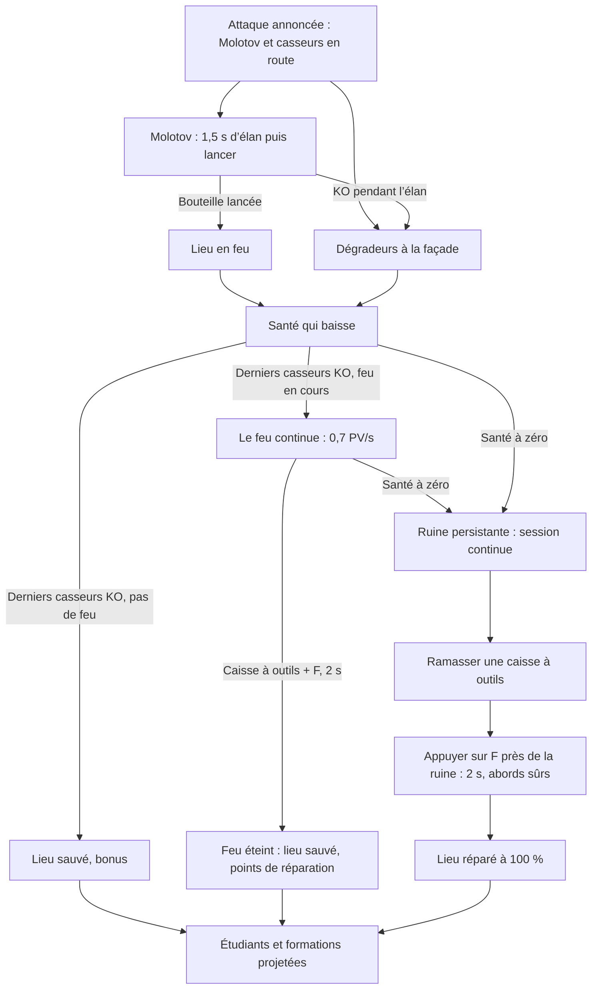

# BreakBreaker — Spécifications : Lieux, monument et services

> **Rôle du fichier :** bâtiments menacés, défense, réparation et objectif monument.  
> Fait partie des spécifications de BreakBreaker (version 1.9.25), découpées en plusieurs fichiers. Retour à l’[index des spécifications](SPECS%20-%20Index.md) (sommaire général, historique des versions, conventions, plan des fichiers).

## 10. Bâtiments menacés, défense et réparation

### 10.1 Boucle d’un lieu attaqué

**Modifié (v1.9) :** l’ancienne réserve de temps (30 s) est remplacée partout, école comprise, par un modèle de santé. La boucle vaut pour tous les lieux de casse (école, voiture, abribus, **ajouté (v1.9.4)** boutique de jeux rétro, puis ceux de la section 12.2).

### 10.2 Alerte, Molotov et santé

Chaque lieu a une **barre de santé** : bâtiments 100 PV (école, boutique de jeux rétro, école maternelle, mairie, bibliothèque ; v1.9.18), mobilier urbain (deux voitures, abribus, kiosque ; v1.9.18 ; deux cabines, v1.9.19) 60 PV, la **prison** (v1.9.20) 400 PV, quatre fois un bâtiment ordinaire (section 12.17). Elle est dessinée au-dessus du lieu sur la carte et reprise dans la carte d’incident du HUD (« École 64 % ») ; le HUD n’affiche pas de compte à rebours pour un lieu.

Une attaque commence par un **casseur Molotov** : il marche vers le lieu, s’arrête à 96 px au plus avec une ligne dégagée, lève une bouteille allumée pendant 1,5 s (élan visible), puis la lance ; le lieu **prend feu**. Le mettre KO pendant l’élan empêche ce feu. **Modifié (v1.9.1) :** une attaque compte plusieurs lanceurs de Molotov, en plus de ses autres casseurs : min(4, 1 + manche ÷ 2 arrondi à l’inférieur), soit 1 en manche 1, 2 en manches 2–3, 3 en manches 4–5, 4 ensuite (aussi pour la boutique de jeux rétro, v1.9.4, qui est un bâtiment), deux au plus pour une voiture ou l’abribus ; ils arrivent en tête de la première ligne, sauf pour l’école de la manche 1 dont le second lanceur vient avec les renforts, après la cinématique. Plusieurs lanceurs du même lieu ne lancent jamais ensemble : chacun garde sa bouteille levée 0,25 s de plus que le précédent. Une bouteille sur un lieu déjà en feu ne le rallume pas (pas de nouvelle bannière ni d’alarme) mais lui retire d’un coup 8 PV (`molotov.burstDamage`), avec une gerbe de flammes visible ; à zéro, même ruine et même pénalité unique que pour le feu. Les autres casseurs de l’attaque se partagent entre **dégradeurs** (ils frappent la façade) et casseurs qui s’en prennent à Paul ; ce mélange est le réglage d’équilibrage. Composition livrée (hors école de la manche 1, section 10.4) : les lanceurs de Molotov, deux dégradeurs et un casseur au contact, plus, pour un bâtiment, min(6, 2 + ⌊pression ÷ 3⌋) dégradeurs et casseurs au contact en alternance, et pour une voiture ou l’abribus min(3, ⌊pression ÷ 4⌋) casseurs au contact ; variantes alternées.

Le feu retire 2 PV/s ; chaque dégradeur en train de frapper retire 1,2 PV/s, quatre au plus comptés. La santé ne baisse que pendant ces dégradations effectives ; elle ne dépend pas de l’entrée de Paul dans une zone. La première école (manche 1) présente sa première ligne puis huit renforts ; ces casseurs comptent dans l’effectif de la manche (section 12.2).

### 10.3 Source de vérité de la santé

La santé du lieu, tenue par la simulation, est l’unique source de vérité : pas de second minuteur. Elle ne se réinitialise pas quand Paul quitte la zone et ne remonte pas pendant l’attaque.

À zéro : lieu détruit. La perte est résolue une seule fois (−3 pour l’école, −2 pour la boutique, une voiture ou l’abribus ; barème complet en section 12.2) et le bonus de sauvetage est perdu. La ruine (brûlée, fumante) persiste d’une manche à l’autre et n’est plus attaquée tant qu’elle n’est pas réparée. Un lieu détruit ne termine jamais la session ; seul le KO de Paul y met fin. Les survivants de l’attaque se reportent sur Paul.

### 10.4 Première ligne et renforts

L’entrée du cercle déclenche la confrontation, pas le début du danger. Les KO obtenus avant l’entrée sont conservés. Aucun agent ne réapparaît à cause d’une sortie/rentrée.

Après la première ligne entièrement KO, une courte cinématique annonce les huit renforts ; elle n’existe que pour l’école de la manche 1. Pendant cette présentation suspendue, la santé du lieu et tous les autres incidents sont également suspendus. Passer la séquence (F, Espace ou toucher) ne double pas les renforts.

Si le bâtiment a déjà été détruit, cette occurrence ne crée pas ses renforts en retard. Les survivants restent à traiter, mais la voie de résolution devient la réparation par caisse à outils.

### 10.5 Sauvetage avant destruction

Tous les casseurs de l’attaque KO avec une santé strictement positive et **aucun feu** : le lieu est sauvé aussitôt. Bonus +8 pour l’école, +6 pour la boutique, +4 pour une voiture ou l’abribus, une seule fois par occurrence ; drapeau français sur l’école ; aucune caisse consommée. La santé d’un lieu sauvé revient au maximum à la fin de la manche.

**Modifié (v1.9.1) — un feu ne s’éteint jamais seul.** Si le lieu brûle quand ses derniers casseurs tombent, l’attaque est réglée pour la manche (objectif « réussi » tant que le lieu tient debout, la manche peut se terminer) mais le feu **continue** : il retire 0,7 PV/s (`target.smoulderDps` ; école de 100 PV ≈ 143 s, voiture de 60 PV ≈ 86 s), à travers les fins de manche et le répit, sans remise à niveau de la santé. Seule une caisse à outils l’éteint (section 10.6) : le lieu est alors sauvé (drapeau de l’école, statistiques), sans le bonus de sauvetage, avec les points de réparation. S’il atteint zéro avant, il devient une ruine (pénalité unique). Un lieu en feu n’est pas attaqué de nouveau ; sa carte « en feu » et son indicateur flamme restent affichés pour guider Paul, sans nouvelle bannière.

### 10.6 Caisses à outils après destruction

**Modifié (v1.9.1) :** la réparation se lance avec la touche Agir (F, bouton Agir), sans la maintenir. Une ruine se répare, et un lieu en feu s’éteint, avec une **caisse à outils** trouvée sur la carte. Elle est distincte des soins médicaux : caisse orange/rouge, même animation flottante que les soins ; portée, son icône flotte au-dessus de Paul (**modifié v1.9.6 :** plus de compteur « Caisse » dans le HUD). Elle ne rend pas de santé à Paul.

Stock : une caisse portée au maximum, au plus deux au sol, posées sur des emplacements libres prévus (quatre sur la carte, à 64 px au moins de Paul) au début et à la fin de chaque manche (la manche 1 en a donc). Paul la ramasse en passant dessus (rayon de 20 px) ; une caisse au sol ne disparaît pas s’il en porte déjà une. Une caisse portée est conservée entre manches. Les emplacements sont accessibles sans traverser bâtiment, tronc ou groupe ; aucune caisse dans la ruine à réparer.

Pour réparer ou éteindre : à 48 px au plus de la porte d’un lieu en ruine ou en feu (la ruine d’abord si les deux sont proches), Paul debout, caisse portée et **sans casseur actif à 64 px**, **appuyer une fois sur Agir** (F au clavier, bouton Agir au tactile) ; l’action dure ensuite **2 secondes** sans maintenir la touche. S’éloigner, laisser un casseur approcher ou un KO de Paul remet la progression à zéro et il faut appuyer de nouveau ; sans appui, rien ne se passe. **Modifié (v1.9.12) :** seul un **nouvel appui** compte (front montant de la touche, suivi par la simulation) : garder F enfoncé en arrivant près du lieu, pendant qu’un casseur s’éloigne ou en ramassant la caisse ne lance rien ; l’appui doit avoir lieu à portée, caisse portée et abords sûrs. Une tape plus courte qu’un pas de simulation (16,7 ms) n’est pas perdue : la saisie la retient pour une lecture. Le HUD l’affiche sous Paul : « F — Réparer » (ruine) ou « F — Éteindre le feu » (feu), sans la touche au tactile où le bouton Agir prend le libellé « Réparer » / « Éteindre » ; « Réparation… » (en cours) ; « Caisse à outils requise » (sans caisse) et « Abords non sécurisés » (casseur trop proche), informatifs.

La caisse n’est consommée qu’à la fin des 2 s. Interruption : aucun gain, aucune caisse consommée. **Modifié (v1.9.11, aligné sur le jeu) :** éteindre un lieu en feu (pendant ou après l’attaque) lui rend toute sa santé, comme une réparation (section 10.7), et rapporte une fois par feu les points de réparation (+5 école, +4 boutique, +3 voiture ou abribus).

### 10.7 Résultat d’une réparation

Le lieu revient à **100 % de sa santé** (ruine réparée ou feu éteint) ; sa fonction reprend (l’école peut de nouveau recevoir des étudiants). Points : +5 pour l’école, +4 pour la boutique, +3 pour une voiture ou l’abribus, sans effacer la pénalité déjà subie ni ajouter le bonus de sauvetage : sauver avant destruction reste mieux récompensé.

Une réparation ne recrée ni l’attaque perdue ni une nouvelle occurrence d’assaut. Chaque lieu conserve la référence de son dernier incident détruit et de sa réparation pour empêcher le double bonus. Une nouvelle attaque ultérieure est annoncée et identifiée séparément.

### 10.8 Étudiants et formations

**À faire :** les étudiants et les formations projetées ne sont pas livrés dans la première tranche ; seul le drapeau français de l’école l’est. **Modifié (v1.9.12) :** il flotte dès que l’école est debout et ne brûle pas, quel que soit l’état de son dernier incident (dès le début de la partie, de retour après une réparation ou une extinction) ; une école en feu ou en ruine n’en a pas.

Après sauvetage ou réparation, quatre étudiants puis de petits groupes peuvent rejoindre la porte. Chaque entrée produit une seule formation projetée, ingénieur ou scientifique. Pas de points de classement par attente. Au plus cinq étudiants en déplacement.

Les arrivées se suspendent si l’école est attaquée ou détruite. Les compteurs déjà obtenus ne sont pas effacés. Une réparation les fait reprendre sans remettre à zéro l’historique de session.

### 10.9 Lanceurs sur Paul

**Confirmé (v1.9.4, demande du porteur du projet) :** quelques casseurs à cocktail Molotov lancent aussi leurs bouteilles **sur Paul**, pas seulement sur les lieux. Ce sont les **lanceurs sur Paul** (rôle `firebomber`), peu nombreux.

- **Comportement :** comme le lanceur de pierres, il se tient entre 140 et 260 px de Paul avec une ligne dégagée, lève une bouteille allumée pendant **1,2 s** (« ! » au-dessus de la tête et ligne de visée en pointillés jusqu’au sol, avec l’anneau de la future flaque), puis lance. La bouteille vole **0,7 s** vers l’endroit où se trouvait Paul **au début de l’élan** : Paul qui se déplace l’évite. Un lancer toutes les 5 s. Paul à moins de 100 px : il se bat au contact comme un casseur ordinaire. Le mettre KO pendant l’élan empêche le lancer. Ses élans comptent dans le plafond des élans de lancer (avec les pierres).
- **Flaque de feu :** là où la bouteille tombe, une flaque de 30 px de rayon brûle **3,5 s** (six au plus à la fois : une nouvelle chasse la plus ancienne). Une bouteille qui tomberait dans un obstacle s’allume au point libre le plus proche (aucune flaque à défaut). Paul debout dedans perd **4 PV toutes les 0,5 s** par le chemin normal des dégâts : les images d’invulnérabilité s’appliquent (un coup refusé est retenté dès qu’elles finissent) et le mode furie les réduit de moitié. La flaque ne blesse aucun casseur et n’enflamme jamais un lieu. La pause la fige.
- **Qui :** jamais en manches 1–2. Dès la manche 3, environ **un casseur de remplissage sur huit** (au moins un dès que le remplissage en compte quatre, trois au plus par manche ; comptés hors meute de coureurs depuis la v1.9.13, section 12.14) ; et, dans chaque attaque de lieu, le **dernier lanceur de Molotov** de la composition, après sa bouteille sur le lieu (inchangée), devient un lanceur sur Paul au lieu d’un simple casseur de contact. Ce sont des casseurs ordinaires de la manche : ils comptent dans K/T, doivent être mis KO, +1 chacun ; leurs variantes alternent comme les autres.
- **Rendu et son :** bouteille en main comme le casseur Molotov, même trajectoire de bouteille, flaque en pixel art (lueur, flammes, étincelles, léger anneau de danger) qui s’estompe sur sa dernière demi-seconde ; même souffle que le Molotov au lancer. Aucune bannière ni nouvel élément de HUD.

## 11. Objectif monument

**Réécrit (v1.9.4, demande du porteur du projet).** L’ancienne version (monument occupé dès le départ, défenseurs à l’entrée dans la zone, capture de 12 s) est remplacée par la règle ci-dessous.

### 11.1 Présentation

Une **statue équestre** fictive en pixel art : un cheval et son cavalier en bronze sombre sur un socle de pierre à plaque vierge, le cavalier tenant une hampe. **Le drapeau tenu est d’abord le drapeau français** (bleu #0055a4, blanc, rouge #ef4135). Le tissu ondule (trois images). Aucune personne réelle n’est représentée. Le socle est solide comme le mobilier urbain : tuiles 33–34 × 21–22 (`R(33,21,2,2)`), mât en {1088, 672}, zone de capture circulaire {1088, 704} de rayon 112 px. Huit points d’occupation entourent le socle sur les tuiles libres ; socle, bord de zone et points sont atteignables depuis l’apparition de Paul et les entrées, sans chevaucher bâtiment, mobilier, station, arbre ni groupe pacifique.

Le monument n’a pas de santé et n’est pas un lieu de casse : il ne brûle pas, n’est pas réparé par caisse à outils et n’entre pas dans les ruines. Son drapeau, en revanche, **persiste comme une ruine** : une fois remplacé, il le reste d’une manche à l’autre et pendant les répits, jusqu’à ce que Paul le reprenne.

### 11.2 Occupation (« MONUMENT ATTAQUÉ ! »)

Dès la manche 4, la deuxième étape de la manche alterne entre le monument et le secours : monument quand le drapeau est français et que la manche précédente n’avait pas le monument, sinon secours. **Aucune occupation ne démarre tant que le drapeau est palestinien.** Si aucun lieu de casse n’est libre, l’étape restante est seule et donne son titre à la manche (« Monument menacé »).

Une occupation (`monument#n`) envoie **6 casseurs** la première fois, puis min(8, 5 + ⌊manche ÷ 3⌋). Ils entrent par la file d’entrée (en tête, comme les autres objectifs), variantes **mélangées en alternance** (classique, drapeau palestinien, Antifa), et marchent jusqu’au socle comme des dégradeurs ; ils comptent dans K/T et chaque KO vaut +1. Ils peuvent se détourner vers Paul quand il approche (règle d’attraction de la section 9).

Tant qu’au moins un casseur de l’occupation se tient au socle, un compteur de remplacement avance d’1 s par seconde **par casseur au socle (trois au plus comptés)** ; il garde sa valeur quand ils s’en éloignent. À **4 s** (environ 1,3 s à trois), le drapeau français est remplacé par le drapeau palestinien : animation (le drapeau descend, l’autre monte, 0,5 s), bannière « DRAPEAU REMPLACÉ ! » / « Reprends le monument », −3 une seule fois par occurrence. L’occupation est alors réglée pour la manche (objectif « perdu ») : la manche peut se clore, mais ses casseurs restent au socle et doivent être mis KO comme les autres. Si tous les casseurs de l’occupation sont KO avant le remplacement, le monument est **défendu** : +4 une fois, objectif « réussi ».

### 11.3 Capture du drapeau

Seulement quand le drapeau est palestinien, **à tout moment, répit compris** :

| Situation | Progression |
| --- | --- |
| Drapeau français | Aucune capture |
| Paul hors de la zone (distance au centre > 112 px) | Suspendue, valeur conservée |
| Paul dans la zone avec un hostile actif à l’intérieur | Suspendue : « zone contestée » |
| Paul dans la zone, aucun hostile actif à l’intérieur | Avance d’1 s par seconde |
| 8 s atteintes | Drapeau français rétabli |

Aucune touche : rester dans la zone suffit. Les corps KO et les personnes protégées ne contestent pas ; pause et KO de Paul figent la progression. À 8 s : drapeau français (animation inverse), son de confirmation, étincelles bleu-blanc-rouge, bannière courte « DRAPEAU RÉCUPÉRÉ ! », **+10 une seule fois par remplacement** (clé `monument#<n° du remplacement>:captured`). Plusieurs cycles remplacement / capture dans une session sont comptés chacun.

### 11.4 Affichage

Bannière « MONUMENT ATTAQUÉ ! » / « Défends le drapeau » au début de l’occupation (palette jaune, icône fanion neutre, flèche et distance), indicateur en bord d’écran « MONUMENT » pendant l’occupation puis « DRAPEAU » tant que le drapeau est palestinien ; carte « Drapeau — capture N/8 s » avec une mini-barre, « zone contestée » quand un hostile bloque. Au sol, l’anneau de la zone est discret quand le drapeau est français, rouge quand il est palestinien, hachuré quand la zone est contestée, avec un arc qui se remplit pendant la capture. Les drapeaux des casseurs restent purement cosmétiques (section 9) ; aucune variante n’est désignée comme occupante.
