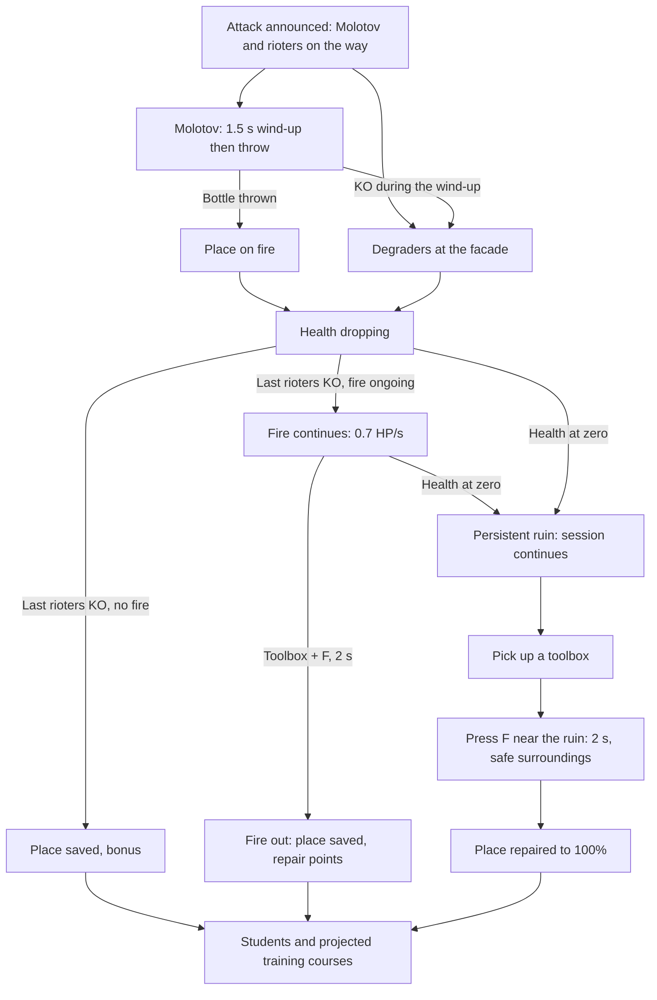

# BreakBreaker — Specifications: Places, Monument and Services

> **Purpose of this file:** threatened buildings, defence, repair and the monument objective.  
> Part of the BreakBreaker specifications (version 1.1.3), split into several files. Back to the [specifications index](SPECS%20-%20Index.md) (overall table of contents, version history, conventions, file map).

## 10. Threatened buildings, defence and repair

### 10.1 Loop of an attacked place

**Changed (v1.9):** the former time reserve (30 s) is replaced everywhere, school included, by a health model. The loop applies to all incident places (school, car, bus shelter, **added (v1.9.4)** retro games shop, then those of section 12.2).

### 10.2 Alert, Molotov and health

Each place has a **health bar**: buildings 100 HP (school, retro games shop, nursery school, town hall, library; v1.9.18), the **church** (v1.1.0) 150 HP (section 10.10), street furniture (two cars, bus shelter, newsstand; v1.9.18; two phone booths, v1.9.19) 60 HP, the **prison** (v1.9.20) 400 HP, four times an ordinary building (section 12.17). It is drawn above the place on the map and repeated in the HUD incident card (« École 64 % »); the HUD displays no countdown for a place.

An attack begins with a **Molotov rioter**: he walks toward the place, stops at 96 px at most with a clear line, raises a lit bottle for 1.5 s (visible wind-up), then throws it; the place **catches fire**. Knocking him out during the wind-up prevents this fire. **Changed (v1.9.1):** an attack includes several Molotov throwers, in addition to its other rioters: min(4, 1 + round ÷ 2 rounded down), that is 1 in round 1, 2 in rounds 2–3, 3 in rounds 4–5, 4 afterwards (also for the retro games shop, v1.9.4, which is a building), two at most for a car or the bus shelter; they arrive at the head of the front line, except for the round 1 school whose second thrower comes with the reinforcements, after the cutscene. Several throwers at the same place never throw together: each keeps its bottle raised 0.25 s longer than the previous one. A bottle on a place already on fire does not relight it (no new banner or alarm) but removes 8 HP at once (`molotov.burstDamage`), with a visible burst of flames; at zero, same ruin and same one-time penalty as for fire. The other rioters of the attack split between **degraders** (they hit the facade) and rioters who go after Paul; this mix is the balancing setting. Composition delivered (excluding the round 1 school, section 10.4): the Molotov throwers, two degraders and one contact rioter, plus, for a building, min(6, 2 + ⌊pressure ÷ 3⌋) degraders and contact rioters alternating, and for a car or the bus shelter min(3, ⌊pressure ÷ 4⌋) contact rioters; variants alternating.

Fire removes 2 HP/s; each degrader currently hitting removes 1.2 HP/s, four at most counted. Health drops only during these effective degradations; it does not depend on Paul entering a zone. The first school (round 1) presents its front line then eight reinforcements; these rioters count in the round roster (section 12.2).

### 10.3 Source of truth for health

The place's health, held by the simulation, is the single source of truth: no second timer. It does not reset when Paul leaves the zone and does not go back up during the attack.

At zero: place destroyed. The loss is resolved only once (−3 for the school, −2 for the shop, a car or the bus shelter; full scale in section 12.2) and the rescue bonus is lost. The ruin (burnt, smoking) persists from one round to the next and is no longer attacked as long as it is not repaired. A destroyed place never ends the session; only Paul's KO does. The survivors of the attack turn on Paul.

### 10.4 Front line and reinforcements

Entering the circle triggers the confrontation, not the start of the danger. KOs obtained before entering are kept. No agent respawns because of an exit/re-entry.

After the front line is entirely KO, a short cutscene announces the eight reinforcements; it exists only for the round 1 school. During this suspended presentation, the place's health and all other incidents are also suspended. Skipping the sequence (F, Space or touch) does not double the reinforcements.

If the building has already been destroyed, this occurrence does not create its reinforcements late. The survivors remain to be dealt with, but the resolution route becomes repair with a toolbox.

### 10.5 Rescue before destruction

All the attack's rioters KO with strictly positive health and **no fire**: the place is saved at once. Bonus +8 for the school, +6 for the shop, +4 for a car or the bus shelter, only once per occurrence; French flag on the school; no toolbox consumed. The health of a saved place returns to maximum at the end of the round.

**Changed (v1.9.1) — a fire never goes out by itself.** If the place is burning when its last rioters fall, the attack is settled for the round (objective « réussi » (succeeded) as long as the place is still standing, the round may end) but the fire **continues**: it removes 0.7 HP/s (`target.smoulderDps`; 100 HP school ≈ 143 s, 60 HP car ≈ 86 s), through round ends and the breather, with no health reset. Only a toolbox puts it out (section 10.6): the place is then saved (school flag, statistics), without the rescue bonus, with the repair points. If it reaches zero before that, it becomes a ruin (one-time penalty). A place on fire is not attacked again; its « en feu » (on fire) card and its flame indicator remain displayed to guide Paul, with no new banner.

### 10.6 Toolboxes after destruction

**Changed (v1.9.1):** repair is started with the Act key (F, Act button), without holding it. A ruin is repaired, and a place on fire is put out, with a **toolbox** found on the map. It is distinct from medical heals: orange/red box, same floating animation as the heals; when carried, its icon floats above Paul (**changed v1.9.6:** no more « Caisse » counter in the HUD). It does not restore health to Paul.

Stock: one box carried at most, at most two on the ground, placed on planned free locations (four on the map, at least 64 px from Paul) at the start and at the end of each round (round 1 therefore has them). Paul picks it up by walking over it (radius of 20 px); a box on the ground does not disappear if he already carries one. A carried box is kept between rounds. The locations are reachable without crossing a building, trunk or group; no box in the ruin to be repaired.

To repair or put out: within 48 px at most of the door of a ruined or burning place (the ruin first if both are close), with Paul standing, box carried and **no active rioter within 64 px**, **press Act once** (F on keyboard, Act button on touch); the action then lasts **2 seconds** without holding the key. Moving away, letting a rioter approach or a Paul KO resets progress to zero and the key must be pressed again; without a press, nothing happens. **Changed (v1.9.12):** only a **new press** counts (rising edge of the key, tracked by the simulation): keeping F held while arriving near the place, while a rioter moves away or while picking up the box starts nothing; the press must take place in range, box carried and surroundings safe. A tap shorter than a simulation step (16.7 ms) is not lost: the input capture holds it for one read. The HUD displays it under Paul: « F — Réparer » (Repair) (ruin) or « F — Éteindre le feu » (Put out the fire) (fire), without the key on touch where the Act button takes the label « Réparer » / « Éteindre »; « Réparation… » (Repairing…) (in progress); « Caisse à outils requise » (Toolbox required) (no box) and « Abords non sécurisés » (Surroundings not secured) (rioter too close), informative.

The box is consumed only at the end of the 2 s. Interruption: no gain, no box consumed. **Changed (v1.9.11, aligned with the game):** putting out a burning place (during or after the attack) restores all its health, like a repair (section 10.7), and earns the repair points once per fire (+5 school, +4 shop, +3 car or bus shelter).

### 10.7 Result of a repair

The place returns to **100% of its health** (ruin repaired or fire put out); its function resumes (the school can receive students again). Points: +5 for the school, +4 for the shop, +3 for a car or the bus shelter, without erasing the penalty already suffered nor adding the rescue bonus: saving before destruction remains better rewarded.

A repair recreates neither the lost attack nor a new assault occurrence. Each place keeps the reference of its last destroyed incident and of its repair to prevent the double bonus. A later new attack is announced and identified separately.

### 10.8 Students and training courses

**To do:** the students and projected training courses are not delivered in the first slice; only the school's French flag is. **Changed (v1.9.12):** it flies as soon as the school is standing and not burning, whatever the state of its last incident (from the start of the game, back after a repair or a fire being put out); a school on fire or in ruins has none.

After a rescue or a repair, four students then small groups may reach the door. Each entry produces a single projected training course, engineer or scientist. No ranking points for waiting. At most five students on the move.

Arrivals are suspended if the school is attacked or destroyed. The counters already obtained are not erased. A repair makes them resume without resetting the session history.

### 10.9 Throwers aimed at Paul

**Confirmed (v1.9.4, project owner's request):** a few rioters with Molotov cocktails also throw their bottles **at Paul**, not only at places. These are the **throwers aimed at Paul** (role `firebomber`), few in number.

- **Behaviour:** like the stone thrower, he stands between 140 and 260 px from Paul with a clear line, raises a lit bottle for **1.2 s** ("!" above the head and a dotted aiming line down to the ground, with the ring of the future pool), then throws. The bottle flies for **0.7 s** toward where Paul was **at the start of the wind-up**: a moving Paul avoids it. One throw every 5 s. Paul within 100 px: he fights in contact like an ordinary rioter. Knocking him out during the wind-up prevents the throw. His wind-ups count in the cap on throw wind-ups (with the stones).
- **Pool of fire:** where the bottle lands, a pool of 30 px radius burns for **3.5 s** (six at most at once: a new one drives out the oldest). A bottle that would land in an obstacle ignites at the nearest free point (no pool otherwise). Paul standing in it loses **4 HP every 0.5 s** through the normal damage path: invulnerability frames apply (a refused hit is retried as soon as they end) and fury mode halves them. The pool hurts no rioter and never sets a place on fire. The pause freezes it.
- **Who:** never in rounds 1–2. From round 3, about **one filler rioter in eight** (at least one as soon as the filler counts four, three at most per round; counted outside the runner pack since v1.9.13, section 12.14); and, in each place attack, the **last Molotov thrower** of the composition, after his bottle on the place (unchanged), becomes a thrower aimed at Paul instead of a simple contact rioter. These are ordinary rioters of the round: they count in K/T, must be knocked out, +1 each; their variants alternate like the others.
- **Rendering and sound:** bottle in hand like the Molotov rioter, same bottle trajectory, pixel-art pool (glow, flames, sparks, slight danger ring) that fades over its last half-second; same whoosh as the Molotov at the throw. No banner or new HUD element.

### 10.10 The church (v1.1.0)

**Project-owner request:** a place to defend at the centre of the map, in the middle of the main square (section 5.5). It follows the loop of section 10.1 (Molotov, fire, health, ruin, toolbox) with the rules below.

- **Place:** building 6, R(25,25,4,5); arched door in the middle of the front wall at C(27,30); four attack points C(25,30), C(26,30), C(27,30), C(28,30) on the street row below. Display name « Église » (Church), HUD label « ÉGLISE ».
- **Health and fire:** **150 HP** (`CONFIG.church.hp`, within the 120–200 range left to the builder); fire, degraders and ruin as for any building.
- **Opening:** from **round 3** (`CONFIG.church.fromRound`, mirrored in `CONFIG.casse.fromRound.church`): never drawn in rounds 1 and 2, then part of the weighted draw of the headline incident, of the twist emergency and of the double sequence.
- **Two-urgency rule:** the church counts as a free place for the two simultaneous urgencies from round 5 (`TWO_URGENCIES_FROM`), like the other places; a church in ruin or on fire is never drawn; the two attacks are always on two distinct places.
- **Lineup:** sized like a building: min(4, 1 + round ÷ 2 rounded down) Molotov throwers and a first line of 3 + 3 + 6 rioters, entering through the entry queue.
- **Scoring:** like a big building, **+8 saved / −3 lost / +5 repaired** (`CONFIG.casse.scores.church`), once per occurrence; every KO is still worth +1 and the « Casseurs neutralisés » counter stays neutral.
- **Repair:** the toolbox (2 s on Act, safe surroundings) rebuilds a ruined church to **60 % of its health** (`CONFIG.church.repairShare`, as the prison), and puts out its fire (+5) when the rioters are already down.
- **Display:** pixel-art front (limestone courses and buttresses, three lancet stained-glass windows, arched oak door up a stone step, slate nave roof, porch bell tower with belfry, round window, slate spire and weathercock, « ÉGLISE » plate on the roof edge); the tower and windows swap for wrecked art when it is in ruins and the rest dims like any ruin; health bar above the place; banner « ÉGLISE ATTAQUÉE ! » (Church under attack!) / « Défends l’église » (Defend the church); screen-edge indicator « ÉGLISE »; orange/red palette with a flame icon. Rendering: `src/game/render/churchFront.ts`. **Satire boundary:** the church is a place to defend like any other, never a mocked symbol; no religious text or symbol is used to mock anyone.

### 10.11 The château, the President and the sauna (v1.1.0)

Two **decor fronts** (section 5.1: ordinary solid buildings in `DISTRICT.decor`, never targets) and one render-side character complete the main square. None of them has any effect on the simulation, the score, the snapshot or the simulation's random streams.

**The château** (building 7, R(27,14,6,4), door C(30,18)). Sign « CHÂTEAU », pale ashlar front with a blue slate roof and corner towers, an oak gate and a **balcony** jutting out over the gate and facing the square (south), with a French window and a balustrade (`src/game/render/chateauFront.ts`; the balcony position comes from the pure `chateauBalcony` of `squareMath.ts`). It is never attacked, burnt or repaired.

**The President** (`src/game/render/president.ts`, pure logic in `presidentMath.ts`). A **fictional, generic** figure on the balcony: navy suit, white shirt, red tie, plain short hair; no real person, no name. Render only:
- **Moods:** four moods in a loop, each change picking a different one at random: **arms** (arms up, waving), **cry** (tears), **angry** (flushed face, fist), **calm**; a mood lasts 3 to 6 s. Two animation frames per pose and a small hop (calm only breathes).
- **Agitation:** when Paul is within **6 tiles** (192 px) of the balcony the animation runs faster and higher (factor 1 at the limit, up to 2 right under it).
- **Quote bubble:** the first one 1.5 s after he appears, then one every **8 to 14 s**, shown for 4.5 s, drawn at random in the dictionary `QUOTES` of `src/content/quotes.ts`, never the same line twice in a row. White pixel bubble with a navy border and a tail towards his head, text wrapped, French spacing kept (no lone « ! » or « ? » on a line).
- **Dictionary rules:** 20 to 30 entries (26 delivered), each **at most 60 characters**, all distinct; **short French public phrases** (widely known ones or invented pompous, tearful or furious lines); **no real name**, of a person or of a party, **no attribution**, nothing aimed at a group of people (a test rejects a list of names, `tests/content/quotes.test.ts`). In-game texts stay in French (examples: « Abracadabrantesque ! », « Moi, président de la République… », « On est en guerre ! », « Mon mouchoir ! Où est mon mouchoir ? »).
- **Random stream:** moods, delays and quotes use a **render-side generator** (`presidentRng`, mulberry32), never the simulation's `rng`, so the replays of a seed are unchanged.
- **Culling and pause:** nothing is drawn, animated or stepped while the balcony is outside the camera view (area of 220 × 170 px around the balcony floor), so his timers do not advance meanwhile.
- **Reduced motion:** mood frozen on one frame (no hop, no frame swap); the quote bubbles are still displayed.

**The sauna** (building 12, R(31,29,4,3), door C(33,32)): an Easter egg with no effect on the game (not a place, Paul cannot enter, no interaction). Pine-plank front with a shingle roof, a lantern with a gently pulsing glow, a hanging board « Sauna – Ne pas déranger » (Sauna – Do not disturb), steam rising from the stove pipe (particles) and **three blurry silhouettes behind a steamed window**, each told apart by props only (a red cap and a long red tie; a judo belt and a hockey stick; dark glasses and a small green-white-red pennant) and slowly drifting; they have no face, are never shown through their physique, ethnicity or religious dress, and name nobody. **Reduced motion:** no steam particles, silhouettes and lantern fixed. Rendering: `src/game/render/saunaFront.ts`; pure helpers `steamSpec`, `lanternGlow`, `silhouetteDrift` and `SAUNA_SIGN` in `squareMath.ts`.

**Satire boundaries.** Nothing identifies a real person, party or religion: no name, no attribution of the phrases, no caricature of the physique, origin or religion, no sexualised or degrading depiction; accessories and attitudes only.

## 11. Monument objective

**Rewritten (v1.9.4, project owner's request).** The former version (monument occupied from the start, defenders on entering the zone, 12 s capture) is replaced by the rule below.

### 11.1 Presentation

A fictional pixel-art **equestrian statue**: a horse and its rider in dark bronze on a stone base with a blank plaque, the rider holding a flagpole. **The flag held is first the French flag** (blue #0055a4, white, red #ef4135). The cloth waves (three frames). No real person is represented. The base is solid like street furniture: tiles 33–34 × 21–22 (`R(33,21,2,2)`), pole at {1088, 672}, circular capture zone {1088, 704} of radius 112 px. Eight occupation points surround the base on free tiles; base, zone edge and points are reachable from Paul's spawn and the entrances, without overlapping a building, furniture, station, tree or peaceful group.

The monument has no health and is not an incident place: it does not burn, is not repaired by toolbox and does not enter the ruins. Its flag, however, **persists like a ruin**: once replaced, it stays so from one round to the next and during breathers, until Paul takes it back.

### 11.2 Occupation (« MONUMENT ATTAQUÉ ! »)

From round 4, the second stage of the round alternates between the monument and the rescue: monument when the flag is French and the previous round did not have the monument, otherwise rescue. **No occupation starts as long as the flag is Palestinian.** If no incident place is free, the remaining stage stands alone and gives the round its title (« Monument menacé »).

An occupation (`monument#n`) sends **6 rioters** the first time, then min(8, 5 + ⌊round ÷ 3⌋). They enter through the entry queue (at the head, like the other objectives), variants **mixed in alternation** (classic, Palestinian flag, Antifa), and walk to the base like degraders; they count in K/T and each KO is worth +1. They may turn toward Paul when he approaches (attraction rule of section 9).

As long as at least one rioter of the occupation stands at the base, a replacement counter advances by 1 s per second **per rioter at the base (three at most counted)**; it keeps its value when they move away. At **4 s** (about 1.3 s with three), the French flag is replaced by the Palestinian flag: animation (the flag comes down, the other goes up, 0.5 s), banner « DRAPEAU REMPLACÉ ! » (Flag replaced!) / « Reprends le monument » (Take the monument back), −3 only once per occurrence. The occupation is then settled for the round (objective « perdu » (lost)): the round may close, but its rioters remain at the base and must be knocked out like the others. If all the occupation's rioters are KO before the replacement, the monument is **defended**: +4 once, objective "succeeded".

### 11.3 Flag capture

Only when the flag is Palestinian, **at any time, breather included**:

| Situation | Progress |
| --- | --- |
| French flag | No capture |
| Paul outside the zone (distance to centre > 112 px) | Suspended, value kept |
| Paul in the zone with an active hostile inside | Suspended: « zone contestée » (contested zone) |
| Paul in the zone, no active hostile inside | Advances by 1 s per second |
| 8 s reached | French flag restored |

No key: staying in the zone is enough. KO bodies and protected persons do not contest; pause and Paul's KO freeze the progress. At 8 s: French flag (reverse animation), confirmation sound, blue-white-red sparks, short banner « DRAPEAU RÉCUPÉRÉ ! » (Flag recovered!), **+10 only once per replacement** (key `monument#<replacement no.>:captured`). Several replacement / capture cycles in a session are each counted.

### 11.4 Display

Banner « MONUMENT ATTAQUÉ ! » (Monument under attack!) / « Défends le drapeau » (Defend the flag) at the start of the occupation (yellow palette, neutral pennant icon, arrow and distance), screen-edge indicator « MONUMENT » during the occupation then « DRAPEAU » as long as the flag is Palestinian; card « Drapeau — capture N/8 s » with a mini-bar, « zone contestée » (contested zone) when a hostile blocks. On the ground, the zone ring is discreet when the flag is French, red when it is Palestinian, hatched when the zone is contested, with an arc that fills during the capture. The rioters' flags remain purely cosmetic (section 9); no variant is designated as the occupier.
